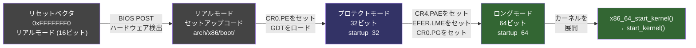

# x86-64アーキテクチャ {#x86-64-architecture}

> リアルモード、プロテクトモード、ロングモード — そしてそれらすべてを動かし続けるためにカーネルが行うこと

## なぜx86-64の内部構造が重要か {#why-x86-64-internals-matter}

x86-64は、Linuxサーバー、デスクトップ、クラウドインフラの圧倒的多数を動かしているアーキテクチャである。その内部構造を理解することは、次のような人々にとって不可欠である。

- クラッシュをデバッグする**カーネル開発者** — oops出力を読むには、例外がどのように配送されるか、`CR2`に何が入っているか、`pt_regs`がスタック上にどのように配置されるかを知る必要がある
- リグレッションを診断する**パフォーマンスエンジニア** — KPTIのCR3切り替えコスト、PCIDの無効化オーバーヘッド、TSCのずれはx86固有の現象である
- 緩和策を理解する**セキュリティ研究者** — Spectre、Meltdown、およびそれらの修正は、アーキテクチャに深く依存している
- OSに近いツールを作る**システムプログラマ** — vDSO、seccomp BPF、ptraceはいずれもSYSCALLとSYSRETの動作に依存している

x86-64アーキテクチャは40年分の後方互換性を抱えている — リアルモードのBIOSブートから、プロテクトモードを経て、64ビットのロングモードまで。カーネルはブート中にこれらすべてのモードを通り抜け、その後はユーザープロセスが依存するロングモードの不変条件を維持しなければならない。

---

## ブート時のモード遷移 {#mode-transitions-at-boot}



UEFIブートではリアルモードの段階が丸ごと省略される — ファームウェアのビット幅に応じて、ファームウェアはすでにプロテクトモード（32ビット）の状態で、または直接ロングモード（64ビット）で、カーネルのEFIスタブに制御を渡す。

---

## このセクションのページ {#pages-in-this-section}

| ページ | 扱う内容 |
|------|----------------|
| [ブートシーケンス](boot.md) | BIOS/UEFIのリセットベクタ → startup_64 → start_kernel()。bzImageのレイアウト、リアル→プロテクト→ロングモードの遷移 |
| [ページテーブル](page-tables.md) | 4レベルおよび5レベルのページング、PTEのビット配置、CR3、PCID、KPTI、ヒュージページ |
| [システムコールエントリ](syscall-entry.md) | SYSCALL命令、MSRの設定、entry_SYSCALL_64、vDSO、シグナル配送 |
| [例外処理](exceptions.md) | IDT、例外エントリ、ハードウェアによるプッシュ順序、ページフォールトハンドラ、ISTスタック |
| [CPU機能](cpu-features.md) | CPUID、x86_capability[]、alternativeパッチング、CPUバグの緩和策 |
| [SpectreとMeltdown](spectre-meltdown.md) | ハードウェアの脆弱性、KPTI、retpoline、IBRS/IBPB/STIBP、MDS/VERW |
| [事件簿](war-stories.md) | KPTIのリグレッション、TSCのずれ、IntelのSYSRETバグ、BPF JIT + retpoline、INVPCIDのフォールバック |

---

## 推奨される読む順序 {#suggested-reading-order}

**x86-64カーネルの内部構造が初めての場合:**

1. **[ブートシーケンス](boot.md)** — カーネルがリセットから`start_kernel()`までどのように到達するかを理解する。これが他のすべてのトピックの土台になる
2. **[ページテーブル](page-tables.md)** — 仮想アドレス変換は、例外、システムコールエントリ、KPTIを理解するための前提知識である
3. **[例外処理](exceptions.md)** — IDT、ハードウェアによる例外配送、`pt_regs`、ページフォールトハンドラ
4. **[システムコールエントリ](syscall-entry.md)** — ユーザープロセスがどのようにカーネルに入り、ユーザー空間に戻るか
5. **[CPU機能](cpu-features.md)** — CPUIDによる検出、alternativeパッチング、実行時の機能チェック
6. **[SpectreとMeltdown](spectre-meltdown.md)** — 上記すべてを横断するセキュリティ緩和策
7. **[事件簿](war-stories.md)** — 理論を生きたものにする実際のインシデント

**特定の問題をデバッグしている場合は**、関連するページへ直接進めばよい。各ページはそれ単体で完結している。

---

## クイックリファレンス: 主要なx86-64レジスタ {#quick-reference-key-x86-64-registers}

| レジスタ | 幅 | 用途 |
|----------|-------|---------|
| `rsp` | 64ビット | スタックポインタ — 常に現在のスタックトップを指す |
| `rbp` | 64ビット | フレームポインタ（慣例による。汎用レジスタとしても使える） |
| `rip` | 64ビット | 命令ポインタ — 次に実行する命令 |
| `rflags` | 64ビット | フラグ: CF, PF, AF, ZF, SF, TF, IF, DF, OF, IOPL, NT, RF, VM, AC, VIF, VIP, ID |
| `cr0` | 64ビット | 制御: PE（プロテクトモード）, MP, EM, TS, ET, NE, WP, AM, NW, CD, PG（ページング） |
| `cr2` | 64ビット | ページフォールトのリニアアドレス — #PF時にハードウェアが設定する |
| `cr3` | 64ビット | PGD（最上位ページテーブル）の物理アドレス。ビット11:0 = PCID |
| `cr4` | 64ビット | 拡張制御: PAE, PSE, VME, PGE, OSFXSR, OSXMMEXCPT, UMIP, LA57, PCIDE, SMEP, SMAP, PKE |
| `EFER` | MSR 0xC0000080 | Extended Feature Enable: LME（ロングモード有効化）, LMA（ロングモード動作中）, SCE（SYSCALL有効化）, NXE（実行禁止有効化） |
| `FS.base` | MSR 0xC0000100 | FSセグメントのベースアドレス — ユーザー空間でスレッドごとのTLSに使われる |
| `GS.base` | MSR 0xC0000101 | GSセグメントのベースアドレス — カーネル内でper-CPUデータに使われる |
| `KernelGSbase` | MSR 0xC0000102 | 退避されたユーザーのGSベース。システムコールエントリ時に`swapgs`によってGS.baseと交換される |
| `STAR` | MSR 0xC0000081 | SYSCALL/SYSRET用のセグメントセレクタ: カーネルとユーザーのCS/SS |
| `LSTAR` | MSR 0xC0000082 | 64ビットSYSCALLのジャンプ先RIP — `entry_SYSCALL_64`を指す |
| `SFMASK` | MSR 0xC0000084 | SYSCALLエントリ時にクリアするRFLAGSのビット |

### 実行時にレジスタ値を確認する {#checking-register-values-at-runtime}

```bash
# MSRを読む（msrカーネルモジュールまたはrootが必要）
modprobe msr
rdmsr 0xC0000082   # LSTAR — entry_SYSCALL_64のアドレスになっているはず

# kallsymsで確認する
grep entry_SYSCALL_64 /proc/kallsyms

# CPU機能（CPUIDから得られるもの）
cat /proc/cpuinfo | grep flags

# CR4の値（おおよそ。dmesgまたはcrash経由）
dmesg | grep -i "cr4\|SMEP\|SMAP"
```

---

## 主要なソースの場所 {#key-source-locations}

| パス | 説明 |
|------|-------------|
| `arch/x86/boot/` | リアルモードのセットアップコード: メモリ検出、ビデオ、モード切り替え |
| `arch/x86/boot/compressed/` | 展開スタブ: `startup_32`、`startup_64`、`decompress_kernel()` |
| `arch/x86/kernel/head_64.S` | 初期の64ビットエントリ: ページテーブルの設定、GSベース、BSSのクリア |
| `arch/x86/kernel/cpu/` | CPU機能の検出、CPUIDの解析 |
| `arch/x86/kernel/alternative.c` | ブート時のalternative命令パッチング |
| `arch/x86/kernel/idt.c` | IDTの初期化 |
| `arch/x86/entry/entry_64.S` | `entry_SYSCALL_64`、例外エントリスタブ |
| `arch/x86/entry/common.c` | `do_syscall_64()`、システムコールテーブルによるディスパッチ |
| `arch/x86/mm/fault.c` | ページフォールトハンドラ |
| `arch/x86/mm/pgtable.c` | ページテーブルの割り当てと操作 |
| `arch/x86/include/asm/cpufeatures.h` | `X86_FEATURE_*`の定義 |
| `arch/x86/include/asm/msr-index.h` | MSRアドレスの定義 |
