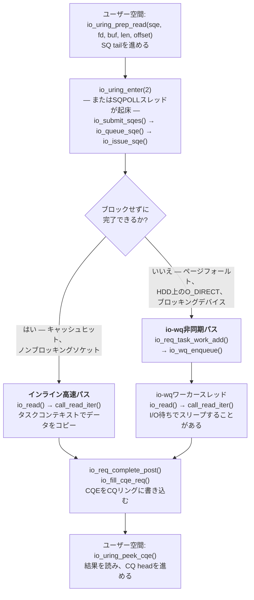
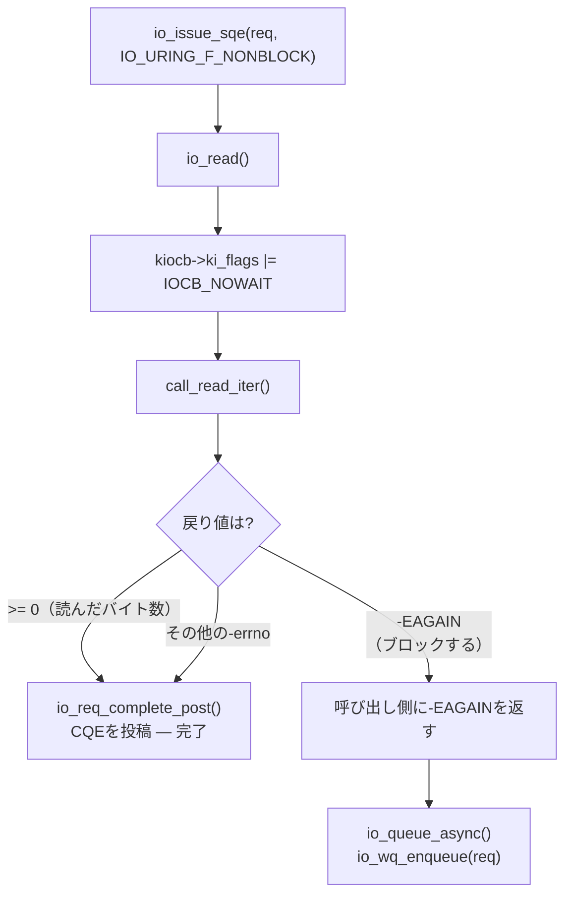
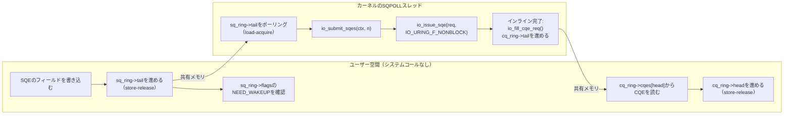
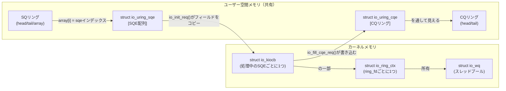

# io_uringリクエストの一生 {#life-of-an-io_uring-request}

> SQEの投入からCQEの完了まで、1回のreadを追跡する

## io_uringでreadを投入すると何が起きるか {#what-happens-when-you-submit-an-io_uring-read}

プログラムがio_uring経由でreadを投入すると、共有メモリ上のリングにSubmission Queue Entry（SQE）を書き込み、必要に応じて`io_uring_enter(2)`を呼んで制御をカーネルに渡す。カーネルはSQEを取り出してreadを即座に実行しようと試み（インライン高速パス）、それがブロックするようであれば処理をio-wqワーカースレッドにオフロードする。いずれの場合も、readが終わるとカーネルはCompletion Queue Entry（CQE）を完了リングに書き込み、ユーザー空間がそれを回収する。



重要な洞察は、**io_uringは投入と完了を分離している**という点である。アプリケーションはディスクreadの完了を待ってシステムコール内でブロックすることがない。投入し、他の作業をこなし、準備ができたところで完了を回収する。

## SQEの準備 {#preparing-the-sqe}

### struct io_uring_sqeのフィールドレイアウト {#struct-io_uring_sqe-field-layout}

SQEは`include/uapi/linux/io_uring.h`で定義された64バイトの構造体である。

```c
/* include/uapi/linux/io_uring.h */
struct io_uring_sqe {
    __u8    opcode;         /* IORING_OP_READ、IORING_OP_WRITE、... */
    __u8    flags;          /* IOSQE_FIXED_FILE、IOSQE_IO_LINK など */
    __u16   ioprio;         /* I/Oスケジューリング優先度（ioniceクラス） */
    __s32   fd;             /* 対象のファイルディスクリプタ */
    union {
        __u64   off;        /* read/write用のファイルオフセット */
        __u64   addr2;      /* 他の一部のopcodeで使用 */
    };
    union {
        __u64   addr;       /* ユーザー空間バッファへのポインタ */
        __u64   splice_off_in;
    };
    __u32   len;            /* read/writeするバイト数 */
    union {
        __kernel_rwf_t  rw_flags;   /* RWF_HIPRI、RWF_NOWAIT など */
        __u32           fsync_flags;
        /* ... opcodeごとのその他のフラグ ... */
    };
    __u64   user_data;      /* 不透明なタグ: CQEにそのままコピーされる */
    union {
        __u16   buf_index;  /* 登録済みバッファのインデックス */
        __u16   buf_group;  /* 自動選択用のバッファグループ */
    };
    __u16   personality;    /* クレデンシャルの上書き（io_uring_register参照） */
    union {
        __s32   splice_fd_in;
        __u32   file_index; /* IOSQE_FIXED_FILE時の固定ファイルスロット */
    };
    __u64   addr3;
    __u64   __pad2[1];
};
```

read操作で意味を持つフィールドは、`opcode`、`fd`、`off`、`addr`、`len`、`rw_flags`、`user_data`である。

### io_uring_prep_readが設定するもの {#what-io_uring_prep_read-sets}

liburingの`io_uring_prep_read()`は、これらのフィールドを設定する薄いラッパーである。

```c
/* liburing/src/include/liburing/io_uring.h */
static inline void io_uring_prep_read(struct io_uring_sqe *sqe,
                                      int fd,
                                      void *buf,
                                      unsigned nbytes,
                                      __u64 offset)
{
    io_uring_prep_rw(IORING_OP_READ, sqe, fd, buf, nbytes, offset);
}

static inline void io_uring_prep_rw(int op,
                                    struct io_uring_sqe *sqe,
                                    int fd,
                                    const void *addr,
                                    unsigned len,
                                    __u64 offset)
{
    memset(sqe, 0, sizeof(*sqe));
    sqe->opcode = (__u8) op;
    sqe->fd     = fd;
    sqe->off    = offset;
    sqe->addr   = (unsigned long) addr;
    sqe->len    = len;
}
```

戻った後、呼び出し側は`sqe->user_data`に対応付け用のタグ（典型的にはアプリケーションレベルのリクエスト構造体へのポインタか、単調増加するカウンタ）を設定し、CQEを正しい操作と照合できるようにする。

### リクエストの対応付けのためのuser_data {#user_data-for-request-correlation}

`user_data`は、カーネルがSQEからCQEへ変更せずにコピーする唯一のフィールドである。カーネル内部では一切解釈されず、純粋にアプリケーションのためのクッキーである。

```c
/* 典型的な使い方 */
struct my_request {
    int    fd;
    char  *buf;
    size_t len;
};

struct my_request *req = alloc_request(...);
sqe->user_data = (uint64_t)(uintptr_t) req;   /* ポインタを格納 */

/* ... 後でCQEを回収するとき: */
struct io_uring_cqe *cqe;
io_uring_wait_cqe(&ring, &cqe);
struct my_request *completed = (struct my_request *)(uintptr_t) cqe->user_data;
```

### SQEフラグ {#sqe-flags}

`flags`バイトは、opcodeとは独立したリクエスト単位の挙動を制御する。

| フラグ | 効果 |
|------|--------|
| `IOSQE_FIXED_FILE` | `fd`はリングの登録済みファイルテーブルへのスロットインデックスであり、操作ごとの`fget`/`fput`を回避する |
| `IOSQE_IO_DRAIN` | それ以前に投入されたすべてのSQEが完了するまで、このSQEを開始しない（順序付けのバリア） |
| `IOSQE_IO_LINK` | このSQEを次のSQEにリンクする。次のSQEはこのSQEが成功した場合にのみ投入される |
| `IOSQE_IO_HARDLINK` | `IO_LINK`と同様だが、次のSQEはこのSQEの結果に関係なく投入される |
| `IOSQE_ASYNC` | 常にio-wqを経由し、インライン高速パスを一切試みない |
| `IOSQE_BUFFER_SELECT` | 登録済みバッファグループ（`buf_group`）からカーネルにバッファを選ばせる |
| `IOSQE_CQE_SKIP_SUCCESS` | 操作が成功した場合はCQEを投稿しない（リンクされたチェーンで有用） |

### 生産者・消費者キューとしてのSQリング {#the-sq-ring-as-a-producer-consumer-queue}

SQリングは、共有メモリ上にある単調増加するheadとtailのカウンタの組である。ユーザー空間が唯一の生産者であり、カーネルが唯一の消費者である。

```
SQ ring in shared memory:

  sq_ring->head  (kernel advances after consuming SQE)
  sq_ring->tail  (userspace advances after writing SQE)
  sq_ring->array[] (indirection: sq_ring->array[i & mask] = index into sqe array)

  Invariant: head <= tail
  Available to kernel: tail - head entries
```

ユーザー空間は`sq_ring->tail`へのstore-releaseでSQEを公開し、カーネルはそれをload-acquireで読む。ホットパスではロックは一切取られない。

## 投入 — カーネルへの進入 {#submission-entering-the-kernel}

### io_uring_enter(2) {#io_uring_enter2}

SQ tailを進めた後、アプリケーションは次を呼び出す。

```c
int io_uring_enter(unsigned int fd,
                   unsigned int to_submit,
                   unsigned int min_complete,
                   unsigned int flags,
                   const void __user *argp,
                   size_t argsz);
```

// argp/argszの組は、Linux 5.11でIORING_ENTER_EXT_ARGが導入された際に、以前のsigset_t引数を置き換えたものである。

- `to_submit`: リングから消費するSQEの数。
- `min_complete`: `flags`に`IORING_ENTER_GETEVENTS`が設定されている場合、少なくともこの数のCQEが利用可能になるまでブロックしてから戻る。`IORING_ENTER_GETEVENTS`とともにこれを`0`にすると、ノンブロッキングのポーリングになる。
- `IORING_ENTER_GETEVENTS`: 投入と待機を1回のシステムコールにまとめる。`epoll_wait`のような2回目の呼び出しを避けられる。

```c
/* SQEを4つ投入し、少なくとも1つの完了を待つ */
io_uring_enter(ring_fd, 4, 1, IORING_ENTER_GETEVENTS, NULL, 0);
```

### カーネルのエントリポイント {#kernel-entry-point}

システムコールは`io_uring/io_uring.c`に到達する。

```c
/* io_uring/io_uring.c（簡略化） */
SYSCALL_DEFINE6(io_uring_enter, unsigned int, fd, u32, to_submit,
                u32, min_complete, u32, flags, const void __user *, argp,
                size_t, argsz)
{
    struct io_ring_ctx *ctx = /* ring_fdからctxを検索 */;

    if (to_submit) {
        ret = io_submit_sqes(ctx, to_submit);
    }

    if (flags & IORING_ENTER_GETEVENTS) {
        ret = io_cqring_wait(ctx, min_complete, sig, argsz, ts);
    }

    return ret;
}
```

### io_submit_sqes → io_queue_sqe → io_issue_sqe {#io_submit_sqes-io_queue_sqe-io_issue_sqe}

`io_submit_sqes()`は`to_submit`個のエントリをループし、それぞれについて`io_queue_sqe()`を呼ぶ。これがさらに`io_issue_sqe()`を呼ぶ。

```c
/* io_uring/io_uring.c（簡略化） */
static int io_submit_sqes(struct io_ring_ctx *ctx, unsigned int nr)
{
    unsigned int i;
    int submitted = 0;

    for (i = 0; i < nr; i++) {
        struct io_uring_sqe *sqe = io_get_sqe(ctx);  /* headを進める */
        struct io_kiocb *req     = io_alloc_req(ctx); /* slabキャッシュから */

        io_init_req(ctx, req, sqe);      /* SQEのフィールドをreqにコピー */
        io_queue_sqe(ctx, req);          /* ディスパッチ */
        submitted++;
    }
    return submitted;
}

static void io_queue_sqe(struct io_ring_ctx *ctx, struct io_kiocb *req)
{
    /* リンク、drain、personalityのチェック */
    io_issue_sqe(req, IO_URING_F_NONBLOCK);
}
```

`IO_URING_F_NONBLOCK`は、opcodeごとのハンドラに`IOCB_NOWAIT`のセマンティクスを使うよう指示する。つまり、操作がブロックするのであれば、スリープせずに即座に`-EAGAIN`を返す。この`-EAGAIN`がio-wqへフォールバックする合図である。

### SQPOLLパス（システムコール不要） {#the-sqpoll-path-no-syscall-required}

`IORING_SETUP_SQPOLL`を指定すると、`io_uring_setup()`はSQリングをタイトなループでポーリングするカーネルスレッド（`io_sq_data`）を作成する。ユーザー空間はSQEを書き込んで`sq_ring->tail`を進めるだけでよく、カーネルスレッドはシステムコールなしでそれを検出する。

```c
/* io_uring/sqpoll.c（簡略化） */
static int io_sq_thread(void *data)
{
    struct io_sq_data *sqd = data;

    for (;;) {
        /* このスレッドが担当する各リングをポーリング */
        list_for_each_entry(ctx, &sqd->ctx_list, sqd_list) {
            unsigned int to_submit = io_sqring_entries(ctx);
            if (to_submit)
                io_submit_sqes(ctx, to_submit);
        }

        if (idle_for_too_long) {
            /* IORING_SQ_NEED_WAKEUPを設定してからスリープ */
            atomic_or(IORING_SQ_NEED_WAKEUP, &ctx->rings->sq_flags);
            schedule();
        }
    }
}
```

ユーザー空間は各バッチの後に`sq_ring->flags & IORING_SQ_NEED_WAKEUP`を確認しなければならない。このビットが立っていれば、`IORING_ENTER_SQ_WAKEUP`を指定して`io_uring_enter()`を呼び、カーネルスレッドを起床させる必要がある。

## リクエストのディスパッチ — インライン高速パス {#request-dispatch-the-inline-fast-path}

### io_uring/rw.cのio_read {#io_read-in-io_uringrwc}

`IORING_OP_READ`の場合、`io_issue_sqe()`は`io_uring/rw.c`の`io_read`ハンドラを呼ぶ。

```c
/* io_uring/rw.c（簡略化） */
static int io_read(struct io_kiocb *req, unsigned int issue_flags)
{
    struct io_rw      *rw    = io_kiocb_to_cmd(req, struct io_rw);
    struct kiocb      *kiocb = &rw->kiocb;
    struct iov_iter    iter;
    ssize_t            ret;

    /* 1. kiocbをセットアップ */
    /* ki_posはio_read_prep()の中でsqe->offから設定済み */
    kiocb->ki_filp  = req->file;

    kiocb_set_rw_flags(kiocb, req->rw.flags);

    /* 2. IO_URING_F_NONBLOCKなら、VFSがスリープしないようIOCB_NOWAITを追加 */
    if (issue_flags & IO_URING_F_NONBLOCK)
        kiocb->ki_flags |= IOCB_NOWAIT;

    /* 3. ユーザーバッファ上にiov_iterを構築 */
    import_ubuf(ITER_DEST, req->buf, req->len, &iter);

    /* 4. ファイルシステムのread_iterを直接呼んでみる */
    ret = call_read_iter(req->file, kiocb, &iter);

    if (ret == -EAGAIN && (issue_flags & IO_URING_F_NONBLOCK)) {
        /* インラインの試行が失敗 — ブロックが必要 */
        return -EAGAIN;   /* 呼び出し側がio-wqにエンキューする */
    }

    /* 5. 成功または本物のエラー: インラインで完了 */
    io_req_complete_post(req, ret);
    return IOU_OK;
}
```

`call_read_iter()`は`file->f_op->read_iter()`を呼び、これは通常の`read(2)`がたどるのと同じ`generic_file_read_iter()`のパス（ページキャッシュの検索を含む）にルーティングされる。

### インライン高速パスにとどまる条件 {#conditions-for-staying-on-the-inline-fast-path}

次の場合、操作はインラインのまま（io-wqを使わずに）処理される。

1. **ページキャッシュヒット**: pageがすでにメモリ上にあり最新の状態である。`filemap_read()`はスリープせずに戻る。
2. **ノンブロッキングソケット**: データがすでにソケットの受信バッファにある。ネットワークスタックは即座に戻る。
3. **ファイルシステムが`IOCB_NOWAIT`を尊重する**: ファイルシステムが`kiocb->ki_flags & IOCB_NOWAIT`を確認し、ブロックする代わりに`-EAGAIN`を返すため、io_uringがどうするかを判断できる。
4. **HIPRI/ポーリングではない**: 高優先度ポーリング（`RWF_HIPRI`）には専用のパスがある。通常のreadは、明示的に要求されない限りこれを使わない。



## リクエストのディスパッチ — io-wq非同期パス {#request-dispatch-the-io-wq-async-path}

### インラインが失敗するとき {#when-inline-fails}

インラインの試行は次の場合に`-EAGAIN`を返す。

- 要求されたファイルオフセットがページキャッシュにない（コールドなキャッシュミス）。
- ファイルが`O_DIRECT`で開かれており、下位のストレージがブロックせずには要求を満たせない（深いキューを持つHDDでよくある）。
- ファイルシステム自身が、スリープしうるロックを保持しているために`-EAGAIN`を返す（例: ext4の特定のジャーナル操作中）。
- SQEに`IOSQE_ASYNC`が設定されており、無条件に非同期が強制される。

### io-wqへのエンキュー {#enqueuing-to-io-wq}

`io_issue_sqe()`がopcodeハンドラから`-EAGAIN`を受け取ると、`io_uring/io_uring.c`の処理を呼び出す。

```c
/* io_uring/io_uring.c（簡略化） */
static void io_queue_async(struct io_kiocb *req, int ret)
{
    if (ret != -EAGAIN || (req->flags & REQ_F_NOWAIT))
        goto fail;

    /* NOWAITを外す — ワーカーはスリープしてよい */
    req->flags &= ~REQ_F_NOWAIT;

    /* io-wqに引き渡す */
    io_req_task_work_add(req);   /* またはio_wq_enqueueを直接 */
}
```

`io_uring/io-wq.c`の`io_wq_enqueue()`は、io-wqスレッドプールが管理するCPUごとのワークキューにリクエストを追加する。

```c
/* io_uring/io-wq.c（簡略化） */
void io_wq_enqueue(struct io_wq *wq, struct io_wq_work *work)
{
    struct io_wq_acct *acct = io_work_get_acct(wq, work);

    raw_spin_lock(&wq->lock);
    io_wq_insert_work(wq, work);
    raw_spin_unlock(&wq->lock);

    /* 必要ならワーカーを起床させる */
    io_wq_wake_worker(wq, acct);
}
```

### io-wqスレッドプール {#the-io-wq-thread-pool}

io-wqは2種類のワーカーを管理する。

| 種類 | `io_wq_acct` | 用途 |
|-------|-------------|-----|
| Bounded（有界） | `IO_WQ_ACCT_BOUND` | 有限時間で完了すると見込まれる処理（ほとんどのI/O） |
| Unbounded（非有界） | `IO_WQ_ACCT_UNBOUND` | 任意に長くかかりうる処理（例: 無期限にブロックするファイルシステム操作） |

ワーカーは必要になった時点で遅延的に作成され、設定可能なアイドルタイムアウトの後に回収される。boundedワーカーの最大数は`io_uring_register(IORING_REGISTER_IOWQ_MAX_WORKERS)`で調整できる。

### クレデンシャルの継承 {#credential-inheritance}

各io-wqワーカーは、リクエストを投入したタスクのクレデンシャル（`req->creds`）を継承する。これは`io_init_req()`の中で設定される。

```c
/* io_uring/io_uring.c（簡略化） */
static void io_init_req(struct io_ring_ctx *ctx,
                        struct io_kiocb *req,
                        const struct io_uring_sqe *sqe)
{
    /* ... フィールドをコピー ... */
    req->creds = get_current_cred();   /* 投入者のクレデンシャルのスナップショット */
}
```

ワーカーはリクエストを実行する前に`override_creds(req->creds)`を呼び、ファイルのパーミッションチェックがワーカーのuid/gidではなく投入タスクのuid/gidを見るようにする。

## io-wqでの実行 {#execution-in-io-wq}

### ワーカーは同じio_readパスを実行する {#the-worker-executes-the-same-io_read-path}

io-wqワーカーは同じopcodeディスパッチテーブルを再び呼び出すが、今度は`IO_URING_F_NONBLOCK`なしである。

```c
/* io_uring/io-wq.c（簡略化） */
static void io_worker_handle_work(struct io_worker *worker,
                                  struct io_wq_acct *acct)
{
    struct io_wq_work *work = io_get_next_work(acct);
    struct io_kiocb   *req  = container_of(work, struct io_kiocb, work);

    override_creds(req->creds);

    /* NONBLOCKなしで発行 — ワーカーは自由にスリープできる */
    io_issue_sqe(req, 0);

    revert_creds(old_creds);
}
```

これにより`io_read()`が再び呼ばれる。今回はkiocbに`IOCB_NOWAIT`が設定されていないため、`call_read_iter()`は自由にブロックできる。

### ページフォールトのパス {#the-page-fault-path}

pageがページキャッシュにない場合、`filemap_read()`はreadaheadエンジンを呼び出し、その後ディスクI/Oが完了するまで`folio_wait_locked()`でブロックする。

```c
/* mm/filemap.c（簡略化） */
ssize_t filemap_read(struct kiocb *iocb, struct iov_iter *iter,
                     ssize_t already_read)
{
    for (;;) {
        folio = filemap_get_folio(mapping, index);
        if (IS_ERR(folio)) {
            /* キャッシュミス — readaheadを開始し、pageを割り当てる */
            page_cache_sync_readahead(mapping, ra, file, index, last_index - index);
            folio = filemap_get_folio(mapping, index);
        }

        /* I/Oが完了するまでここでブロック */
        folio_wait_locked(folio);

        copied = copy_folio_to_iter(folio, offset, bytes, iter);
        index++;
        if (copied == bytes)
            break;
    }
}
```

io-wqワーカーは`folio_wait_locked()`の中でスリープする。ブロック層がI/Oを完了させ、folioの待ちキューを起こすと、ワーカーは再開してデータをコピーする。

### io-wqにおけるO_DIRECT {#o_direct-in-io-wq}

`O_DIRECT`ファイルの場合、`generic_file_read_iter()`はページキャッシュを完全にバイパスして`mapping_direct_IO()`を呼び、これが`bio`を構築してブロック層に投入する。ワーカーはbioの完了を待ってブロックする。これは、io_uringを使う高性能データベースワークロードで主流となるパスである。

## 完了 — CQEの投稿 {#completion-posting-the-cqe}

### io_req_complete_post {#io_req_complete_post}

`io_read()`が（インラインでもio-wqでも）終わると、`io_req_complete_post()`を呼ぶ。

```c
/* io_uring/io_uring.c（簡略化） */
void io_req_complete_post(struct io_kiocb *req, s32 res)
{
    struct io_ring_ctx *ctx = req->ctx;

    req->cqe.res = res;   /* 読んだバイト数、または-errno */

    spin_lock(&ctx->completion_lock);
    io_fill_cqe_req(ctx, req);
    io_commit_cqring(ctx);
    spin_unlock(&ctx->completion_lock);

    io_cqring_ev_posted(ctx);   /* io_cqring_waitでスリープしている者を起こす */
}
```

### io_fill_cqe_req {#io_fill_cqe_req}

これがCQEをリングに書き込む。

```c
/* io_uring/io_uring.c（簡略化） */
static bool io_fill_cqe_req(struct io_ring_ctx *ctx,
                             struct io_kiocb *req)
{
    struct io_rings   *rings = ctx->rings;
    struct io_uring_cqe *cqe;
    unsigned int      tail;

    tail = ctx->cached_cq_tail;
    cqe  = &rings->cqes[tail & ctx->cq_mask];

    /* フィールドを書き込む — tailが進んだときに見えるようuser_dataを先に */
    WRITE_ONCE(cqe->user_data, req->cqe.user_data);
    WRITE_ONCE(cqe->res,       req->cqe.res);
    WRITE_ONCE(cqe->flags,     req->cqe.flags);

    ctx->cached_cq_tail++;
    return true;
}
```

### io_commit_cqring — store-release {#io_commit_cqring-the-store-release}

CQEのフィールドを書き込んだ後、`io_commit_cqring()`がstore-releaseでCQ tailを進め、エントリをユーザー空間から見えるようにする。

```c
static void io_commit_cqring(struct io_ring_ctx *ctx)
{
    /* smp_store_releaseにより、tail更新の前にすべてのCQE書き込みが見えることを保証 */
    smp_store_release(&ctx->rings->cq.tail, ctx->cached_cq_tail);
}
```

### 生産者・消費者キューとしてのCQリング {#the-cq-ring-as-a-producer-consumer-queue}

CQリングはSQリングの鏡像である。カーネルが唯一の生産者であり、ユーザー空間が唯一の消費者である。

```
CQ ring in shared memory:

  cq_ring->head  (userspace advances after consuming CQE)
  cq_ring->tail  (kernel advances after writing CQE)
  cq_ring->cqes[head & mask] → next CQE to consume

  Available to userspace: tail - head entries
```

ユーザー空間の処理が遅すぎてCQリングが満杯になると、カーネルは`cq_ring->overflow`（「CQオーバーフロー」カウンタ）をインクリメントする。`IORING_SETUP_CQ_NODROP`（対応カーネルでは`IORING_FEAT_NODROP`によって暗黙に有効）がある場合、オーバーフローしたCQEは内部にバッファリングされ、空きができたときに排出される。

### マルチショット操作のためのIORING_CQE_F_MORE {#ioring_cqe_f_more-for-multishot-operations}

マルチショット操作（例: `IORING_RECV_MULTISHOT`付きの`IORING_OP_RECV`）では、カーネルは1つのSQEから複数のCQEを投稿することがある。操作がまだ有効である限り、各CQEの`cqe->flags`には`IORING_CQE_F_MORE`が設定される。（エラーまたは明示的なキャンセルにより）最後のCQEが届くと、`IORING_CQE_F_MORE`はクリアされている。

```c
struct io_uring_cqe {
    __u64   user_data;  /* SQEからコピー */
    __s32   res;        /* read/writeしたバイト数、または-errno */
    __u32   flags;      /* IORING_CQE_F_MORE、IORING_CQE_F_SOCK_NONEMPTY、... */
};
```

## CQEの回収 {#reaping-the-cqe}

### io_uring_peek_cqeとio_uring_wait_cqe {#io_uring_peek_cqe-and-io_uring_wait_cqe}

liburingは完了を回収するための2つのプリミティブを提供する。

```c
/* ノンブロッキング: CQEがあれば0、なければ-EAGAINを返す */
int io_uring_peek_cqe(struct io_uring *ring, struct io_uring_cqe **cqe_ptr);

/* ブロッキング: 少なくとも1つのCQEが利用可能になるまで待つ */
int io_uring_wait_cqe(struct io_uring *ring, struct io_uring_cqe **cqe_ptr);
```

内部的には、`io_uring_peek_cqe()`は純粋にユーザー空間だけの操作であり、システムコールを伴わない。

```c
/* liburing（簡略化） */
static inline int io_uring_peek_cqe(struct io_uring *ring,
                                    struct io_uring_cqe **cqe_ptr)
{
    unsigned head = *ring->cq.khead;  /* アトミックなロード */
    unsigned tail = io_uring_smp_load_acquire(ring->cq.ktail);

    if (head == tail)
        return -EAGAIN;   /* リングは空 */

    *cqe_ptr = &ring->cq.cqes[head & ring->cq.ring_mask];
    return 0;
}
```

`io_uring_wait_cqe()`は、リングが空であれば`IORING_ENTER_GETEVENTS`と`min_complete=1`を指定した`io_uring_enter()`にフォールバックし、カーネルがCQEを投稿するまでタスクをスリープさせる。

### io_uring_cqe_seen — CQ headを進める {#io_uring_cqe_seen-advancing-the-cq-head}

CQEを処理した後、アプリケーションは`io_uring_cqe_seen()`を呼んで消費済みとしてマークしなければならない。

```c
/* liburing（簡略化） */
static inline void io_uring_cqe_seen(struct io_uring *ring,
                                     struct io_uring_cqe *cqe)
{
    if (cqe)
        io_uring_cq_advance(ring, 1);
        /* これは次を行う: smp_store_release(ring->cq.khead,
                                         *ring->cq.khead + 1) */
}
```

store-releaseにより、ユーザー空間がCQEスロットを読み終える前にカーネルがそれを上書きしないことが保証される。

### タイムアウト付きの待機 {#waiting-with-a-timeout}

無期限のブロックを避けるには、`IORING_ENTER_EXT_ARG`経由で`__kernel_timespec`を渡す。

```c
struct io_uring_getevents_arg arg = {
    .sigmask    = 0,
    .sigmask_sz = 0,
    .ts         = (uint64_t)(uintptr_t)&timeout,  /* struct __kernel_timespec */
};

io_uring_enter(ring_fd, 0, 1,
               IORING_ENTER_GETEVENTS | IORING_ENTER_EXT_ARG,
               &arg, sizeof(arg));
```

あるいは、これをラップしたliburingの`io_uring_wait_cqe_timeout()`を使う。

## システムコールゼロのパス — SQPOLLの詳細 {#the-zero-syscall-path-sqpoll-in-depth}

`IORING_SETUP_SQPOLL`を使うと、投入から完了までのサイクル全体をシステムコールなしで実行できる。



**アイドルスリープの仕組み**: 新しいSQEがないまま`sq_thread_idle`ミリ秒（`io_uring_params`で設定可能）が経過すると、SQPOLLスレッドは`IORING_SQ_NEED_WAKEUP`を設定して`schedule()`を呼ぶ。その後ユーザー空間は、スレッドを起こすために`io_uring_enter(IORING_ENTER_SQ_WAKEUP)`を1回呼ばなければならない。パターンは次のとおりである。

```c
/* SQEを書き込みtailを進めた後: */
if (IO_URING_READ_ONCE(*ring->sq.kflags) & IORING_SQ_NEED_WAKEUP) {
    io_uring_enter(ring_fd, 0, 0, IORING_ENTER_SQ_WAKEUP, NULL, 0);
}
```

liburingの`io_uring_submit()`はこのチェックを自動的に行う。

**SQPOLLが最も効果を発揮するとき**: 単位時間あたりに多数の操作を投入し、そうでなければ`io_uring_enter()`のシステムコールごとのオーバーヘッドが支配的になるようなワークロード。毎秒数千の処理中操作を抱えるデータベースエンジンやネットワークプロキシが典型的な利用者である。

**SQPOLLが役に立たないとき**: バースト間に長いアイドル期間があるバースト的なワークロード。投入がまれだと、SQPOLLスレッドはスピンしてCPUを浪費する。その場合は通常の`io_uring_enter()`による投入のほうが適切である。

## 主要なデータ構造 {#key-data-structures}

### struct io_ring_ctx — カーネル側のリングコンテキスト {#struct-io_ring_ctx-the-kernel-side-ring-context}

`struct io_ring_ctx`は`io_uring_setup()`の呼び出しごとに1つ割り当てられ、カーネル側のすべての状態の拠り所となる。

```c
/* io_uring/io_uring.h（主要フィールドを抜粋） */
struct io_ring_ctx {
    /* 投入の状態 */
    struct io_rings         *rings;       /* 共有SQ/CQリングメモリへのポインタ */
    struct io_uring_sqe     *sq_sqes;     /* 共有SQE配列へのポインタ */
    unsigned                sq_mask;      /* sq_entries - 1 */
    unsigned                cq_mask;      /* cq_entries - 1 */
    unsigned                cached_sq_head;   /* カーネル専用のSQ head */
    unsigned                cached_cq_tail;   /* カーネル専用のCQ tail */

    /* 完了 */
    spinlock_t              completion_lock;
    struct list_head        locked_free_list; /* 解放待ちの完了済みreq */

    /* SQPOLL */
    struct io_sq_data       *sq_data;     /* SQPOLLスレッドの状態 */

    /* 非同期ワーカー */
    struct io_wq            *io_wq;       /* リングごとのio-wqインスタンス */

    /* ファイルテーブル（IOSQE_FIXED_FILE用） */
    struct io_rsrc_data     *file_data;
    unsigned                nr_user_files;

    /* バッファテーブル（固定バッファ用） */
    struct io_rsrc_data     *buf_data;
    unsigned                nr_user_bufs;

    /* クレデンシャル */
    struct xarray           personalities; /* 登録済みクレデンシャルセット */

    /* 設定 */
    unsigned                flags;        /* IORING_SETUP_*フラグ */
};
```

### struct io_kiocb — カーネル側のリクエスト {#struct-io_kiocb-the-kernel-side-request}

投入された各SQEは、内部では`struct io_kiocb`として表現される（「kiocb」という名前は、VFSとの統合のために`struct kiocb`を埋め込んでいることに由来する）。

```c
/* io_uring/io_uring.h（主要フィールドを抜粋） */
struct io_kiocb {
    struct file             *file;    /* 解決済みのファイルポインタ（独立したフィールド） */

    struct io_ring_ctx      *ctx;     /* 所属するリング */
    struct io_uring_task    *tctx;    /* 投入タスクのio_uring状態 */

    /* 構築中のCQE */
    struct io_uring_cqe      cqe;    /* user_data、res、flags */

    /* リクエストフラグ（REQ_F_*） */
    unsigned long            flags;

    /* io-wq用のワークアイテム */
    struct io_wq_work        work;

    /* リンク/マルチショットリクエストのための参照カウント */
    atomic_t                 refs;

    /* クレデンシャルのスナップショット */
    const struct cred        *creds;

    /* リンクされたリクエストのチェーン */
    struct io_kiocb          *link;

    /* 後始末 / 解放 */
    struct callback_head      task_work;

    /* コマンド固有のデータは構造体末尾のフレキシブル配列に置かれ、
     * io_kiocb_to_cmd(req, struct io_rw) などでアクセスする。
     * fileはコマンドデータとunionになっていない。 */
    u8                        cmd[];  /* 例: struct io_rw、struct io_poll_iocb */
};
```

### 構造体間の関係 {#relationship-between-structures}



`struct io_kiocb`はリングコンテキストが管理するslabキャッシュに置かれる。投入時に割り当てられ、（インラインでもio-wqでも）リクエストの生存期間全体を通じて存在し、`io_fill_cqe_req()`が戻った後に解放される。

## 自分で試してみる {#try-it-yourself}

### io_uringプログラムをstraceする {#strace-an-io_uring-program}

```bash
# 最小限のio_uring readプログラムをビルドする（liburing使用）
# その後システムコールをトレースする:
strace -e trace=io_uring_setup,io_uring_enter,io_uring_register ./your-program

# 次のような出力が見られる:
# io_uring_setup(32, {flags=0, sq_thread_cpu=0, sq_thread_idle=0,
#                     features=IORING_FEAT_SINGLE_MMAP|IORING_FEAT_NODROP|...,
#                     sq_off={head=0, tail=64, ...},
#                     cq_off={head=128, tail=192, ...}}) = 3
# mmap(NULL, 4096, PROT_READ|PROT_WRITE, MAP_SHARED, 3, IORING_OFF_SQ_RING) = 0x7f...
# mmap(NULL, 4096, PROT_READ|PROT_WRITE, MAP_SHARED, 3, IORING_OFF_SQES)    = 0x7f...
# io_uring_enter(3, 1, 1, IORING_ENTER_GETEVENTS, NULL, 0) = 1
```

SQPOLLを有効にすると、`io_uring_setup`と最初のmmapは見えるが、個々の操作に対する`io_uring_enter`は現れない。

### /proc/PID/fdinfo/\<ring_fd\> {#procpidfdinforing_fd}

カーネルはfdinfoを通じてリングの状態を公開している。

```bash
# リングのfdを見つける（通常はstdin/stdout/stderrの次の最初のfd）
ls -la /proc/$(pgrep your-program)/fd

# リングの状態をダンプする
cat /proc/$(pgrep your-program)/fdinfo/3

# 出力（例）:
# pos:	0
# flags:	02000002
# sq entries:	32
# cq entries:	64
# sq head:	17
# sq tail:	17
# sq mask:	0x1f
# cq head:	17
# cq tail:	17
# cq_overflow:	0
```

`cq_overflow`が0でない場合、ユーザー空間が消費するよりも速くCQEが投稿されたことを意味する。これは完了の取りこぼしの最も一般的な原因である。

### io_uringのftrace tracepoint {#ftrace-io_uring-tracepoints}

カーネルにはio_uringの活動を追うためのtracepointが一通りそろっている。

```bash
# io_uringのtracepointをすべて有効化
echo 1 > /sys/kernel/debug/tracing/events/io_uring/enable

# キャプチャを開始
cat /sys/kernel/debug/tracing/trace_pipe &

# ワークロードを実行...

# 無効化
echo 0 > /sys/kernel/debug/tracing/events/io_uring/enable
```

注目すべき主要なtracepoint:

| Tracepoint | 発火するタイミング |
|------------|------------|
| `io_uring:io_uring_create` | `io_uring_setup()`が完了したとき |
| `io_uring:io_uring_submit_sqe` | SQEがリングから消費されたとき |
| `io_uring:io_uring_queue_async_work` | リクエストがio-wqに引き渡されたとき |
| `io_uring:io_uring_defer` | リクエストが遅延されたとき（IOSQE_IO_DRAIN） |
| `io_uring:io_uring_complete` | CQEがリングに投稿されたとき |
| `io_uring:io_uring_cqring_wait` | 呼び出し側が完了待ちでブロックしたとき |

1回のreadに対する出力例:

```
io_uring_submit_sqe:   ring 0xffff... req 0xffff... opcode=READ user_data=0x1 flags=0
io_uring_queue_async_work: ring 0xffff... req 0xffff... rw=0 op=READ flags=0 work_flags=1
io_uring_complete:     ring 0xffff... req 0xffff... user_data=0x1 res=4096 cflags=0
```

submitとcompleteの間に`io_uring_queue_async_work`の行があれば、そのリクエストはio-wqパスを通った（pageがキャッシュになかったか、デバイスがブロックした）ことを意味する。その行がなければ、インライン高速パスが使われたことを意味する。

### インラインと非同期の比率を測定する {#measure-inline-vs-async-split}

```bash
# リクエストが非同期になる頻度を数える
perf stat -e 'io_uring:io_uring_queue_async_work' \
          -e 'io_uring:io_uring_submit_sqe' \
          -- ./your-io-workload

# 非同期/全体の比率から、io_uringから見たキャッシュヒット率がわかる。
# コールドキャッシュでのシーケンシャルreadワークロードでは、ほぼ100%が非同期になる。
# ウォームキャッシュのワークロードでは、非同期はほぼ0%になるはずである。
```

### io-wqワーカー数を調べる {#inspect-io-wq-worker-count}

```bash
# ワークロード実行中に、io-wqワーカーがいくつ存在するかを確認する
cat /proc/$(pgrep your-program)/status | grep Threads

# あるいは"iou-wrk-<pid>"という名前のkworker風スレッドを監視する
ps -eLf | grep iou-wrk
```

io-wqワーカースレッドは`ps`の出力に`iou-wrk-<ring_pid>`として現れる。コールドなストレージに対する並列度の高いreadワークロードでは複数見えることがあり、キャッシュが効いたワークロードでは1つも見えないはずである（すべての完了がインラインで行われる）。

## 主要なソースファイル {#key-source-files}

| ファイル | 内容 |
|------|-----------------|
| [`io_uring/io_uring.c`](https://git.kernel.org/pub/scm/linux/kernel/git/torvalds/linux.git/tree/io_uring/io_uring.c) | リング管理の中核、システムコールのエントリ、SQEのディスパッチ、CQEの投稿 |
| [`io_uring/rw.c`](https://git.kernel.org/pub/scm/linux/kernel/git/torvalds/linux.git/tree/io_uring/rw.c) | `io_read`、`io_write`、`io_readv`、`io_writev`ハンドラ |
| [`io_uring/io-wq.c`](https://git.kernel.org/pub/scm/linux/kernel/git/torvalds/linux.git/tree/io_uring/io-wq.c) | io-wqスレッドプール: ワーカーのライフサイクル、ワークキュー、bounded/unboundedのアカウンティング |
| [`io_uring/sqpoll.c`](https://git.kernel.org/pub/scm/linux/kernel/git/torvalds/linux.git/tree/io_uring/sqpoll.c) | SQPOLLカーネルスレッド |
| [`io_uring/io_uring.h`](https://git.kernel.org/pub/scm/linux/kernel/git/torvalds/linux.git/tree/io_uring/io_uring.h) | `struct io_ring_ctx`、`struct io_kiocb` |
| [`include/uapi/linux/io_uring.h`](https://git.kernel.org/pub/scm/linux/kernel/git/torvalds/linux.git/tree/include/uapi/linux/io_uring.h) | ABI: `struct io_uring_sqe`、`struct io_uring_cqe`、`IORING_*`定数 |
| [`mm/filemap.c`](https://git.kernel.org/pub/scm/linux/kernel/git/torvalds/linux.git/tree/mm/filemap.c) | `filemap_read()`、`filemap_get_folio()` — io-wqワーカーが実行する |

## 悪名高いバグとエッジケース {#notorious-bugs-and-edge-cases}

io_uringのリクエストパスは複雑である。ユーザー空間とカーネルの境界をまたぎ、共有された可変メモリやスレッドプールが関与し、VFSにも触れる。いくつかのカテゴリのバグが現れている。

---

### ケース1: インライン完了とCQリングのオーバーフロー {#case-1-inline-completion-and-cq-ring-overflow}

#### 何が起きたか {#what-happened}

ユーザー空間がCQEの消費に手間取ると、CQリングが満杯になりうる。`IORING_FEAT_NODROP`のないカーネルでは、カーネルは収まりきらないCQEを黙って破棄し、オーバーフローカウンタをインクリメントしていた。リクエストはカーネル内では正常に完了したが、ユーザー空間はその結果を目にすることがなかった。

#### バグ {#the-bug}

`IORING_FEAT_NODROP`がない場合、回収するよりも速く投入するプログラムは、黙って完了を失う。

```c
/* 危険: 回収せずに多数のリクエストを投入 */
for (int i = 0; i < 1000; i++)
    io_uring_submit(&ring);
/* CQリング（デフォルトはSQエントリ数の2倍）が満杯になると、完了が破棄される */
```

#### 現実世界への影響 {#real-world-implications}

リクエストをバースト的に投入し、のんびり回収するアプリケーションは、次のいずれかを行わなければならない。

- `io_uring_params`の`IORING_SETUP_CQSIZE`でCQリングを十分な大きさにする。
- 回収を投入と交互に行う。
- `IORING_FEAT_NODROP`（カーネル5.5以降で利用可能）に頼る。これはオーバーフローしたCQEを内部にバッファリングする。

#### 緩和策 {#mitigation}

セットアップ時に`io_uring_params.features & IORING_FEAT_NODROP`を確認する。古いカーネルでは`/proc/PID/fdinfo/<ring_fd>`の`cq_overflow`を監視し、0でなければアラートを出す。

---

### ケース2: 登録解除中の固定ファイルテーブルの競合 {#case-2-fixed-file-table-races-during-unregistration}

#### 何が起きたか {#what-happened_1}

ユーザー空間が`io_uring_register(IORING_REGISTER_FILES)`でファイルテーブルを登録し、それらのファイルを使うリクエストが（io-wq経由で）まだ処理中のうちに登録を解除すると、ワーカーがまだファイルポインタを保持している間にそれが解放されうる時間窓が生じる。

#### バグ {#the-bug_1}

カーネルは`io_rsrc_data`の参照カウントを使い、処理中のすべてのリクエストが完了するまでファイルテーブルを生かしておく。この参照カウントのバグにより、固定ファイルのパスでuse-after-freeが発生したことがある。

```c
/* リクエストが処理中の場合は危険 */
io_uring_register(ring_fd, IORING_UNREGISTER_FILES, NULL, 0);
/* ワーカースレッドが、解放されたばかりのファイルテーブルでまだ実行中かもしれない */
```

#### 現実世界への影響 {#real-world-implications_1}

カーネルコードにおけるuse-after-freeは、通常、悪用可能な権限昇格かカーネルクラッシュを意味する。io_uringのリソース管理コードに対しては、いくつものCVEが登録されている。

#### 緩和策 {#mitigation_1}

リソースの登録を解除する前に、必ず処理中のリクエストを排出する（`io_uring_register(IORING_REGISTER_SYNC_CANCEL)`を使うか、`IOSQE_IO_DRAIN`付きのバリアSQEを投入する）。

---

### ケース3: SQPOLLのCPUピン留めとウェイクアップの取りこぼし {#case-3-sqpoll-cpu-pinning-and-missed-wakeups}

#### 何が起きたか {#what-happened_2}

`IORING_SETUP_SQ_AFF`が設定されていると、SQPOLLスレッドは特定のCPUにピン留めされる。そのCPUがオフラインになると（CPUホットプラグ）、SQPOLLスレッドは停止し、リングは新しいSQEの処理をやめてしまう — しかもユーザー空間には何のエラーも返らない。

#### バグ {#the-bug_2}

SQPOLLスレッドは`kthread_bind()`を使って要求されたCPUにピン留めされる。セットアップ後にそのCPUがオフラインになると、次のようになる。
1. SQPOLLスレッドはホットプラグのコードによって移動される（またはブロックされる）。
2. この状態では`IORING_SQ_NEED_WAKEUP`が正しく設定されないことがある。
3. ユーザー空間は、決して消費されることのないSQEを書き込み続ける。
4. CQEは一切投稿されない。

#### 緩和策 {#mitigation_2}

CPUホットプラグのある環境（vCPUのリサイズを行うクラウドVM、CPUピン留めを行うコンテナ）では`IORING_SETUP_SQ_AFF`を避ける。どうしてもピン留めする必要があるなら、fdinfoの`sq_head`と`sq_tail`を監視する。`tail - head`が際限なく増え続けるなら、SQPOLLスレッドが停止している。

---

### ケース4: personalityを切り替えたリクエストにおけるクレデンシャルの混同 {#case-4-credential-confusion-in-personality-switched-requests}

#### 何が起きたか {#what-happened_3}

io_uringでは、SQEの`personality`と`io_uring_register(IORING_REGISTER_PERSONALITY)`を組み合わせることで、別のクレデンシャルセットの下でリクエストを投入できる。personalityのインデックスが正しく検証されていないと、権限の低いクレデンシャルが権限の高いものに昇格されてしまうバグがありえた。

#### バグ {#the-bug_3}

```c
sqe->personality = some_index;  /* どのクレデンシャルセットを使うか */
```

`some_index`が範囲外であったり、personalityの登録解除中の競合によって誤ったクレデンシャルセットに対応付けられたりすると、ワーカースレッドは誤ったクレデンシャルで`override_creds()`を呼ぶ。最悪の場合、リクエストが昇格した権限で実行される。

#### 現実世界への影響 {#real-world-implications_2}

権限昇格。io_uringに対するいくつかのセキュリティ監査はpersonalityの仕組みに特に焦点を当てており、その結果、より厳密な範囲チェックと参照カウントの修正がなされた。

#### 緩和策 {#mitigation_3}

personalityの使用は最小限にとどめ、リングのファイルディスクリプタを信頼境界をまたいで共有しない。脅威モデルの全体については、本ドキュメントの[`io_uring/security.md`](security.md)を参照のこと。

---

### ケース5: io-wqワーカー数の際限ない増加 {#case-5-io-wq-worker-count-unbounded-growth}

#### 何が起きたか {#what-happened_4}

io-wqワーカーが完了させるよりも速くリクエストが到着し、かつリングごとのワーカー上限が高すぎる（あるいは設定されていない）と、カーネルは多数のスレッドを生成し、システムのPID空間やメモリを使い果たす。

#### バグ {#the-bug_4}

```c
/* ワーカー数に上限なし — 病的なワークロードでは壊滅的 */
/* デフォルト: 明示的な上限なし、システムリソースが尽きるまで増える */
```

多数のio-wqワーカーを意図的にブロックさせるワークロード（例: 非常に遅いデバイスへの大量のO_DIRECT read）の下では、バグのあるアプリケーションがマシンをDoS状態に陥らせうる。

#### 緩和策 {#mitigation_4}

セットアップ時に明示的なワーカー上限を設定する。

```c
unsigned int max_workers[2] = { 64, 64 };  /* bounded、unbounded */
io_uring_register(ring_fd, IORING_REGISTER_IOWQ_MAX_WORKERS,
                  max_workers, 2);
```

---

### まとめ: 得られた教訓 {#summary-lessons-learned}

| バグ | 根本原因 | 影響 | 予防策 |
|-----|------------|--------|------------|
| **CQオーバーフロー** | CQE回収の遅さ | 完了の喪失 | CQリングのサイズを決める。`IORING_FEAT_NODROP`を使う |
| **固定ファイルのUAF** | 登録解除時の参照カウントの競合 | クラッシュ / 権限昇格 | リソースの登録解除前にリクエストを排出する |
| **SQPOLLのCPUオフライン** | CPUホットプラグ + kthread_bind | リングが黙って停止する | ホットプラグ環境では`SQ_AFF`を避ける。fdinfoを監視する |
| **personalityの混同** | クレデンシャルインデックスの競合 | 権限昇格 | personalityの使用を最小限にする。境界を監査する |
| **ワーカー数の爆発** | io-wqワーカーに上限がない | DoS、OOM | `IORING_REGISTER_IOWQ_MAX_WORKERS`を設定する |

共通するのは、**io_uringの性能はホットパスでの同期を排除することから生まれるが、その同じ設計が競合やリソースの生存期間に関するバグを検出しにくくしている**という点である。正しさのためには、登録APIとキャンセルAPIを注意深く使うことが不可欠である。

## 参考文献 {#further-reading}

### 関連ドキュメント {#related-docs}

- [io_uringのアーキテクチャとリング](io-uring-arch.md) — リングのレイアウト、`io_uring_setup`、SQE/CQE構造体
- [操作と高度な機能](io-uring-ops.md) — opcodeの全一覧、SQPOLL、固定バッファ、リンクされたリクエスト
- [固定バッファ](fixed-buffers.md) — 登録済みバッファの内部
- [マルチショット操作](multishot-ops.md) — `IORING_CQE_F_MORE`と繰り返しの完了
- [セキュリティ](security.md) — io_uringの脅威モデルとハードニング
- [ファイルreadの一生](../mm/life-of-read.md) — io-wqワーカーがたどるページキャッシュのパス

### LWNの記事 {#lwn-articles}

- [Ringing in a new asynchronous I/O API](https://lwn.net/Articles/776703/)（2019） — Jonathan Corbetによる最初のio_uring紹介
- [The rapid growth of io_uring](https://lwn.net/Articles/810414/)（2020） — 5.6までの機能拡張
- [Security requirements for new kernel features](https://lwn.net/Articles/902466/)（2022） — 新機能の投稿（io_uringを含む）がセキュリティ面で対処すべきとされる事項
- [Buffered I/O without page-cache thrashing](https://lwn.net/Articles/806980/)（2019） — `RWF_UNCACHED`、ページキャッシュを汚さないバッファードI/Oモード
