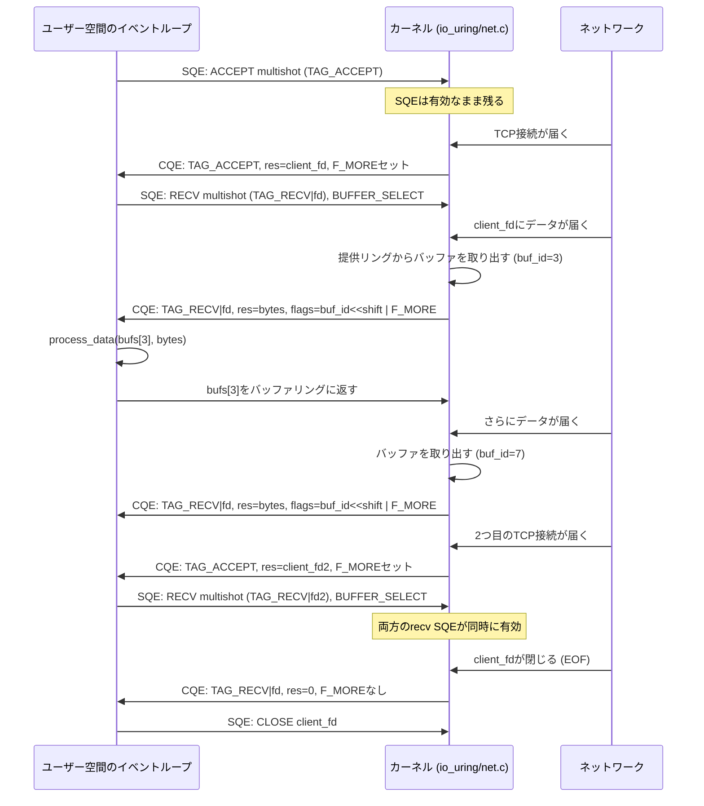

# io_uringによるネットワーキング {#io_uring-networking}

> システムコールなしのネットワークI/O、マルチショットaccept、ゼロコピー送信、高性能サーバーのパターン

## なぜネットワーキングにio_uringを使うのか {#why-io_uring-for-networking}

古典的なLinuxのネットワーキングスタックは、`epoll`とノンブロッキングソケットを組み合わせる。これはうまく機能するが、個々のI/O操作のたびに依然としてシステムコールのコストがかかる。

1. `epoll_wait`はソケットが読み込み/書き込み可能になるまでブロックする。
2. `recv`/`send`が実際の転送を行う。

これはデータ転送1回あたり最低でも2回のシステムコールであり、`accept`や`close`も呼ぶならさらに増える。接続レートが高いと、システムコールのオーバーヘッドが蓄積して計測可能なレベルになる。

`IORING_SETUP_SQPOLL`を使ったio_uringは、操作ごとのシステムコールを完全になくす。リングのセットアップ後は、カーネルのSQポーリングスレッドがサブミッションキューを継続的に監視する。ユーザー空間はリングにSQEを入れ、CQEを読み出すだけで、二度とカーネルに入ることはない。数万の接続を処理するネットワークサーバーにとって、これはカーネルがホットパス上にあるか、完全にその外にあるかの違いである。

### 比較: epoll+recv vs io_uringのマルチショットrecv {#comparison-epollrecv-vs-io_uring-multishot-recv}

| 観点 | epoll + ノンブロッキングrecv | io_uringのマルチショットrecv |
|---|---|---|
| メッセージあたりのシステムコール | 2回（`epoll_wait` + `recv`） | 0回（セットアップ後、SQPOLL使用時） |
| 接続あたりのシステムコール | 4回以上（`epoll_ctl` + `accept` + `epoll_ctl` + ...） | ほぼ0回（マルチショットaccept） |
| バッファ管理 | 呼び出し側が各recvの前に割り当てる | カーネルが事前登録されたプールから選ぶ |
| メッセージサイズが不明な場合 | 呼び出し側は保守的にバッファサイズを決める必要がある | 提供バッファリング。カーネルは収まるものを使う |
| ゼロコピー送信 | `MSG_ZEROCOPY` + エラーキューのポーリング | `IORING_OP_SEND_ZC`、整理された2つのCQE |
| APIの複雑さ | 馴染みのあるPOSIX | 新しいが一貫したSQE/CQEモデル |
| 必要なカーネルバージョン | どこでも使える | Linux 5.1以降（ネットワーク操作）、5.19以降（マルチショット） |

## 基本的なネットワーク操作 {#basic-network-operations}

すべてのネットワーク操作は同じSQEモデルに従う。liburingのヘルパーが生の構造体フィールドを覆い隠してくれる。

### `IORING_OP_ACCEPT` {#ioringopaccept}

`accept4(2)`に相当する。成功時、CQEの`res`には新しいクライアントのファイルディスクリプタが入る。

```c
struct io_uring_sqe *sqe = io_uring_get_sqe(&ring);
struct sockaddr_in client_addr;
socklen_t client_addrlen = sizeof(client_addr);

io_uring_prep_accept(sqe, listen_fd,
                     (struct sockaddr *)&client_addr,
                     &client_addrlen,
                     0);           /* accept4に渡されるフラグ */
io_uring_sqe_set_data64(sqe, TAG_ACCEPT);
```

マルチショットaccept（Linux 5.19）には`io_uring_prep_multishot_accept`を使う。詳しくは次の節で扱う。

### `IORING_OP_CONNECT` {#ioringopconnect}

`connect(2)`に相当する。ノンブロッキングであり、SQEを投入すると、接続が完了した（または失敗した）ときにCQEが届く。成功時は`res == 0`である。

```c
struct io_uring_sqe *sqe = io_uring_get_sqe(&ring);
struct sockaddr_in addr = {
    .sin_family = AF_INET,
    .sin_port   = htons(8080),
};
inet_pton(AF_INET, "127.0.0.1", &addr.sin_addr);

io_uring_prep_connect(sqe, sock_fd,
                      (struct sockaddr *)&addr,
                      sizeof(addr));
io_uring_sqe_set_data64(sqe, TAG_CONNECT);
```

### `IORING_OP_SEND`と`IORING_OP_RECV` {#ioringopsend-and-ioringoprecv}

`send(2)`と`recv(2)`の直接の相当物である。`res`には転送したバイト数または`-errno`が入る。

```c
/* 送信 */
sqe = io_uring_get_sqe(&ring);
io_uring_prep_send(sqe, client_fd, buf, len, 0 /* msg_flags */);
io_uring_sqe_set_data64(sqe, TAG_SEND);

/* 受信 */
sqe = io_uring_get_sqe(&ring);
io_uring_prep_recv(sqe, client_fd, buf, len, 0 /* msg_flags */);
io_uring_sqe_set_data64(sqe, TAG_RECV);
```

マルチショットrecvには、`IORING_RECV_MULTISHOT`と`IOSQE_BUFFER_SELECT`を設定する。提供バッファの節で扱う。

### `IORING_OP_SENDMSG`と`IORING_OP_RECVMSG` {#ioringopsendmsg-and-ioringoprecvmsg}

`sendmsg(2)`と`recvmsg(2)`に相当する。`sqe->addr`に`struct msghdr`へのポインタを受け取る。スキャッタ/ギャザーI/Oや補助データの送信に有用である。

```c
struct msghdr msg = {
    .msg_iov    = iov,
    .msg_iovlen = iov_count,
};

/* sendmsg */
sqe = io_uring_get_sqe(&ring);
io_uring_prep_sendmsg(sqe, client_fd, &msg, 0 /* msg_flags */);

/* recvmsg */
sqe = io_uring_get_sqe(&ring);
io_uring_prep_recvmsg(sqe, client_fd, &msg, 0 /* msg_flags */);
```

### ネットワーク操作の主要なSQEフラグ {#key-sqe-flags-for-network-operations}

| フラグ | 効果 |
|---|---|
| `IOSQE_FIXED_FILE` | `fd`フィールドはOSのfdではなく、登録済みファイルテーブルのインデックスである |
| `IOSQE_BUFFER_SELECT` | カーネルが`buf_group`からバッファを選ぶ。マルチショットrecvに必須 |
| `IOSQE_IO_LINK` | このSQEを次のSQEに連鎖させる。次はこれが完了した後にのみ開始する |
| `IOSQE_IO_HARDLINK` | 無条件に連鎖させる。これが失敗しても次は実行される |
| `IOSQE_ASYNC` | 非同期実行を強制する（インラインでの試行を省略する。ブロックすることがわかっている操作に有用） |

## 高性能なacceptループ {#high-performance-accept-loop}

### マルチショットaccept（Linux 5.19） {#multishot-accept-linux-519}

`IORING_ACCEPT_MULTISHOT`は、1つの`IORING_OP_ACCEPT` SQEを無期限に有効なまま保つ。新しい接続ごとに`res = new_client_fd`のCQEが生成される。SQEは消費されることがなく、明示的にキャンセルされるか、致命的なエラーにより無効化されるまでアクティブなままである。

実装は`io_uring/net.c`にある。主要な関数`io_accept_multishot()`は`inet_csk_accept()`を呼び、返されたソケットに対するCQEを投稿し、ただちに再設定する。これはすべてカーネルコンテキストで行われ、接続と接続の間にユーザー空間への往復はない。

```c
#include <liburing.h>
#include <netinet/in.h>
#include <stdio.h>
#include <string.h>
#include <errno.h>

#define QUEUE_DEPTH   128
#define TAG_ACCEPT    1ULL

void start_multishot_accept(struct io_uring *ring, int listen_fd)
{
    struct io_uring_sqe *sqe = io_uring_get_sqe(ring);
    io_uring_prep_multishot_accept(sqe, listen_fd,
                                   NULL,  /* sockaddr: 非NULLならCQEごとに埋められる */
                                   NULL,  /* addrlen */
                                   0);    /* フラグ */
    io_uring_sqe_set_data64(sqe, TAG_ACCEPT);
    io_uring_submit(ring);
}

int accept_loop(int listen_fd)
{
    struct io_uring ring;
    struct io_uring_cqe *cqe;

    io_uring_queue_init(QUEUE_DEPTH, &ring, 0);
    start_multishot_accept(&ring, listen_fd);

    for (;;) {
        if (io_uring_wait_cqe(&ring, &cqe) < 0)
            break;

        if (io_uring_cqe_get_data64(cqe) == TAG_ACCEPT) {
            bool more = cqe->flags & IORING_CQE_F_MORE;

            if (cqe->res >= 0) {
                int client_fd = cqe->res;
                on_new_connection(client_fd, &ring);
            } else if (cqe->res != -ECANCELED) {
                fprintf(stderr, "accept: %s\n", strerror(-cqe->res));
            }

            io_uring_cqe_seen(&ring, cqe);

            if (!more) {
                /* SQEが無効化された。受け付けを続けるために再投入する */
                start_multishot_accept(&ring, listen_fd);
            }
        } else {
            dispatch_cqe(cqe, &ring);
            io_uring_cqe_seen(&ring, cqe);
        }
    }

    io_uring_queue_exit(&ring);
    return 0;
}
```

`IORING_CQE_F_MORE`がないことは、SQEが無効化されたことを意味する。これは`ECANCELED`、`EMFILE`（ファイルディスクリプタテーブルが満杯）、または特定のソケットエラーで起こる。常に確認して再投入すること。

acceptをきれいにキャンセルするには:

```c
sqe = io_uring_get_sqe(&ring);
io_uring_prep_cancel64(sqe, TAG_ACCEPT, 0);
io_uring_submit(&ring);
/* マルチショットacceptはres == -ECANCELEDの最後のCQEを投稿する */
```

## 提供バッファを使ったマルチショットrecv {#multishot-recv-with-provided-buffers}

### なぜ提供バッファが必要か {#why-provided-buffers-are-required}

通常の`IORING_OP_RECV`では、呼び出し側が投入前にバッファを指定する。カーネルはデータをどこに書けばよいか正確にわかっている。マルチショットrecvでは、データは予測できないタイミングで、予測できないサイズで届く。カーネルはイベントとイベントの間にユーザー空間のメモリを借りておくことはできず、データが届いた瞬間に利用可能なバッファが必要である。

提供バッファリングはこれを解決する。アプリケーションはバッファのプールを事前に登録する。カーネルはバッファが必要になるたびに（recvのため、acceptの結果のため、あるいは任意の`IOSQE_BUFFER_SELECT`操作のため）、リングから1つをアトミックに取り出す。CQEはバッファIDを運ぶので、アプリケーションはどのバッファにデータが入っているかがわかる。

`IORING_RECV_MULTISHOT`には`IOSQE_BUFFER_SELECT`が必須である。これがないと、投入は`EINVAL`を返す。

### バッファリングのセットアップ {#buffer-ring-setup}

```c
#define NUM_BUFS   64      /* 2の累乗でなければならない */
#define BUF_SIZE   4096    /* バッファあたりのサイズ */
#define BUF_GID    0       /* バッファグループID */

struct io_uring_buf_ring *buf_ring;
void *bufs[NUM_BUFS];
int ret;
unsigned ring_mask = io_uring_buf_ring_mask(NUM_BUFS);

/* バッファリングを割り当ててカーネルに登録する */
buf_ring = io_uring_setup_buf_ring(&ring, NUM_BUFS, BUF_GID, 0, &ret);
if (!buf_ring) {
    fprintf(stderr, "buf_ring setup: %s\n", strerror(-ret));
    return -1;
}

/* 背後のメモリを割り当て、各バッファをリングに追加する */
for (int i = 0; i < NUM_BUFS; i++) {
    bufs[i] = malloc(BUF_SIZE);
    io_uring_buf_ring_add(buf_ring,
                          bufs[i],    /* バッファへのポインタ */
                          BUF_SIZE,   /* 長さ */
                          i,          /* バッファID（CQEのflagsで返される） */
                          ring_mask,
                          i);         /* リング内のオフセット */
}
/* すべてのバッファを一度にカーネルに公開する */
io_uring_buf_ring_advance(buf_ring, NUM_BUFS);
```

### マルチショットrecvの投入 {#submitting-multishot-recv}

```c
#define TAG_RECV(fd)  ((uint64_t)(fd) | (1ULL << 32))

void arm_recv(struct io_uring *ring, int client_fd)
{
    struct io_uring_sqe *sqe = io_uring_get_sqe(ring);
    io_uring_prep_recv_multishot(sqe, client_fd, NULL, 0, 0);
    sqe->buf_group = BUF_GID;
    io_uring_sqe_set_flags(sqe, IOSQE_BUFFER_SELECT);
    io_uring_sqe_set_data64(sqe, TAG_RECV(client_fd));
    io_uring_submit(ring);
}
```

### recvのCQEの処理とバッファの再利用 {#handling-recv-cqes-and-recycling-buffers}

```c
void handle_recv_cqe(struct io_uring_cqe *cqe,
                     struct io_uring_buf_ring *buf_ring,
                     void **bufs)
{
    bool more = cqe->flags & IORING_CQE_F_MORE;

    if (cqe->res > 0) {
        /* flagsの上位ビットからバッファIDを取り出す */
        int buf_id = cqe->flags >> IORING_CQE_BUFFER_SHIFT;
        int bytes  = cqe->res;

        process_data(bufs[buf_id], bytes);

        /* カーネルが再利用できるようにバッファをプールに返す */
        unsigned ring_mask = io_uring_buf_ring_mask(NUM_BUFS);
        io_uring_buf_ring_add(buf_ring, bufs[buf_id], BUF_SIZE,
                              buf_id, ring_mask, 0);
        io_uring_buf_ring_advance(buf_ring, 1);

    } else if (cqe->res == 0) {
        /* EOF: 相手が接続を閉じた */
        close_connection(cqe->user_data);

    } else if (cqe->res == -ENOBUFS) {
        /* バッファプールが枯渇した。補充と再投入は下で処理する */

    } else {
        fprintf(stderr, "recv error: %s\n", strerror(-cqe->res));
    }

    /* SQEが無効化された場合（-ENOBUFSを含む）、再投入する */
    if (!more) {
        int client_fd = (int)(cqe->user_data & 0xFFFFFFFF);
        arm_recv(&ring, client_fd);
    }
}
```

### `-ENOBUFS`の処理 {#-enobufs-handling}

バッファプールが枯渇すると、マルチショットSQEは自動的に無効化され、`res == -ENOBUFS`のCQEが投稿される（`IORING_CQE_F_MORE`は付かない）。アプリケーションは次のことを行うべきである。

1. 処理済みのバッファをすべてリングに返す。
2. マルチショットrecvのSQEを再投入する。

`NUM_BUFS`を想定される並行度に合わせて調整すれば、`ENOBUFS`を完全に避けられる。有用な目安は、アクティブな接続ごとに少なくとも1つのバッファに、バーストトラフィック用の余裕を加えることである。

## `IORING_OP_SEND_ZC`: ゼロコピー送信（Linux 6.1） {#ioringopsend_zc-zero-copy-send-linux-61}

### 背景: io_uring以前のMSG_ZEROCOPY {#background-msgzerocopy-before-iouring}

カーネルの`MSG_ZEROCOPY`フラグ（Linux 4.14で追加）は、`send()`がユーザーデータをカーネルバッファにコピーするのを避けられるようにする。代わりに、カーネルはユーザーページをピン留めして直接転送する。送信が完了してページのピン留めを解除できるようになると、カーネルはソケットのエラーキューのメッセージでアプリケーションに通知し、アプリケーションはそれを`recvmsg(MSG_ERRQUEUE)`で読まなければならない。

結果として動作はするが、扱いにくい。送信が1回のシステムコールで、完了通知の回収は別のコードパスでの2回目の`recvmsg`呼び出しになる。ゼロコピーは、利点に見合うだけの複雑さを加える。

### `IORING_OP_SEND_ZC`の仕組み {#how-ioringopsend_zc-works}

`IORING_OP_SEND_ZC`は、ゼロコピーをio_uringのモデルに直接統合する。1回のSQEの投入で**2つのCQE**が生成される。

1. **1つ目のCQE**（`res = bytes_sent`）: カーネルがデータページの所有権を取得した。送信は確定した。アプリケーションはまだバッファを変更してはならない。
2. **2つ目のCQE**（`res = 0`、`flags & IORING_CQE_F_NOTIF`がセット）: カーネルがページを解放した。これでバッファを安全に再利用または解放できる。

```c
#include <liburing.h>

#define TAG_SEND_ZC  10ULL

void send_zero_copy(struct io_uring *ring, int fd,
                    void *buf, size_t len)
{
    struct io_uring_sqe *sqe = io_uring_get_sqe(ring);

    io_uring_prep_send_zc(sqe, fd, buf, len,
                          0,    /* msg_flags */
                          0);   /* zc_flags */
    io_uring_sqe_set_data64(sqe, TAG_SEND_ZC);
    io_uring_submit(ring);
}

void handle_send_zc_cqe(struct io_uring_cqe *cqe, void *buf)
{
    if (cqe->flags & IORING_CQE_F_NOTIF) {
        /* 2つ目のCQE: カーネルがバッファを解放した */
        free_or_reuse_buffer(buf);
    } else {
        /* 1つ目のCQE: 送信が確定した */
        if (cqe->res < 0)
            fprintf(stderr, "send_zc: %s\n", strerror(-cqe->res));
        /* NOTIFのCQEが届くまでbufに触れてはならない */
    }
}
```

### ゼロコピーが役立つとき {#when-zero-copy-helps}

ゼロコピーは、ユーザー空間からカーネルのソケットバッファへの`memcpy`を回避する。その利点は大きな転送でのみ現れる。小さなメッセージでは、ピン留めのオーバーヘッドがコピーのコストを上回る。

| メッセージサイズ | 推奨 |
|---|---|
| 約10 KB未満 | 通常の`IORING_OP_SEND`を使う。ページのピン留めよりコピーのほうが速い |
| 10 KB〜100 KB | ベンチマークする。損益分岐点はワークロード次第 |
| 100 KB超 | `IORING_OP_SEND_ZC`のほうが一貫して速い |

賢明なアプローチは、小さなメッセージには`IORING_OP_SEND`を使い、大きなメッセージでは`IORING_OP_SEND_ZC`に切り替えることである。

```c
void adaptive_send(struct io_uring *ring, int fd,
                   void *buf, size_t len)
{
    struct io_uring_sqe *sqe = io_uring_get_sqe(ring);

    if (len >= 10 * 1024) {
        io_uring_prep_send_zc(sqe, fd, buf, len, 0, 0);
        io_uring_sqe_set_data64(sqe, TAG_SEND_ZC);
    } else {
        io_uring_prep_send(sqe, fd, buf, len, 0);
        io_uring_sqe_set_data64(sqe, TAG_SEND);
    }
    io_uring_submit(ring);
}
```

## `IORING_OP_SENDMSG_ZC`: ゼロコピーsendmsg {#ioringopsendmsg_zc-zero-copy-sendmsg}

`IORING_OP_SENDMSG_ZC`（Linux 6.1）は、`struct msghdr`を介したスキャッタ/ギャザーI/Oにゼロコピーを拡張する。`IORING_OP_SEND_ZC`と同じ2つのCQEのプロトコルに従う。結果のCQEの後に、`IORING_CQE_F_NOTIF`の解放CQEが来る。

```c
struct iovec iov[2] = {
    { .iov_base = header_buf, .iov_len = header_len },
    { .iov_base = body_buf,   .iov_len = body_len   },
};
struct msghdr msg = {
    .msg_iov    = iov,
    .msg_iovlen = 2,
};

struct io_uring_sqe *sqe = io_uring_get_sqe(&ring);
io_uring_prep_sendmsg_zc(sqe, client_fd, &msg, 0 /* msg_flags */);
io_uring_sqe_set_data64(sqe, TAG_SENDMSG_ZC);
io_uring_submit(&ring);
```

### 固定バッファと`IORING_OP_SENDMSG_ZC`を併用する {#using-ioringopsendmsg_zc-with-fixed-buffers}

`io_uring_register_buffers()`でバッファを事前登録すると、カーネルは送信ごとではなく登録時に一度だけそれをピン留めできる。`sqe->ioprio`の`IORING_SENDMSG_FIXED_BUF`と組み合わせて、iovecが登録済みバッファを参照していることを示す。

```c
/* 起動時にバッファを一度だけ登録する */
struct iovec reg_iov = { .iov_base = send_buf, .iov_len = SEND_BUF_SIZE };
io_uring_register_buffers(&ring, &reg_iov, 1);

/* sendmsg_zcで使う。カーネルはピン留め済みのページを使う */
struct msghdr msg = { .msg_iov = &reg_iov, .msg_iovlen = 1 };
sqe = io_uring_get_sqe(&ring);
io_uring_prep_sendmsg_zc(sqe, fd, &msg, 0);
sqe->ioprio |= IORING_RECVSEND_FIXED_BUF;
io_uring_sqe_set_data64(sqe, TAG_SENDMSG_ZC);
io_uring_submit(&ring);
```

## ネットワーク操作の連鎖 {#chaining-network-operations}

### リンクされたaccept + recv {#linked-accept-recv}

新しく受け付けた接続には、すぐに受信を設定する必要がある。`IOSQE_IO_LINK`を使うと、acceptがクライアントのfdを渡した瞬間にrecvが始まるように連鎖させられる。ただし、マルチショットacceptでは投入時にfdがわからないため、このパターンはワンショットのacceptでより有用である。

```c
/* recvにリンクされたワンショットaccept */
sqe = io_uring_get_sqe(&ring);
io_uring_prep_accept(sqe, listen_fd, NULL, NULL, 0);
io_uring_sqe_set_flags(sqe, IOSQE_IO_LINK);
io_uring_sqe_set_data64(sqe, TAG_ACCEPT);

sqe = io_uring_get_sqe(&ring);
io_uring_prep_recv(sqe, /* accept時にカーネルがfdを設定する? いいえ */ -1, buf, BUF_SIZE, 0);
/* 注: fd=-1はrecvでは機能しない。このパターンではマルチショットacceptを使い、
   acceptのCQEハンドラから独立にrecvを投入する。 */
```

リンクされたSQEは同じリングへの投入を共有するが、実行は逐次的である。カーネルは順番に結果を埋める。次のfdが現在の結果に依存するネットワーク操作では、マルチショットのパターン（CQEハンドラからrecvを投入する）のほうがすっきりしている。

### リンクされたsend + close {#linked-send-close}

応答を送信した後、接続を閉じる。ハードリンクを使うと、sendが失敗しても`close`が確実に実行される。

```c
/* 応答を送信する */
sqe = io_uring_get_sqe(&ring);
io_uring_prep_send(sqe, client_fd, response, response_len, 0);
io_uring_sqe_set_flags(sqe, IOSQE_IO_HARDLINK);  /* sendが失敗してもcloseは実行される */
io_uring_sqe_set_data64(sqe, TAG_SEND);

/* 接続を閉じる */
sqe = io_uring_get_sqe(&ring);
io_uring_prep_close(sqe, client_fd);
io_uring_sqe_set_data64(sqe, TAG_CLOSE);

io_uring_submit(&ring);
```

### タイムアウト付きのconnect {#connect-with-timeout}

`IORING_OP_LINK_TIMEOUT`は、直前のリンクされたSQEが期限内に完了しなければそれをキャンセルする。ここではソフトリンク（`IOSQE_IO_LINK`）が正しい。connectがタイムアウト前に成功すれば、タイムアウトのSQEは自動的にキャンセルされる。

```c
struct __kernel_timespec ts = { .tv_sec = 5, .tv_nsec = 0 };

/* connect */
sqe = io_uring_get_sqe(&ring);
io_uring_prep_connect(sqe, sock_fd,
                      (struct sockaddr *)&server_addr,
                      sizeof(server_addr));
io_uring_sqe_set_flags(sqe, IOSQE_IO_LINK);
io_uring_sqe_set_data64(sqe, TAG_CONNECT);

/* タイムアウト: connectに5秒を超えてかかったらキャンセルする */
sqe = io_uring_get_sqe(&ring);
io_uring_prep_link_timeout(sqe, &ts, 0);
io_uring_sqe_set_data64(sqe, TAG_TIMEOUT);

io_uring_submit(&ring);

/* 2つのCQEを回収する: connectの結果とタイムアウトの結果。
 * 成功時:       connectのCQE res=0、タイムアウトのCQE res=-ECANCELED
 * タイムアウト時: connectのCQE res=-ECANCELED、タイムアウトのCQE res=0
 * エラー時:     connectのCQE res=-errno、タイムアウトのCQE res=-ECANCELED
 */
```

## ソケットに対する固定ファイル {#fixed-files-for-sockets}

通常のファイルディスクリプタに対する`IORING_OP_RECV`、`IORING_OP_SEND`、`IORING_OP_ACCEPT`はすべて、ファイルディスクリプタテーブルからファイルを検索してピン留めするために内部で`fdget`と`fdput`を呼ぶ。接続レートが高いと、これが積み重なる。

**固定ファイル**は、起動時にファイルディスクリプタのテーブルをリングに事前登録する。`IOSQE_FIXED_FILE`を設定した各操作は`fdget`/`fdput`を完全に省略し、カーネルは事前にピン留めされた`struct file`を直接参照する。

### サーバーソケットの登録 {#registering-the-server-socket}

```c
/* listen_fdを固定ファイルのスロット0として登録する */
int fds[MAX_CLIENTS + 1];
memset(fds, -1, sizeof(fds));   /* -1 = 空きスロット */
fds[0] = listen_fd;

io_uring_register_files(&ring, fds, MAX_CLIENTS + 1);
```

### 受け付けたクライアントソケットを動的に追加する {#adding-accepted-client-sockets-dynamically}

`IORING_REGISTER_FILES_UPDATE`は、テーブル全体を再登録せずに個々のスロットを更新する。マルチショットacceptから新しいクライアントのfdが届いたら、それを次の空きスロットに設置する。

```c
int install_fixed_file(struct io_uring *ring, int client_fd, int slot)
{
    struct io_uring_files_update update = {
        .offset = slot,
        .fds    = (__u64)(uintptr_t)&client_fd,
    };
    return io_uring_register(ring->ring_fd,
                             IORING_REGISTER_FILES_UPDATE,
                             &update, 1);
}
```

あるいは、`io_uring_prep_multishot_accept_direct()`は、ユーザー空間から`IORING_REGISTER_FILES_UPDATE`を呼ぶことなく、新しいクライアントのfdをそれぞれ固定ファイルテーブルに直接設置するマルチショットacceptを投入する。この場合、CQEの`res`フィールドにはOSのファイルディスクリプタではなく、固定ファイルのスロットインデックスが入る。なお、`io_uring_prep_accept_direct()`は結果を固定ファイルのスロットに設置するワンショットのacceptである。fdを直接設置するマルチショット操作には`io_uring_prep_multishot_accept_direct()`を使う。

### 後続の操作で固定ファイルを使う {#using-fixed-files-in-subsequent-operations}

```c
/* スロット`fixed_slot`に対するすべての操作はfdget/fdputを省略する */
sqe = io_uring_get_sqe(&ring);
io_uring_prep_recv_multishot(sqe, fixed_slot, NULL, 0, 0);
sqe->buf_group = BUF_GID;
io_uring_sqe_set_flags(sqe, IOSQE_FIXED_FILE | IOSQE_BUFFER_SELECT);
io_uring_sqe_set_data64(sqe, TAG_RECV(fixed_slot));
```

固定ファイルのスロットを閉じるときは、`sqe->flags`に`IOSQE_FIXED_FILE`を設定した`IORING_OP_CLOSE`か、liburingのラッパー`io_uring_prep_close_direct()`を使い、登録済みテーブルからエントリを削除すると同時に下位のソケットをアトミックに閉じる。

## マルチショットaccept + recvの流れ {#multishot-accept-recv-flow}

次の図は、マルチショットacceptと、提供バッファを使った接続ごとのマルチショットrecvを使うサーバーの、完全なイベントの流れを示す。すべてのイベントは単一のCQに流れ込み、イベントループは`user_data`タグによってディスパッチする。



## ネットワーキングにおけるio_uring vs epoll {#io_uring-vs-epoll-for-networking}

### 機能比較 {#feature-comparison}

| | epoll + ノンブロッキングソケット | io_uring |
|---|---|---|
| メッセージあたりのシステムコール（定常状態） | 2 | 0（SQPOLL） |
| マルチショットaccept | なし。レディネスイベントごとに1回のaccept | あり。Linux 5.19 |
| マルチショットrecv | なし。EPOLLINごとに1回のrecv | あり。Linux 5.20/6.0 |
| ゼロコピー送信 | `MSG_ZEROCOPY` + エラーキュー | `IORING_OP_SEND_ZC`、整理された2 CQEのAPI |
| スキャッタ/ギャザーのゼロコピー | `MSG_ZEROCOPY` + `sendmsg` | `IORING_OP_SENDMSG_ZC` |
| 操作ごとのfd検索のオーバーヘッド | 毎回の操作で`fdget`/`fdput` | 固定ファイルでなくなる |
| APIの馴染み | POSIX標準 | 新しいが文書は充実 |
| 必要なカーネルバージョン | Linux 2.6以降 | Linux 5.1以降（操作）、5.19以降（マルチショット） |
| 移植性 | Linux、BSD、macOS（kqueueが類似機能） | Linuxのみ |
| 既存コードベースへの統合 | 容易（select/pollの置き換えとしてそのまま使える） | I/Oループの再設計が必要 |

### epollを維持すべきとき {#when-to-keep-epoll}

- **既存のコードベース**で、I/Oループが`epoll_fd`とイベントコールバックを中心に構成されている場合。中程度のワークロードでは、再設計のコストが利点を上回る。
- 呼び出し側に**ファイルディスクリプタを公開するライブラリ**（例: libev、libeventとの統合）。epollのfd中心のモデルがそのまま対応する。
- **移植性の要件**: epollはLinux固有だが、BSDやmacOSもターゲットにするアプリケーションは、libuvやkqueue/epollを統一する移植性のためのシムを使うことがある。
- **単純なワークロード**: 接続数が約10,000未満なら、io_uringによるシステムコールの節約はボトルネックにならない。

### io_uringが勝るとき {#when-io_uring-wins}

- 維持すべき既存のイベントループがない状態で構築される**新しい高性能サーバー**。
- **高い接続レート**（100,000接続超、またはSO_REUSEPORTでコアごとのリングを使って1M接続超）。マルチショットacceptは、acceptのシステムコールのボトルネックをなくす。
- **大きなレスポンスボディ**: `IORING_OP_SEND_ZC`は、数百KBのペイロードをソケットバッファにコピーするのを回避する。
- **カーネルバイパスとの比較**: io_uringは、DPDKやio_uring + AF_XDPのようにカーネルのネットワークスタックをバイパスするわけではないが、個々の操作ごとのユーザー空間とカーネル間の遷移オーバーヘッドをなくす。生のパケットへのアクセスを必要としないアプリケーションにとって、io_uringは実用的な中間点である。
- **混在したワークロード**: ディスクI/O、タイマー、ネットワーク、`splice`/`tee`操作のすべてが、別個の`aio`コンテキストやスレッドプールなしで単一のイベントループを共有できる。

## 完全なエコーサーバーの例 {#complete-echo-server-example}

次の内容を示す、最小限だが完全なエコーサーバー:

- 接続の受け入れにマルチショットaccept
- 提供バッファリングを使ったマルチショットrecv
- データをエコーバックするための直接の`IORING_OP_SEND`
- すべてのソケット操作に固定ファイル

```c
/*
 * echo_server.c — io_uringエコーサーバー
 * 要件:     Linux 5.19以降、liburing
 * ビルド:   gcc -O2 -o echo_server echo_server.c -luring
 */
#include <liburing.h>
#include <netinet/in.h>
#include <stdio.h>
#include <stdlib.h>
#include <string.h>
#include <errno.h>
#include <unistd.h>

#define QUEUE_DEPTH   256
#define NUM_BUFS      128       /* 2の累乗でなければならない */
#define BUF_SIZE      4096
#define BUF_GID       0
#define MAX_FDS       1024
#define FIXED_LISTEN  0         /* listenソケット用の固定ファイルスロット */

/* user_dataのタグ */
#define TAG_ACCEPT      1ULL
#define TAG_RECV(slot)  (0x100000000ULL | (uint32_t)(slot))
#define TAG_SEND(slot)  (0x200000000ULL | (uint32_t)(slot))
#define TAG_NOTIF(slot) (0x300000000ULL | (uint32_t)(slot))
#define TAG_TYPE(tag)   ((tag) >> 32)
#define TAG_SLOT(tag)   ((uint32_t)(tag))

static struct io_uring        ring;
static struct io_uring_buf_ring *buf_ring;
static void                  *bufs[NUM_BUFS];
static int                    fixed_fds[MAX_FDS];

static void arm_recv(int slot)
{
    struct io_uring_sqe *sqe = io_uring_get_sqe(&ring);
    io_uring_prep_recv_multishot(sqe, slot, NULL, 0, 0);
    sqe->buf_group = BUF_GID;
    io_uring_sqe_set_flags(sqe, IOSQE_FIXED_FILE | IOSQE_BUFFER_SELECT);
    io_uring_sqe_set_data64(sqe, TAG_RECV(slot));
}

static void arm_accept(void)
{
    struct io_uring_sqe *sqe = io_uring_get_sqe(&ring);
    io_uring_prep_multishot_accept_direct(sqe, FIXED_LISTEN, NULL, NULL, 0);
    io_uring_sqe_set_flags(sqe, IOSQE_FIXED_FILE);
    io_uring_sqe_set_data64(sqe, TAG_ACCEPT);
}

int main(void)
{
    int listen_fd, ret;
    unsigned ring_mask = io_uring_buf_ring_mask(NUM_BUFS);

    /* listenソケットを作成してbindする */
    listen_fd = socket(AF_INET, SOCK_STREAM | SOCK_NONBLOCK, 0);
    setsockopt(listen_fd, SOL_SOCKET, SO_REUSEADDR,
               &(int){1}, sizeof(int));
    struct sockaddr_in addr = {
        .sin_family = AF_INET,
        .sin_port   = htons(8080),
        .sin_addr   = { INADDR_ANY },
    };
    bind(listen_fd, (struct sockaddr *)&addr, sizeof(addr));
    listen(listen_fd, 512);

    /* io_uringをセットアップする */
    io_uring_queue_init(QUEUE_DEPTH, &ring, 0);

    /* 固定ファイルテーブルを登録する。スロット0 = listen_fd */
    memset(fixed_fds, -1, sizeof(fixed_fds));
    fixed_fds[FIXED_LISTEN] = listen_fd;
    io_uring_register_files(&ring, fixed_fds, MAX_FDS);

    /* 提供バッファリングをセットアップする */
    buf_ring = io_uring_setup_buf_ring(&ring, NUM_BUFS, BUF_GID, 0, &ret);
    for (int i = 0; i < NUM_BUFS; i++) {
        bufs[i] = malloc(BUF_SIZE);
        io_uring_buf_ring_add(buf_ring, bufs[i], BUF_SIZE,
                              i, ring_mask, i);
    }
    io_uring_buf_ring_advance(buf_ring, NUM_BUFS);

    /* マルチショットacceptを開始する */
    arm_accept();
    io_uring_submit(&ring);

    printf("Listening on :8080\n");

    /* イベントループ */
    for (;;) {
        struct io_uring_cqe *cqe;
        if (io_uring_wait_cqe(&ring, &cqe) < 0)
            break;

        uint64_t tag  = io_uring_cqe_get_data64(cqe);
        uint64_t type = TAG_TYPE(tag);
        bool     more = cqe->flags & IORING_CQE_F_MORE;

        if (tag == TAG_ACCEPT) {
            if (cqe->res >= 0) {
                int slot = cqe->res;   /* 固定ファイルのスロットインデックス */
                arm_recv(slot);
                io_uring_submit(&ring);
            } else if (cqe->res != -ECANCELED) {
                fprintf(stderr, "accept: %s\n", strerror(-cqe->res));
            }
            if (!more) arm_accept(), io_uring_submit(&ring);

        } else if (type == 1 /* TAG_RECV */) {
            int slot = TAG_SLOT(tag);
            if (cqe->res > 0) {
                int buf_id = cqe->flags >> IORING_CQE_BUFFER_SHIFT;
                int bytes  = cqe->res;
                /* エコー: データを送り返す */
                struct io_uring_sqe *sqe = io_uring_get_sqe(&ring);
                io_uring_prep_send(sqe, slot, bufs[buf_id], bytes, 0);
                io_uring_sqe_set_flags(sqe, IOSQE_FIXED_FILE);
                io_uring_sqe_set_data64(sqe, TAG_SEND(buf_id));
                io_uring_submit(&ring);
                /* バッファはSENDのCQEハンドラで再利用される */
            } else if (cqe->res == 0) {
                /* 相手が切断した。固定ファイルのスロットを閉じる */
                struct io_uring_sqe *sqe = io_uring_get_sqe(&ring);
                io_uring_prep_close_direct(sqe, slot);
                io_uring_sqe_set_data64(sqe, 0);
                io_uring_submit(&ring);
            } else if (cqe->res != -ENOBUFS) {
                fprintf(stderr, "recv slot %d: %s\n",
                        slot, strerror(-cqe->res));
            }
            if (!more) arm_recv(slot), io_uring_submit(&ring);

        } else if (type == 2 /* TAG_SEND */) {
            /* 送信完了。バッファをプールに返す */
            int buf_id = TAG_SLOT(tag);
            io_uring_buf_ring_add(buf_ring, bufs[buf_id], BUF_SIZE,
                                  buf_id, ring_mask, 0);
            io_uring_buf_ring_advance(buf_ring, 1);
        }

        io_uring_cqe_seen(&ring, cqe);
    }

    io_uring_queue_exit(&ring);
    close(listen_fd);
    return 0;
}
```

この例についていくつか補足する。

- `io_uring_prep_multishot_accept_direct`は、受け付けたソケットを固定ファイルテーブルに直接設置する。`cqe->res`はOSのfdではなく、固定スロットのインデックスである。`IORING_REGISTER_FILES_UPDATE`の呼び出しは不要である。
- sendのCQEハンドラはバッファの再利用も兼ねている。`TAG_SEND`が`buf_id`を運ぶので、送信が完了したらバッファをリングに返せる。
- すべての操作が`IOSQE_FIXED_FILE`を使い、SQEのディスパッチごとの`fdget`/`fdput`を回避している。
- `epoll_fd`も、別個のpollスレッドも、接続ごとのスレッドもない。単一のCQが、すべての接続のaccept、recv、sendのイベントを扱う。

## 参考文献 {#further-reading}

- [アーキテクチャとリング](io-uring-arch.md): SQE/CQE構造体、リングレイアウト、`io_uring_enter`
- [マルチショット、リンクされたリクエスト、プローブ](multishot-ops.md): `IORING_CQE_F_MORE`、リンクされたSQE、機能のプローブ
- カーネルツリーの`io_uring/net.c`: `io_accept()`、`io_accept_multishot()`、`io_send_zc()`、`io_recv_multishot()`
- `include/uapi/linux/io_uring.h`: `IORING_OP_SEND_ZC`、`IORING_ACCEPT_MULTISHOT`、`IORING_RECV_MULTISHOT`、`IORING_CQE_F_NOTIF`
- `liburing`のGitHubリポジトリ: `io_uring_prep_send_zc()`、`io_uring_prep_multishot_accept_direct()`、`io_uring_setup_buf_ring()`
- カーネルツリーの`tools/testing/selftests/net/`: ゼロコピー送受信のselftest
