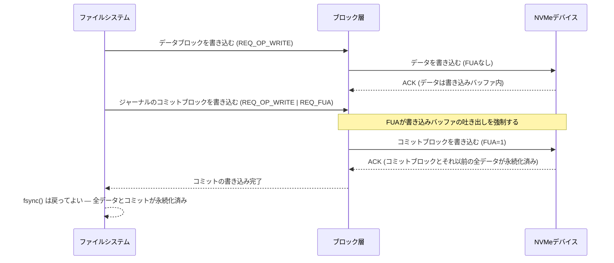

# 永続性のセマンティクス: fsync、fdatasync、O_SYNC、ライトバリア {#durability-semantics-fsync-fdatasync-o_sync-and-write-barriers}

> 永続性に関わる各システムコールが実際に何を約束するのか、その保証がどこで崩れるのか、そしてデータベースがそれらをどう正しく使っているのか

## 永続性のギャップ {#the-durability-gap}

`write()`は、データがDRAM、具体的にはカーネルの**ページキャッシュ**にある時点で戻る。この呼び出しは永続ストレージには触れない。`write()`が戻った瞬間から、データが電源断を生き延びる瞬間までの間に、3つの独立した層のそれぞれがデータを失いうる:

```
User process
    │  write(fd, buf, n)
    ▼
┌─────────────────────────────────────────────────────┐  ← DRAM
│  Page cache (kernel)                                │
│  Page marked PG_dirty. write() returns here.        │
│  Data lost if: kernel panic, OOM kill, power cut    │
└─────────────────────────────────────────────────────┘
    │  writeback (async, bdflush / wb_workfn)
    ▼
┌─────────────────────────────────────────────────────┐  ← DRAM (drive)
│  Drive write buffer (volatile DRAM on the device)   │
│  Data written to device but not yet to platter/cell │
│  Data lost if: power cut without battery-backed WBC │
└─────────────────────────────────────────────────────┘
    │  FLUSH CACHE / FUA command
    ▼
┌─────────────────────────────────────────────────────┐  ← persistent
│  Persistent storage medium (flash cells, platters)  │
│  Data survives power loss                           │
└─────────────────────────────────────────────────────┘
```

**層1 — ページキャッシュ**: `write()`はページをダーティにして戻る。カーネルのライトバックスレッドは、自分のペース（`dirty_expire_centisecs`、`dirty_writeback_centisecs`、およびメモリ逼迫によって制御される）でダーティページをドライブへフラッシュする。ライトバック前にカーネルパニックが起きると、データは完全に失われる。

**層2 — ドライブの書き込みバッファ**: 現代のドライブはDRAMのライトキャッシュを持つ。カーネルはブロック書き込みをドライブに渡し、ドライブがフラッシュセルやプラッタにコミットする前にACKを受け取ることがある。この段階で電源断が起きると、ドライブがバッテリーバックアップ付きライトキャッシュ（BBWC）を持っているか、カーネルがFLUSHコマンド（あるいは書き込み自体にFUA — Force Unit Access）を発行していない限り、データは失われる。

**層3 — 記憶媒体**: データが媒体上に載れば、物理的な破壊以外でそれが失われることはない。フラッシュセルやプラッタは永続的である。

各永続化メカニズムの契約は、どの層を閉じるかを規定している:

| メカニズム | ページキャッシュをフラッシュ | ドライブのバッファをフラッシュ | 備考 |
|---|---|---|---|
| `write()` | しない | しない | データはDRAMにのみある |
| バックグラウンドライトバック | する | しない | タイミングは非決定的 |
| `fsync(fd)` | する | する | ファイルの完全な永続性 |
| `fdatasync(fd)` | する | する | 必須でないメタデータを除いた永続性 |
| `sync()` | する | しない* | システム全体。後述の注意点を参照 |
| `syncfs(fd)` | する | しない* | ファイルシステム単位。後述の注意点を参照 |
| `O_SYNC`書き込み | する | する | 書き込みごと。各`write_iter`の後 |
| `O_DSYNC`書き込み | する | する（データ+サイズ） | 書き込みごと。データのみの変種 |

*`sync()`と`syncfs()`は、各デバイスに無条件でFLUSHを発行するわけではない。ファイルシステムのジャーナルコミット（これはFLUSHを発行する）が実行されていることか、呼び出し側が代表的なファイルに対して`fsync()`も呼ぶことに依存している。

---

## fsync() {#fsync}

### POSIXの定義 {#posix-definition}

POSIXは、`fsync()`がファイルの変更されたすべてのデータ**およびメタデータ**を下位のハードウェアへ転送することを要求している。「転送」とは、ハードウェアが永続化を確認応答したことを意味し、アプリケーションはデータが電源障害を生き延びると想定してよい。

鍵となるのは*すべてのメタデータ*という語句である。`fsync()`はファイルのデータブロックだけでなく、inode（サイズ、ブロックポインタ、更新時刻、変更時刻）と、そのinodeの状態を回復可能にするために必要なファイルシステムレベルのジャーナルレコードも永続化しなければならない。

### カーネルの実装 {#kernel-implementation}

エントリポイントは`fs/sync.c`の`SYSCALL_DEFINE1(fsync)`で、これは`do_fsync(fd, 0)`を呼ぶ。`0`は`datasync`フラグであり、`fsync()`では常に0である。システムコールからファイルシステムまでのパスは次のとおり:

```
fsync(fd)
  → do_fsync(fd, datasync=0)            [fs/sync.c]
  → vfs_fsync(file, datasync=0)
  → vfs_fsync_range(file, 0, LLONG_MAX, 0)
  → file->f_op->fsync(file, 0, LLONG_MAX, datasync=0)
```

`vfs_fsync_range()`が正規のVFSエントリポイントである:

```c
/* fs/sync.c */
int vfs_fsync_range(struct file *file, loff_t start, loff_t end, int datasync)
{
    struct inode *inode = file->f_mapping->host;

    if (!file->f_op->fsync)
        return -EINVAL;

    return file->f_op->fsync(file, start, end, datasync);
}
```

範囲`[start, end]`は`msync()`が部分的なフラッシュに使う。単純な`fsync()`呼び出しではファイル全体の範囲が渡される。`datasync`引数はそのままファイルシステムに転送され、ファイルシステムはそれを使って必須でないメタデータをフラッシュするかどうかを決める。

### ハードウェアごとの「安定ストレージ」の意味 {#what-stable-storage-means-for-different-hardware}

回転ディスクでは、安定ストレージとはプラッタである。ドライブは揮発性のライトキャッシュを吐き出さなければならない。カーネルは`REQ_OP_FLUSH`ブロックリクエストを発行してこれを行い、それはATAの`FLUSH CACHE EXT`コマンドやSCSIの`SYNCHRONIZE CACHE`に変換される。

SATA SSDやNVMeでは、安定ストレージとは（書き込みバッファに置かれているだけでなく）プログラム済みのフラッシュセルである。NVMeは2つの仕組みを公開している。`FLUSH`コマンド（ライトキャッシュを吐き出す）と、特定の書き込みに対するFUA（Force Unit Access）である。後者はNVMe書き込みコマンドのフラグで、その操作に限って書き込みバッファを迂回する。

バッテリーバックアップ付きライトキャッシュ（BBWC）やキャパシタでバックアップされた永続メモリ（PMem/Optane）を持つエンタープライズ向けフラッシュでは、デバイスのRAMへの書き込みはすでに永続とみなされるため、FLUSHをno-opにできる。カーネルは、デバイスがFUAに従うことを示す`BLK_FEAT_FUA`フラグと、揮発性ライトキャッシュが存在することを示す`BLK_FEAT_WRITE_CACHE`フラグを尊重する。

### ext4のジャーナルモードとfsyncのコスト {#ext4-journal-modes-and-fsync-cost}

ext4には3つのジャーナルモードがあり、`fsync()`が行うべきことを大きく左右する:

**`data=ordered`（デフォルト）**: データブロックは、メタデータの変更を記録するジャーナルコミットの*前に*ディスクへ書き込まれる。`fsync()`では:
1. ダーティなデータページが`filemap_write_and_wait_range()`でライトバックされる。
2. `ext4_sync_file()`が`jbd2_complete_transaction()`を呼び、現在のジャーナルトランザクションをコミットする。
3. ジャーナルのコミットブロックがFLUSHまたはFUA付きでジャーナルデバイスに書き込まれる。
4. ファイルのデータが別のデバイス上にある場合は、2回目のFLUSHが必要になることがある。

つまり`fsync()`は通常、1回のジャーナルコミットと1回のストレージバリアを引き起こす。最後のコミット以降データが変わっていなくても同様である（データを参照するメタデータのジャーナルエントリがコミットされなければならないため）。

```c
/* fs/ext4/fsync.c */
int ext4_sync_file(struct file *file, loff_t start, loff_t end, int datasync)
{
    struct inode *inode = file->f_mapping->host;
    struct ext4_inode_info *ei = EXT4_I(inode);
    journal_t *journal = EXT4_SB(inode->i_sb)->s_journal;
    int ret = 0, err;
    tid_t commit_tid;
    bool needs_barrier = false;

    if (unlikely(ext4_forced_shutdown(inode->i_sb)))
        return -EIO;

    ASSERT(ext4_journal_current_handle() == NULL);

    trace_ext4_sync_file_enter(file, datasync);

    if (inode->i_sb->s_flags & SB_RDONLY) {
        /* 更新された s_mount_flags の値を確実に読む */
        smp_rmb();
        if (EXT4_SB(inode->i_sb)->s_mount_flags & EXT4_MF_FS_ABORTED)
            ret = -EROFS;
        goto out;
    }

    if (!journal) {
        ret = __generic_file_fsync(file, start, end, datasync);
        if (!ret)
            ret = ext4_sync_parent(inode);
        if (test_opt(inode->i_sb, BARRIER))
            goto issue_flush;
        goto out;
    }

    ret = filemap_write_and_wait_range(inode->i_mapping, start, end);
    if (ret)
        goto out;

    /*
     * data=writeback,ordered: inode がジャーナルの
     * チェックポイントリストにあれば、ジャーナルをコミットする必要がある。
     */
    if (datasync)
        commit_tid = atomic_read(&ei->i_datasync_tid);
    else
        commit_tid = atomic_read(&ei->i_sync_tid);

    if (journal->j_flags & JBD2_BARRIER &&
        !jbd2_trans_will_send_data_barrier(journal, commit_tid))
        needs_barrier = true;

    ret = jbd2_complete_transaction(journal, commit_tid);
    if (needs_barrier) {
issue_flush:
        err = blkdev_issue_flush(inode->i_sb->s_bdev);
        if (!ret)
            ret = err;
    }
out:
    trace_ext4_sync_file_exit(inode, ret);
    return ret;
}
```

**`data=writeback`**: メタデータはジャーナルされるが、データブロックの書き込みはジャーナルコミットに対して順序付けられない。`fsync()`では、ext4はやはり`filemap_write_and_wait_range()`を呼んでジャーナルをコミットするが、データとメタデータの間に順序保証はない。クラッシュからの回復時に、有効なメタデータが指しているブロックに古いデータが露出することがある。このモードは高速だが、アプリケーションがそのリスクを許容する必要がある。

**`data=journal`**: すべてのデータは、最終的な位置に書き込まれる前にジャーナルへ書き込まれる。`fsync()`は、メタデータだけでなくデータそのものを含むジャーナルトランザクションをコミットしなければならないため高価である。めったに使われず、厳密な順序付けを必要とし、書き込み増幅を許容できるアプリケーション向けである。

### XFS: ログフォースとデータ書き込みの順序付け {#xfs-log-force-vs-data-write-ordering}

XFSはext4の意味でのブロックレベルのジャーナルは使わず、トランザクション向けに構造化されたログを使う。`xfs_file_fsync()`はログフォース（`xfs_log_force_seq()`）を発行してメモリ内のログをディスクへフラッシュし、必要に応じてストレージバリアを発行する。

```c
/* fs/xfs/xfs_file.c */
int xfs_file_fsync(struct file *file, loff_t start, loff_t end, int datasync)
{
    struct xfs_inode *ip = XFS_I(file->f_mapping->host);
    struct xfs_mount *mp = ip->i_mount;
    int error = 0;
    int log_flushed = 0;
    xfs_lsn_t lsn = 0;

    trace_xfs_file_fsync(ip);

    error = file_write_and_wait_range(file, start, end);
    if (error)
        return error;

    xfs_iflags_clear(ip, XFS_ITRUNCATED);

    /*
     * RT サブボリュームやログサブボリュームがある場合は、まず
     * ファイルデータに使われるデバイスのライトキャッシュを
     * フラッシュする必要がある。ログフォースを発行する前に
     * 保留中のすべての I/O がフラッシュされるようにするためである。
     */
    if (mp->m_rtdev_targp != mp->m_ddev_targp)
        blkdev_issue_flush(mp->m_rtdev_targp->bt_bdev);

    if (datasync && !xfs_ipincount(ip))
        goto out;

    if (!xfs_ilog_flushed(ip)) {
        lsn = xfs_fsync_lsn(ip, datasync);
        if (lsn) {
            error = xfs_log_force_seq(mp, lsn, XFS_LOG_SYNC,
                                      &log_flushed);
        }
    }

out:
    if (log_flushed || !mp->m_logdev_targp)
        goto out_flush;
    /* ... */
out_flush:
    if (mp->m_logdev_targp != mp->m_ddev_targp)
        error = blkdev_issue_flush(mp->m_logdev_targp->bt_bdev);
    return error;
}
```

### 典型的なfsyncのレイテンシ {#typical-fsync-latency}

小さな書き込みワークロードにおける1回の`fsync()`呼び出しの代表的な数値は次のとおり:

| ストレージの種類 | 典型的なfsyncレイテンシ |
|---|---|
| NVMe SSD（PCIe 4.0） | 50–500 µs |
| NVMe SSD（PCIe 3.0） | 100–1000 µs |
| SATA SSD | 1–5 ms |
| SATA HDD（7200 RPM） | 5–15 ms |
| HDD（5400 RPM） | 10–30 ms |
| ネットワークブロックデバイス（iSCSI/FC） | 1–10 ms（ストレージアレイに依存） |

レイテンシの大部分は、ライトキャッシュを吐き出し、ジャーナルのコミットブロックが安定媒体に載るまでの時間である。NVMeでは、ジャーナルへのFUA書き込みによって別個のFLUSHコマンドが不要になり、レイテンシがおよそ半分になる。

---

## fdatasync() {#fdatasync}

### POSIXの定義 {#posix-definition_1}

`fdatasync()`は、ファイルのデータと**データを取り出すのに十分なメタデータ**を安定ストレージへ転送する。データを読み戻す能力に影響しないメタデータは、明示的にフラッシュする必要がない。POSIXより:

> *If the file is not in a special file, it is not required to update metadata such as st_atime or st_mtime.*

`fdatasync()`がスキップできるメタデータ:

- `atime`（最終アクセス時刻） — データの取り出しに影響することはない
- `mtime`（最終更新時刻） — データの位置に影響しない
- `ctime`（最終状態変更時刻） — inodeの変更タイムスタンプ

`fdatasync()`がフラッシュ**しなければならない**メタデータ:

- ファイルサイズ（`i_size`） — ファイルが伸びた場合、新しいデータの位置を特定するには新しいサイズが必要
- ブロックポインタ — 新たに割り当てられたデータブロックは見つけられる状態でなければならない
- 間接ブロック/エクステントツリーの変更 — データの位置を特定するのに必要

### datasyncフラグのパス {#the-datasync-flag-path}

`SYSCALL_DEFINE1(fdatasync)`は`do_fsync(fd, 1)`を呼ぶ。`1`は`vfs_fsync_range()`を通り、`datasync`引数としてファイルシステムの`fsync`メソッドに渡る。

```c
/* fs/sync.c */
SYSCALL_DEFINE1(fdatasync, unsigned int, fd)
{
    return do_fsync(fd, 1);  /* datasync = 1 */
}
```

ext4では、`datasync=1`は`ei->i_sync_tid`の代わりに`ei->i_datasync_tid`を選択する:

```c
/* fs/ext4/fsync.c — 簡略化 */
if (datasync)
    commit_tid = atomic_read(&ei->i_datasync_tid);
else
    commit_tid = atomic_read(&ei->i_sync_tid);

ret = jbd2_complete_transaction(journal, commit_tid);
```

`i_datasync_tid`は、データのアクセスに関わるメタデータに影響した最後のトランザクションのIDである。最後のジャーナルコミット以降サイズが変わっていないファイルでは、`i_datasync_tid`はすでにコミット済みである可能性があり、その場合`jbd2_complete_transaction()`の呼び出しはすぐに戻る。これは事前割り当てされたファイルに書き込むデータベースでよくあるケースである。サイズの変更がないため、待つべきメタデータのジャーナルコミットがない。

### fdatasyncがfsyncと同等になるとき {#when-fdatasync-is-equivalent-to-fsync}

`fdatasync()`は、次の場合に完全なメタデータのフラッシュ（`fsync()`と同等）を行わなければならない:

- **ファイルサイズが変わった**: ファイル末尾を超える`write()`、または`truncate()`。新しい`i_size`は、それが記述するデータを安全に取り出せるようになる前にディスク上になければならない。
- **新しいブロックが割り当てられた**: ブロックベースのファイルシステムで、書き込みによって新しいエクステントや間接ブロックのエントリが作られた場合。
- **新しいファイル**: 新規作成されたファイルは、そのinodeが一度もコミットされていない。データとすべてのinodeメタデータの両方をフラッシュしなければならない。
- **ファイルのrenameやlink**: ディレクトリエントリは、ファイルの位置を記述するメタデータの一部である。

事前割り当てされ、サイズを変えずに順次書き込まれるデータベースのWALファイルでは、`fdatasync()`は最初の書き込み以降のすべての書き込みでメタデータのジャーナルコミットを完全にスキップする。PostgreSQLがWALの書き込みに`fdatasync()`を使うのはこのためである。WALファイルは事前割り当てされており、通常運用中にそのサイズが変わることはまれである。

### なぜfdatasyncのほうが速いか {#why-fdatasync-is-faster}

性能上の利点は、書き込むデータが少ないことではない。`fsync()`も`fdatasync()`もダーティなデータページをフラッシュしなければならない。利点はジャーナルコミットにある。メタデータのジャーナルコミットには、ジャーナルデバイスへコミットブロックを書き込み、FLUSHまたはFUAの確認応答を待つ必要がある。書き込みの多いファイルシステムでは、このコミットに他のファイルの無関係なメタデータが含まれることがあり、すべてのfsync()呼び出し側を直列化してしまう。`fdatasync()`は、メタデータの変更が不要なときにこの直列化ポイントを回避する。

ext4 `data=ordered`のSATA SSDでのベンチマークでは、事前割り当てされたファイルへの小さなランダム書き込みにおいて、`fdatasync()`は通常`fsync()`の2〜3倍のスループットを示す。主な理由は、`fdatasync()`がジャーナルコミットによる直列化を回避することである。

---

## sync()とsyncfs() {#sync-and-syncfs}

### sync() — システム全体のフラッシュ {#sync-system-wide-flush}

`sync()`は、マウントされたすべてのファイルシステムにわたって、すべてのダーティページとすべてのジャーナルトランザクションをフラッシュするようカーネルに指示する。歴史的に`sync()`はライトバックを開始してすぐに戻っていた。これは意図的なもので、Unixのドキュメントは単に書き込みを「スケジュールする」と述べており、それを待つとは述べていなかった。

**Linuxの挙動**: 素のPOSIXの要件とは異なり、Linuxの`sync()`は非常に長い間、ライトバックとジャーナルコミットの完了を待ってきた（この挙動は2.6系列より前からある。`sync(2)`のNOTESを参照）。現在のカーネル実装は`ksys_sync()`に委譲している:

```c
/* fs/sync.c */
void ksys_sync(void)
{
    int nowait = 0, wait = 1;

    wakeup_flusher_threads(WB_REASON_SYNC);
    iterate_supers(sync_inodes_one_sb, NULL);  /* inode をライトバックして待つ */
    iterate_supers(sync_fs_one_sb, &nowait);   /* ->sync_fs、待たない */
    iterate_supers(sync_fs_one_sb, &wait);     /* ->sync_fs、待つ */
    sync_bdevs(false);                         /* ブロックデバイスのキャッシュをフラッシュ */
    sync_bdevs(true);                          /* ... そして待つ */
}

SYSCALL_DEFINE0(sync)
{
    ksys_sync();
    return 0;
}
```

待つにもかかわらず、`sync()`はすべてのストレージデバイスにFLUSHコマンドを発行するわけでは**ない**。順序付けの保証は、ファイルシステムのジャーナルコミット（これはバリアを使う）に依存している。ファイルシステムにダーティなデータがあっても保留中のジャーナルコミットがない場合（例: `nobarrier`マウントオプション）、`sync()`はドライブのライトキャッシュを完全にはフラッシュしないことがある。

**`sync()`を使うべきとき**: システムのシャットダウン、テスト、すべてをディスクに載せる必要があるスクリプトのシナリオ。アプリケーションレベルの永続性には適さない。範囲が広すぎ、コストが高すぎる。

### syncfs() — ファイルシステム単位のフラッシュ {#syncfs-per-filesystem-flush}

`syncfs()`は、`sync()`のシステム全体にわたるコストなしにファイルシステム単位のセマンティクスを提供するため、Linux 2.6.39で追加された。ファイルディスクリプタを受け取り、それを含むファイルシステムをフラッシュする:

```c
/* fs/sync.c */
SYSCALL_DEFINE1(syncfs, int, fd)
{
    CLASS(fd, f)(fd);              /* スコープガード付きの fd。return 時に解放される */
    struct super_block *sb;
    int ret, ret2;

    if (fd_empty(f))
        return -EBADF;
    sb = fd_file(f)->f_path.dentry->d_sb;

    down_read(&sb->s_umount);
    ret = sync_filesystem(sb);
    up_read(&sb->s_umount);

    /* この fd が最後に確認して以降に見られたライトバックエラーを報告する */
    ret2 = errseq_check_and_advance(&sb->s_wb_err, &fd_file(f)->f_sb_err);
    return ret ? ret : ret2;
}
```

`sync_filesystem()`は`sb->s_op->sync_fs()`（定義されていれば）を呼び、次にスーパーブロックのブロックデバイスに対して`sync_blockdev()`を呼ぶ。ライトバックとジャーナルコミットを待つ。`sync()`と同様に、ファイルシステムのジャーナルコミットが行わない限り、ストレージデバイスへ明示的にFLUSHを送ることはない。

**`syncfs()`と複数の`fsync()`呼び出しの比較**: `syncfs()`は、例えばスナップショットの前など、すべてのファイルに`fsync()`を呼ばずにファイルシステム上のすべてをフラッシュする必要があるときに便利である。`sync()`より安価で、1つのファイルシステムに範囲が限定される。ファイル単位の永続性保証には、依然として`fsync()`か`fdatasync()`が必要である。

---

## O_SYNCとO_DSYNC {#o_sync-and-o_dsync}

### fd単位の同期I/O {#per-fd-synchronous-io}

`O_SYNC`と`O_DSYNC`は`open()`に渡すフラグで、そのファイルディスクリプタに対する以降のすべての`write()`を同期的にする。書き込み呼び出しは、データが安定ストレージに載るまでブロックする。これにより、書き込みのたびに別途`fsync()`を呼ぶ必要がなくなる。

```c
int fd = open("wal.log", O_WRONLY | O_CREAT | O_DSYNC, 0644);
write(fd, record, len);  /* データが安定ストレージに載るまでブロックする */
```

### IOCBフラグとgeneric_write_sync {#iocb-flags-and-generic_write_sync}

ファイルに`O_SYNC`または`O_DSYNC`が設定されていると、VFSは`write_iter`を呼ぶ前に、`kiocb`構造体に対応するフラグを設定する:

```c
/* include/linux/fs.h — open フラグが kiocb フラグになる */
static inline int iocb_flags(struct file *file)
{
    int res = 0;
    /* ... O_APPEND -> IOCB_APPEND, O_DIRECT -> IOCB_DIRECT ... */
    if (file->f_flags & O_DSYNC)
        res |= IOCB_DSYNC;   /* O_DSYNC と O_SYNC の両方が O_DSYNC ビットを立てる */
    if (file->f_flags & __O_SYNC)
        res |= IOCB_SYNC;    /* 完全な O_SYNC だけが __O_SYNC ビットを立てる */
    return res;
}
```

（`O_SYNC`は`__O_SYNC | O_DSYNC`と定義されているため、完全な`O_SYNC`のファイルは`IOCB_DSYNC`と`IOCB_SYNC`の*両方*を得るが、`O_DSYNC`は`IOCB_DSYNC`だけを得る。sync判定が`O_SYNC`ではなく`__O_SYNC`をテストしなければならないのはこのためである。）

`write_iter`が完了した後、`generic_file_write_iter()`はこれらのフラグを確認して`generic_write_sync()`を呼ぶ:

```c
/* mm/filemap.c */
ssize_t generic_file_write_iter(struct kiocb *iocb, struct iov_iter *from)
{
    struct file *file = iocb->ki_filp;
    struct inode *inode = file->f_mapping->host;
    ssize_t ret;

    inode_lock(inode);
    ret = generic_write_checks(iocb, from);
    if (ret > 0)
        ret = generic_perform_write(iocb, from);
    inode_unlock(inode);

    if (ret > 0)
        ret = generic_write_sync(iocb, ret);
    return ret;
}

/* include/linux/fs.h */
static inline ssize_t generic_write_sync(struct kiocb *iocb, ssize_t count)
{
    if (iocb->ki_flags & IOCB_DSYNC) {
        int ret = vfs_fsync_range(iocb->ki_filp,
                                   iocb->ki_pos - count, iocb->ki_pos - 1,
                                   (iocb->ki_flags & IOCB_SYNC) ? 0 : 1);
        if (ret)
            return ret;
    }
    return count;
}
```

`vfs_fsync_range()`の呼び出しは、`O_DSYNC`（`IOCB_DSYNC`のみ設定）では`datasync=1`を、`O_SYNC`（`IOCB_SYNC`と`IOCB_DSYNC`の両方が設定）では`datasync=0`を渡す。これが正確なセマンティクスの違いである:

- **`O_DSYNC`**（`IOCB_DSYNC`のみ）: `vfs_fsync_range(..., datasync=1)`を呼ぶ — データとサイズ関連のメタデータ。タイムスタンプはフラッシュしない。
- **`O_SYNC`**（`IOCB_SYNC | IOCB_DSYNC`）: `vfs_fsync_range(..., datasync=0)`を呼ぶ — タイムスタンプを含む完全なメタデータ。

実際には、事前割り当てされたファイルへのほとんどの書き込みワークロードで、`O_DSYNC`と`O_SYNC`の性能は同一である。純粋なメタデータの変更が保留されていなければ、`fdatasync`と`fsync`は同じように振る舞うからである。

### 性能コスト {#performance-cost}

`O_SYNC`と`O_DSYNC`は、各書き込みをストレージのフラッシュと直列化する。小さなランダム書き込みでは、書き込みの合体（coalescing）がすべて失われる:

| 書き込みパターン | バッファードのスループット | O_DSYNCのスループット | 比率 |
|---|---|---|---|
| 4KBシーケンシャル、NVMe | ~3 GB/s | ~400 MB/s | 7倍遅い |
| 4KBランダム、NVMe | ~2 GB/s | ~30 MB/s | 60倍遅い |
| 64KBシーケンシャル、NVMe | ~3 GB/s | ~1 GB/s | 3倍遅い |
| 4KBシーケンシャル、SATA SSD | ~500 MB/s | ~50 MB/s | 10倍遅い |

ランダム4KB書き込みの比率が大きいのは、各書き込みがドライブとの往復を伴い（NVMeでのコミットレイテンシは~100 µs）、パイプライン化が行われないためである。

### O_SYNC / O_DSYNCを使うべきとき {#when-to-use-o_sync-o_dsync}

- **WALファイルとredoログ**: コミットを確認応答する前にすべてのログレコードを永続化する必要があるデータベース。WALファイルに`O_DSYNC`を使えば、別途`fdatasync()`を呼ぶ必要がなくなり、システムコールの回数が減る。
- **監査ログ**: すべてのイベントがクラッシュを生き延びなければならない、セキュリティ上重要なログ。
- **メッセージキューのトランザクションログファイル**（例: Kafkaのセグメントファイル）: セグメントファイルに`O_DSYNC`を使えば、プロデューサーに確認応答する前に各メッセージが永続化されることが保証される。

一般的なアプリケーションのデータファイルには`O_SYNC`/`O_DSYNC`を**使ってはならない**。性能コストが高すぎ、ほとんどのアプリケーションにとっては時折の`fsync()`によるチェックポイントのほうが適している。

---

## ファイルシステムにおけるライトバリア {#write-barriers-in-filesystems}

### 順序付けの問題 {#the-ordering-problem}

データベースがデータページを書き込み、次にその書き込みを記述するジャーナルレコードを書き込む場合を考える。ストレージデバイスがこの2つの書き込みを並べ替えると（ジャーナルレコードが先に届き、クラッシュが起き、データページは届かない）、回復処理は古いデータを指すジャーナルエントリをリプレイしてしまう。ファイルは破損する。

ライトバリアはこれを解決する。バリアは、それより前に発行されたすべての書き込みが、それより後に発行された書き込みが始まる前に永続化されることを保証する。NVMeでは:

- **FUA（Force Unit Access）**: 特定の書き込みコマンドのフラグで、そのコマンドに限って揮発性ライトキャッシュを迂回する。
- **FLUSHコマンド**（`REQ_OP_FLUSH`）: 揮発性ライトキャッシュ全体を吐き出す。このコマンドが戻る前に、それ以前のすべての書き込みが永続化される。

カーネルのbioフラグ:

```c
/* include/linux/blk_types.h */
#define REQ_FUA         ((__force blk_opf_t)(1 << __REQ_FUA))
#define REQ_PREFLUSH    ((__force blk_opf_t)(1 << __REQ_PREFLUSH))
```

`REQ_FUA`はNVMe書き込みコマンドのFUAビットを立てる。`REQ_PREFLUSH`は、書き込みの前にFLUSHコマンドを発行させる。`blk-flush.c`のブロック層は、FUAの代わりにFLUSH+WRITEを必要とするドライブに対してこれらを正しく順序付ける。

### ジャーナリングファイルシステムはバリアをどう使うか {#how-journaling-filesystems-use-barriers}



**ext4**: ジャーナルのコミットブロック（`jbd2_commit_block`）は、`REQ_FUA`付き（デバイスがFUAをサポートする場合）か、先行する`REQ_PREFLUSH`付き（デバイスがコミット前にFLUSHを必要とする場合）で書き込まれる。`JBD2_BARRIER`ジャーナルフラグがバリアを使うかどうかを制御する。これはデフォルトで有効であり、`nobarrier`マウントオプションで無効にできる（危険であり、テストかバッテリーバックアップ付きストレージ専用）。

**XFS**: XFSは`xlog_write()`でログレコードを書き込み、ログフラッシュの末尾のログレコードは`REQ_FUA`付きで書き込まれる。ログヘッドは`xfs_log_force()`によって保護され、これはFUA書き込みを発行して完了を待つ。ext4と同様に、XFSも`nobarrier`マウントオプションを尊重する。

**btrfs**: btrfsはデータに順序付き書き込みを使い（データは、それを参照するツリールートより前にディスク上にある）、新しいツリールートがスーパーブロックの更新前に永続化されるよう、スーパーブロックを`REQ_FUA | REQ_PREFLUSH`で書き込む。

### バリアの検出とnobarrierのリスク {#barrier-detection-and-the-nobarrier-risk}

`nobarrier`マウントオプションはライトバリアを無効にする。揮発性ライトキャッシュを持つストレージデバイスでは、これにより、ジャーナルコミットが、それが記述するデータの永続化より前に確認応答されてしまう窓が生じる。クラッシュからの回復時に、ジャーナルはコミットをリプレイするが、参照されるデータブロックには古い内容やゼロ埋めされた内容が入っている。

`nobarrier`が安全なのは次の場合だけである:
1. ブロックデバイスに揮発性ライトキャッシュがないことがわかっている（例: RAMDISK、特定のPMem構成、あるいは永続媒体へ自動的にフラッシュされるバッテリーバックアップ付きNVRAMを持つストレージアレイ）。
2. アプリケーションがより上位のレベルで明示的に永続性を扱い、ファイルシステムのクラッシュ一貫性に依存しない。

デバイスがFLUSHコマンドに従うかどうかをテストするには、[fsyncのベンチマーク](#benchmarking-fsync)の節を参照。

---

## 新規ファイルの永続性の罠 {#the-new-file-durability-trap}

よくあるアプリケーションの間違いは、新しいファイルを作成し、データを書き込み、ファイルを`fsync()`して、そのファイルが永続化されたと思い込むことである。これでは不十分である。

ファイルが作成されるとき、2つのことが起きる:
1. ファイルのinodeが割り当てられ、そのデータが書き込まれる。
2. ディレクトリエントリ（dentry）が親ディレクトリに追加され、ファイル名とinodeを結び付ける。

`fsync(fd)`はinodeとそのデータをフラッシュするが、ディレクトリエントリは*親ディレクトリの*inodeにあり、それは独自のダーティ状態を持つ。`fsync(fd)`の後、ディレクトリエントリがフラッシュされる前にクラッシュすると、データブロックはディスク上にあるのに、それを指すディレクトリエントリがない状態になりうる。そのファイルのデータは回復不能である。

**永続的なファイル作成の正しいパターン:**

```c
/* 新しいファイルを永続的に作成する */
int fd = open("/data/new_file", O_WRONLY | O_CREAT | O_TRUNC, 0644);
write(fd, data, len);
fsync(fd);   /* ファイルのデータと inode をフラッシュする */
close(fd);

/* 新しいファイルを含むディレクトリもフラッシュする */
int dirfd = open("/data", O_RDONLY);
fsync(dirfd);   /* ディレクトリエントリをディスクへフラッシュする */
close(dirfd);
```

2つの`fsync()`呼び出しは次のことを保証する:
1. ファイルのデータとinodeがディスク上にある。
2. ファイル名とinodeを結び付けるディレクトリエントリがディスク上にある。

ext4 `data=ordered`では、両方が同じトランザクションの窓の中で起きれば、2つの`fsync()`呼び出しが1回のジャーナルコミットにまとめられることがある。しかしアプリケーションはそれを前提にできず、両方の呼び出しを発行しなければならない。

### これを正しく行っているもの {#who-does-this-correctly}

**SQLite**: WALモードでは、SQLiteはWALファイルを作成した後、WALファイルとディレクトリに対して`fsync()`を呼ぶ。`os_unix.c`の`unixSync()`を参照:

```c
/* SQLite os_unix.c — 簡略化 */
static int unixSync(sqlite3_file *id, int flags)
{
    unixFile *pFile = (unixFile*)id;
    /* ... */
    rc = full_fsync(pFile->h, isFullSync, isDataOnly);
    SimulateIOError( rc=1 );
    if( rc ){
        storeLastErrno(pFile, errno);
        return SQLITE_IOERR_FSYNC;
    }
    if( pFile->dirfd>=0 ){
        /* WAL ファイルを含むディレクトリも sync する */
        full_fsync(pFile->dirfd, 0, 0);
        robust_close(pFile, pFile->dirfd, __LINE__);
        pFile->dirfd = -1;
    }
    return SQLITE_OK;
}
```

**PostgreSQL**: `fd.c`の`pg_fsync()`はデータファイルに対して`fsync()`を呼ぶ。`PathNameOpenFile()`で新しいファイルを作成した後、PostgreSQLは`fsync_fname()`を介して親ディレクトリも開いてfsyncする。`storage/file/fd.c`と`storage/smgr/md.c`を参照。

**LevelDB / RocksDB**: どちらも新しいSSTファイルを作成した後に`SyncDir()`を呼び、ディレクトリを`O_RDONLY`で開いてそれに`fsync()`を呼ぶ。RocksDBでは、`env/io_posix.cc`に`PosixDirectory::FsyncWithDirOptions()`がある。

---

## 永続性マトリクス {#durability-matrix}

次の表は、各書き込みメカニズムが3つの永続性の層にわたって何を保証するかをまとめたものである:

| メカニズム | ページキャッシュのフラッシュ | ドライブのライトキャッシュのフラッシュ | 電源断を生き延びる | 備考 |
|---|---|---|---|---|
| `write()` | しない | しない | いいえ | データはDRAMにのみある |
| `write()` + バックグラウンドライトバック | する（いずれ） | しない | いいえ | タイミングは非決定的 |
| `write()` + `fsync()` | する | する | はい | ファイルの完全な永続性 |
| `write()` + `fdatasync()` | する | する | はい | 必須でないメタデータはフラッシュしない |
| `write()` + `sync()` | する | 部分的* | 部分的* | システム全体。バリアはジャーナル経由 |
| `O_SYNC`書き込み | する | する | はい | 書き込みごと。完全なメタデータ |
| `O_DSYNC`書き込み | する | する | はい | 書き込みごと。データ + サイズのメタデータ |
| `O_DIRECT`書き込み | する（迂回） | しない | いいえ | ページキャッシュを迂回する。ドライブのバッファは依然として揮発性 |
| `O_DIRECT` + `O_DSYNC` | する（迂回） | する | はい | ページキャッシュを迂回し、かつドライブのキャッシュをフラッシュする |
| `O_DIRECT` + `fsync()` | する（迂回） | する | はい | 最も一般的なDBのパターン |

*`sync()`がドライブのライトキャッシュをフラッシュするかどうかは、sync中にバリア付きのジャーナルコミットが実行されるかどうかに依存する。

---

## アトミック書き込みの保証 {#atomic-write-guarantees}

### POSIXのアトミック性とその限界 {#posix-atomicity-and-its-limits}

POSIXは、`write()`が並行する読み込み側に対してアトミックであることを**保証しない**。`write()`と並行して同じファイルに`read()`を呼ぶ読み込み側は、ページキャッシュの状態やファイルシステムの実装によっては、部分的な書き込み（一部のバイトは古く、一部は新しい）を見ることがある。

POSIXが保証するのは次のことである:

- `O_APPEND`の書き込みは**オフセットの割り当てに限って**アトミックである。ファイルオフセットはアトミックに割り当てられるため、`O_APPEND`を使った2つの並行する`write()`呼び出しが同じオフセットを割り当てることはない。各書き込みのデータは直列化される。
- `pwrite()`による更新は、ほとんどのLinuxファイルシステム（ext4、xfs、btrfs）で、単一のファイルシステムブロック内の書き込みであればセクタレベルでアトミックに見えるが、これは実装の詳細であってPOSIXの保証ではない。

### O_APPENDのアトミック性 {#o_append-atomicity}

ファイルが`O_APPEND`で開かれていると、カーネルは末尾へのシークと書き込みにわたって`inode_lock`を保持し、オフセットの割り当てと書き込み自体を、同じinodeに対する他の`O_APPEND`の書き込み側に対してアトミックにする。write(2)が次のように述べているのはこのためである:

> *If the O_APPEND file status flag is set on the open file description, then a write() shall atomically seek the file offset to the end of the file before each write.*

このアトミック性は、1回の`write()`呼び出しで完了する書き込みについて成り立つ。書き込みが複数ページにまたがり、部分書き込み（例: シグナルによる中断や`PIPE_BUF`の制限による）を必要とする場合、カーネルはページの書き込みの合間にinodeロックを解放して再取得することがあり、アトミック性が崩れる。

### io_uring RWF_ATOMIC（Linux 6.11以降） {#io_uring-rwf_atomic-linux-611}

Linux 6.11はio_uring経由で`RWF_ATOMIC`を導入し、`stx_atomic_write_unit_max`バイト（`statx(2)`で報告される）までの真のアトミック書き込みを提供した:

```c
/* include/uapi/linux/fs.h */
#define RWF_ATOMIC  ((__kernel_rwf_t)0x00000040)
```

`RWF_ATOMIC`を使うと、カーネルは並行する読み込み側が書き込みの全部か何も見ないかのどちらかであることを保証する。指定されたサイズ境界内でのtorn write（書き込みの裂け）は起きない。NVMeデバイスは、アトミック書き込みの単位サイズを`IDENTIFY`コントローラデータで公開する。ファイルシステムはこれを`struct statx`の`stx_atomic_write_unit_min`と`stx_atomic_write_unit_max`でユーザー空間に伝える。

```c
struct statx sbuf;
statx(fd, "", AT_EMPTY_PATH, STATX_WRITE_FLAGS, &sbuf);

printf("atomic_write_unit_min = %u\n", sbuf.stx_atomic_write_unit_min);
printf("atomic_write_unit_max = %u\n", sbuf.stx_atomic_write_unit_max);

/* io_uring 経由でアトミック書き込みを発行する */
struct io_uring_sqe *sqe = io_uring_get_sqe(&ring);
io_uring_prep_write(sqe, fd, buf, len, offset);
sqe->rw_flags = RWF_ATOMIC;
```

`RWF_ATOMIC`は永続性とは別物である。アトミック書き込みは`fsync()`のセマンティクスを意味しない。保証するのはtorn writeからの保護であり、電源断を越えた永続化ではない。

---

## データベースによくあるパターン {#common-database-patterns}

### PostgreSQLのWAL {#postgresql-wal}

PostgreSQLはWrite-Ahead Logを`pg_wal/`内のファイルに書き込む。各トランザクションのWALレコードは`write()`で書き込まれ、トランザクションをクライアントに確認応答する前に`fdatasync()`が呼ばれる。WALファイルは（`posix_fallocate()`で）事前割り当てされているため、ファイルサイズが変わることはまれである。これは、`fdatasync()`がフラッシュのたびにメタデータのジャーナルコミットを回避できることを意味する。

`src/backend/access/transam/xlog.c`のWALフラッシュパス:

```c
/*
 * XLogFlush -- 指定位置までの xlog がディスクへフラッシュされていることを保証する。
 */
void XLogFlush(XLogRecPtr record)
{
    /* ... WAL ページを WAL ファイルに書き込む ... */

    issue_xlog_fsync(openLogFile, openLogSegNo, tli);
}

static void issue_xlog_fsync(int fd, XLogSegNo segno, TimeLineID tli)
{
    switch (sync_method) {
    case SYNC_METHOD_FDATASYNC:
        if (pg_fdatasync(fd) != 0)
            ereport(PANIC, ...);
        break;
    case SYNC_METHOD_FSYNC:
        if (pg_fsync_no_writethrough(fd) != 0)
            ereport(PANIC, ...);
        break;
    case SYNC_METHOD_OPEN_DSYNC:
        /* fd は O_DSYNC で開かれている。明示的な sync は不要 */
        break;
    /* ... */
    }
}
```

`wal_sync_method`のデフォルトは、Linuxでは`fdatasync`、macOS（`fdatasync`の挙動が異なる）では`fsync`である。

### SQLiteのWALモード {#sqlite-wal-mode}

WALモードでは、SQLiteはトランザクションをWALファイルに書き込み、定期的にチェックポイント（WALレコードをメインのデータベースファイルにコピーし戻す）を行う。チェックポイントには特定のfsyncの順序が必要である:

1. `fdatasync(wal_fd)` — チェックポイント開始前にWALレコードが永続化されていることを保証する。
2. WALレコードをデータベースファイルにコピーする。
3. `fdatasync(db_fd)` — データベースファイルがチェックポイントされたデータを持つことを保証する。
4. WALヘッダを更新してチェックポイントの完了を記録する。
5. 再度`fdatasync(wal_fd)` — チェックポイント完了のマーカーが永続化されていることを保証する。

この2段階のバリアパターンにより、どの時点でクラッシュしても、WALかデータベースファイルのどちらかが一貫した状態に保たれる。

### MySQL InnoDB: innodb_flush_method {#mysql-innodb-innodb_flush_method}

InnoDBは、データファイルとログファイルをどのようにフラッシュするかを制御する`innodb_flush_method`を公開している:

| 方式 | データファイル | ログファイル | 備考 |
|---|---|---|---|
| `fsync`（デフォルト） | `fsync()` | `fsync()` | 移植性が高い。OSのページキャッシュで二重バッファリングになる |
| `O_DIRECT` | `O_DIRECT` | `fsync()` | データはページキャッシュを迂回。ログは依然としてバッファード |
| `O_DIRECT_NO_FSYNC` | `O_DIRECT` | `O_DIRECT`（fsyncなし） | ハードウェアのBBWCが必要。それがなければ危険 |
| `O_DSYNC` | バッファード | `O_DSYNC` | ログの各書き込みが同期的。データファイルはバッファード |
| `littlesync` | バッファード | `O_DSYNC` | レプリカ向けにsyncを減らしたもの |

`O_DIRECT_NO_FSYNC`はデータファイルに対する`fsync()`を完全にスキップし、`O_DIRECT`がページキャッシュを迂回すること（つまりOS側にはフラッシュするものがないこと）に依存する。それでもドライブのライトキャッシュは吐き出される必要があり、これが安全なのはBBWCがあるか、揮発性ライトキャッシュを無効にするよう設定されたNVMeデバイスの場合だけである。

### RocksDB: use_fsync {#rocksdb-use_fsync}

RocksDBは、SSTファイルのフラッシュとコンパクションの出力ファイルに対して、デフォルトで`fdatasync()`（`use_fsync = false`）を使う。`use_fsync`オプションで`fsync()`に切り替わる:

```cpp
/* RocksDB env/io_posix.cc */
IOStatus PosixWritableFile::Sync(const IOOptions& opts, IODebugContext* dbg) {
  if (use_direct_io()) {
    /* O_DIRECT: フラッシュすべきページキャッシュはない */
    if (IsPageCacheFlushRequired()) {
      IOStatus s = Flush(opts, dbg);
      if (!s.ok()) return s;
    }
  }
#ifdef HAVE_FULLFSYNC
  if (use_fsync_) {
    if (::fcntl(fd_, F_FULLFSYNC) < 0)
      return IOError("fsync failed", filename_, errno);
  } else
#endif
  if (use_fsync_) {
    if (::fsync(fd_) < 0)
      return IOError("fsync failed", filename_, errno);
  } else {
    if (::fdatasync(fd_) < 0)
      return IOError("fdatasync failed", filename_, errno);
  }
  return IOStatus::OK();
}
```

`fdatasync()`が好まれるのは、SSTファイルは一度書き込まれると作成後に追記されることがない、つまりイミュータブルだからである。ファイルサイズは書き込み中に決まり変化しないため、`fdatasync()`は永続性に影響を与えずにメタデータのジャーナルコミットをスキップする。

macOSでは`fsync()`の代わりに`F_FULLFSYNC`（`fcntl`呼び出し）が必要である。macOSの`fsync()`はカーネルの書き込みバッファまでしかフラッシュせず、ドライブのライトキャッシュまではフラッシュしないからである。RocksDBはこれを`#ifdef HAVE_FULLFSYNC`で扱っている。

---

## fsyncのベンチマーク {#benchmarking-fsync}

### fio: スループットとレイテンシの測定 {#fio-measuring-throughput-and-latency}

fioは、N回の書き込みごとにsyncを発行する`--fsync=N`と`--fdatasync=N`オプションを提供している:

```bash
# ベースライン: バッファード書き込み、fsync なし
fio --name=buffered --rw=randwrite --bs=4k --size=1G \
    --filename=/mnt/test/bench --ioengine=libaio --iodepth=32 \
    --numjobs=1 --runtime=30 --time_based

# 書き込みごとに fdatasync
fio --name=fdatasync --rw=randwrite --bs=4k --size=1G \
    --filename=/mnt/test/bench --ioengine=sync --fsync=0 \
    --fdatasync=1 --numjobs=1 --runtime=30 --time_based

# 書き込みごとに fsync
fio --name=fsync --rw=randwrite --bs=4k --size=1G \
    --filename=/mnt/test/bench --ioengine=sync --fsync=1 \
    --numjobs=1 --runtime=30 --time_based

# O_DSYNC 書き込み
fio --name=odsync --rw=randwrite --bs=4k --size=1G \
    --filename=/mnt/test/bench --ioengine=sync \
    --sync_file_range=write:4k --sync=1 \
    --open_flags=O_DSYNC --numjobs=1 --runtime=30 --time_based
```

fsyncのベンチマークで重要なfioの出力フィールド:

- `lat (usec)`: fsyncを含む操作ごとのレイテンシ
- `iops`: 1秒あたりの操作数
- `clat percentiles`: 99/99.9パーセンタイルのレイテンシから外れ値がわかる

### bpftrace: fsyncごとのレイテンシ {#bpftrace-per-fsync-latency}

ユーザー空間からカーネルが戻るまでの実際のfsyncレイテンシの分布を測定する:

```bash
# fsync() のレイテンシのヒストグラム（マイクロ秒）
bpftrace -e '
tracepoint:syscalls:sys_enter_fsync { @start[tid] = nsecs; }
tracepoint:syscalls:sys_exit_fsync  /@start[tid]/
{
    @fsync_lat_us = hist((nsecs - @start[tid]) / 1000);
    delete(@start[tid]);
}
'

# プロセスごとに fsync のレイテンシを追跡する
bpftrace -e '
tracepoint:syscalls:sys_enter_fsync { @start[tid] = nsecs; }
tracepoint:syscalls:sys_exit_fsync  /@start[tid]/
{
    @lat_by_proc[comm] = hist((nsecs - @start[tid]) / 1000);
    delete(@start[tid]);
}
'

# 10ms を超える fsync があれば警告する
bpftrace -e '
tracepoint:syscalls:sys_enter_fsync { @start[tid] = nsecs; }
tracepoint:syscalls:sys_exit_fsync  /@start[tid]/
{
    $lat_us = (nsecs - @start[tid]) / 1000;
    if ($lat_us > 10000) {
        printf("SLOW fsync: pid=%d comm=%s lat=%d us\n",
               pid, comm, $lat_us);
    }
    delete(@start[tid]);
}
'
```

### ドライブがFLUSHに従うかどうかの検出 {#detecting-whether-a-drive-honors-flush}

FLUSHコマンドを無視するドライブは、非常に低い（低すぎる）fsyncレイテンシを報告する。ライトキャッシュのないNVMeでは、4KB書き込みのfsyncは~50–200 µsかかるはずである。一貫して10–20 µsが見えるなら、ドライブはFLUSHを無視しているかもしれない。

決定的なテストは、ライトキャッシュ破棄テストである:

```bash
# 1. 大量のデータを書き込む（ライトキャッシュを埋める）
fio --name=fill --rw=write --bs=1M --size=4G \
    --filename=/dev/nvme0n1 --ioengine=libaio --iodepth=32 \
    --direct=1

# 2. ただちに電源を切る（または VM スナップショットのロールバックを使う）
# 3. 次回起動時に、最後の書き込みが残っているか確認する

# 電源を切らずにテストする場合: hdparm/nvme-cli を使って
# 揮発性ライトキャッシュが有効かどうかを確認する
hdparm -I /dev/sda | grep -i cache
nvme id-ctrl /dev/nvme0 | grep vwc   # vwc=1 は揮発性ライトキャッシュがあることを意味する
nvme id-ctrl /dev/nvme0 | grep awun  # atomic write unit normal
```

`nvme-cli`でドライブのライトキャッシュの状態を確認する:

```bash
# NVMe で揮発性ライトキャッシュが有効か確認する
nvme get-feature /dev/nvme0 -f 6    # Feature ID 6 = Volatile Write Cache

# SATA ドライブの場合
hdparm -W /dev/sda    # 1 = ライトキャッシュ有効、0 = 無効

# ドライブが FUA をサポートし使っているか確認する
cat /sys/block/nvme0n1/queue/write_cache   # "write back" または "write through"
```

`write through`を報告するデバイスは書き込みをバッファせず、FLUSHコマンドを必要としない。そのようなデバイスでの`fsync()`は、バリアのレベルではno-opである（データの書き込み自体は必要だが、FLUSHは不要）。

---

## 主要なソースファイル {#key-source-files}

| ファイル | 目的 |
|---|---|
| `fs/sync.c` | `fsync()`、`fdatasync()`、`sync()`、`syncfs()`システムコールの実装。`vfs_fsync_range()` |
| `mm/filemap.c` | `filemap_write_and_wait_range()`、`generic_file_write_iter()`、`generic_write_sync()` |
| `fs/ext4/fsync.c` | `ext4_sync_file()` — ext4のfsync実装 |
| `fs/xfs/xfs_file.c` | `xfs_file_fsync()` — XFSのfsync実装 |
| `fs/btrfs/file.c` | `btrfs_sync_file()` — btrfsのfsync実装 |
| `fs/jbd2/commit.c` | `jbd2_journal_commit_transaction()` — バリア付きのext4ジャーナルコミット |
| `block/blk-flush.c` | `blkdev_issue_flush()`、PREFLUSHとFUAのフラッシュ順序制御 |
| `include/linux/fs.h` | `kiocb`、`file_operations`、`address_space`構造体の定義。`IOCB_SYNC`、`IOCB_DSYNC`フラグ |
| `include/linux/blk_types.h` | `REQ_FUA`、`REQ_PREFLUSH` bioフラグ |
| `include/uapi/linux/fs.h` | `RWF_ATOMIC`、`RWF_SYNC`、`RWF_DSYNC`ユーザー空間フラグ |

### 参考文献 {#further-reading}

- POSIX `fsync`仕様: The Open Group Base Specifications Issue 8, `<unistd.h>`
- [Filesystem Robustness - The Linux Documentation Project](https://www.kernel.org/doc/html/latest/filesystems/ext4/journal.html)
- Pillai et al., *All File Systems Are Not Created Equal*（OSDI 2014） — 新規ファイルの罠を含む、アプリケーションレベルのクラッシュ一貫性バグの体系的研究
- Zheng et al., *Fast Crash Recovery in RAMCloud*（SOSP 2013） — 大規模環境におけるライトバリアのセマンティクスの議論
- [PostgreSQL WAL Internals](https://www.postgresql.org/docs/current/wal-internals.html)
- [SQLite WAL modeのドキュメント](https://www.sqlite.org/wal.html) — チェックポイントのfsync順序を解説
- カーネルツリー内の`Documentation/block/writeback_cache_control.rst` — ブロック層の観点からFUAとFLUSHを扱う
- カーネルツリー内の`Documentation/filesystems/journalling.rst` — ext4/jbd2のジャーナルモードを扱う
