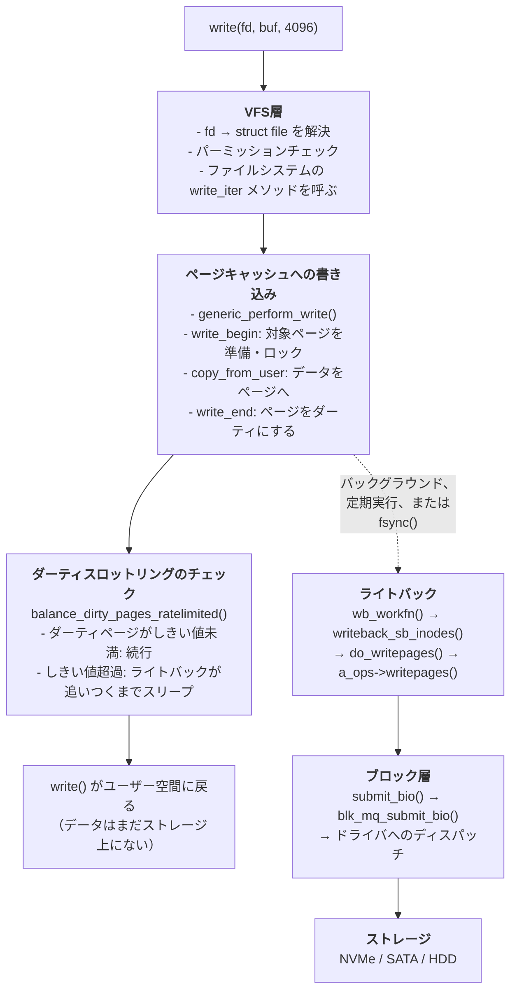
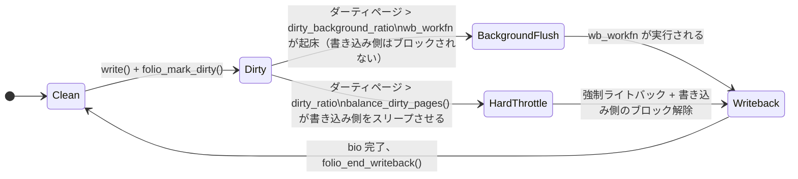

# writeの一生 {#life-of-a-write}

> write()システムコールを、ユーザー空間からページキャッシュ、ダーティスロットリング、ライトバックを経てストレージに至るまで追跡する

## ファイルに書き込むと何が起きるのか？ {#what-happens-when-you-write-to-a-file}

プログラムがファイルに書き込むとき、データがディスクへ直接書かれることはほとんどない。カーネルはデータを**ページキャッシュ**のページにコピーし、そのページを**ダーティ**とマークして、すぐに戻る。データがストレージに到達するのは後になってからである。それはOSがバックグラウンドでフラッシュするとき、メモリ逼迫によって追い出しが強制されるとき、あるいはアプリケーションが明示的に`fsync()`を呼んだときのいずれかである。



決定的に重要な点は、**write()はデータが永続化される前に戻る**ということである。これは意図的な設計判断である。書き込みをDRAMにバッファリングし、大きなバッチで非同期にフラッシュするほうが、1バイトずつ同期的に書き込むより桁違いに速い。しかしそれは、永続性を必要とするアプリケーションは`fsync()`や`O_SYNC`で明示的にそれを要求しなければならないことを意味する。

## ステージ1: write()システムコールへの入口 {#stage-1-the-write-syscall-entry}

ユーザープログラムが`write()`を呼ぶ:

```c
// ユーザー空間
ssize_t n = write(fd, buffer, 4096);

/* fs/read_write.c */
SYSCALL_DEFINE3(write, unsigned int, fd, const char __user *, buf, size_t, count)
{
    return ksys_write(fd, buf, count);
}

ssize_t ksys_write(unsigned int fd, const char __user *buf, size_t count)
{
    struct fd f = fdget_pos(fd);
    ssize_t ret = -EBADF;

    if (f.file) {
        ret = vfs_write(f.file, buf, count, file_ppos(f.file));
        fdput_pos(f);
    }
    return ret;
}
```

### システムコールからVFSへ: ksys_writeとvfs_write {#from-syscall-to-vfs-ksyswrite-and-vfswrite}

システムコールのスタブは単に`ksys_write()`を呼ぶだけである。`ksys_write()`はfdの解決をラップしており、同じロジックを`SYSCALL_DEFINE`を経由せずにカーネルコードから呼べるようにしている。`vfs_write()`はパーミッションチェックを行い、ファイルシステムへディスパッチする:

```c
// fs/read_write.c
ssize_t vfs_write(struct file *file, const char __user *buf,
                  size_t count, loff_t *pos)
{
    ssize_t ret;

    if (!(file->f_mode & FMODE_WRITE))
        return -EBADF;
    if (!(file->f_mode & FMODE_CAN_WRITE))
        return -EINVAL;
    if (!access_ok(buf, count))
        return -EFAULT;

    ret = rw_verify_area(WRITE, file, pos, count);
    if (ret)
        return ret;

    if (file->f_op->write)
        ret = file->f_op->write(file, buf, count, pos);
    else if (file->f_op->write_iter)
        ret = new_sync_write(file, buf, count, pos);
    else
        ret = -EINVAL;

    if (ret > 0) {
        fsnotify_modify(file);
        add_wchar(current, ret);
    }
    inc_syscw(current);
    return ret;
}
```

現代のファイルシステムのほぼすべてが`write_iter`パスを使う。`new_sync_write()`は同期インターフェースをイテレータベースのインターフェースにラップする:

```c
// fs/read_write.c
static ssize_t new_sync_write(struct file *filp, const char __user *buf,
                               size_t len, loff_t *ppos)
{
    struct kiocb kiocb;
    struct iov_iter iter;

    init_sync_kiocb(&kiocb, filp);
    kiocb.ki_pos = (ppos ? *ppos : 0);
    iov_iter_ubuf(&iter, ITER_SOURCE, (void __user *)buf, len);

    ret = filp->f_op->write_iter(&kiocb, &iter);

    if (ret > 0)
        *ppos = kiocb.ki_pos;
    return ret;
}
```

### kiocbとiov_iter {#the-kiocb-and-iov_iter}

2つの構造体が、操作ごとの状態を書き込みパス全体にわたって運ぶ:

```c
// include/linux/fs.h
struct kiocb {
    struct file       *ki_filp;    // 書き込み対象のファイル
    loff_t             ki_pos;     // 現在のファイルオフセット（書き込み後に更新）
    void (*ki_complete)(struct kiocb *, long); // 非同期完了コールバック（NULL = 同期）
    void              *private;
    int                ki_flags;   // IOCB_DIRECT, IOCB_SYNC, IOCB_DSYNC, ...
    u16                ki_ioprio;  // I/O優先度
    struct wait_page_queue *ki_waitq; // 非同期のページ待ち用
};
```

`iov_iter`はデータの供給元を抽象化する。ユーザーバッファ、カーネルバッファ、パイプ、あるいはスキャッタギャザーリストのいずれでもよい:

```c
// include/linux/uio.h（簡略化）
struct iov_iter {
    u8              iter_type;   // ITER_UBUF, ITER_IOVEC, ITER_BVEC, ITER_KVEC
    bool            nofault;
    bool            data_source; // ITER_SOURCE（書き込み）または ITER_DEST（読み込み）
    size_t          count;       // イテレータ内の残りバイト数
    union {
        const struct iovec *iov;
        const struct kvec  *kvec;
        const struct bio_vec *bvec;
        struct xarray      *xarray;
        void __user        *ubuf;  // ITER_UBUF 用（単一バッファの一般的なケース）
    };
    // ...
};
```

`iov_iter`を使うことで、`generic_perform_write()`はデータがユーザー空間のバッファから来るのか、カーネルバッファから来るのか、`iovec`配列から来るのかを知る必要がない。一律に`copy_page_from_iter_atomic()`を呼ぶだけである。

ほとんどのファイルシステムは`f_op->write_iter`を`generic_file_write_iter()`に結び付けている:

```c
// mm/filemap.c
ssize_t generic_file_write_iter(struct kiocb *iocb, struct iov_iter *from)
{
    struct file *file = iocb->ki_filp;
    struct inode *inode = file->f_mapping->host;
    ssize_t ret;

    inode_lock(inode);

    ret = generic_write_checks(iocb, from);
    if (ret > 0)
        ret = generic_perform_write(iocb, from);

    inode_unlock(inode);

    if (ret > 0) {
        // O_SYNC または O_DSYNC なら、戻る前にストレージへフラッシュする
        ret = generic_write_sync(iocb, ret);
    }
    return ret;
}
```

`generic_perform_write`を囲む`inode_lock()` / `inode_unlock()`は、inodeの`i_rwsem`である。これは同じファイルへの並行する書き込み側を直列化する。バッファードI/Oでは、`generic_perform_write`の中にいる書き込みは一度に1つだけである。

## ステージ2: ページキャッシュの書き込みパス {#stage-2-the-page-cache-write-path}

`generic_perform_write()`はバッファード書き込みパスのエンジンである。書き込み範囲を1ページずつループし、ページごとに`address_space_operations`（`a_ops`）ディスパッチテーブルを介してファイルシステムを呼び出す:

```c
// mm/filemap.c（簡略化）
ssize_t generic_perform_write(struct kiocb *iocb, struct iov_iter *i)
{
    struct file          *file    = iocb->ki_filp;
    struct address_space *mapping = file->f_mapping;
    const struct address_space_operations *a_ops = mapping->a_ops;
    loff_t pos = iocb->ki_pos;
    ssize_t written = 0;
    int status = 0;

    do {
        struct page *page;
        void        *fsdata = NULL;
        unsigned long offset = pos & (PAGE_SIZE - 1);  // ページ内オフセット
        unsigned long bytes  = min_t(unsigned long,
                                     PAGE_SIZE - offset,
                                     iov_iter_count(i));

        // ステップ1: 対象ページを準備する
        status = a_ops->write_begin(file, mapping, pos, bytes,
                                     &page, &fsdata);
        if (unlikely(status < 0))
            break;

        // ステップ2: ユーザーからページへコピーする
        if (mapping_writably_mapped(mapping))
            flush_dcache_page(page);
        copied = copy_page_from_iter_atomic(page, offset, bytes, i);
        flush_dcache_page(page);

        // ステップ3: ダーティにしてアンロックする
        status = a_ops->write_end(file, mapping, pos, bytes, copied,
                                   page, fsdata);
        if (unlikely(status != copied)) {
            iov_iter_revert(i, copied - max(status, 0L));
            if (unlikely(status < 0))
                break;
        }

        pos     += copied;
        written += copied;

        // ステップ4: ダーティページが多すぎればスロットリングする
        balance_dirty_pages_ratelimited(mapping);

    } while (iov_iter_count(i));

    iocb->ki_pos += written;
    return written ? written : status;
}
```

### write_begin: ページの準備 {#write_begin-preparing-the-page}

`a_ops->write_begin`は、コピーの前に対象folioを準備するためのファイルシステムのフックである。iomapベースのファイルシステムでは、`a_ops->write_begin`のディスパッチはファイルシステム自身のwrite_begin実装（例: `ext4_write_begin`）を経由し、そこからiomapの機構が呼ばれる。`iomap_write_begin()`はiomap内部のヘルパーであり、`a_ops`コールバックそのものではない。write_beginは次のことを行わなければならない:

1. 対象オフセットのページをページキャッシュ内で見つけるか、割り当てる。
2. **部分ページ書き込み**（4 KBのページ全体をカバーしない書き込み）の場合は、まずディスクから既存のページ内容を読み込み、書き込まれないバイトがディスク上の値を保持するようにする。このリードモディファイライトのパターンにより、未初期化データの露出を防ぐ。
3. 必要なファイルシステムメタデータ（例: ext4のジャーナルクレジット）を割り当てる。
4. ロックされたページを呼び出し元に返す。

```c
// fs/iomap/buffered-io.c（概念的な流れ）
static int iomap_write_begin(struct iomap_iter *iter, loff_t pos,
                              unsigned len, struct folio **foliop)
{
    struct address_space *mapping = iter->inode->i_mapping;
    struct folio *folio;

    // このファイルオフセットの folio を取得または割り当てる
    folio = iomap_get_folio(iter, pos, len);

    // 部分ページ書き込みか？ まず既存の内容を読み込む。
    if (!folio_test_uptodate(folio)) {
        // 完全には上書きされないブロックだけを読み込む
        status = iomap_read_folio_sync(iter, folio, pos, len);
    }

    *foliop = folio;
    return 0;
}
```

部分書き込み時の読み込みは、性能上の重要な懸念事項である。アプリケーションが常に4 KB境界に揃ったページ全体単位で書き込むなら、カーネルはこの余分な読み込みを省略する。データベースや書き込みに最適化されたアプリケーションが書き込みをアラインするのは、まさにこの理由による場合が多い。

### copy_page_from_iter_atomic: 実際のコピー {#copypagefromiteratomic-the-actual-copy}

ページがロックされ、uptodateになった状態で、カーネルはユーザーのイテレータからページへコピーする:

```c
// lib/iov_iter.c
size_t copy_page_from_iter_atomic(struct page *page, unsigned offset,
                                   size_t bytes, struct iov_iter *i)
{
    // kmap_local_page: ページを一時的にカーネルアドレス空間へマップする
    // （kmap_atomic() は ~5.19 以降非推奨。kmap_local_page() が現代の代替）
    // copy_from_user_inatomic: スリープせずにコピーする（ページロックを保持しているため）
    char *kaddr = kmap_local_page(page);
    size_t copied = copyout(kaddr + offset, i, bytes);
    kunmap_local(kaddr);
    return copied;
}
```

### write_end: ページをダーティにする {#write_end-marking-the-page-dirty}

`a_ops->write_end`はコピーの後に呼ばれる。これは3つのことを行う:

1. 書き込みによってファイルが伸びた場合、inodeのサイズ（`i_size`）を更新する。
2. `folio_mark_dirty()`を呼んでfolioをダーティにする。ファイルバックのページでは、`folio_mark_dirty()`（またはそのラッパー）だけを使うべきである。`SetPageDirty`のような生のフラグ設定関数は、`a_ops->dirty_folio`のディスパッチとinodeのアカウンティングを迂回してしまう。
3. ページをアンロックし、他の待機者が先に進めるようにする。

```c
// fs/iomap/buffered-io.c（簡略化）
static int iomap_write_end(struct iomap_iter *iter, loff_t pos, unsigned len,
                            unsigned copied, struct folio *folio)
{
    struct inode *inode = iter->inode;

    // 書き込みでファイルが伸びたらファイルサイズを更新する
    if (pos + copied > i_size_read(inode))
        i_size_write(inode, pos + copied);

    // folio をダーティにする — これでライトバックの対象として認識される
    folio_mark_dirty(folio);

    folio_unlock(folio);
    folio_put(folio);

    return copied;
}
```

## ステージ3: 「ダーティ」の意味 {#stage-3-what-dirty-means}

ページをダーティにすることは、「メモリに書かれたデータ」と「ディスクに書かれたデータ」を分ける重要な出来事である。カーネルはダーティページを、グローバル、ノード単位、cgroup単位で追跡する。

### folio_mark_dirtyとSetPageDirty {#foliomarkdirty-and-setpagedirty}

```c
// include/linux/pagemap.h / mm/page-writeback.c
bool folio_mark_dirty(struct folio *folio)
{
    struct address_space *mapping = folio_mapping(folio);

    if (mapping)
        return mapping->a_ops->dirty_folio(mapping, folio);
    return folio_mark_dirty_lock(folio);
}
```

`dirty_folio` a_opsフックは、ファイルシステムがバッファヘッドを使うかどうかに応じて、2つの実装のいずれかにディスパッチする:

**`filemap_dirty_folio`**（iomapベースのファイルシステムで使われる。iomapを使うext4、xfs、btrfs、f2fs。旧来のページベースの`__set_page_dirty_nobuffers`を置き換えるもの）:

```c
// mm/page-writeback.c
bool filemap_dirty_folio(struct address_space *mapping, struct folio *folio)
{
    // PG_dirty をアトミックにテスト・アンド・セットする
    if (folio_test_set_dirty(folio))
        return false;   // すでにダーティ。何もしない

    // この folio をノード単位の統計でダーティとして計上する
    folio_account_dirtied(folio, mapping);

    // inode を BDI のダーティリスト（b_dirty）に載せる
    __mark_inode_dirty(mapping->host, I_DIRTY_PAGES);
    return true;
}
```

**`__set_page_dirty_buffers`**（`struct buffer_head`でブロック単位の状態をいまだに追跡するファイルシステムで使われる。例: 一部のext2/ext3のコードパス）:

```c
// fs/buffer.c
bool block_dirty_folio(struct address_space *mapping, struct folio *folio)
{
    struct buffer_head *head, *bh;
    bool newly_dirty = false;

    spin_lock(&mapping->private_lock);
    head = folio_buffers(folio);
    bh = head;
    do {
        // 各 buffer_head もダーティにする
        if (!buffer_dirty(bh))
            mark_buffer_dirty(bh);
        bh = bh->b_this_page;
    } while (bh != head);
    spin_unlock(&mapping->private_lock);

    if (!folio_test_set_dirty(folio)) {
        folio_account_dirtied(folio, mapping);
        __mark_inode_dirty(mapping->host, I_DIRTY_PAGES);
        newly_dirty = true;
    }
    return newly_dirty;
}
```

### ダーティページのアカウンティング {#dirty-page-accounting}

`folio_account_dirtied()`は、グローバルおよびノード単位のダーティページカウンタをインクリメントする:

```c
// mm/page-writeback.c
void folio_account_dirtied(struct folio *folio,
                            struct address_space *mapping)
{
    struct inode *inode = mapping->host;
    int nr = folio_nr_pages(folio);

    // グローバルカウンタ: NR_FILE_DIRTY（すべてのダーティなファイルページ）
    node_stat_mod_folio(folio, NR_FILE_DIRTY, nr);

    // BDI 単位（デバイス単位）の帯域アカウンティング
    wb_stat_mod(inode_to_wb(inode), WB_RECLAIMABLE, nr);
}
```

これらのカウンタは直接観察できる:

```bash
# /proc/meminfo の NR_FILE_DIRTY と NR_WRITEBACK:
grep -E "^Dirty:|^Writeback:" /proc/meminfo
# Dirty:           131072 kB   ← 変更済みでまだディスク上にないページ
# Writeback:         4096 kB   ← 現在ディスクへ書き込み中のページ

# /proc/vmstat からさらに詳細を見る:
grep -E "nr_dirty|nr_writeback" /proc/vmstat
```

### __mark_inode_dirty: inodeのダーティリスト {#_markinode_dirty-the-inode-dirty-list}

ページをダーティにすると、それを所有するinodeもダーティになる。ライトバックワーカーは、これによってどのinodeにフラッシュすべきページがあるかを知る:

```c
// fs/fs-writeback.c
void __mark_inode_dirty(struct inode *inode, int flags)
{
    struct super_block *sb = inode->i_sb;
    struct bdi_writeback *wb;

    // すでにこれらのフラグでダーティなら何もしない
    if ((inode->i_state & flags) == flags)
        return;

    inode->i_state |= flags;

    // まだ載っていなければ inode を BDI の b_dirty リストへ移す
    wb = inode_to_wb(inode);
    if (list_empty(&inode->i_io_list))
        inode->dirtied_when = jiffies;

    if (!(inode->i_state & I_DIRTY))
        wb_wakeup_delayed(wb);  // 新たにダーティになった場合のみ BDI 単位のライトバックワーカーを起こす

    list_move(&inode->i_io_list, &wb->b_dirty);
}
```

## ステージ4: ダーティスロットリング {#stage-4-dirty-throttling}

書き込みのバッファリングは高速だが、書き込み側がライトバックのフラッシュよりも速くダーティページを生み出すと、メモリが埋まってしまう。これを防ぐため、`generic_perform_write()`はループの各反復で`balance_dirty_pages_ratelimited()`を呼ぶ。

### 2つのしきい値 {#the-two-thresholds}

カーネルは2つのダーティメモリしきい値を強制する。どちらも利用可能メモリに対する割合で表される:

| sysctl | デフォルト | 意味 |
|--------|---------|---------|
| `vm.dirty_background_ratio` | 10% | ソフトリミット — バックグラウンドのフラッシャを起こすが、書き込み側はブロックしない |
| `vm.dirty_ratio` | 20% | ハードリミット — ダーティページが掃けるまで書き込み側をブロックする |
| `vm.dirty_background_bytes` | 0 | バイト単位の絶対的なソフトリミット（0でなければratioより優先される） |
| `vm.dirty_bytes` | 0 | バイト単位の絶対的なハードリミット（0でなければratioより優先される） |
| `vm.dirty_writeback_centisecs` | 500 | フラッシャの起床間隔（センチ秒。500 = 5秒） |
| `vm.dirty_expire_centisecs` | 3000 | これより長くダーティなページはライトバックの対象となる（30秒） |



> **注:** `HardThrottle`状態は単一の遷移ではない。`balance_dirty_pages()`は内部でループする。書き込み側をスリープさせ、起床し、ダーティ数を再チェックし、まだしきい値を超えていれば再びスリープする。書き込み側のブロックが解除されるのは、ダーティページがリミットを下回るまで掃けたときだけである。

### balance_dirty_pages_ratelimited {#balancedirtypages_ratelimited}

レート制限付きのラッパーは、書き込みのたびに`balance_dirty_pages()`を呼ぶことを避ける。それではコストが高すぎるからである。代わりにチェックのコストを償却する:

```c
// mm/page-writeback.c
void balance_dirty_pages_ratelimited(struct address_space *mapping)
{
    struct inode *inode = mapping->host;
    struct bdi_writeback *wb = inode_to_wb(inode);
    int ratelimit;

    // 安価なチェック: このタスクは完全なチェックが必要なほどページをダーティにしたか？
    ratelimit = current->nr_dirtied_pause;
    if (current->nr_dirtied >= ratelimit)
        balance_dirty_pages(wb, current->nr_dirtied);
}
```

### balance_dirty_pages: スロットリングのループ {#balancedirtypages-the-throttling-loop}

ダーティページがハードリミットを超えると、`balance_dirty_pages()`はリミットをどれだけ超えているかに比例したスリープ時間を計算し、書き込み側を一時停止させる:

```c
// mm/page-writeback.c（簡略化）
static void balance_dirty_pages(struct bdi_writeback *wb,
                                 unsigned long pages_dirtied)
{
    for (;;) {
        unsigned long nr_dirty = global_node_page_state(NR_FILE_DIRTY);
        unsigned long dirty_thresh, bg_thresh;

        // ratio × 利用可能メモリからしきい値を計算する
        global_dirty_limits(&bg_thresh, &dirty_thresh);

        if (nr_dirty <= dirty_thresh)
            break;   // ハードリミット未満。書き込み側は続行できる

        // バックグラウンドのフラッシャを起こす（スロットリング中でも常に）
        if (nr_dirty > bg_thresh)
            wb_start_background_writeback(wb);

        // スリープ時間を計算する — リミットを超えているほど長くスリープする
        nr_reclaimable = nr_dirty - dirty_thresh;
        pause = dirty_poll_interval(nr_dirty, dirty_thresh);
        usleep_range(pause, pause + pause / 8);

        // 起床後、ループの先頭に戻って再チェックする
    }
    current->nr_dirtied = 0;
}
```

### 本番環境でどう見えるか {#what-this-looks-like-in-production}

書き込みがライトバックの処理能力を圧倒すると、`balance_dirty_pages()`が書き込み側をスリープさせ始める。その影響は目に見える:

```bash
# 書き込みスロットリングの様子を見る — D 状態のプロセスを探す:
ps aux | grep " D "

# ダーティページのウォーターマークと現在のダーティ数を観察する:
watch -n1 'grep -E "^Dirty:|^Writeback:|^NFS_Unstable:" /proc/meminfo'

# ダーティスロットリングが起きているか確認する（perf または ftrace が必要）:
perf trace -e 'balance_dirty_pages' -p <pid>

# vmstat でスロットリング関連の値を数える:
grep -E "nr_dirty_threshold|nr_dirty_background_threshold" /proc/vmstat
```

本番環境での実際の影響として、1つの大きな書き込み側が「パイプを埋め」てしまい、たまたまファイルに書き込む他のすべてのプロセスを`balance_dirty_pages()`で停止させることがある。これは書き込みの多いマシンにおけるアプリケーションのレイテンシスパイクのよくある原因である。`dirty_ratio`と`dirty_background_ratio`をチューニングするか、`dirty_bytes` / `dirty_background_bytes`（メモリサイズに応じてスケールしない）に切り替えると改善できる。

## ステージ5: 書き込みは実際にいつストレージに届くのか？ {#stage-5-when-does-the-write-actually-hit-storage}

`write()`が戻った後、データはページキャッシュにあるがディスク上にはない。最終的にそこへ到達する経路は4つある。

### 経路1: 定期ライトバック（デフォルトで5秒ごと） {#path-1-periodic-writeback-every-5-seconds-by-default}

BDI単位のライトバックワーカー`wb_workfn`は、`dirty_writeback_centisecs`センチ秒ごと（デフォルト500 = 5秒）に実行される。各実行で、`dirty_expire_centisecs`（デフォルト3000 = 30秒）より長くダーティであったページをフラッシュする。これがほとんどのワークロードにおける通常の経路である。

### 経路2: バックグラウンド比率の超過 {#path-2-background-ratio-crossed}

ダーティページが`dirty_background_ratio`を超えると、`wb_start_background_writeback()`が書き込み側を停止させることなく、ただちにフラッシャを起こす。フラッシャは書き込みと並行して実行される。

### 経路3: メモリ逼迫 {#path-3-memory-pressure}

`kswapd`が新たな割り当てのためにページを回収しようとしているとき、ダーティページはライトバックされるまで回収できない。`kswapd`はライトバックを加速するために`wakeup_flusher_threads()`を呼ぶ。ライトバックが遅すぎる場合は、`kswapd`自身がページを直接書き込むこともある。これは**ダイレクトライトバック**と呼ばれ、メモリ逼迫の兆候である。

### 経路4: 明示的な同期（fsync、fdatasync、sync） {#path-4-explicit-sync-fsync-fdatasync-sync}

永続性の保証を必要とするアプリケーションは、同期系のシステムコールのいずれかを呼ぶ:

```c
// ファイルのデータとメタデータ（サイズ、mtime）の両方を永続化する:
fsync(fd);

// ファイルのデータを永続化する。メタデータは変更がなければスキップ:
fdatasync(fd);

// すべてのファイルシステムのダーティページをフラッシュする（システム全体）:
sync();
```

`fsync`のカーネルパス:

```c
// fs/sync.c
SYSCALL_DEFINE1(fsync, unsigned int, fd)
{
    return do_fsync(fd, 0);   // 0 = データ + メタデータを同期
}

SYSCALL_DEFINE1(fdatasync, unsigned int, fd)
{
    return do_fsync(fd, 1);   // 1 = データのみ（可能ならメタデータはスキップ）
}

static int do_fsync(unsigned int fd, int datasync)
{
    struct fd f = fdget(fd);
    if (!f.file)
        return -EBADF;

    ret = vfs_fsync(f.file, datasync);
    fdput(f);
    return ret;
}

int vfs_fsync(struct file *file, int datasync)
{
    return vfs_fsync_range(file, 0, LLONG_MAX, datasync);
}

int vfs_fsync_range(struct file *file, loff_t start, loff_t end, int datasync)
{
    // ファイルシステムの fsync 実装を呼ぶ
    // （例: ext4_sync_file, xfs_file_fsync）
    return file->f_op->fsync(file, start, end, datasync);
}
```

ファイルシステムのfsync実装は次のことを行わなければならない:
1. 範囲内のすべてのダーティページをライトバックする（`filemap_write_and_wait_range`を呼ぶ）。
2. inodeのメタデータをジャーナルに書き込む（ジャーナリングファイルシステムの場合）。
3. ストレージデバイスにflush/FUAコマンドを発行する。

`fsync()`が戻った後は、書き込みは永続化されている。直後に電源が失われたとしてもである。

## ステージ6: ライトバックのパス {#stage-6-the-writeback-path}

ライトバックとは、カーネルがダーティページを実際にストレージへ書き込む処理である。これは`wb_workfn`によって駆動されるBDI単位のワーカースレッドのコンテキストで実行される。

### ライトバックのコールチェーン {#the-writeback-call-chain}

```
wb_workfn()                               fs/fs-writeback.c
  └── wb_do_writeback()
        └── writeback_inodes_wb()
              └── writeback_sb_inodes()   per-superblock iteration
                    └── __writeback_single_inode()
                          └── do_writepages()       mm/page-writeback.c
                                └── a_ops->writepages()   filesystem op
                                      └── (ext4) ext4_writepages()
                                      └── (xfs)  iomap_writepages()
                                            └── submit_bio()
                                                  └── block layer → driver → disk
```

### wb_workfnワーカー {#the-wb_workfn-worker}

```c
// fs/fs-writeback.c
void wb_workfn(struct work_struct *work)
{
    struct bdi_writeback *wb =
        container_of(to_delayed_work(work), struct bdi_writeback, dwork);

    // キューに積まれた明示的な作業（fsync、sync）を先に処理する
    while ((work_item = get_next_work_item(wb)) != NULL) {
        wb_do_writeback(wb, work_item);
        finish_writeback_work(wb, work_item);
    }

    // 次に定期/バックグラウンドのライトバックを処理する
    wb_do_writeback(wb, NULL);

    // まだダーティなデータがあれば再スケジュールする
    if (wb_has_dirty_io(wb))
        wb_wakeup_delayed(wb);
}
```

### writeback_sb_inodes: inodeごとのループ {#writebacksbinodes-the-per-inode-loop}

```c
// fs/fs-writeback.c（簡略化）
static long writeback_sb_inodes(struct super_block *sb,
                                 struct bdi_writeback *wb,
                                 struct wb_writeback_work *work)
{
    while (!list_empty(&wb->b_io)) {
        struct inode *inode = wb_inode(wb->b_io.prev);
        struct writeback_control wbc = {
            .sync_mode      = work->sync_mode,
            .nr_to_write    = writeback_chunk_size(wb, work),
            .range_cyclic   = work->range_cyclic,
            .for_kupdate    = work->for_kupdate,
            .for_background = work->for_background,
        };

        __writeback_single_inode(inode, &wbc);

        work->nr_pages -= wbc.nr_to_write;
        if (work->nr_pages <= 0)
            break;
    }
}
```

### writeback_control構造体 {#the-writeback_control-struct}

`writeback_control`は、コールチェーンを下って渡される指示パケットである。各層に対して、どれだけ、どのモードで、どんな理由で書き込むかを伝える:

```c
// include/linux/writeback.h
struct writeback_control {
    long nr_to_write;               // 書き込むページ数。ページが投入されるたびに減る
    long pages_skipped;             // 書き込めなかったページ数（ロック中など）
    loff_t range_start;             // 書き込むファイルのバイト範囲の開始
    loff_t range_end;               // ファイルのバイト範囲の終端

    enum writeback_sync_modes sync_mode;  // WB_SYNC_NONE または WB_SYNC_ALL
    // WB_SYNC_NONE: I/O の完了を待たない（バックグラウンドライトバック）
    // WB_SYNC_ALL:  I/O の完了を待つ（fsync パス）

    unsigned for_kupdate:1;         // 定期フラッシャによる実行
    unsigned for_background:1;      // dirty_background_ratio によって起動された
    unsigned tagged_writepages:1;   // タグベースのページ選択を使う
    unsigned no_cgroup_owner:1;     // cgroup ライトバックに課金しない
    unsigned range_cyclic:1;        // writeback_index から始めてファイルを巡回する
};
```

### WB_REASON: ライトバックが起動された理由 {#wb_reason-why-writeback-was-triggered}

`wb_writeback_work`構造体は、このライトバックのパスを起動したものを記録する`reason`フィールドを持つ:

```c
// fs/fs-writeback.c
enum wb_reason {
    WB_REASON_BACKGROUND,       // dirty_background_ratio を超過
    WB_REASON_VMSCAN,           // kswapd / メモリ逼迫
    WB_REASON_SYNC,             // 明示的な sync() システムコール
    WB_REASON_PERIODIC,         // dirty_writeback_centisecs タイマー
    WB_REASON_LAPTOP_TIMER,     // ラップトップモード: 遅延ライトバック
    WB_REASON_FS_FREE_SPACE,    // ファイルシステムの空き容量不足
    WB_REASON_FORKER_THREAD,    // forker スレッド（内部用）
};
```

これはライトバックのtracepointで確認でき、予期しない書き込みの嵐を診断するのに役立つ。

### do_writepagesとa_ops->writepages {#dowritepages-and-aops-writepages}

ライトバックのコールチェーンの最下部で、`do_writepages()`がファイルシステムを呼び出す:

```c
// mm/page-writeback.c
int do_writepages(struct address_space *mapping, struct writeback_control *wbc)
{
    const struct address_space_operations *a_ops = mapping->a_ops;
    int ret;

    // ファイルシステム固有の実装を優先する
    if (a_ops->writepages)
        ret = a_ops->writepages(mapping, wbc);
    else
        ret = generic_writepages(mapping, wbc);

    return ret;
}
```

iomapを使うext4とxfsでは、`a_ops->writepages`は`iomap_writepages`である。これはアドレス空間内のダーティなfolioをたどり、`iomap_begin`を呼んでブロックマッピングを取得し、`struct bio`オブジェクトを組み立てて`submit_bio()`を呼ぶ。

この処理の間のfolioの状態遷移:

```c
// ライトバック前: folio は PG_dirty
// PG_dirty はライトバック開始前に、PG_writeback とは別にクリアされる:
folio_clear_dirty_for_io(folio);  // PG_dirty をクリアする（ライトバック開始前に行われる）
folio_start_writeback(folio);     // PG_writeback をセットするだけ — PG_dirty はクリアしない

// bio 完了後（bio の end_io ハンドラ）:
folio_end_writeback(folio);    // PG_writeback をクリアし、待機者を起こす
```

## ステージ7: ブロック層への引き渡し {#stage-7-block-layer-handoff}

`submit_bio()`が呼ばれると、制御はファイルシステムからブロック層へ移る。書き込みはこの時点で`struct bio`、すなわちI/O操作の記述になっている:

```c
// include/linux/bio.h（主要フィールド）
struct bio {
    struct block_device *bi_bdev;   // 対象のブロックデバイス
    blk_opf_t            bi_opf;   // REQ_OP_WRITE, REQ_FUA, REQ_PREFLUSH, ...
    unsigned short       bi_flags;
    unsigned short       bi_ioprio;
    struct bvec_iter     bi_iter;   // bi_io_vec 内の現在位置
    bio_end_io_t        *bi_end_io; // I/O 完了時に呼ばれる
    void                *bi_private;
    struct bio_vec       bi_inline_vecs[]; // ページのスキャッタギャザーリスト
};
```

### submit_bioからblk_mq_submit_bioへ {#submitbio-to-blkmqsubmitbio}

```c
// block/blk-core.c
void submit_bio(struct bio *bio)
{
    if (blkcg_punt_bio_submit(bio))
        return;   // cgroup の I/O スケジューリング — bio は workqueue に引き渡される

    __submit_bio(bio);
}

static void __submit_bio(struct bio *bio)
{
    struct gendisk *disk = bio->bi_bdev->bd_disk;

    // 整合性チェック（DIF/DIX）
    if (!blk_crypto_bio_prep(&bio))
        return;

    disk->fops->submit_bio(bio);    // ドライバへディスパッチ、または:
    blk_mq_submit_bio(bio);         // マルチキューのパス（ほとんどの現代的なドライバ）
}
```

`blk_mq_submit_bio`は、bioを適切なハードウェアディスパッチキューに配置し、I/Oスケジューリング（BFQ、mq-deadline、none）を扱い、可能であれば隣接するbioをマージし、最終的にデバイスドライバのキューコマンド関数を呼ぶ。

リクエストキュー、I/Oスケジューラ、ドライバのディスパッチについて詳しくは、[ブロック層のドキュメント](../block/README.md)を参照。

## ステージ8: バリアと永続性の保証 {#stage-8-barriers-and-persistence-guarantees}

### O_SYNCとO_DSYNC {#osync-and-odsync}

ファイルを`O_SYNC`で開くと、すべての`write()`呼び出しが同期的になる。データとメタデータが永続化されたことをストレージデバイスが確認するまで戻らない。`O_DSYNC`はデータのみの同等版である（書き込みのたびに`fdatasync()`を行うようなもの）:

```c
// すべての書き込みが完全に永続化される（データ + メタデータ）:
int fd = open("journal.log", O_WRONLY | O_CREAT | O_SYNC, 0644);
write(fd, record, len);   // ディスクに載るまでブロック

// データは永続化される。inode の mtime は遅れることがある:
int fd = open("data.bin", O_WRONLY | O_CREAT | O_DSYNC, 0644);
write(fd, buf, len);      // データがディスクに載るまでブロック
```

これらのフラグは`kiocb`に`IOCB_SYNC` / `IOCB_DSYNC`をセットする。`generic_perform_write()`が戻った後、`generic_file_write_iter()`は次のようにチェックする:

```c
// mm/filemap.c
if (ret > 0) {
    ret = generic_write_sync(iocb, ret);
    // generic_write_sync → vfs_fsync_range → ファイルシステムの fsync
}
```

### FUA対FLUSH {#fua-vs-flush}

ブロック層は、2つの仕組みを通じてストレージデバイスに順序付けの要件を伝える:

| 仕組み | 動作 | コスト |
|-----------|-------------|------|
| `REQ_PREFLUSH` | 書き込みの前にデバイスのライトキャッシュをフラッシュする | 余分な往復 |
| `REQ_FUA`（Force Unit Access） | この特定の書き込みについてライトキャッシュを迂回する | 書き込みとほぼ同じ |
| `REQ_SYNC` | ヒント: これは同期書き込みである（優先度） | なし |

`O_DSYNC`の書き込みでは、デバイスがFUAをサポートしていれば（`/sys/block/sda/queue/fua` == 1）、ブロック層はFUAを使い、別個のフラッシュコマンドのコストを避ける。`fsync()`では、ファイルシステムはダーティページをフラッシュした後に`REQ_PREFLUSH`を発行して順序を保証する。

```bash
# FUA のサポートを確認する:
cat /sys/block/nvme0n1/queue/fua    # 1 = FUA サポートあり
cat /sys/block/sda/queue/fua        # 0 = FUA なし（古い SATA ドライブ）

# 回転ディスクのライトキャッシュの状態を確認する:
hdparm -W /dev/sda                  # 1 = ライトキャッシュ有効（揮発性）
```

### NVMeの順序付け {#nvme-ordering}

NVMeはFUAと`Flush`コマンドをネイティブにサポートしている。NVMeでは、`fsync()`は通常次のように対応付けられる:

1. すべてのダーティなデータページを書き込む（通常の書き込みコマンド）。
2. inode/ジャーナルを書き込む。
3. NVMeコントローラに`Flush`コマンドを1つ発行する。

NVMeコントローラはFlushコマンドに従うことが要求されている。Flushコマンドが完了する前に、それ以前のすべての書き込みが不揮発性ストレージにコミットされなければならない。これが`fsync()`を意味あるものにしているハードウェアの保証である。

## ステージ9: 何がうまくいかなくなりうるか {#stage-9-what-can-go-wrong}

### 揮発性ライトキャッシュの問題 {#the-volatile-write-cache-problem}

ほとんどのHDDと多くのSSDはDRAMのライトキャッシュを持つ。カーネルが書き込みを発行すると、デバイスはデータがこのキャッシュに届いた時点で、プラッタやNANDに書き込む前に完了を応答する。応答と実際の物理的な書き込みの間に電源が落ちると、データは失われる。

つまり、`fsync()`が成功して戻った後でさえ、揮発性ライトキャッシュを持つドライブでは、次のいずれかが満たされない限りデータが失われうる:

- ドライブのライトキャッシュが無効化されている（`hdparm -W 0 /dev/sda`）、または
- ドライブがFUA / Flushコマンドをサポートし、それに従う。

エンタープライズ向けのHDDやSSDは通常、バッテリーやキャパシタでバックアップされたライトキャッシュを持ち、これがこの問題を緩和する。キャッシュは短時間の電源喪失を、永続ストレージへフラッシュできるだけの時間持ちこたえる。

### アプリケーションを欺くカーネルのバッファリング {#kernel-buffering-fooling-applications}

よくある間違いとして、アプリケーションがデータを書き込み、`fsync()`なしで`close()`を呼び、`close()`が成功したからデータは安全だと思い込むことがある。実際には、`close()`はダーティページをフラッシュしない。ファイルディスクリプタの参照カウントを減らすだけである。ダーティページは`close()`が戻った後も最大30秒（`dirty_expire_centisecs`のデフォルト）ページキャッシュに残りうる。

```c
// 誤り: 永続性を保証しない
int fd = open("data", O_WRONLY | O_CREAT, 0644);
write(fd, buf, len);
close(fd);    // <-- ディスクへフラッシュしない

// 正しい:
int fd = open("data", O_WRONLY | O_CREAT, 0644);
write(fd, buf, len);
fsync(fd);    // <-- データとメタデータをストレージへフラッシュする
close(fd);
```

### rename安全性のためのディレクトリへのfsync {#fsync-on-a-directory-for-rename-safety}

ファイルのrename（ほとんどのアプリケーションが「アトミックな書き込み」を行う方法。一時ファイルに書き込み、それをrenameで所定の位置に置く）には、ファイルだけでなくディレクトリに対する`fsync()`も必要である:

```c
// データベースやエディタなどが使うアトミック書き込みパターン

// ステップ1: 一時ファイルに書き込む
int fd = open("data.tmp", O_WRONLY | O_CREAT | O_TRUNC, 0644);
write(fd, new_content, len);
fsync(fd);            // データと inode をディスクへフラッシュする
close(fd);

// ステップ2: 所定の位置へ rename する（ファイルシステム上でアトミック）
rename("data.tmp", "data");

// ステップ3: rename によるディレクトリエントリが永続化されるようディレクトリを fsync する
int dir_fd = open(".", O_RDONLY);
fsync(dir_fd);        // <-- これがないと、クラッシュ後に "data" が存在しないかもしれない
close(dir_fd);
```

ディレクトリの`fsync`がないと、クラッシュ時にrenameによるディレクトリエントリの更新がまだページキャッシュにある可能性がある。再起動後、古い名前も新しい名前も存在せず、ファイルが孤立するか失われることがある。

### ページキャッシュとダイレクトI/Oの一貫性 {#page-cache-and-direct-io-coherency}

バッファード書き込み（ページキャッシュを経由する）とダイレクト読み込み（`O_DIRECT`。キャッシュを迂回する）を混在させると、古いデータを読むことがある:

```c
// スレッドA: バッファード書き込み
write(fd, "new_value", 9);   // ページキャッシュに入る（ダーティ）

// スレッドB: ダイレクト読み込みはページキャッシュを迂回し、ディスク上の古いデータを見る
int fd_direct = open("file", O_RDONLY | O_DIRECT);
pread(fd_direct, buf, 9, 0); // ディスクから読む: 古いデータ！
```

カーネルは、ダイレクト読み込みが発行されたときにページキャッシュを自動的にフラッシュしない。バッファードI/OとダイレクトI/Oを混在させるアプリケーションは、バッファード書き込みからダイレクト読み込みに切り替える前に`fsync()`を呼ばなければならない。

### NFSと分散環境での書き込みの安全性 {#nfs-and-distributed-write-safety}

NFSでは、`write()`呼び出しはNFSクライアントでバッファリングされることがある。サーバーは、クライアントがフラッシュするまでその書き込みを見ない。NFSクライアントでの`fsync()`は、サーバーに`COMMIT` RPCを送り、サーバー自身のバッファを安定ストレージへフラッシュするよう要求する。クライアントの書き込みと`COMMIT`の間にサーバーがクラッシュすると、クライアントの`write()`が成功を返していてもデータは失われうる。これがNFSの「unstable write（不安定な書き込み）」の挙動である。

## 自分で試す {#try-it-yourself}

### straceで書き込みをトレースする {#trace-a-write-with-strace}

```bash
# コマンドの write 系システムコールをトレースする:
strace -e trace=write,fsync,fdatasync dd if=/dev/zero of=/tmp/test bs=4096 count=256

# 時間を計測しながらトレースし、どこで時間を使っているか見る:
strace -T -e trace=write,fsync dd if=/dev/zero of=/tmp/test bs=4096 count=256 oflag=sync
```

### ダーティページが溜まりフラッシュされる様子を見る {#watch-dirty-pages-accumulate-and-flush}

```bash
# dirty/writeback ページを継続的に監視する:
watch -n1 'grep -E "^Dirty:|^Writeback:|^NFS_Unstable:" /proc/meminfo'

# 別のターミナルで大きなファイルを書き込む:
dd if=/dev/zero of=/tmp/bigfile bs=1M count=512

# 観察: 書き込みがバッファされると Dirty: が上がり、ライトバックが走ると下がる
```

### fsyncのコストを測る {#measure-the-cost-of-fsync}

```bash
# バッファード書き込みのみ（fsync なし）— 速い:
time dd if=/dev/zero of=/tmp/test bs=4096 count=4096

# バッファード書き込みと最後に fsync — 少し遅い:
time dd if=/dev/zero of=/tmp/test bs=4096 count=4096 conv=fsync

# 書き込みごとに同期（O_SYNC 相当）— かなり遅い:
time dd if=/dev/zero of=/tmp/test bs=4096 count=4096 oflag=sync
```

### iostatでライトバックを観察する {#watch-writeback-with-iostat}

```bash
# デバイスごとのリアルタイム I/O 統計（1秒間隔）:
iostat -x 1

# 注目する項目:
#   wMB/s   — 書き込みスループット（ライトバック中に上昇）
#   w_await — 書き込みレイテンシ（ドライブが飽和すると上昇）
#   %util   — デバイス使用率

# ライトバックの嵐が起きると、wMB/s のスパイクに続いて、
# balance_dirty_pages() が書き込み側をスロットリングすることによるアプリケーションのレイテンシスパイクが見える。
```

### ftraceでライトバックワーカーを観察する {#observe-the-writeback-worker-with-ftrace}

```bash
# ライトバックの tracepoint を有効にする:
echo 1 > /sys/kernel/debug/tracing/events/writeback/enable
cat /sys/kernel/debug/tracing/trace_pipe &

# 別のターミナルで書き込みを発生させる:
dd if=/dev/zero of=/tmp/trace_test bs=4096 count=1024

# トレーシングを無効にする:
echo 0 > /sys/kernel/debug/tracing/events/writeback/enable

# 次のようなイベントが見えるはずである:
# wb_writeback_start: bdi=8:0 nr_pages=... reason=periodic
# writeback_dirty_inode: dev=8:0 ino=... state=I_DIRTY_PAGES
# writeback_single_inode: dev=8:0 ino=... wrote=...
```

### ダーティスロットリングのしきい値を確認する {#check-dirty-throttling-thresholds}

```bash
# 現在の sysctl 値:
sysctl vm.dirty_ratio vm.dirty_background_ratio \
       vm.dirty_writeback_centisecs vm.dirty_expire_centisecs

# ページ単位の実際のしきい値（ratio × 利用可能メモリから計算）:
grep -E "nr_dirty_threshold|nr_dirty_background_threshold" /proc/vmstat

# 書き込みの多いワークロード向けにチューニング（バッファリングを増やし、停止を減らす）:
sudo sysctl -w vm.dirty_ratio=40
sudo sysctl -w vm.dirty_background_ratio=20

# 永続性を高めるためのチューニング（より頻繁にフラッシュ）:
sudo sysctl -w vm.dirty_writeback_centisecs=100   # 1秒ごとに起床
sudo sysctl -w vm.dirty_expire_centisecs=500      # 5秒より古いページをフラッシュ
```

### BDI単位のライトバック状態を監視する {#monitor-per-bdi-writeback-state}

```bash
# すべてのバッキングデバイスを一覧する:
ls /sys/class/bdi/

# BDI 単位のライトバック統計:
cat /sys/class/bdi/*/stats

# 出力フィールドの例:
# BdiDirtyThresh: このデバイスのダーティしきい値（KB）
# BdiDirty:       このデバイス上の現在のダーティページ（KB）
# BdiWriteback:   現在ライトバック中のページ（KB）
# BdiWritten:     起動以降に書き込まれた総バイト数
```

## 主要なソースファイル {#key-source-files}

| ファイル | 役割 |
|------|--------------|
| [`mm/filemap.c`](https://git.kernel.org/pub/scm/linux/kernel/git/torvalds/linux.git/tree/mm/filemap.c) | `generic_file_write_iter`、`generic_perform_write`、`filemap_dirty_folio` |
| [`mm/page-writeback.c`](https://git.kernel.org/pub/scm/linux/kernel/git/torvalds/linux.git/tree/mm/page-writeback.c) | `balance_dirty_pages`、ダーティのアカウンティング、`do_writepages`、`folio_mark_dirty` |
| [`fs/fs-writeback.c`](https://git.kernel.org/pub/scm/linux/kernel/git/torvalds/linux.git/tree/fs/fs-writeback.c) | `wb_workfn`、`writeback_sb_inodes`、`__writeback_single_inode`、`__mark_inode_dirty` |
| [`fs/sync.c`](https://git.kernel.org/pub/scm/linux/kernel/git/torvalds/linux.git/tree/fs/sync.c) | `fsync`、`fdatasync`、`sync`システムコールの実装 |
| [`fs/read_write.c`](https://git.kernel.org/pub/scm/linux/kernel/git/torvalds/linux.git/tree/fs/read_write.c) | `vfs_write`、`ksys_write`、`new_sync_write` |
| [`include/linux/fs.h`](https://git.kernel.org/pub/scm/linux/kernel/git/torvalds/linux.git/tree/include/linux/fs.h) | `struct address_space`、`struct kiocb`、`address_space_operations` |
| [`include/linux/writeback.h`](https://git.kernel.org/pub/scm/linux/kernel/git/torvalds/linux.git/tree/include/linux/writeback.h) | `struct writeback_control`、`wb_reason` enum |
| [`fs/iomap/buffered-io.c`](https://git.kernel.org/pub/scm/linux/kernel/git/torvalds/linux.git/tree/fs/iomap/buffered-io.c) | `iomap_write_begin`、`iomap_write_end`、`iomap_writepages` |

## 参考文献 {#further-reading}

### 関連ドキュメント {#related-docs}

- [ページキャッシュのライトバック](page-cache-writeback.md) — ライトバックの仕組みの詳細
- [バッファードI/O](buffered-io.md) — ページキャッシュを通る読み書きパスの全体
- [ダイレクトI/O](direct-io.md) — `O_DIRECT`でページキャッシュを完全に迂回する
- [非同期I/O](async-io.md) — ノンブロッキングな書き込み投入のためのio_uring
- [readの一生](../mm/life-of-read.md) — このページの読み込み側の対になるページ

### LWNの記事 {#lwn-articles}

- [Writeback and control groups](https://lwn.net/Articles/648292/)（2015） — cgroup単位のライトバックのアカウンティング
- [Dynamic writeback throttling](https://lwn.net/Articles/405076/)（2010） — ダーティスロットリングの歴史
- [Flushing out pdflush](https://lwn.net/Articles/326552/) — 単一のpdflushスレッドをBDI単位のフラッシャスレッドで置き換える
- [The end of block barriers](https://lwn.net/Articles/400541/) — I/OバリアからFLUSH/FUAモデルへの移行
- [The rapid growth of io_uring](https://lwn.net/Articles/810414/)（2020） — io_uringの機能拡張の最初の1年
