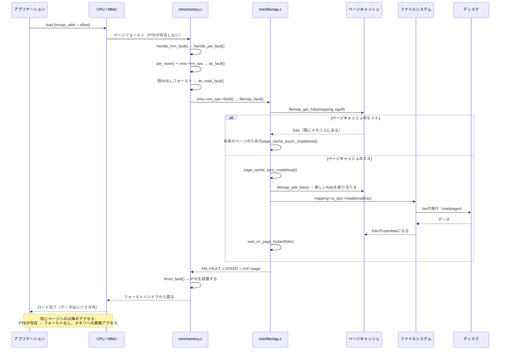

# I/Oの仕組みとしてのmmap {#mmap-as-an-io-mechanism}

> ファイルベースのmmap()をI/Oに使う: ゼロコピーの読み出し、共有書き込み、そしてページフォールトのコストが見合うのはいつか

## このページで扱う内容 {#what-this-page-covers}

`mmap()`は通常、プロセスのアドレス空間や匿名メモリの文脈で説明される。しかし通常ファイルの`mmap()`は、それ自体が完全な機能を備えたI/Oの仕組みでもある。`read()`や`write()`の代替であり、システムコールのオーバーヘッドをページフォールトのオーバーヘッドと引き換えにし、ページキャッシュをプロセスのメモリとして直接公開する。

このページでは、I/O経路としてのファイルベースmmapに焦点を当てる。匿名mmap（ヒープ、スタック、ファイルを伴わない共有メモリ）については[プロセスのアドレス空間](../mm/mmap.md)を参照。低レベルのページフォールトとVMAの仕組みについては[ファイルベースmmapとページフォールト](../mm/file-mmap.md)を参照。

---

## ファイルベースmmapとread/writeの比較 {#file-backed-mmap-vs-readwrite}

### 基本的なトレードオフ {#the-basic-trade-off}

`read()`と`write()`は汎用のI/Oインターフェースである。すべてのアクセスがシステムコールであり、カーネルはページキャッシュとユーザー空間バッファの間でデータをコピーする。

```
read() path:
  user buffer (stack/heap)
       ↑  copy_to_user()
  page cache page
       ↑  readpage (if miss)
  disk
```

`mmap()`はページキャッシュをプロセスの仮想アドレス空間に直接マップする。最初のフォールトの後、以降のアクセスは単なるロード/ストア命令であり、システムコールもコピーもない。

```
mmap() path (after fault):
  process virtual address → (page table) → page cache page
                                                 ↑  readpage (only on first fault)
                                               disk
```

2つのコストは次のように入れ替わる。

| コスト | read/write | mmap |
|------|-----------|------|
| アクセスごとのシステムコール | あり | なし（マッピング後） |
| アクセスごとの`copy_to_user` | あり | なし |
| 初回アクセス時のページフォールト | なし | あり（4KBページごと） |
| TLBへの負荷 | 低い | 高め（大きなマッピングはTLBを埋める） |
| ページテーブルエントリ | なし | マップされたページごとにPTEが1つ |

### mmapが有利な場合 {#when-mmap-wins}

**ランダムアクセスされる大きなファイル** — 検索インデックス、組み込みデータベース、任意のオフセットでアクセスされる大きなルックアップテーブルなど。`pread()`では、各アクセスがシステムコール+コピーになる。mmapでは、フォールトでページが温まった後はロード命令1つで済む。

**複数のプロセスが同じファイルを読む** — すべてのプロセスが、同じ物理的なページキャッシュのページを共有する。それらのPTEはすべて同じフレームを指す。`read()`では各プロセスが独自のユーザー空間バッファを持つため、データはRAM上に二重に存在する。mmapでは1回だけである。

**RAMに収まる読み出し中心のワークロード** — 一度フォールトインすれば、繰り返しのアクセスにカーネルはまったく関与しない。LMDB、ブロックキャッシュを無効にしたRocksDB、Luceneのセグメントファイルはいずれもこれを活用している。

**二重バッファリングの回避** — アプリケーションが`read()`の上に独自のプロセス内キャッシュを実装すると、そのキャッシュとOSのページキャッシュによって、同じバイトがRAM上に二重に存在することになる。mmapはアプリケーション側のコピーを取り除く。

### read/writeが有利な場合 {#when-readwrite-wins}

**大きなファイルのシーケンシャルなストリーミング** — 128KB〜1MBのバッファを使う`read()`は、システムコールのオーバーヘッドを多数のページで償却する。カーネルのリードアヘッドはどちらの場合も同じように働く。しかしmmapでは、128KBあたり32回のページフォールト（32 × 4KB）がフォールトのオーバーヘッドとして加わる。ここでは`read()`が勝つことが多い。`O_DIRECT`を変数から除外した場合は特にそうである。

**O_DIRECTのワークロード** — O_DIRECTはページキャッシュを完全にバイパスする。mmapにはこれができない。mmapは本質的にページキャッシュと結びついているからである。

**短命なプロセス** — 4KBの設定ファイルを読んで終了するプロセスは、何の利益もないのにmmapのセットアップコスト（カーネルがVMAを割り当て、マッピングを設置する）を支払うことになる。小さな一度きりの読み出しには`read()`の方が単純で速い。

**明示的な永続性の制御が必要な書き込み** — `write()` + `fsync()`はなじみ深く、よくテストされた経路である。mmapでの書き込みは永続性のために`msync()`を必要とし、そのセマンティクスはより微妙である（[msync()のセマンティクス](#msync-semantics)を参照）。

**ページテーブルのオーバーヘッドが支配的な場合** — 100GBのファイルをマップしてそのごく一部にしか触れない場合、100GB分のPTEが割り当てられる可能性があり、コンテキストスイッチのたびにTLBに負荷がかかる。`pread()`にはバイトあたりの仮想メモリのオーバーヘッドがない。

---

## mmap()呼び出しの構造 {#mmap-call-anatomy}

```c
#include <sys/mman.h>

void *mmap(void *addr, size_t length, int prot, int flags, int fd, off_t offset);
```

### 保護フラグ（prot） {#protection-flags-prot}

```c
PROT_READ    /* ページは読み出し可能 */
PROT_WRITE   /* ページは書き込み可能 */
PROT_EXEC    /* ページは実行可能 */
PROT_NONE    /* アクセス不可（ガードページ、userfaultfd） */
```

読み出し専用のファイルI/Oには`PROT_READ`を使う。
読み書きするファイルI/Oには`PROT_READ | PROT_WRITE`を使う。

### MAP_SHAREDとMAP_PRIVATE {#mapshared-vs-mapprivate}

`MAP_SHARED` — 書き込みはページキャッシュに直接入る。変更されたページは、同じファイルをマップしている（またはそのファイルに対して`read()`を呼ぶ）他のすべてのプロセスから見える。カーネルは、ライトバック中または`msync()`が呼ばれたときに、ダーティページをディスクに書き戻す。

`MAP_PRIVATE` — 書き込みはコピーオンライトを引き起こす。このプロセス用にページのプライベートコピーが作られる。元のページキャッシュのページには手を付けない。他のプロセスがその書き込みを目にすることはない。プライベートコピーがファイルに書き戻されることはない。

```c
/* 読み出し専用のビュー、COWのオーバーヘッドなし */
char *ro = mmap(NULL, len, PROT_READ, MAP_SHARED, fd, 0);

/* 読み書き可能、変更は全員に見え、ファイルに書き戻される */
char *rw = mmap(NULL, len, PROT_READ | PROT_WRITE, MAP_SHARED, fd, 0);

/* 読み書き可能、変更はプライベート（変更するかもしれない設定の読み込みなど） */
char *priv = mmap(NULL, len, PROT_READ | PROT_WRITE, MAP_PRIVATE, fd, 0);
```

### MAP_POPULATE: 先行フォールトイン {#map_populate-eager-fault-in}

デフォルトでは、ページは初回アクセス時に遅延してフォールトインされる。`MAP_POPULATE`は、`mmap()`呼び出しの中でマッピング全体を事前にフォールトさせるようカーネルに指示し、`readahead`を使ってI/Oをバッチ化する。ファイルベースのマッピングでは、`MAP_POPULATE`はページをフォールトインするためのI/Oを発行するが、`mmap()`が戻った時点ですべてのI/Oが完了していることは保証*しない*。匿名マッピングでは、この操作は同期的に完了する。対照的に`MADV_POPULATE_READ`は、ページが実際にフォールトインされるまでブロックする。

```c
/* mmap()はすべてのページに対してリードアヘッドを発行する（ファイルベース: I/Oはまだ処理中かもしれない） */
void *addr = mmap(NULL, len, PROT_READ, MAP_SHARED | MAP_POPULATE, fd, 0);
/* ファイルベースのマッピングでフォールトの完了を保証するには、MADV_POPULATE_READを使う */
```

これは、ワークロード全体に散らばった個々のフォールトのレイテンシが、事前の1回のI/Oバーストよりも有害な場合に有用である。LMDBは環境のオープン時に`MAP_POPULATE`を使う。

`MAP_PRIVATE`と組み合わせた`MAP_POPULATE`も事前フォールトを行うが、COWは引き起こさない。ページはページキャッシュから読み出し専用でマップされ、最初の書き込み時にCOWされる。

### MAP_FIXED: 正確なアドレスにマップする {#map_fixed-map-at-an-exact-address}

```c
/* 特定の仮想アドレスにマッピングを強制する */
/* 警告: そのアドレスにある既存のマッピングを黙って置き換える */
void *addr = mmap((void *)0x7f0000000000, len,
                  PROT_READ, MAP_SHARED | MAP_FIXED, fd, 0);
```

`MAP_FIXED_NOREPLACE`（Linux 4.17）はより安全である。既存のマッピングを黙って上書きする代わりに、`EEXIST`で失敗する。

```c
void *addr = mmap(hint, len, PROT_READ,
                  MAP_SHARED | MAP_FIXED_NOREPLACE, fd, 0);
if (addr == MAP_FAILED && errno == EEXIST)
    /* hintは使用中だった。別の場所を試す */
```

### MAP_HUGETLB: ヒュージページによるマッピング {#map_hugetlb-huge-page-mappings}

```c
#include <linux/mman.h>

/* 2MBのヒュージページを使ってファイルをマップする */
void *addr = mmap(NULL, len,
                  PROT_READ | PROT_WRITE,
                  MAP_SHARED | MAP_HUGETLB | (MAP_HUGE_2MB << MAP_HUGE_SHIFT),
                  fd, 0);
```

`MAP_HUGETLB`は主に、hugetlbfsベースのファイルや`MFD_HUGETLB`付きの`memfd_create()`向けである。通常ファイルのmmapでは、Transparent Huge Pages（THP）の方が柔軟な選択肢である。[ヒュージページとTHP](../mm/thp.md)を参照。

---

## ファイルベースmmapの読み出しの仕組み {#how-a-file-backed-mmap-read-works}

mmapしたファイル内のページへの最初のアクセスは、ハードウェアのページフォールトを引き起こす。カーネルのフォールトハンドラはVMAツリーをたどってファイルベースのVMAを見つけ、ページキャッシュから（キャッシュされていなければディスクから）ページを読み出す。以降のアクセスはページテーブルに直接ヒットし、カーネルは関与しない。



### カーネルのコードパス {#kernel-code-path}

```c
/* mm/memory.c — アーキテクチャのフォールトハンドラからの入口 */
vm_fault_t handle_mm_fault(struct vm_area_struct *vma,
                            unsigned long address, unsigned int flags,
                            struct pt_regs *regs)
{
    /* ページテーブルの各レベルをたどる/割り当てる: pgd → p4d → pud → pmd */
    return handle_pte_fault(vmf);
}

static vm_fault_t handle_pte_fault(struct vm_fault *vmf)
{
    pte_t entry = *vmf->pte;

    if (!pte_present(entry)) {
        if (pte_none(entry)) {
            if (vmf->vma->vm_ops)
                return do_fault(vmf);       /* ファイルベース */
            return do_anonymous_page(vmf);  /* 匿名 */
        }
        return do_swap_page(vmf);           /* スワップアウトされている */
    }
    /* 存在するが書き込み保護されている: コピーオンライト */
    if (vmf->flags & FAULT_FLAG_WRITE && !pte_write(entry))
        return do_wp_page(vmf);
    return 0;
}

/* mm/memory.c — 読み出し、書き込み、共有のフォールトを振り分ける */
static vm_fault_t do_fault(struct vm_fault *vmf)
{
    if (!(vmf->flags & FAULT_FLAG_WRITE))
        return do_read_fault(vmf);          /* 読み出し: ページキャッシュのページを共有する */
    if (!(vmf->vma->vm_flags & VM_SHARED))
        return do_cow_fault(vmf);           /* MAP_PRIVATEへの書き込み: COW */
    return do_shared_fault(vmf);            /* MAP_SHAREDへの書き込み: その場でダーティにする */
}
```

### filemap_fault: ページキャッシュの検索 {#filemap_fault-page-cache-lookup}

```c
/* mm/filemap.c */
vm_fault_t filemap_fault(struct vm_fault *vmf)
{
    struct file *file        = vmf->vma->vm_file;
    struct address_space *mapping = file->f_mapping;
    pgoff_t offset           = vmf->pgoff;
    struct file_ra_state *ra = &file->f_ra;
    struct folio *folio;

    /* ステップ1: ページキャッシュ（radix tree / xarray）を検索する */
    folio = filemap_get_folio(mapping, offset);

    if (!folio) {
        /* キャッシュミス */
        count_vm_event(PGMAJFAULT);         /* メジャーフォールトのカウンタ */
        mem_cgroup_count_vm_event(vma->vm_mm, PGMAJFAULT);

        /* 同期リードアヘッド: このページと周辺のページを読む */
        page_cache_sync_readahead(mapping, ra, file, offset, ra->ra_pages);

        /* folioを割り当ててページキャッシュに追加する */
        folio = filemap_alloc_folio(vmf->gfp_mask, 0);
        filemap_add_folio(mapping, folio, offset, vmf->gfp_mask);

        /* ファイルシステムのリードアヘッドを呼び出す: bioを発行する */
        mapping->a_ops->readahead(rac);
        /* → ext4_readahead → ext4_mpage_readpages → submit_bio */

        /* ディスクI/Oの完了を待つ */
        wait_on_page_locked(folio);
    } else {
        /* キャッシュヒット: このページより先のページを非同期にリードアヘッドする */
        count_vm_event(PGMINORAULT);
        page_cache_async_readahead(mapping, ra, file, folio,
                                   offset, ra->ra_pages);
    }

    vmf->page = folio_file_page(folio, offset);
    return VM_FAULT_LOCKED;
    /* do_read_faultがfinish_fault()を呼んでPTEを設置する */
}
```

`finish_fault()`がPTEを設置した後、仮想アドレスはページキャッシュ内の物理ページに直接マップされる。そのページ上の任意のバイトへの次のロードは、完全にハードウェア内で解決される。カーネルへのトラップは発生しない。

---

## MAP_SHAREDへの書き込みの仕組み {#how-writes-to-map_shared-work}

`MAP_SHARED | PROT_WRITE`では、書き込みはページキャッシュに直接入る。別個のユーザー空間バッファは存在せず、プロセスはカーネルのページキャッシュに書き込んでいる。

### 初期状態と最初の書き込みフォールト {#initial-state-and-first-write-fault}

VMAが書き込み可能とマークされていても、PTEは最初は読み出し専用で設置される。これは意図的なものである。カーネルは、ページが初めてダーティになる時点を知る必要がある。そうすることで、ダーティビットをセットし、ライトバックのための追跡を開始し、（ext4のようなジャーナリングを行うファイルシステムでは）ジャーナルトランザクションを開始できる。

```
Initial state after read fault:
  PTE → page cache page [read-only PTE]

First write to the page:
  Hardware: write to read-only page → fault
  do_shared_fault():
    1. Ensure page is in cache (__do_fault)
    2. Call vma->vm_ops->page_mkwrite (if set)
       → ext4: starts journal transaction, reserves blocks
    3. set_page_dirty(page) — mark page dirty in page cache
    4. Install writable PTE
    5. Writeback daemon (pdflush/flusher) will eventually write to disk
```

```c
/* mm/memory.c */
static vm_fault_t do_shared_fault(struct vm_fault *vmf)
{
    struct vm_area_struct *vma = vmf->vma;
    vm_fault_t ret;

    /* キャッシュ（またはディスク）からページを読む */
    ret = __do_fault(vmf);
    if (unlikely(ret & (VM_FAULT_ERROR | VM_FAULT_NOPAGE | VM_FAULT_RETRY)))
        return ret;

    /* 差し迫った書き込みをファイルシステムに通知する（ジャーナリングなど） */
    if (vma->vm_ops->page_mkwrite) {
        ret = do_page_mkwrite(vmf);
        if (unlikely(ret & (VM_FAULT_ERROR | VM_FAULT_NOPAGE)))
            return ret;
    }

    /* ダーティにして書き込み可能なPTEを設置する */
    fault_dirty_shared_page(vmf);
    return ret;
}
```

### 他のプロセスからの可視性 {#visibility-to-other-processes}

`MAP_SHARED`マッピングへの書き込みは、同じファイルをマップしている他のすべてのプロセスから即座に見える。それらは同じ物理ページを共有しており、PTEは同じフレームを指している。プロセス間の可視性のために`msync()`は不要であり、即座に反映される。

```c
/* プロセスA */
int fd = open("shared.dat", O_RDWR);
char *a = mmap(NULL, 4096, PROT_READ | PROT_WRITE, MAP_SHARED, fd, 0);
a[0] = 'X';   /* プロセスBから即座に見える */

/* プロセスB（同じファイルをオープン） */
char *b = mmap(NULL, 4096, PROT_READ | PROT_WRITE, MAP_SHARED, fd, 0);
printf("%c\n", b[0]);   /* 'X'を出力する — msyncは不要 */
```

### ディスクへのライトバック {#writeback-to-disk}

カーネルは、通常のライトバック（`dirty_expire_centisecs`、`dirty_writeback_centisecs`、`dirty_ratio`で制御される）の一環として、ダーティページを自動的にディスクに書き込む。これはアプリケーションが何もしなくても非同期に行われる。

明示的に制御するには`msync()`を使う。[msync()のセマンティクス](#msync-semantics)を参照。

---

## MAP_PRIVATE: コピーオンライトのセマンティクス {#map_private-copy-on-write-semantics}

`MAP_PRIVATE`はファイルの独立したビューを作る。読み出しはページキャッシュを共有する（コピーなし）。書き込みはページのプライベートコピーを作り、それがファイルに書き戻されることはない。

### COWフォールトの経路 {#cow-fault-path}

```
Initial (read fault, MAP_PRIVATE):
  PTE → page cache page [read-only]

First write to page:
  Hardware: write to read-only page → fault
  do_cow_fault():
    1. Allocate a fresh anonymous page
    2. __do_fault(): get the original file page
    3. copy_user_highpage(): copy file page → new anonymous page
    4. Install writable PTE → new anonymous page
    5. Page cache page untouched, original file unchanged
```

```c
/* mm/memory.c */
static vm_fault_t do_cow_fault(struct vm_fault *vmf)
{
    struct vm_area_struct *vma = vmf->vma;
    vm_fault_t ret;

    /* プライベートコピー用に新しい匿名ページを割り当てる */
    vmf->cow_page = alloc_page_vma(GFP_HIGHUSER_MOVABLE, vma, vmf->address);
    if (!vmf->cow_page)
        return VM_FAULT_OOM;

    /* 元のファイルページをvmf->pageに読み込む */
    ret = __do_fault(vmf);
    if (unlikely(ret & (VM_FAULT_ERROR | VM_FAULT_NOPAGE | VM_FAULT_RETRY)))
        goto uncharge_out;

    /* ファイルページ → プライベートページへコピーする */
    copy_user_highpage(vmf->cow_page, vmf->page, vmf->address, vma);
    __SetPageUptodate(vmf->cow_page);

    /* プライベートコピーを指すPTE（書き込み可能）を設置する */
    ret |= finish_fault(vmf);
    unlock_page(vmf->page);
    put_page(vmf->page);
    return ret;
}
```

### ファイルに対するMAP_PRIVATEの用途 {#use-cases-for-map_private-on-files}

**ローカルで変更する可能性のある読み出し専用アクセス** — プロセスが大きな読み出し専用データセットを読み込むが、いくつかのエントリをローカルで変更するかもしれない（セッション単位のキャッシュ、正規化など）場合。MAP_PRIVATEは読み出しが効率的（ページはページキャッシュと共有される）であり、書き込みも効率的（変更されたページだけがコピーされる）である。

**プロセスの分離 / forkのセマンティクス** — `fork()`の後、親と子はどちらもMAP_PRIVATEマッピングを継承する。PTEは書き込み保護されており、どちらかのプロセスでの最初の書き込みがプライベートコピーを作る。これはまさに`exec()`がテキストセグメントに対して行っていることである。

**アプリケーションレベルのスナップショットの実装** — データベースファイルをMAP_PRIVATEでマップする。現在の状態の「スナップショット」を取る。アプリケーションはスナップショットを自由に変更でき、元のファイルには手が付けられない。

```c
/* 読み出し専用のデータセットを読み込む。変更はローカルにとどまる */
int fd = open("embedding-index.bin", O_RDONLY);
struct stat st;
fstat(fd, &st);

float *index = mmap(NULL, st.st_size,
                    PROT_READ | PROT_WRITE,
                    MAP_PRIVATE,           /* 書き込みがファイルに届くことはない */
                    fd, 0);
close(fd);   /* mmapの直後にfdを閉じてよい */

/* 読み出しはページキャッシュを共有する — 変更されていないページに余分なRAMは不要 */
float score = index[1024];

/* この書き込みは、このページだけのプライベートなCOWコピーを作る */
index[42] = 0.0f;   /* ファイルに触れずに正規化する */
```

---

## msync()のセマンティクス {#msync-semantics}

`msync()`は、`MAP_SHARED`マッピング内のダーティページとディスク上のデータとの関係を制御する。

```c
#include <sys/mman.h>

int msync(void *addr, size_t length, int flags);
```

### MS_SYNC: ライトバックを待つ {#ms_sync-wait-for-writeback}

`MS_SYNC`は範囲内のすべてのダーティページのライトバックを開始し、それが完了するのを待ってから戻る。`MS_SYNC`が戻った後、データがストレージデバイスに到達していることが保証される（ただしデバイス自身の書き込みキャッシュに左右される。完全な永続性を得るには`O_SYNC`やその後の`sync_file_range()`と組み合わせること）。

```c
char *map = mmap(NULL, len, PROT_READ | PROT_WRITE, MAP_SHARED, fd, 0);

/* ... ページを変更する ... */
map[0] = 'A';
map[4096] = 'B';

/* ディスクにフラッシュして待つ */
if (msync(map, len, MS_SYNC) != 0)
    perror("msync");
/* データは今やディスク上にある */
```

### MS_ASYNC: 助言的なフラッシュ {#ms_async-advisory-flush}

`MS_ASYNC`は、カーネル2.6.19以降のLinuxでは完全に何もしない（no-op）。カーネルのライトバックデーモンが、ダーティページのフラッシュを独立して処理する。`MS_ASYNC`を呼んでも観測可能な効果はなく、POSIXのソース互換性のためだけに残されている。

```c
/* ブロックを書き込み、フラッシュをスケジュールし、処理を続ける */
memcpy(map + offset, data, chunk_size);
msync(map + offset, chunk_size, MS_ASYNC);
/* 他の作業を続ける。ライトバックはバックグラウンドで行われる */
```

### MS_INVALIDATE: キャッシュされた変更を破棄する {#ms_invalidate-discard-cached-changes}

`MS_INVALIDATE`は、範囲に対するメモリ上の変更をすべて破棄し、基になるファイルから再読み込みする。他のプロセス（またはディスク上のファイル）が背後のデータを変更した可能性があり、マッピングにディスク上の状態を反映させたい場合に使う。

```c
/* 他のプロセスがファイルに書き込んだ。こちらのビューを再読み込みする */
msync(map, len, MS_INVALIDATE);
/* 以降の読み出しではディスクからページが再フォールトされる */
```

`MS_INVALIDATE`を`MS_SYNC`と組み合わせる（`MS_SYNC | MS_INVALIDATE`として）と、まずダーティページを書き出してから無効化する。

### msyncが必要になるのはいつか {#when-is-msync-required}

| 目的 | すべきこと |
|------|-----------|
| 書き込みを他のmmapプロセスから見えるようにする | 何もしない — 自動的（共有されたページキャッシュ） |
| 書き込みを他のプロセスのread()から見えるようにする | 何もしない — 同じページキャッシュ |
| 書き込みをディスク上で永続化する（電源断に耐える） | `msync(MS_SYNC)`または`fsync(fd)` |
| `msync(MS_ASYNC)` — 2.6.19以降のLinuxではno-op | 不要（ライトバックはライトバックデーモンによって独立して行われる） |
| 外部での変更後にディスクから再読み込みする | `msync(MS_INVALIDATE)` |
| ファイルの一部分の永続化 | `sync_file_range(fd, offset, len, SYNC_FILE_RANGE_WRITE \| SYNC_FILE_RANGE_WAIT_AFTER)` |

### msyncとfsync {#msync-vs-fsync}

`fsync(fd)`と`msync(addr, len, MS_SYNC)`はどちらもダーティページをディスクにフラッシュするが、操作対象が異なる。`fsync()`はファイルディスクリプタを取り、そのファイルのすべてのダーティページ（とメタデータ）をフラッシュする。`msync()`は仮想アドレス範囲を取り、これはマッピングの部分集合（したがってファイルの部分集合）である。

ファイル全体の永続性を保証するなら、`fsync(fd)`の方が単純である。大きなファイルの一部範囲の永続性なら、特定の範囲に対する`msync()`の方が効率的である。

```c
/* ファイル全体の永続性については等価 */
msync(map, file_size, MS_SYNC);
/* 対 */
fsync(fd);
```

---

## F_SEAL_*によるファイルシーリング {#file-sealing-with-fseal}

ファイルシーリング（Linux 3.17で導入）により、プロセスはファイルディスクリプタに対する操作を恒久的に制限し、不変または部分的に不変な共有メモリ領域を作ることができる。最も有用なのは`memfd_create()`と組み合わせた場合だが、シーリングが有効な任意の`tmpfs`ファイルに適用できる。

### シールの種類 {#the-seals}

```c
#include <linux/memfd.h>
#include <fcntl.h>

/* これ以上シールを追加できないようにする */
F_SEAL_SEAL

/* write()呼び出しとMAP_SHARED | PROT_WRITEのマッピングを禁止する */
F_SEAL_WRITE

/* ファイルの縮小を禁止する */
F_SEAL_SHRINK

/* ファイルの拡大を禁止する（末尾を越える書き込み、より大きなサイズへのftruncate） */
F_SEAL_GROW

/* MAP_SHARED | PROT_WRITEを禁止するが、MAP_PRIVATE | PROT_WRITEは許可する */
F_SEAL_FUTURE_WRITE   /* Linux 5.1 */
```

### シールの適用 {#applying-seals}

```c
int fd = memfd_create("shared_data", MFD_ALLOW_SEALING);

/* 初期データを書き込む */
ftruncate(fd, DATA_SIZE);
write(fd, data, DATA_SIZE);

/* シール: 以降の書き込みやサイズ変更をすべて禁止する */
fcntl(fd, F_ADD_SEALS, F_SEAL_WRITE | F_SEAL_GROW | F_SEAL_SHRINK);

/* fdを別のプロセスに渡す。そのプロセスができること: */
/*   - MAP_SHARED | PROT_READでのmmap ✓ */
/*   - MAP_SHARED | PROT_WRITEでのmmap ✗ (EPERM) */
/*   - fdへのwrite() ✗ (EPERM) */
/*   - ftruncate() ✗ (EPERM) */

/* シールのリスト自体をシールする（これ以上シールを追加できない） */
fcntl(fd, F_ADD_SEALS, F_SEAL_SEAL);
```

### 現在のシールを問い合わせる {#query-current-seals}

```c
int seals = fcntl(fd, F_GET_SEALS);
if (seals & F_SEAL_WRITE)
    printf("file is write-sealed\n");
```

### AndroidのAshmemの置き換え {#android-ashmem-replacement}

Androidの元々の共有メモリの仕組みであるAshmemは、Android 10（APIレベル29）で`memfd_create()` + シーリングに置き換えられた。そのパターンは次のとおりである。

1. プロセスAが`memfd`を作成し、データを書き込み、`F_SEAL_WRITE | F_SEAL_SHRINK | F_SEAL_GROW`を適用する。
2. プロセスAが、Unixソケット経由で（`SCM_RIGHTS`を使って）fdをプロセスBに送る。
3. プロセスBは、mmapする前に`F_GET_SEALS`でシールを検証する。
4. プロセスBは、データが自分の下で変更されないことを知った上で、安全に`MAP_SHARED`でmmapできる。

シーリングはセキュリティ上の契約を提供する。受信側は、送信側が後からデータを変更しないと信頼することなく、送信側の約束を検証できる。

```c
/* 送信側 */
int fd = memfd_create("asset", MFD_ALLOW_SEALING);
ftruncate(fd, asset_size);
write(fd, asset_data, asset_size);
fcntl(fd, F_ADD_SEALS, F_SEAL_SEAL | F_SEAL_WRITE |
                        F_SEAL_GROW | F_SEAL_SHRINK);
send_fd_over_socket(sock, fd);

/* 受信側 */
int fd = recv_fd_from_socket(sock);
int seals = fcntl(fd, F_GET_SEALS);
assert((seals & (F_SEAL_WRITE | F_SEAL_SEAL)) ==
               (F_SEAL_WRITE | F_SEAL_SEAL));  /* 約束を検証する */
void *data = mmap(NULL, asset_size, PROT_READ, MAP_SHARED, fd, 0);
/* 安全: 送信側はデータを変更できない */
```

---

## 性能特性 {#performance-characteristics}

### ベンチマークの直感 {#benchmark-intuition}

mmapとread/writeの損益分岐点は、次の要素に依存する。

- **ファイルサイズ** — 大きなファイルはmmapに有利（VMAやフォールトのオーバーヘッドを償却できる）
- **アクセスパターン** — ランダムアクセスはmmapに強く有利。シーケンシャルアクセスでは同程度か、わずかにread()に有利
- **再利用** — 同じデータを何度も走査する場合はmmapに強く有利（フォールトが償却される）
- **CPUアーキテクチャ** — TLBのサイズが重要。x86は大きなTLBを持つが、ARMはそれより小さいことが多い

### copy_to_userの除去 {#the-copytouser-elimination}

`read()`は`copy_to_user()`を呼んで、ページキャッシュからユーザーバッファへデータを移す。ERMS（Enhanced REP MOVSB）を備えた最近のx86では高速だが、無償ではない。4KBのページでは、キャッシュの状態に応じておおよそ400〜1000nsかかる。

mmapはこのコピーを取り除く。ページフォールトの後、マップされたアドレスからのロードはページキャッシュのページに直接ヒットする（最近アクセスされていればL1/L2キャッシュに当たることもある）。同じページに何度もアクセスするワークロードでは、これは大きな利点である。

### TLBのコスト {#tlb-cost}

ページフォールトによって設置された新しいPTEは、いずれもコンテキストスイッチやTLBシュートダウンの際にTLBから追い出されなければならない。大きなマッピングはTLBに負荷をかけうる。TLBの無効化がIPIとしてブロードキャストされるマルチコアシステムでは特にそうである。

ヒュージページ（`MAP_HUGETLB`やTHPによる2MB）を使えば、TLBへの負荷は劇的に減る。1つのTLBエントリが、1つではなく512 × 4KBをカバーするからである。

```c
/* 大きなmmapに2MBのTHPを使う: TLBエントリは512分の1になる */
void *addr = mmap(NULL, 512 * 1024 * 1024,
                  PROT_READ, MAP_SHARED, fd, 0);
madvise(addr, 512 * 1024 * 1024, MADV_HUGEPAGE);
```

### mmapのページテーブルのオーバーヘッドが支配的になる場合 {#when-mmap-page-table-overhead-dominates}

ページの1%にランダムアクセスする100GBのマッピングでも、カーネルはフォールトしたすべてのページに対してPTEを割り当てる必要がある。各PTEは8バイトであり、100GB / 4KBの1% = 約260,000個のPTE = ページテーブルだけで約2MBになる。VMA自体はO(1)である。ほとんどのワークロードではこれは無視できるが、何千もの疎なマッピングがあると積み重なる。

`pread()`には、ページあたりの仮想メモリのオーバーヘッドがまったくない。

### まとめの表 {#summary-table}

| シナリオ | 勝者 | 理由 |
|----------|--------|--------|
| 大きなファイル、ランダム読み出し、複数回走査 | mmap | コピーなし、フォールトが償却される |
| 大きなファイル、ランダム読み出し、1回の走査 | 引き分け | フォールトのコスト ≈ コピーのコスト |
| シーケンシャルなストリーミング、1回の走査 | read() | リードアヘッドの効果は同等。フォールトのオーバーヘッドがない |
| 複数のプロセスが同じファイルを読む | mmap | 物理ページが共有される |
| 小さなファイル、1回だけ読む | read() | VMAとフォールトのオーバーヘッドに見合わない |
| データベースのバッファプール | O_DIRECT | ページキャッシュを完全にバイパスする |
| 組み込みキーバリューストア（LMDB） | mmap | ゼロコピー、プロセス間で共有 |
| 永続性の保証付きの書き込み | 場合による | fsyncかmsyncか。read/writeの方が単純 |

---

## I/Oのヒントとしてのmadvise() {#madvise-for-io-hints}

`madvise()`は、アプリケーションがマップされた領域にどのようにアクセスするかをカーネルに伝える。カーネルはこれらのヒントを、リードアヘッド、ページ追い出しのポリシー、THPの判断に利用する。

```c
int madvise(void *addr, size_t length, int advice);
```

### I/Oの挙動に影響するヒント {#hints-that-affect-io-behaviour}

**MADV_SEQUENTIAL** — アプリケーションはページを順番にアクセスする。カーネルはリードアヘッドのウィンドウを広げ、ページを早期の追い出し候補としてマークする（それらは順番に「使用済み」になっていくため）。大きなファイルをストリーミングで読む場合に最も重要なヒントである。

```c
madvise(map, file_size, MADV_SEQUENTIAL);
/* シーケンシャルに読む: カーネルは積極的にプリフェッチする */
for (size_t i = 0; i < file_size; i += 64)
    process_byte(map[i]);
```

**MADV_RANDOM** — アプリケーションはページをランダムな順序でアクセスする。リードアヘッドは無効になる。このヒントがないと、カーネルはすぐにはアクセスされないページをプリフェッチしてI/Oを無駄にする。

```c
madvise(map, file_size, MADV_RANDOM);
/* ランダムアクセス: 無駄なリードアヘッドがない */
uint64_t key = hash_to_page_offset(query);
return *(uint64_t *)(map + key);
```

**MADV_WILLNEED** — 指定した範囲を今すぐ非同期にプリフェッチする。カーネルはその範囲のリードアヘッドを直ちにスケジュールする。呼び出しはI/Oの完了前に戻る。計算とI/Oを重ね合わせるのに有用である。

```c
/* 現在のチャンクを処理している間に、次のチャンクのプリフェッチを開始する */
madvise(map + next_offset, CHUNK_SIZE, MADV_WILLNEED);
process_chunk(map + current_offset, CHUNK_SIZE);
/* ここに到達する頃には、次のチャンクはおそらくキャッシュにある */
```

**MADV_DONTNEED** — カーネルはこの範囲の物理ページを回収してよい。仮想マッピングは有効なまま残り、次のアクセスではディスクからページが再フォールトされる。大きなファイルのある区間を処理した後にメモリを解放するために使う。

```c
/* このチャンクの処理は終わった。物理ページを解放する */
madvise(map + processed_offset, CHUNK_SIZE, MADV_DONTNEED);
```

**MADV_FREE**（Linux 4.5） — `MADV_DONTNEED`に似ているが遅延的である。ページは解放候補としてマークされるが、すぐには回収されない。メモリ圧迫が低ければ、次のアクセス時にもまだメモリ上にあるかもしれない（フォールトを避けられる）。呼び出し元がデータを再び必要と「するかもしれない」再利用パターンで有用である。

### MADV_POPULATE_READとMADV_POPULATE_WRITE（Linux 5.14） {#madvpopulateread-and-madvpopulatewrite-linux-514}

これらのヒントは、呼び出し元のスレッドが各ページにアクセスすることなく、フォールトをシミュレートして範囲を明示的に事前に埋める。

```c
/* 読み出し用にページを事前フォールトする: MAP_POPULATEと同等だが、mmap後に行う */
madvise(map, file_size, MADV_POPULATE_READ);

/* 書き込み用にページを事前フォールトする: MAP_PRIVATE領域ではCOWを引き起こす */
madvise(map, file_size, MADV_POPULATE_WRITE);
```

`MADV_POPULATE_READ`は、他のセットアップを続けながら範囲に対するI/Oを開始したい場合に有用である。`MADV_WILLNEED`とは異なり、戻る前にページが完全にフォールトインされていること（単にスケジュールされただけではないこと）を保証する。`MAP_POPULATE`に似ているが、mmap後の任意の時点で部分範囲に適用できる。

`MAP_PRIVATE`マッピングに対する`MADV_POPULATE_WRITE`は、すべてのCOWフォールトを事前に発生させるため、実際の書き込みの前にプロセスはすべてのページの書き込み可能なコピーを所有することになる。これによりホットパスからCOWのレイテンシが取り除かれる。

### カーネルの実装 {#kernel-implementation}

```c
/* mm/madvise.c */
static long madvise_behavior(struct vm_area_struct *vma,
                              struct vm_area_struct **prev,
                              unsigned long start, unsigned long end,
                              int behavior)
{
    struct mm_struct *mm = vma->vm_mm;
    int error = 0;
    pgoff_t pgoff;
    unsigned long new_flags = vma->vm_flags;

    switch (behavior) {
    case MADV_SEQUENTIAL:
        new_flags |= VM_SEQ_READ;
        new_flags &= ~VM_RAND_READ;
        break;
    case MADV_RANDOM:
        new_flags |= VM_RAND_READ;
        new_flags &= ~VM_SEQ_READ;
        break;
    case MADV_DONTNEED:
        return madvise_dontneed_single_vma(vma, start, end);
    case MADV_WILLNEED:
        return madvise_willneed(vma, prev, start, end);
    /* ... */
    }
    /* VMAのフラグを更新する */
    vma = vma_modify_flags(vma, prev, start, end, new_flags);
}

/* filemap_faultはvm_flagsを読んでリードアヘッドのサイズを設定する */
/* mm/filemap.c */
if (vma->vm_flags & VM_RAND_READ)
    ra->ra_pages = 0;    /* リードアヘッドを無効にする */
if (vma->vm_flags & VM_SEQ_READ)
    ra->ra_pages = max(ra->ra_pages, bdi->ra_pages);
```

---

## 実践的な例 {#practical-examples}

### 例1: 読み出し専用のデータファイル {#example-1-read-only-data-file}

ランダムアクセス用に、大きな読み出し専用ファイル（例えば事前に構築されたルックアップテーブル）をマップする。

```c
#include <fcntl.h>
#include <sys/mman.h>
#include <sys/stat.h>
#include <stdio.h>
#include <stdlib.h>
#include <unistd.h>

struct lookup_entry {
    uint64_t key;
    uint64_t value;
};

struct lookup_table {
    const struct lookup_entry *entries;
    size_t count;
    void *map_addr;
    size_t map_size;
};

int lookup_open(struct lookup_table *tbl, const char *path)
{
    int fd = open(path, O_RDONLY);
    if (fd < 0)
        return -1;

    struct stat st;
    if (fstat(fd, &st) < 0) {
        close(fd);
        return -1;
    }

    /* ランダムアクセス: リードアヘッドを無効にする */
    void *addr = mmap(NULL, st.st_size, PROT_READ, MAP_SHARED, fd, 0);
    close(fd);   /* mmapの後はfdはもう不要 */

    if (addr == MAP_FAILED)
        return -1;

    madvise(addr, st.st_size, MADV_RANDOM);

    tbl->map_addr  = addr;
    tbl->map_size  = st.st_size;
    tbl->entries   = addr;
    tbl->count     = st.st_size / sizeof(struct lookup_entry);
    return 0;
}

uint64_t lookup_query(const struct lookup_table *tbl, uint64_t key)
{
    /* 二分探索: O(log N)個のページに触れ、新しいページごとにフォールトのコストがかかる */
    size_t lo = 0, hi = tbl->count;
    while (lo < hi) {
        size_t mid = lo + (hi - lo) / 2;
        if (tbl->entries[mid].key == key)
            return tbl->entries[mid].value;
        if (tbl->entries[mid].key < key)
            lo = mid + 1;
        else
            hi = mid;
    }
    return 0;
}

void lookup_close(struct lookup_table *tbl)
{
    munmap(tbl->map_addr, tbl->map_size);
}
```

### 例2: メモリマップドデータベース（LMDBのパターン） {#example-2-memory-mapped-database-lmdb-pattern}

LMDB（Lightning Memory-Mapped Database）は、データファイル全体をプロセスのアドレス空間にマップし、ポインタの参照外しによってBツリーをたどる。これはmmapをデータベースとして使う典型的なパターンである。

```c
#include <fcntl.h>
#include <sys/mman.h>
#include <sys/stat.h>
#include <stdio.h>
#include <stdint.h>

#define DB_MAX_SIZE (1UL << 32)   /* 4GBの仮想アドレス空間を予約 */

typedef struct {
    uint32_t magic;
    uint32_t version;
    uint64_t root_pgno;         /* Bツリーのルートのページ番号 */
    uint64_t num_pages;
} db_meta_t;

typedef struct {
    void    *addr;              /* mmapのベースアドレス */
    size_t   map_size;          /* 現在のマッピングサイズ */
    int      fd;
} db_env_t;

int db_open(db_env_t *env, const char *path)
{
    env->fd = open(path, O_RDWR | O_CREAT, 0644);
    if (env->fd < 0)
        return -1;

    struct stat st;
    fstat(env->fd, &st);

    /* 予約したアドレス空間全体を最初にマップする。
     * 物理ページはファイルが大きくなるにつれてのみ割り当てられる。
     * LMDBはまさにこれを行う — DB_MAX_SIZEをマップするが、ファイルは小さく始まる。 */
    env->map_size = DB_MAX_SIZE;
    env->addr = mmap(NULL, env->map_size,
                     PROT_READ | PROT_WRITE,
                     MAP_SHARED,      /* 書き込みはファイルに届く */
                     env->fd, 0);
    if (env->addr == MAP_FAILED)
        return -1;

    /* メタページ（常にページ0）を読む */
    db_meta_t *meta = env->addr;
    if (meta->magic != 0xBEEFCAFE) {
        /* 新しいデータベース: メタページを初期化する */
        meta->magic    = 0xBEEFCAFE;
        meta->version  = 1;
        meta->root_pgno = 1;
        meta->num_pages = 2;
        msync(env->addr, 4096, MS_SYNC);   /* メタページを永続的に書き込む */
    }

    return 0;
}

/* ページへのアクセス: 最初のフォールトの後は単なるポインタの参照外し */
static inline void *db_page(db_env_t *env, uint64_t pgno)
{
    return (char *)env->addr + (pgno * 4096);
}

void db_close(db_env_t *env)
{
    msync(env->addr, env->map_size, MS_SYNC);  /* ダーティページをフラッシュする */
    munmap(env->addr, env->map_size);
    close(env->fd);
}
```

LMDBの主要な設計上のポイント:

- マッピングは`MAP_SHARED`である — 書き込みはすべての読み出し側プロセスから即座に見える。
- 読み出し側は、読み出し専用アクセスのためのロックを必要としない。Bツリーはデータベースレベルでのコピーオンライト（OSのCOWではなく、MVCCページ）によって更新されるからである。
- `msync(MS_SYNC)`は書き込みのたびではなく、トランザクションのコミット時にのみ呼ばれる。
- 仮想アドレス空間全体を最初に予約する。カーネルは実際にアクセスされたページに対してのみPTE（と物理ページ）を割り当てる。

### 例3: ファイルベースmmapによる共有メモリIPC {#example-3-shared-memory-ipc-via-file-backed-mmap}

2つのプロセスが、通常ファイルをバックエンドとするリングバッファを共有する。

```c
/* shared_ring.h */
#define RING_MAGIC   0xABCD1234
#define RING_ENTRIES 256

typedef struct {
    uint32_t magic;
    uint32_t head;          /* プロデューサはここに書き込む */
    uint32_t tail;          /* コンシューマはここから読む */
    uint32_t _pad;
    char     data[RING_ENTRIES][64];   /* 固定サイズのスロット */
} ring_t;

/* プロデューサ */
int ring_produce(ring_t *ring, const char *msg, size_t len)
{
    uint32_t next = (ring->head + 1) % RING_ENTRIES;
    if (next == ring->tail)
        return -1;  /* 満杯 */

    memcpy(ring->data[ring->head], msg, len < 64 ? len : 63);
    /* headを更新する前のコンパイラ/CPUのメモリバリア */
    __atomic_store_n(&ring->head, next, __ATOMIC_RELEASE);
    return 0;
    /* msyncは不要: コンシューマは同じページキャッシュのページを共有している */
}

/* コンシューマ */
int ring_consume(ring_t *ring, char *out, size_t out_len)
{
    if (__atomic_load_n(&ring->tail, __ATOMIC_ACQUIRE) ==
        __atomic_load_n(&ring->head, __ATOMIC_ACQUIRE))
        return -1;  /* 空 */

    memcpy(out, ring->data[ring->tail], out_len < 64 ? out_len : 63);
    __atomic_store_n(&ring->tail,
                     (ring->tail + 1) % RING_ENTRIES,
                     __ATOMIC_RELEASE);
    return 0;
}

/* セットアップ（両方のプロセス） */
ring_t *ring_open(const char *path)
{
    int fd = open(path, O_RDWR | O_CREAT, 0600);
    ftruncate(fd, sizeof(ring_t));

    ring_t *r = mmap(NULL, sizeof(ring_t),
                     PROT_READ | PROT_WRITE,
                     MAP_SHARED,    /* 必須: ページキャッシュを共有する */
                     fd, 0);
    close(fd);

    if (r->magic != RING_MAGIC) {
        r->magic = RING_MAGIC;
        r->head  = 0;
        r->tail  = 0;
    }
    return r;
}
```

このIPCの仕組みでは、プロセス間の可視性のために`msync()`は必要ない。`MAP_SHARED`のページは、両方のプロセスで同じ物理ページだからである。必要な同期は、head/tailのインデックスに対するアトミック操作だけである。`msync(MS_SYNC)`が必要になるのは、データがクラッシュを生き延びなければならない場合だけである。

---

## 参考文献 {#further-reading}

- [ファイルベースmmapとページフォールト](../mm/file-mmap.md) — VMAの内部、ページフォールトの仕組み、リードアヘッド
- [ページキャッシュ](../mm/page-cache.md) — すべてのファイルベースmmapが共有するバッキングストア
- [Direct I/O](direct-io.md) — 代替手段: ページキャッシュを完全にバイパスする
- [バッファードI/O](buffered-io.md) — ページキャッシュを通るread/writeの経路
- [コピーオンライト](../mm/cow.md) — MAP_PRIVATEのCOWの仕組みの詳細
- [プロセスのアドレス空間](../mm/mmap.md) — VMAのレイアウト、munmap、mremap
- [ヒュージページとTHP](../mm/thp.md) — 大きなマッピングでのTLBへの負荷を減らす
- [userfaultfd](../mm/userfaultfd.md) — ユーザー空間からページフォールトを横取りする
- `mm/filemap.c` — `filemap_fault()`、`filemap_get_folio()`、リードアヘッド
- `mm/memory.c` — `do_fault()`、`do_cow_fault()`、`do_shared_fault()`
- `mm/mmap.c` — `mmap_region()`、VMAの作成
- `mm/madvise.c` — `madvise()`の実装
