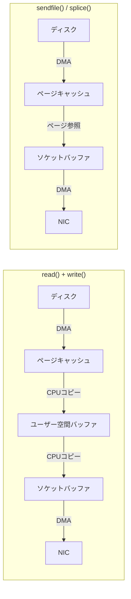

# ゼロコピーI/O: splice、sendfile、およびその仲間 {#zero-copy-io-splice-sendfile-and-friends}

> ユーザー空間を経由せずにファイルディスクリプタ間でデータを移動する

## 問題: 不要なコピー {#the-problem-unnecessary-copies}

ファイルをネットワークソケット経由で送り出す素朴な方法は次のとおりである。

```c
/* 古典的なread+writeループ — コピー2回、コンテキストスイッチ4回 */
char buf[65536];
ssize_t n;
while ((n = read(file_fd, buf, sizeof buf)) > 0)
    write(sock_fd, buf, n);
```

ループの各反復で、ユーザー空間を往復するコストを丸ごと支払う。なぜそれが問題なのかを理解するため、カーネルが実際に何をしているかを追ってみる。

```
┌─────────────────────────────────────────────────────────────────┐
│  Traditional read() + write() data path                         │
│                                                                 │
│  1. read(file_fd, buf, n)                                       │
│     ┌──────┐  DMA   ┌───────────────┐  CPU copy  ┌──────────┐   │
│     │ Disk │──────► │ Kernel page   │──────────► │ Userspace│   │
│     └──────┘        │ cache         │            │ buffer   │   │
│                     └───────────────┘            └──────────┘   │
│                                                                 │
│  2. write(sock_fd, buf, n)                                      │
│     ┌──────────┐  CPU copy  ┌─────────────────┐  DMA   ┌─────┐  │
│     │ Userspace│──────────► │ Socket send     │──────► │ NIC │  │
│     │ buffer   │            │ buffer (sk_buff)│        └─────┘  │
│     └──────────┘            └─────────────────┘                 │
│                                                                 │
│  Copies: 4 (disk→pagecache, pagecache→user, user→skbuff,        │
│             skbuff→NIC)                                         │
│  Context switches: 4 (user→kernel read, kernel→user,            │
│                        user→kernel write, kernel→user)          │
└─────────────────────────────────────────────────────────────────┘
```

毎秒数百メガバイトを送り出す静的ファイルのWebサーバーでは、これらのCPUコピーが積み重なる。カーネルのページキャッシュは既にファイルデータを保持しており、ネットワークスタックが必要とするのはそれへの参照だけである。ユーザー空間を経由するコピーは純粋なオーバーヘッドである。

Linuxはこれらを取り除く3つのシステムコール、`sendfile(2)`、`splice(2)`、`vmsplice(2)`を提供している。4つ目の`copy_file_range(2)`は、ファイルからファイルへの転送でコピーを取り除く。



ゼロコピー経路では、バイトをコピーする代わりに**ページ参照**（ポインタと長さ）を渡す。その後、NICのスキャッタギャザーDMAがページキャッシュのページから直接読み出す。データのバイトを移動するのにCPUはまったく関与しない。

---

## `sendfile(2)` — ユーザー空間を経由しないファイルからソケットへの転送 {#sendfile2-file-to-socket-without-userspace}

`sendfile`はLinux 2.2で追加された、最も単純なゼロコピーインターフェースである。カーネル内でファイルからソケットへ直接データを転送する。

```c
#include <sys/sendfile.h>

ssize_t sendfile(int out_fd, int in_fd, off_t *offset, size_t count);
```

- `out_fd` — ソケットでなければならない（カーネル2.6.33以降ではパイプも可）
- `in_fd` — 通常ファイルまたはブロックデバイスでなければならない。`mmap`的なアクセスをサポートしている必要がある
- `offset` — NULLでなければ、読み出しはここから始まり、戻り時に更新される。ファイルの位置は変わらない
- `count` — 転送するバイト数。カーネルは`count`バイトを送信するかエラーになるまで内部でループする

```c
/* HTTPでファイルを送出する — 典型的なsendfileのパターン */
#include <sys/sendfile.h>
#include <sys/stat.h>
#include <fcntl.h>

void serve_file(int sock_fd, const char *path)
{
    int file_fd = open(path, O_RDONLY);
    if (file_fd < 0) { /* エラー処理 */ return; }

    struct stat st;
    fstat(file_fd, &st);

    off_t offset = 0;
    ssize_t remaining = st.st_size;

    while (remaining > 0) {
        ssize_t sent = sendfile(sock_fd, file_fd, &offset, remaining);
        if (sent < 0) {
            if (errno == EAGAIN || errno == EINTR) continue;
            break;  /* 本当のエラー */
        }
        remaining -= sent;
    }

    close(file_fd);
}
```

### sendfileがカーネル内で行うこと {#what-sendfile-does-in-the-kernel}

内部的に`sendfile`は`fs/read_write.c`の`do_sendfile`を呼び出し、これは次の処理を行う。

1. `in_file->f_op->splice_read`を呼び出し、一時的なパイプをファイルのページ参照で満たす
2. `sock_sendpage`（または`generic_splice_sendpage`）を呼び出し、それらのページ参照を`skb_frag_t`エントリとしてソケットの送信バッファに渡す
3. NICがスキャッタギャザーDMA（`NETIF_F_SG`）をサポートしていれば、NICはページキャッシュのページを直接読み出す — CPUによるコピーはゼロ

NICがスキャッタギャザーをサポートしていない場合、カーネルはページキャッシュから連続した`sk_buff`への1回のコピーにフォールバックする。それでも`read+write`経路よりコピーが1回少ない。

### ノンブロッキングのsendfile {#non-blocking-sendfile}

Linuxの`sendfile(2)`はフラグ引数を取らない。ノンブロッキングの挙動を得るには、出力側ソケットに`O_NONBLOCK`をセットする。ソケットバッファが満杯のとき、`sendfile`は`EAGAIN`を返す。

```c
/* 非同期sendfileのため出力ソケットをノンブロッキングにする */
fcntl(sock_fd, F_SETFL, O_NONBLOCK);
/* ソケットバッファが満杯ならsendfileはEAGAINを返す */
ret = sendfile(sock_fd, file_fd, &offset, len);
if (ret == -1 && errno == EAGAIN) {
    /* poll/epollでソケットが書き込み可能になるのを待つ */
}
```

### nginxとsendfile {#nginx-and-sendfile}

nginxはデフォルトで`sendfile`を有効にしている。

```nginx
http {
    sendfile        on;
    tcp_nopush      on;   # TCP_CORK: 小さなヘッダを最初のデータチャンクとまとめる
    tcp_nodelay     on;   # corkの解除後にフラッシュする
    sendfile_max_chunk 512k;   # 他の接続を飢餓状態にしないよう1回あたりの量を制限する
}
```

`tcp_nopush`は`sendfile`の前に`TCP_CORK`をセットし、HTTPヘッダとファイル本体の先頭が1つのTCPセグメントで送出されるようにしてから、corkを解除する。

### sendfileの制限 {#sendfile-limitations}

- `out_fd`はソケット（またはパイプ）でなければならず、ファイルからファイルへの転送はできない
- 変換処理（圧縮、暗号化）を挟むことはできない — それらはデータに触れる必要がある
- HTTPSでは、kTLS（`SO_TLS_TX`）なしにsendfileを使えない。[kTLS](../net/ktls.md)を参照
- オフセットは`off_t`のサイズに制限される — `sendfile64`を使う（64ビットではglibcがこれを`sendfile`にマップする）

---

## `splice(2)` — 一般化 {#splice2-the-generalisation}

`splice`はJens AxboeによってLinux 2.6.17で導入され、ファイルからソケットへのケースを一般化したものである。**少なくとも一方がパイプである**任意の2つのファイルディスクリプタ間でデータを転送する。

```c
#define _GNU_SOURCE
#include <fcntl.h>

ssize_t splice(int fd_in,  loff_t *off_in,
               int fd_out, loff_t *off_out,
               size_t len, unsigned int flags);
```

- `fd_in` / `fd_out` — 転送元と転送先。一方はパイプでなければならない
- `off_in` / `off_out` — ファイルオフセット（戻り時に更新される）。パイプの場合はNULLでなければならない
- `len` — この呼び出しで移動する最大バイト数
- `flags` — `SPLICE_F_MOVE | SPLICE_F_NONBLOCK | SPLICE_F_MORE | SPLICE_F_GIFT`

### フラグ {#flags}

| フラグ | 意味 |
|------|---------|
| `SPLICE_F_MOVE` | ヒント: ページをコピーではなく移動する（カーネルは無視することがある） |
| `SPLICE_F_NONBLOCK` | パイプI/Oでブロックしない。ファイルI/Oはブロックする可能性がある |
| `SPLICE_F_MORE` | さらにデータが続く。ソケット層へのヒント（`MSG_MORE`と同様） |
| `SPLICE_F_GIFT` | `vmsplice`で使う。ユーザーページを恒久的にカーネルへ譲渡する |

### パイプ経由のファイルからソケットへの転送 {#file-to-socket-via-a-pipe}

`sendfile`は、パイプを介した2回の`splice`呼び出しでエミュレートできる。

```c
/* spliceベースのファイルからソケットへの転送（sendfileを一般化したもの） */
int pfd[2];
pipe(pfd);

off_t offset = 0;
ssize_t remaining = file_size;

while (remaining > 0) {
    /* ステップ1: ファイル → パイプの読み出し端（パイプバッファにページ参照を追加する） */
    ssize_t n = splice(file_fd, &offset, pfd[1], NULL,
                       remaining, SPLICE_F_MOVE | SPLICE_F_MORE);
    if (n <= 0) break;

    /* ステップ2: パイプの書き込み端 → ソケット（ページ参照をskbフラグメントとして送る） */
    ssize_t sent = 0;
    while (sent < n) {
        ssize_t r = splice(pfd[0], NULL, sock_fd, NULL,
                           n - sent, SPLICE_F_MOVE | SPLICE_F_MORE);
        if (r <= 0) goto done;
        sent += r;
    }
    remaining -= n;
}
done:
close(pfd[0]);
close(pfd[1]);
```

### 有効なspliceの組み合わせ {#valid-splice-combinations}

```
file  → pipe  ✓   (adds page refs from page cache into pipe)
pipe  → file  ✓   (writes pipe buffer pages into a file)
pipe  → socket ✓  (passes pipe buffer pages as socket frags)
pipe  → pipe  ✓   (moves pipe_buffer references between pipes)
file  → file  ✗   (EINVAL — neither fd is a pipe)
socket → pipe ✓   (drains socket receive buffer into pipe)
```

---

## `tee(2)` — パイプのデータを消費せずに複製する {#tee2-duplicating-pipe-data-without-consuming-it}

`tee`は、2つのパイプのファイルディスクリプタ間で、転送元からデータを取り除かずにデータをコピーする。ページは参照で共有され、バイトはコピーされない。

```c
ssize_t tee(int fd_in, int fd_out, size_t len, unsigned int flags);
```

`fd_in`と`fd_out`はどちらもパイプでなければならない。`tee`の後も、データは`fd_in`から読み出せる状態のまま残り、`fd_out`でも利用可能になる。

### ログを取りつつ転送するパターン {#log-and-forward-pattern}

```c
/*
 * 転送元から読み出し、すべてのバイトをディスクにログとして記録し、
 * 同時に下流のソケットへ転送する。
 */
int src_pipe[2];    /* データはここに到着する */
int log_pipe[2];    /* ログ用のコピー */

pipe(src_pipe);
pipe(log_pipe);

/* プロデューサがsrc_pipe[1]を満たす */

/* --- コンシューマのループ --- */
while (1) {
    /* 1. src_pipe → log_pipeに複製する（ページは共有され、消費されない） */
    ssize_t n = tee(src_pipe[0], log_pipe[1], 65536, SPLICE_F_NONBLOCK);
    if (n < 0 && errno == EAGAIN) {
        /* まだteeするものがない */
        poll_on(src_pipe[0]);
        continue;
    }

    /* 2. log_pipeをディスクにフラッシュする（log_pipe側を消費する） */
    splice(log_pipe[0], NULL, log_fd, &log_offset, n, SPLICE_F_MOVE);

    /* 3. src_pipeから消費 → 下流のソケット */
    splice(src_pipe[0], NULL, downstream_fd, NULL, n, SPLICE_F_MOVE);
}
```

これはGNU coreutilsの`tee(1)`の基礎になっている。`tee(1)`は、転送元と転送先がどちらもパイプの場合に内部で`tee(2)`を使う。

---

## spliceの内部動作 {#how-splice-works-internally}

### ページ参照キューとしてのパイプ {#the-pipe-as-a-page-reference-queue}

中心となるデータ構造は`struct pipe_inode_info`（`include/linux/pipe_fs_i.h`）であり、`struct pipe_buffer`エントリのリングを含んでいる。

```c
/* include/linux/pipe_fs_i.h */
struct pipe_buffer {
    struct page             *page;    /* 実際のページ */
    unsigned int             offset;  /* ページ内のバイトオフセット */
    unsigned int             len;     /* バイト数 */
    const struct pipe_buf_operations *ops;
    unsigned int             flags;
    unsigned long            private;
};

struct pipe_inode_info {
    struct mutex             mutex;
    wait_queue_head_t        rd_wait, wr_wait;
    unsigned int             head;    /* 次に書き込むスロットのインデックス */
    unsigned int             tail;    /* 次に読み出すスロットのインデックス */
    unsigned int             ring_size;
    unsigned int             nr_accounted;
    unsigned int             readers;
    unsigned int             writers;
    unsigned int             files;
    unsigned int             r_counter;
    unsigned int             w_counter;
    unsigned int             poll_usage;
    struct page             *tmp_page;
    struct fasync_struct    *fasync_readers;
    struct fasync_struct    *fasync_writers;
    struct pipe_buffer      *bufs;   /* pipe_bufferのリングバッファ */
    struct user_struct      *user;
#ifdef CONFIG_WATCH_QUEUE
    struct watch_queue      *watch_queue;
#endif
};
```

`splice(file_fd, ..., pipe_wr, ...)`が実行されると、`do_splice_to`は`file->f_op->splice_read`（例えば通常ファイルなら`filemap_splice_read`）を呼び出す。この関数はページキャッシュ内のページを見つけ、コピーではなくそれらへの参照を、パイプリング内の`pipe_buffer`エントリとして設置する。ページの参照カウントがインクリメントされるだけで、データは移動しない。

`splice(pipe_rd, ..., sock_fd, ...)`が実行されると、`do_splice_from`は`sock_splice_write`（またはソケットの`splice_write`ファイル操作）を呼び出す。TCPの場合、これは`tcp_sendpage`を呼び出し、ページを`sk_buff`内のフラグメントとして付加する。ここでもコピーではなく参照による。

バイトが最終的にマシンを離れるのは、送信リング内のスキャッタギャザーディスクリプタに従って、NICのDMAエンジンがページキャッシュのページを直接読み出すときである。

### splice_from_pipeとsplice_to_pipe {#splice_from_pipe-and-splice_to_pipe}

カーネルは、ファイルシステムやソケットのドライバが使う2つのヘルパーをエクスポートしている。

```c
/* fs/splice.c — ソケット/ファイルのsplice_write実装から呼ばれる */
ssize_t splice_from_pipe(struct pipe_inode_info *pipe,
                         struct file *out,
                         loff_t *ppos, size_t len,
                         unsigned int flags,
                         splice_actor *actor);

/* fs/splice.c — ファイルのsplice_read実装から呼ばれる */
ssize_t splice_to_pipe(struct pipe_inode_info *pipe,
                       struct splice_pipe_desc *spd);
```

`splice_from_pipe`はパイプの`pipe_buffer`リングを走査し、バッファごとに1回`actor`コールバック（例えばソケットなら`pipe_to_sendpage`、ファイルなら`pipe_to_file`）を呼び出す。actorはページをコピーせずに引き渡す。

### spliceがコピーにフォールバックせざるを得ない場合 {#when-splice-must-fall-back-to-copying}

すべての組み合わせが、カーネルレベルで真にゼロコピーになるわけではない。

- **`O_DIRECT`のファイル**: ダイレクトI/Oはページキャッシュをバイパスするため、参照すべきキャッシュ済みページが存在しない。カーネルは一時的なページにコピーしなければならない。
- **一部の暗号化ファイルシステム**: fscryptで暗号化されたファイルは、ページキャッシュに暗号文を格納する。spliceすると受信側のソケットに暗号文を晒すことになるため、カーネルはこれを拒否して`EOPNOTSUPP`を返し、呼び出し元にユーザー空間を通じて復号させる。
- **ネットワークファイルシステム（NFS、CIFS）**: リモートのページは同じようにはピン留めできないことがあるため、実装はカーネルレベルのコピーにフォールバックする。
- **`O_DIRECT`がセットされたパイプ**（古いカーネルでの`O_DIRECT`セマンティクスを伴う`F_SETPIPE_SZ`）: パケットモードの挙動を強制する。

---

## 比較: sendfile、splice、io_uring、MSG_ZEROCOPY {#comparison-sendfile-vs-splice-vs-io_uring-vs-msg_zerocopy}

| 機能 | `sendfile` | `splice` | `io_uring IORING_OP_SPLICE` | `MSG_ZEROCOPY` |
|---------|-----------|---------|----------------------------|----------------|
| カーネルバージョン | 2.2 | 2.6.17 | 5.7 | 4.14 |
| ゼロコピー（SG対応NIC使用時） | はい | はい | はい | はい |
| ファイル→ソケット | 可 | パイプ経由 | パイプ経由 | N/A（送信のみ） |
| ファイル→ファイル | 不可 | パイプ経由 | パイプ経由 | 不可 |
| パイプのfdが必要 | いいえ | はい | はい | いいえ |
| 非同期 / ノンブロッキング | いいえ（ディスクでブロックする） | いいえ | はい（サブミッションキュー） | `SO_EE_ORIGIN_ZEROCOPY`によるコールバック |
| 複雑さ | 低 | 中 | 中 | 高 |
| 典型的な用途 | 静的ファイルの配信 | パイプライン、ログ転送 | 高並行性サーバー | 高スループットな送信側 |
| 変換処理の挿入 | 不可 | 不可 | 不可 | 不可 |

### io_uringのsplice {#io_uring-splice}

`IORING_OP_SPLICE`はLinux 5.7で追加され、io_uringのサブミッションリング内でsplice操作を非同期に連鎖させることができる。

```c
#include <liburing.h>

/* 連鎖: ファイル → パイプ → ソケット、すべてを1つのバッチとして発行する */
void submit_splice_chain(struct io_uring *ring,
                         int file_fd, off_t file_off,
                         int pipe_wr, int pipe_rd,
                         int sock_fd, size_t len)
{
    struct io_uring_sqe *sqe;

    /* SQE 1: ファイル → パイプの書き込み端 */
    sqe = io_uring_get_sqe(ring);
    io_uring_prep_splice(sqe, file_fd, file_off, pipe_wr, -1,
                         len, SPLICE_F_MOVE);
    io_uring_sqe_set_flags(sqe, IOSQE_IO_LINK);

    /* SQE 2: パイプの読み出し端 → ソケット（リンクされており、SQE 1の後に実行される） */
    sqe = io_uring_get_sqe(ring);
    io_uring_prep_splice(sqe, pipe_rd, -1, sock_fd, -1,
                         len, SPLICE_F_MOVE);

    io_uring_submit(ring);
    /* 完了はCQリングに届く — ブロックするスレッドはない */
}
```

### MSG_ZEROCOPY {#msg_zerocopy}

`MSG_ZEROCOPY`（Linux 4.14、`include/uapi/linux/socket.h`）は性格が異なる。これは`send(2)` / `sendmsg(2)`に作用し、ユーザーバッファのページをソケットバッファにコピーする代わりに保持するようカーネルに指示する。カーネルがページを使い終わると、アプリケーションはソケットのエラーキュー（`SO_EE_ORIGIN_ZEROCOPY`）経由で通知を受け取る。

```c
/* ソケットで有効にする */
int one = 1;
setsockopt(sock_fd, SOL_SOCKET, SO_ZEROCOPY, &one, sizeof one);

/* コピーせずに送信する */
send(sock_fd, buf, len, MSG_ZEROCOPY);

/* 完了通知を待つ */
struct msghdr msg = {};
struct iovec  iov;
char control[100];
msg.msg_control    = control;
msg.msg_controllen = sizeof control;
recvmsg(sock_fd, &msg, MSG_ERRQUEUE);
/* cmsgを解析してSO_EE_ORIGIN_ZEROCOPYの範囲を得る */
```

`MSG_ZEROCOPY`は大きな`send`呼び出し（約10KB超）に最適である。小さな送信では、通知のオーバーヘッドがコピーのコストを上回る。また、アプリケーションは処理中のバッファを注意深く追跡する必要がある。

---

## `vmsplice(2)` — ユーザー空間のメモリをパイプへ {#vmsplice2-userspace-memory-into-a-pipe}

`vmsplice`はユーザー空間の仮想メモリをパイプにspliceし、ユーザーページをコピーせずにカーネルへ渡せるようにする。

```c
#define _GNU_SOURCE
#include <fcntl.h>
#include <sys/uio.h>

ssize_t vmsplice(int fd, const struct iovec *iov,
                 unsigned long nr_segs, unsigned int flags);
```

`fd`はパイプの書き込み端でなければならない。各`iovec`は呼び出し元の仮想アドレス空間の範囲を表す。

### SPLICE_F_GIFT {#splice_f_gift}

`SPLICE_F_GIFT`がない場合、カーネルはページがパイプに入る前にコピーする（パイプのコンシューマが読む前にユーザーが変更するかもしれないため）。`SPLICE_F_GIFT`を指定すると、ユーザーはページを変更も解放もしないと約束し、カーネルはそれらを贈り物として受け取ってパイプリングに直接マップする。

```c
/* プロデューサ: ページアラインされたバッファをカーネルに引き渡す（ゼロコピー） */
void *buf;
posix_memalign(&buf, getpagesize(), BUF_SIZE);

/* bufを埋める ... */

struct iovec iov = { .iov_base = buf, .iov_len = BUF_SIZE };

/*
 * SPLICE_F_GIFT: これらのページは今やカーネルのものである。
 * この呼び出しの後でbufにアクセスしてはならない。
 */
ssize_t n = vmsplice(pipe_wr, &iov, 1, SPLICE_F_GIFT);
/* bufは今やカーネルのページであり、アプリケーションは触れてはならない */

/* コンシューマはpipe_rd → ソケット / ファイルへゼロコピーでspliceできる */
splice(pipe_rd, NULL, sock_fd, NULL, n, SPLICE_F_MOVE);
```

`SPLICE_F_GIFT`は、事実上ユーザーページをカーネルへゼロコピーで転送するものである。`SPLICE_F_GIFT`はユーザー空間側の約束事であり、カーネルは譲渡後に呼び出し元がページを変更しないと信頼している。カーネルレベルでの強制は一切ない。カーネルは呼び出し元プロセスからページをアンマップ*しない*。譲渡後に`buf`にアクセスするのは未定義動作であり、パイプ内のデータを黙って破壊する可能性があるが、セグメンテーション違反やその他のカーネルによる保護は発生しない。実際には、`vmsplice` + `SPLICE_F_GIFT`は高性能なメッセージブローカーや、カーネルバイパスに近いコードで使われている。

---

## 実践的なパターン {#practical-patterns}

### パターン1: nginx風の静的ファイル配信 {#pattern-1-nginx-style-static-file-serving}

これはゼロコピーWebサーバーの基本的なループである。実際のnginxは`sendfile`を直接使う。以下に示すspliceのバージョンは任意の種類のソケットで動作する。

```c
#define _GNU_SOURCE
#include <fcntl.h>
#include <sys/sendfile.h>
#include <sys/socket.h>
#include <sys/stat.h>
#include <unistd.h>
#include <errno.h>

#define CHUNK (1 << 20)   /* sendfile 1回あたり1 MiB — 飢餓状態を避ける */

/*
 * serve_static: sendfileを使ってfile_fdの内容をsock_fdに送る。
 *
 * 成功時は0、エラー時は-1を返す。
 */
int serve_static(int sock_fd, int file_fd)
{
    struct stat st;
    if (fstat(file_fd, &st) < 0)
        return -1;

    off_t  offset    = 0;
    size_t remaining = (size_t)st.st_size;

    while (remaining > 0) {
        size_t  chunk = remaining < CHUNK ? remaining : CHUNK;
        ssize_t sent  = sendfile(sock_fd, file_fd, &offset, chunk);

        if (sent < 0) {
            if (errno == EINTR)  continue;
            if (errno == EAGAIN) {
                /* ソケットの送信バッファが満杯: 書き込み可能になるのを待つ */
                fd_set wfds;
                FD_ZERO(&wfds);
                FD_SET(sock_fd, &wfds);
                select(sock_fd + 1, NULL, &wfds, NULL, NULL);
                continue;
            }
            return -1;
        }
        remaining -= (size_t)sent;
    }
    return 0;
}
```

### パターン2: spliceとteeによるログ転送 {#pattern-2-splice-based-log-shipping-with-tee}

バイトストリームをログファイルと下流のサービスの両方へ、ゼロコピーで転送する。

```c
#define _GNU_SOURCE
#include <fcntl.h>
#include <poll.h>
#include <unistd.h>

#define BUF 65536

/*
 * log_and_forward:
 *   src_fd（例: stdinやソケット）から読み出し、
 *   すべてのバイトをlog_fdに書き込み、
 *   すべてのバイトをfwd_fdに転送する。
 */
void log_and_forward(int src_fd, int log_fd, int fwd_fd)
{
    int a[2], b[2];   /* a = 主パイプ、b = teeによるコピー */
    pipe(a);
    pipe(b);

    while (1) {
        /* 1. srcを主パイプに流し込む */
        ssize_t n = splice(src_fd, NULL, a[1], NULL,
                           BUF, SPLICE_F_MOVE);
        if (n <= 0) break;

        /* 2. a[0]を消費せずにa[0] → b[1]へ複製する */
        ssize_t t = tee(a[0], b[1], n, 0);
        if (t < n) break;  /* 部分的なteeはまれだが起こりうる */

        /* 3. b[0] → 下流へ転送する（b側を消費する） */
        while (t > 0) {
            ssize_t r = splice(b[0], NULL, fwd_fd, NULL,
                               t, SPLICE_F_MOVE);
            if (r <= 0) goto done;
            t -= r;
        }

        /* 4. a[0] → ログファイルへ書き込む（a側を消費する） */
        ssize_t w = n;
        while (w > 0) {
            ssize_t r = splice(a[0], NULL, log_fd, NULL,
                               w, SPLICE_F_MOVE);
            if (r <= 0) goto done;
            w -= r;
        }
    }
done:
    close(a[0]); close(a[1]);
    close(b[0]); close(b[1]);
}
```

### パターン3: パイプ段によるデータ処理 {#pattern-3-pipe-stage-data-processing}

変換処理が必要な場合（例えば各メッセージにヘッダを前置する）、変換部分を避けてデータをspliceする。

```c
/*
 * ストリームを処理する: srcからチャンクを読み、4バイトの長さヘッダを
 * 前置してdstに送る。ユーザー空間を経由するのはヘッダだけで、
 * ペイロードはspliceされる。
 */
void framed_forward(int src_fd, int dst_sock)
{
    int p[2];
    pipe(p);

    while (1) {
        /* 利用可能なデータを覗く */
        ssize_t n = splice(src_fd, NULL, p[1], NULL,
                           65536, SPLICE_F_MOVE | SPLICE_F_NONBLOCK);
        if (n < 0 && errno == EAGAIN) {
            struct pollfd pf = { .fd = src_fd, .events = POLLIN };
            poll(&pf, 1, -1);
            continue;
        }
        if (n <= 0) break;

        /* 4バイトのヘッダをユーザー空間経由で書き込む（小さく、避けられない） */
        uint32_t hdr = htonl((uint32_t)n);
        send(dst_sock, &hdr, 4, MSG_MORE);

        /* ペイロードをゼロコピーでspliceする */
        splice(p[0], NULL, dst_sock, NULL, n, SPLICE_F_MOVE);
    }
    close(p[0]); close(p[1]);
}
```

---

## ゼロコピーが役に立たない場合 {#when-zero-copy-doesnt-help}

ゼロコピーは常に有益なわけではない。かえって悪化させる場合や適用できない場合を理解しておくこと。

### 小さなファイル {#small-files}

`sendfile`と`splice`には呼び出しごとのオーバーヘッドがある。システムコールへの入口、パイプバッファの割り当て、ページ参照の管理、スキャッタギャザーディスクリプタのセットアップである。おおよそ64KBより小さいファイルでは、このオーバーヘッドが、CPUキャッシュが温まった状態での単純な`read+write`のコストを上回ることがある。静的アセットのサーバーは、設定可能なしきい値を超えるファイルにのみ`sendfile`を使うことが多い。

### kTLSなしのHTTPS {#https-without-ktls}

TLS暗号化では、平文を読み、それを暗号化し、暗号文を書き込む必要がある。CPUはデータに*必ず*触れなければならない。**kTLS**（`SO_TLS_TX`）を使っていない限り（Linux 4.17以降）、`sendfile`は役に立たない。kTLSを使えば、カーネルのTLSレコード層がNICへ向かう途中でページを暗号化し、ファイルからネットワークへの区間のゼロコピーが保たれる。[kTLS](../net/ktls.md)を参照。

kTLSなしの場合:

```
Disk → page cache → CPU decrypt (TLS record) → socket buffer → NIC
                      ↑
             userspace (or kTLS) must touch every byte
```

### 圧縮済みコンテンツ {#compressed-content}

gzipやBrotliで圧縮済みのファイルを送るのには、`sendfile`を問題なく使える。圧縮されたバイトは既にページキャッシュにあるからである。しかし、*その場での圧縮*（nginxが`gzip on`で行うもの）はユーザー空間での読み出しと圧縮を必要とするため、その経路ではゼロコピーは何の利益ももたらさない。

### コンテンツの変換 {#content-transformations}

置換、エンコーディング変換、画像のリサイズなど、あらゆる変換はバイトに触れる必要がある。その場合に可能な最適化は、余分なコピーを最小限にすること（転送元に`O_DIRECT` + `mmap`を使い、ソケットバッファに直接書き込む）だけであり、`splice`や`sendfile`ではない。

### 高頻度の小さな送信（MSG_ZEROCOPY） {#high-frequency-small-sends-msg_zerocopy}

`MSG_ZEROCOPY`には送信ごとの完了通知があり、エラーキューから回収しなければならない。約10KBより小さいメッセージでは、同期のコストが支配的になる。Linuxネットワーキングチームのベンチマークによれば、損益分岐点はワークロードに応じて約10〜100KBである。

### NUMAの影響 {#numa-effects}

NICとページキャッシュが異なるNUMAノード上にある場合、NICが行うDMA読み出しはインターコネクトをまたぐ。これはハードウェアトポロジーに固有のものであり、spliceで解決できるものではない。マルチソケットシステム上のレイテンシに敏感な経路では、ワーカースレッドとそのページ割り当てを、NICにローカルなNUMAノードに固定すること。

---

## `copy_file_range(2)` — サーバー側でのファイルコピー {#copy_file_range2-server-side-file-copy}

`copy_file_range`はLinux 4.5で追加された。2つのファイルディスクリプタ間で、完全にカーネル内でバイトをコピーする。ユーザー空間のバッファは一切関与しない。

```c
#define _GNU_SOURCE
#include <unistd.h>

ssize_t copy_file_range(int fd_in,  loff_t *off_in,
                        int fd_out, loff_t *off_out,
                        size_t len, unsigned int flags);
```

`flags`は現在未使用であり、0でなければならない。`off_in`と`off_out`は省略可能で、NULLの場合はファイルの現在位置が使われる。

### ファイルシステムによる近道 {#the-filesystem-shortcut}

カーネルはまず、ファイルシステムの`copy_file_range`操作を呼び出す。

```c
/* fs/read_write.c */
SYSCALL_DEFINE6(copy_file_range, ...)
{
    /* ファイルシステム固有の実装を試す */
    if (out_file->f_op->copy_file_range) {
        ret = out_file->f_op->copy_file_range(file_in, pos_in,
                                               file_out, pos_out,
                                               len, flags);
        if (ret != -EOPNOTSUPP && ret != -EXDEV)
            return ret;
    }
    /* フォールバック: do_splice_direct — spliceベースのカーネル内コピー */
    return do_splice_direct(file_in, &pos_in, file_out, &pos_out,
                            len, 0);
}
```

これを実装しているファイルシステムでは次のようになる。

- **Btrfs**（`btrfs_copy_file_range`）: **reflink**を行う。コピー先のファイルはコピー元のエクステントツリーのノードを共有し、コピーオンライトのセマンティクスを持つ。コピーはファイルサイズにかかわらずマイクロ秒単位で完了し、ディスクからのデータ読み出しもディスクへの書き込みも行われない。
- **XFS**（`reflink=1`マウントオプション付き、Linux 4.16以降）: 同じreflinkセマンティクス。
- **NFS v4.2以降**（`nfs42_copy_file_range`）: サーバー上の`COPY`操作に委譲する。サーバーが内部でコピーを行う。
- **SMB3**（`smb2_copychunk_range`）: `IOCTL FSCTL_SRV_COPYCHUNK`操作を使う。
- **その他すべて**: `do_splice_direct`にフォールバックする。これは一時的なパイプを開き、内部でspliceを使う。ユーザー空間へのコピーはやはりゼロだが、瞬時には終わらない。

### reflink: コピーオンライトによるファイルコピー {#reflink-copy-on-write-file-copies}

```
Before copy_file_range on Btrfs:
  src inode ──► [leaf A] ──► [extent: blocks 0..127]
                [leaf B] ──► [extent: blocks 128..255]

After copy_file_range (reflink):
  src inode ──► [leaf A] ──► [extent: blocks 0..127]   ◄── shared
  dst inode ──► [leaf A']    [extent: blocks 0..127]   ──┘

  A write to dst block 0 triggers copy-on-write:
  dst inode ──► [new leaf]──► [new extent: blocks 0..127 (private)]
```

実際の効果として、`cp --reflink=always large-file copy`は即座に戻る。

```bash
# ファイルシステムのreflinkサポートを確認する
cp --reflink=always src.img dst.img   # サポートされていなければエラー
cp --reflink=auto   src.img dst.img   # 黙って通常のコピーにフォールバックする

# XFS: reflinkが有効か確認する
xfs_info /mount/point | grep reflink

# Btrfs: 最近のカーネルでは常にサポートされている
```

### copy_file_rangeとファイルシステムをまたぐコピー {#copy_file_range-and-cross-filesystem-copies}

`copy_file_range`は、`fd_in`と`fd_out`が異なるファイルシステム（または同じファイルシステムの異なるマウント）上にある場合に`-EXDEV`を返す。Linux 5.3以降、この場合カーネルは`do_splice_direct`にフォールバックする。それ以前のカーネルはエラーをユーザー空間に返していた。

### ファイルコピーにおけるspliceとの比較 {#comparison-with-splice-for-file-copies}

| | `splice`（パイプ経由） | `copy_file_range` |
|--|--------------------|--------------------|
| パイプのfdが必要 | はい | いいえ |
| ファイル→ファイル | 可（パイプ経由） | 可（直接） |
| reflinkサポート | なし | あり（対応FS上） |
| ファイルシステムをまたぐ | 可 | 不可（EXDEV） |
| 典型的な速度 | 高速（ページ参照） | 瞬時（reflink） |

---

## カーネルソースの参照先 {#kernel-source-references}

実装は主に2つのファイルにある。

- `fs/splice.c` — `sys_splice`、`sys_tee`、`sys_vmsplice`、`do_splice_to`、`do_splice_from`、`splice_pipe_to_pipe`、`splice_from_pipe`、`filemap_splice_read`、`generic_splice_sendpage`
- `include/linux/splice.h` — `struct splice_pipe_desc`、`splice_actor`のtypedef、`splice_from_pipe` / `splice_to_pipe`のプロトタイプ、パイプバッファの操作テーブル
- `fs/read_write.c` — `sys_sendfile64`、`do_sendfile`、`sys_copy_file_range`、`do_splice_direct`
- `include/linux/pipe_fs_i.h` — `struct pipe_inode_info`、`struct pipe_buffer`、`struct pipe_buf_operations`
- `net/socket.c` — `sock_splice_read`、`sock_splice_write`（ソケット側のspliceフック）

---

## 参考文献 {#further-reading}

- [バッファードI/Oとページキャッシュ](buffered-io.md) — spliceのページ参照が指す先
- [Direct I/O](direct-io.md) — O_DIRECTとspliceの相性が悪い理由
- [io_uring: 操作](../io-uring/io-uring-ops.md) — `IORING_OP_SPLICE`と`IORING_OP_TEE`
- [kTLS](../net/ktls.md) — カーネル内TLSによるゼロコピーHTTPS
- [splice、sendfile、copy_file_range（VFS層）](../vfs/splice-sendfile.md) — 同じシステムコールをVFSレベルから見たもの
- [ページキャッシュ](../mm/page-cache.md) — ゼロコピーを安全にしているページの参照カウント
- `fs/splice.c` — 標準的な実装
- `include/linux/splice.h` — データ構造とエクスポートされたヘルパー
