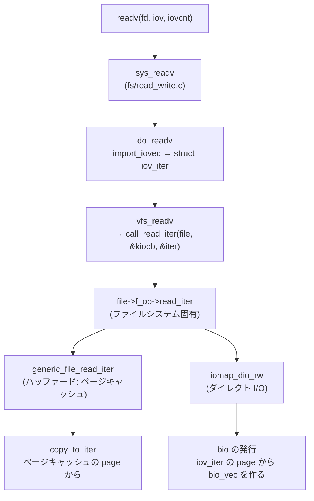

# ベクタI/O（スキャッタ・ギャザー） {#vectored-io-scatter-gather}

> readv/writev: 1回のシステムコールで複数のバッファ — カーネルのスキャッタ・ギャザーインターフェース

## ベクタI/Oとは何か {#what-vectored-io-is}

1回の`read()`や`write()`呼び出しは、1つの連続したバッファを扱う。実際のアプリケーションでは、データが1か所にまとまっていることはまれである。ネットワークパケットには固定長のヘッダ、可変長のペイロード、ときにはトレーラーがある。連続したバッファを組み立てるには、余分な`malloc`と`memcpy`が必要になる。

ベクタI/Oは、**iovec** と呼ばれる`(pointer, length)`の組の配列でこれを解決する。1回のシステムコールで、複数の非連続なバッファへデータを分散（scatter）したり、複数のバッファからデータを収集（gather）したりする。

```
writev(fd, iov, 3):
  iov[0] → [header buf, 20 bytes]  ─┐
  iov[1] → [payload buf, 512 bytes] ├─→ written atomically as 532 bytes
  iov[2] → [trailer buf, 4 bytes]  ─┘

readv(fd, iov, 3):
  disk/socket ─┬→ [header buf, 20 bytes]
               ├→ [payload buf, 512 bytes]
               └→ [trailer buf, 4 bytes]
```

### アトミック性の保証 {#the-atomicity-guarantee}

POSIX仕様、そしてLinuxの実装は、`readv()`や`writev()`が **ファイルレベルでアトミック** であることを保証する。すなわち、まとめた転送は単一の操作として見える。パイプや通常ファイルに対する別の書き込み側が、ベクタ間に割り込むことはできない。これが`write()`を3回続けて呼ぶ場合との重要な違いであり、その場合は同じfdを共有する別のプロセスが呼び出しの合間に書き込みを差し挟むことがありうる。

### システムコールのファミリー {#the-syscall-family}

| システムコール | 説明 |
|---------|-------------|
| `readv(fd, iov, iovcnt)` | 現在のファイル位置からのスキャッタ読み出し |
| `writev(fd, iov, iovcnt)` | 現在のファイル位置へのギャザー書き込み |
| `preadv(fd, iov, iovcnt, offset)` | 明示的なオフセットでのスキャッタ読み出し |
| `pwritev(fd, iov, iovcnt, offset)` | 明示的なオフセットでのギャザー書き込み |
| `preadv2(fd, iov, iovcnt, offset, flags)` | `preadv` + 呼び出しごとのフラグ |
| `pwritev2(fd, iov, iovcnt, offset, flags)` | `pwritev` + 呼び出しごとのフラグ |

---

## `struct iovec`とシステムコールインターフェース {#struct-iovec-and-the-syscall-interface}

ユーザー空間の構造体は`include/uapi/linux/uio.h`で定義されている。

```c
struct iovec {
    void  *iov_base;   /* バッファの開始アドレス */
    size_t iov_len;    /* このバッファのバイト数 */
};
```

転送の合計は、すべての`iov_len`の値の和である。バッファはメモリ上で連続している必要はなく、同じサイズである必要もない。

### IOV_MAX {#iov_max}

POSIXは`IOV_MAX`を、1回の呼び出しあたりの`iovec`エントリの最大数として定義している。Linuxではこれは **1024**（`include/uapi/linux/uio.h`の`UIO_MAXIOV`）である。1024を超えるベクタを渡すと`EINVAL`が返る。実際には数十を超えるベクタを使うことはまれであり、多数の離れた範囲を送る必要があるときは`sendfile`や`splice`を使う。

```c
#include <limits.h>   /* IOV_MAX */
#include <sys/uio.h>

/* コンパイル時に検証する */
_Static_assert(IOV_MAX >= 16, "need at least 16 vectors");
```

### `preadv2`/`pwritev2`のフラグ {#preadv2pwritev2-flags}

`preadv2`/`pwritev2`の`flags`引数は、ファイルを開き直すことなく呼び出しごとの制御を可能にする。

| フラグ | 値 | 意味 |
|------|-------|---------|
| `RWF_HIPRI` | `0x01` | 完了をポーリングする（NVMeのポーリングキュー）。`O_DIRECT`が必要 |
| `RWF_DSYNC` | `0x02` | この書き込みにデータ同期セマンティクスを適用（`O_DSYNC`と同様） |
| `RWF_SYNC` | `0x04` | この書き込みを完全同期にする（メタデータ + データ、`O_SYNC`と同様） |
| `RWF_NOWAIT` | `0x08` | ブロックする代わりに`EAGAIN`を返す（ページキャッシュのヒットまたはミス） |
| `RWF_APPEND` | `0x10` | アトミックな追記: `offset`にかかわらずファイル末尾に書き込む |

これらのフラグは`include/uapi/linux/fs.h`で`rwf_t`型として定義されている。

---

## `iov_iter` — カーネルの統一I/Oイテレータ {#iov_iter-the-kernels-unified-io-iterator}

カーネルは生の`iovec`配列をファイルシステムやドライバまでそのまま渡すことはしない。代わりにVFSがユーザー空間の`iovec`を`struct iov_iter`に変換する。これはすべての層が共通に扱う単一の抽象である。

`struct iov_iter`は`include/linux/uio.h`で定義されている。

```c
struct iov_iter {
    u8 iter_type;          /* ITER_IOVEC、ITER_KVEC、ITER_BVEC、
                              ITER_XARRAY、ITER_PIPE、ITER_UBUF */
    bool nofault;
    bool data_source;      /* WRITE（true）または READ（false） */
    size_t iov_offset;     /* 現在のセグメントで消費済みのバイト数 */
    union {
        /* ITER_IOVEC / ITER_UBUF */
        struct {
            union {
                const struct iovec *__iov;
                const struct kvec  *kvec;
                const struct bio_vec *bvec;
                struct xarray      *xarray;
                struct pipe_inode_info *pipe;
                void __user        *ubuf;
            };
            size_t count;  /* 残りバイト数 */
        };
    };
    /* ... パイプ固有のフィールドは省略 ... */
};
```

### イテレータの種類 {#iterator-flavours}

| `iter_type` | 裏付けとなる記憶域 | 使用元 |
|-------------|--------------|---------|
| `ITER_IOVEC` | ユーザー空間の`struct iovec[]` | ユーザー空間からのシステムコール |
| `ITER_KVEC` | カーネルの`struct kvec[]` | カーネル内部のI/O |
| `ITER_BVEC` | `struct bio_vec[]` | ブロック層 / DMA |
| `ITER_XARRAY` | ページキャッシュのxarray | `iomap`、ダイレクトI/O |
| `ITER_PIPE` | パイプのリングバッファ | `splice`、`sendfile` |
| `ITER_UBUF` | 単一のユーザーバッファ | 最適化された単一ベクタの高速パス |

### イテレータの中核操作（`lib/iov_iter.c`） {#core-iterator-operations-libiov_iterc}

```c
/* ユーザー空間へデータをコピーする（読み出し経路） */
size_t copy_to_iter(const void *addr, size_t bytes, struct iov_iter *i);

/* ユーザー空間からデータをコピーする（書き込み経路） */
size_t copy_from_iter(void *addr, size_t bytes, struct iov_iter *i);

/* コピーせずにイテレータを 'bytes' だけ進める */
void iov_iter_advance(struct iov_iter *i, size_t bytes);

/* イテレータに残っているバイト数 */
size_t iov_iter_count(const struct iov_iter *i);

/* 直前の advance を巻き戻す（部分書き込み時に使う） */
void iov_iter_revert(struct iov_iter *i, size_t bytes);
```

### なぜこの抽象が存在するか {#why-this-abstraction-exists}

`iov_iter`以前は、各層（ネットワーク、VFS、ブロック）がスキャッタ・ギャザーをそれぞれ異なる方法で扱っていた。`iov_iter`は単一の呼び出し規約を提供する。ネットワークの`recvmsg`経路、ファイルシステムの`read_iter`、ブロック層のDMAマッピングコードは、いずれも`iov_iter *`を受け取り、同じヘルパーを呼び出す。以前は`iovec`、カーネルバッファ、pageリストを場合分けしなければならなかったコードが、今では1つのインターフェースですべてのケースを扱う。

---

## `readv`がカーネル内をどう流れるか {#how-readv-flows-through-the-kernel}



`fs/read_write.c`における呼び出しの連鎖は次のとおりである。

```c
SYSCALL_DEFINE3(readv, unsigned long, fd,
                const struct iovec __user *, vec, unsigned long, vlen)
{
    return do_readv(fd, vec, vlen, 0);
}

static ssize_t do_readv(unsigned long fd, const struct iovec __user *vec,
                        unsigned long vlen, rwf_t flags)
{
    struct fd f = fdget_pos(fd);
    struct iovec iovstack[UIO_FASTIOV];   /* 少数の場合のスタックバッファ */
    struct iovec *iov = iovstack;
    struct iov_iter iter;
    ssize_t ret;

    /* ユーザーの iovec 配列を取り込んで検証する */
    ret = import_iovec(READ, vec, vlen, ARRAY_SIZE(iovstack), &iov, &iter);
    if (ret < 0)
        return ret;

    ret = do_iter_read(f.file, &iter, &f.file->f_pos, flags);

    kfree(iov);   /* ヒープ割り当ての場合のみ（vlen > UIO_FASTIOV） */
    fdput_pos(f);
    return ret;
}
```

`import_iovec`は`iovec`配列をユーザー空間からコピーし、各`iov_base`が有効なユーザーポインタであること、`iov_len`が妥当であることを検証し、`iov_iter`を初期化する。この時点以降、iovecに再び触れることはなく、すべては`iov_iter`を通じて行われる。

`do_iter_read`は`call_read_iter`を呼び、それが`file->f_op->read_iter`を呼び出す。バッファードI/Oのext4では、これは`generic_file_read_iter`に到達し、ページキャッシュのpageをループしながら`copy_page_to_iter`（内部で`copy_to_iter`を呼ぶ）を呼び出す。O_DIRECTの場合は`iomap_dio_rw`に到達し、イテレータのpageを`bio_vec`エントリにマップしてブロック層に発行する。

---

## ネットワークI/Oでのスキャッタ・ギャザー {#scatter-gather-for-network-io}

ソケット層は、`struct msghdr`を通じて同じスキャッタ・ギャザーの概念を使う。

```c
/* include/linux/socket.h */
struct msghdr {
    void            *msg_name;       /* 省略可能なアドレス（UDP） */
    int              msg_namelen;
    int              msg_inq;
    struct iov_iter  msg_iter;       /* 実際のデータイテレータ */
    /* ... 制御メッセージ用フィールド ... */
    unsigned int     msg_flags;
};
```

ユーザー空間は`struct user_msghdr`に`iovec`配列を詰めて`sendmsg`/`recvmsg`を呼ぶ。カーネルはそれを内部の`msghdr`に変換し、`msg_iter`を`ITER_IOVEC`としてセットアップする。

### パケットヘッダとペイロードを別々のバッファに置く {#packet-headers-and-payload-in-separate-buffers}

よくあるネットワークのパターンでは、iovec[0]に固定のプロトコルヘッダを、iovec[1]にペイロードを置く。これにより、ヘッダを前置するためだけにペイロードを連続バッファへコピーすることを避けられる。

```c
#include <sys/socket.h>
#include <sys/uio.h>
#include <netinet/in.h>
#include <string.h>

/* プロトコルヘッダ（固定レイアウト） */
struct proto_header {
    uint32_t magic;
    uint32_t payload_len;
    uint16_t msg_type;
    uint16_t flags;
} __attribute__((packed));

ssize_t send_framed(int sockfd, const void *payload, size_t paylen)
{
    struct proto_header hdr = {
        .magic       = htonl(0xDEADBEEF),
        .payload_len = htonl(paylen),
        .msg_type    = htons(1),
        .flags       = 0,
    };

    struct iovec iov[2] = {
        { .iov_base = &hdr,           .iov_len = sizeof(hdr)  },
        { .iov_base = (void *)payload, .iov_len = paylen       },
    };

    struct msghdr msg = {
        .msg_iov    = iov,
        .msg_iovlen = 2,
    };

    return sendmsg(sockfd, &msg, 0);
    /*
     * カーネルは hdr + payload を sk_buff のフラグメントに収集する。
     * ペイロードを大きなバッファへ memcpy する必要はない。
     */
}
```

カーネル内部では、`tcp_sendmsg_locked`が`sk_msg_from_msghdr`（またはTCPのゼロコピー経路）を呼び、`iov_iter`から`sk_buff`のフラグメントへpageを直接取り込む。ペイロードのpageは、新しい割り当てにコピーされることなく送信できる。

---

## ブロック層のスキャッタ・ギャザー — `struct bio_vec` {#block-layer-scatter-gather-struct-bio_vec}

ブロック層では、スキャッタ・ギャザーに`iovec`ではなく`struct bio_vec`を使う。`iovec`がユーザー空間の仮想バッファを記述するのに対し、`bio_vec`は **物理page** を記述する。

```c
/* include/linux/bvec.h */
struct bio_vec {
    struct page *bv_page;    /* 物理 page */
    unsigned int bv_len;     /* このセグメントのバイト数 */
    unsigned int bv_offset;  /* page 内のオフセット */
};
```

`struct bio`は`bio_vec`エントリの配列を運ぶ。各エントリは1つのpage内の連続したバイト列を記述する。非連続な物理メモリは、複数の`bio_vec`エントリとして表現される。

### セグメントの走査 {#iterating-segments}

```c
/* include/linux/bio.h */
struct bio_vec bv;
struct bvec_iter iter;

bio_for_each_segment(bv, bio, iter) {
    void *kaddr = kmap_local_page(bv.bv_page);
    /* kaddr + bv.bv_offset から bv.bv_len バイトを処理する */
    kunmap_local(kaddr);
}
```

### ハードウェアレベルでのDMAスキャッタ・ギャザー {#dma-scatter-gather-at-the-hardware-level}

ブロック層がNVMeやSATAコントローラに`bio`を発行するとき、`bio_vec`配列をDMAエンジンが理解する **Physical Region Descriptor Table（PRDT）** または **PRPリスト** に変換する。DMAエンジンはCPUによるコピーなしに、デバイスとRAMの間で直接転送を行う。

```
bio_vec[0]: page=0x1a000, offset=0, len=4096  ─┐
bio_vec[1]: page=0x3c000, offset=0, len=4096   ├─→ NVMe PRDT entries
bio_vec[2]: page=0x7f000, offset=512, len=3584 ─┘
                                                    ↕ DMA (no CPU involved)
                                                  NVMe SSD controller
```

物理pageは連続している必要はなく、DMAエンジンのスキャッタ・ギャザー機能が非連続なリストを扱う。これが、`iov_iter`を使った`O_DIRECT`読み出しを効率的にしている点である。ユーザーの`iovec`からピン留めされたpageが`bio_vec`エントリとなり、DMAエンジンがそこへ直接書き込む。

### `iov_iter` ↔ `bio_vec`の変換 {#iov_iter-bio_vec-conversion}

`iomap_dio_rw`がダイレクトI/O要求を処理するとき、`iov_iter_get_pages2`を呼んでユーザーのpageをピン留めし、それらから`bio_vec`エントリを構築する。`iov_iter`の仕組みがこの変換を透過的に処理する。

---

## `process_vm_readv` / `process_vm_writev` {#process_vm_readv-process_vm_writev}

Linux 3.2では、プロセス間のベクタI/Oのための2つのシステムコールが追加された。

```c
#include <sys/uio.h>

ssize_t process_vm_readv(pid_t pid,
                         const struct iovec *local_iov,  unsigned long liovcnt,
                         const struct iovec *remote_iov, unsigned long riovcnt,
                         unsigned long flags);

ssize_t process_vm_writev(pid_t pid,
                          const struct iovec *local_iov,  unsigned long liovcnt,
                          const struct iovec *remote_iov, unsigned long riovcnt,
                          unsigned long flags);
```

`local_iov`は **呼び出し側** プロセスのバッファを記述し、`remote_iov`は（`pid`で識別される）**対象** プロセスのバッファを記述する。カーネルは`ptrace`を経由せずに、2つのアドレス空間の間で直接データをコピーする。

### 権限 {#authorization}

呼び出し側は、対象プロセスに対して`PTRACE_MODE_ATTACH_REALCREDS`相当の権限を持っていなければならない（`ptrace(PTRACE_ATTACH, ...)`と同じチェック）。これは次を意味する。

- 同じUID/GIDであること、または
- `CAP_SYS_PTRACE`ケーパビリティを持つこと、かつ
- 対象プロセスが`PR_SET_DUMPABLE`を0に設定していないこと

### なぜptraceよりこちらを好むか {#why-prefer-this-over-ptrace}

`ptrace(PTRACE_PEEKDATA, ...)`は一度に1ワードずつ読み、対象が停止している必要がある。`process_vm_readv`は、対象が実行を続けている間に、任意の大きさの領域を1回のシステムコールで読み出す。デバッガやメモリプロファイラ（たとえば稼働中のプロセスのヒープのスナップショットを取るもの）は、性能のためにこれを使う。

```c
/* プロセス pid のアドレス 0x400000 から 4 KB を読む */
struct iovec local_iov  = { .iov_base = local_buf, .iov_len = 4096 };
struct iovec remote_iov = { .iov_base = (void *)0x400000, .iov_len = 4096 };

ssize_t n = process_vm_readv(pid, &local_iov, 1, &remote_iov, 1, 0);
if (n < 0)
    perror("process_vm_readv");
```

注意: 2つのアドレス空間にまたがるアトミック性の保証はない。リモートプロセスは、読み出し中にその領域を変更しているかもしれない。

---

## 性能上の考慮事項 {#performance-considerations}

### iovecごとのシステムコールのオーバーヘッドを避ける {#avoid-per-iovec-syscall-overhead}

ベクタI/Oの主な利点は **システムコールが少なくなること** である。各システムコールにはユーザー→カーネル→ユーザーの往復コスト（現代のハードウェアで約100〜300 ns、加えてTLBフラッシュ）がかかる。ヘッダ + ペイロード + チェックサムを送る場合、データが1つのpageに収まるとしても、`write`を3回呼ぶより`writev`を1回呼ぶほうが速い。

```
Three write() calls:             One writev():
  syscall overhead × 3     vs    syscall overhead × 1
  possible interleaving    vs    atomic at file level
  three cache-line fills   vs    one iov[] array prefetch
```

### 理想的なiovecの粒度 {#ideal-iovec-granularity}

小さすぎるiovecが多すぎると性能を損なう。`import_iovec`は各エントリを検証し、イテレータは1セグメントずつ進むからである。経験則としては次のとおり。

- 典型的なリクエスト/レスポンス型プロトコルでは、`iovcnt`を約16未満に保つ。
- キャッシュライン（64バイト）より小さいiovecは避ける。イテレータのオーバーヘッドがコピーの節約分を上回る。
- 多数のpageにまたがる大きなペイロードでは、ユーザーのpageのピン留めを避けるため`sendfile`や`splice`を優先する。

### ノンブロッキングなページキャッシュ読み出しのための`RWF_NOWAIT` {#rwf_nowait-for-non-blocking-page-cache-reads}

`RWF_NOWAIT`を指定した`preadv2`は、読み出しがブロックする場合、すなわちpageがページキャッシュにない場合や、ファイルシステムがロックを取る必要がある場合に、直ちに`EAGAIN`を返す。これはio_uringなしでノンブロッキングI/Oを構築するのに役立つ。

```c
#include <sys/uio.h>
#include <linux/fs.h>   /* RWF_NOWAIT */

/*
 * ブロックせずにページキャッシュから読み出しを試みる。
 * page がキャッシュされていなければ EAGAIN を返す。その場合は
 * ブロッキング読み出しにフォールバックするか、io_uring で発行する。
 */
ssize_t try_cached_read(int fd, void *buf, size_t len, off_t offset)
{
    struct iovec iov = { .iov_base = buf, .iov_len = len };

    ssize_t n = preadv2(fd, &iov, 1, offset, RWF_NOWAIT);
    if (n == -1 && errno == EAGAIN) {
        /* page がキャッシュにない — ブロックしてしまう。非同期で発行する。 */
        return -EAGAIN;
    }
    return n;
}
```

`RWF_NOWAIT`は`generic_file_read_iter`でチェックされる。`iocb->ki_flags & IOCB_NOWAIT`が立っていてpageがキャッシュにない場合、読み出しは`filemap_get_pages`の中でスリープする代わりに`-EAGAIN`を返す。

### 複数パートからなるネットワークパケットの例 {#multi-part-network-packet-example}

```c
#include <sys/uio.h>
#include <sys/socket.h>
#include <netinet/in.h>
#include <stdint.h>
#include <string.h>
#include <errno.h>

/*
 * 3 つのパートからなるレスポンス:
 *   [ステータスヘッダ 8 バイト] [本体 N バイト] [CRC32 4 バイト]
 * を、中間バッファを割り当てずに別々のバッファへ組み立てる。
 */
struct resp_header {
    uint32_t status;
    uint32_t body_len;
};

int recv_response(int fd, struct resp_header *hdr,
                  void *body, size_t body_max,
                  uint32_t *crc_out)
{
    struct iovec iov[3] = {
        { .iov_base = hdr,     .iov_len = sizeof(*hdr)  },
        { .iov_base = body,    .iov_len = body_max       },
        { .iov_base = crc_out, .iov_len = sizeof(uint32_t) },
    };

    ssize_t n = readv(fd, iov, 3);
    if (n < 0)
        return -errno;
    if ((size_t)n < sizeof(*hdr) + sizeof(uint32_t))
        return -EIO;    /* ショートリード — 接続が閉じられた */

    /*
     * hdr、body、crc_out がこれで埋まった。
     * 中間の割り当ても、フラットなバッファからの memcpy もない。
     */
    return 0;
}
```

### pollループ内での`RWF_NOWAIT`付き`preadv2` {#preadv2-with-rwf_nowait-in-a-poll-loop}

```c
#include <sys/uio.h>
#include <linux/fs.h>
#include <poll.h>
#include <errno.h>

ssize_t nonblocking_file_read(int fd, struct iovec *iov, int iovcnt,
                               off_t offset)
{
    for (;;) {
        ssize_t n = preadv2(fd, iov, iovcnt, offset, RWF_NOWAIT);
        if (n >= 0)
            return n;

        if (errno == EAGAIN) {
            /* page がキャッシュにない。fd が読み出し可能になるのを待つ */
            struct pollfd pfd = { .fd = fd, .events = POLLIN };
            poll(&pfd, 1, -1);   /* 真の非同期には io_uring を使う */
            continue;
        }
        return -errno;
    }
}
```

---

## カーネルソースの参照先 {#kernel-source-references}

| ファイル | 内容 |
|------|----------|
| `include/uapi/linux/uio.h` | `struct iovec`、`struct iovmax`、`UIO_MAXIOV` |
| `include/linux/uio.h` | `struct iov_iter`、`iter_type`列挙型、イテレータ関数のプロトタイプ |
| `lib/iov_iter.c` | `copy_to_iter`、`copy_from_iter`、`iov_iter_advance`、`iov_iter_get_pages2` |
| `fs/read_write.c` | `do_readv`、`do_writev`、`do_iter_read`、`do_iter_write` |
| `include/uapi/linux/fs.h` | `RWF_*`フラグ、`rwf_t`型 |
| `include/linux/bvec.h` | `struct bio_vec`、`bvec_iter`、`bio_for_each_segment` |
| `kernel/process_vm_access.c` | `process_vm_readv`、`process_vm_writev` |

---

## 参考文献 {#further-reading}

- [ダイレクトI/O](direct-io.md) — データベースのワークロード向けのO_DIRECT + preadv2
- [非同期I/Oの進化](async-io.md) — スキャッタ・ギャザーでaioを置き換えるio_uring
- [バッファードI/Oとページキャッシュ](buffered-io.md) — RWF_NOWAITが何に対して判定するか
- [ブロック層: bioとrequest](../block/bio-request.md) — bio_vecとDMAマッピング
- [sk_buff: ネットワークバッファ](../net/sk-buff.md) — sendmsgのiovecがどうsk_buffのフラグメントになるか
- [splice、sendfile、copy_file_range](../vfs/splice-sendfile.md) — ゼロコピーの代替手段
