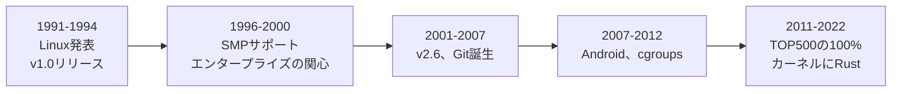

# Linuxの進化 {#the-evolution-of-linux}

> 趣味のプロジェクトから世界のインフラを動かす存在へ

## ビジュアル年表 {#visual-timeline}

## 年表の概観 {#timeline-at-a-glance}

| 年 | 出来事 | カーネルへの影響 |
|------|-------|---------------|
| 1991 | LinusがLinuxを発表 | i386向けモノリシックカーネル |
| 1992 | GPLの採用 | コミュニティからの貢献が始まる |
| 1994 | v1.0リリース | 本番利用可能に |
| 1996 | v2.0: SMPサポート | マルチプロセッサシステム |
| 1999 | v2.2: エンタープライズ機能 | 大容量メモリ、ネットワークの改善 |
| 2001 | v2.4: エンタープライズでの採用 | IBM、Oracle、SAPのサポート |
| 2003 | v2.6: O(1)スケジューラ | スケーラビリティの改善 |
| 2005 | カーネルのためにGitが作られる | 開発がスケールする |
| 2007 | Androidの発表 | モバイル時代の始まり |
| 2008 | v2.6.28: コンテナ（cgroups） | クラウドの基盤 |
| 2011 | v3.0: バージョン番号の変更 | 20周年 |
| 2017 | TOP500の100% | スーパーコンピュータの制覇 |
| 2018 | Meltdown/Spectre | セキュリティ強化の時代の始まり |
| 2022 | v6.1: カーネルにRust | 言語の進化 |

---

## 1991-1994: 始まり {#1991-1994-the-beginning}

### 発表（1991年8月25日） {#the-announcement-august-25-1991}

ヘルシンキ大学の21歳の学生だったLinus Torvaldsは、[`comp.os.minix`に投稿した](https://www.cs.cmu.edu/~awb/linux.history.html):

> *"I'm doing a (free) operating system (just a hobby, won't be big and professional like gnu) for 386(486) AT clones."*

（訳: 「386(486) ATクローン向けの（フリーな）オペレーティングシステムを作っている（ただの趣味で、gnuのように大きくてプロフェッショナルなものにはならない）。」）

彼は、MINIX（Andrew Tanenbaumの教育用OS）を自由に改変できないことに不満を抱いていた。Linux 0.01には次のものがあった:

- 基本的なプロセス管理
- 単純なメモリ管理（buddyアロケータ）
- 最小限のファイルシステムサポート
- `i386`上でのみ動作

### GPLの決断（1992年） {#the-gpl-decision-1992}

当初は制限的なライセンスの下にあったが、Torvaldsは1992年2月に[GPL](https://www.gnu.org/licenses/old-licenses/gpl-2.0.html)へ切り替えた。これは決定的な転機だった - それは次のことを意味した:

- 誰でも貢献できる
- 改良は還元されなければならない
- 企業はプロプライエタリなフォークを作れない

### Tanenbaum論争（1992年1月） {#the-tanenbaum-debate-january-1992}

Andrew Tanenbaumは[「Linuxは時代遅れだ」と宣言し](https://www.oreilly.com/openbook/opensources/book/appa.html)、次のように主張した:

- モノリシックカーネルは時代遅れである
- マイクロカーネルこそが未来である
- Linuxは`i386`に縛られすぎている

Torvaldsは実用的な選択を擁護した: モノリシックのほうが単純で、高速で、実際に動いた。歴史はTorvaldsの側についた - Linuxはあらゆる場所で動いている一方、純粋なマイクロカーネルはニッチにとどまっている。

### v1.0（1994年3月） {#v10-march-1994}

3年の開発を経て、[Linux 1.0](https://cdn.kernel.org/pub/linux/kernel/v1.0/)がリリースされた。次のものをサポートしていた:

- ネットワーク（`TCP/IP`）
- ローダブルカーネルモジュール
- 複数のファイルシステム
- 仮想メモリ

---

## 1996-2000: 成長期 {#1996-2000-growing-up}

### v2.0: SMPサポート（1996年） {#v20-smp-support-1996}

**必要性**: マルチプロセッサシステムが手頃な価格になりつつあった。

**課題**: 元のカーネルは単一CPUを前提としていた。SMPの追加には次のものが必要だった:

- 同期のためのspinlock
- per-CPUデータ構造
- 当初の解決策としてのBig Kernel Lock（`BKL`）

`BKL`は単一のグローバルロックだった - 単純だがスケーラビリティに限界があった。完全に取り除くには何年もかかった。[「kill the BKL」の取り組み](https://lore.kernel.org/all/alpine.LFD.1.10.0805141452330.3019@woody.linux-foundation.org/T/)は2008年に始まり、最終的に[v2.6.39で削除された](https://lore.kernel.org/all/1295993854-4971-1-git-send-email-arnd@arndb.de/T/)（2011年）。

### エンタープライズの関心の始まり {#enterprise-interest-begins}

1990年代後半には、企業がLinuxに注目していた:

- **1998**: [OracleがLinux向けOracle8を出荷した](https://www.theregister.com/1998/10/09/oracle_aims_oracle8_for_linux/)
- **1999**: [HPがLinux部門を設立し](https://www.linux.co.cr/oem-support/review/1999/0301.html)、24時間365日のサポートを提供した
- **2000**: [IBMがLinuxに10億ドルを投資し](https://www.linux.co.cr/oem-support/review/2000/1212.html)、DellはLinuxサーバーを出荷した

**なぜか？** コモディティハードウェアで動く無料のOS。ライセンス料が不要。デバッグのためにソースにアクセスできる。

### v2.2: エンタープライズ機能（1999年） {#v22-enterprise-features-1999}

- より多くのRAM（`2GB`以上）のサポート
- ネットワークスタックの改善
- SMPスケーラビリティの向上
- ファイルシステムの選択肢の拡大

---

## 2001-2007: エンタープライズの制覇 {#2001-2007-enterprise-dominance}

### v2.4: 本番対応（2001年） {#v24-production-ready-2001}

エンタープライズを納得させたカーネル:

- ジャーナリングファイルシステム（`ext3`、ReiserFS）
- LVM（Logical Volume Manager）
- USBサポート
- ラップトップサポートの改善（ACPI）

**IBMの全面投入**: IBMは2000年にLinuxを自社のメインフレーム（S/390）に移植し、Linuxが小規模方向だけでなく大規模方向にもスケールできることを証明した。

### SCO訴訟（2003-2007年） {#the-sco-lawsuit-2003-2007}

[SCO GroupがIBMを提訴し](https://en.wikipedia.org/wiki/SCO_Group,_Inc._v._International_Business_Machines_Corp.)、Linuxには盗まれたUnixのコードが含まれていると主張した。この訴訟は:

- 恐怖、不確実性、疑念（FUD）を生み出した
- コードの出自のより良い文書化につながった
- 最終的に崩壊した（SCOは敗訴し、[2021年に和解](https://en.wikipedia.org/wiki/SCO%E2%80%93Linux_disputes#Settlement)）

[Groklaw](https://en.wikipedia.org/wiki/SCO%E2%80%93Linux_disputes)のWebサイトは、SCOの主張を追跡し反論するためのコミュニティの拠点となった。

結果: コードの来歴を追跡するためのより強固なプロセス、[Developer Certificate of Origin（DCO）](https://docs.kernel.org/process/submitting-patches.html#sign-your-work-the-developer-s-certificate-of-origin)。

### v2.6: スケーラビリティのカーネル（2003年） {#v26-the-scalability-kernel-2003}

次のものを含む大規模な書き直し:

- **`O(1)`スケジューラ**: プロセス数に関係なく定数時間でスケジューリングする（後にv2.6.23、2007年でCFSに置き換えられた）
- **プリエンプティブルカーネル**: 応答性の向上
- **NPTL**: Native POSIX Thread Library（スレッド処理が大幅に改善）
- **`sysfs`**: モダンなデバイスモデル

このカーネルは組み込みからエンタープライズまでスケールできた。

### Gitの誕生（2005年） {#git-created-2005}

カーネル開発はBitKeeper（プロプライエタリ）に収まりきらなくなった。Torvaldsは[代替が必要だと表明し](https://lore.kernel.org/all/Pine.LNX.4.58.0504060800280.2215@ppc970.osdl.org/)、数週間でGitを書き上げた。影響:

- 分散型の開発モデル
- 誰もが完全な履歴を持てる
- ブランチ/マージが簡単になった
- はるかに速い開発ペースが可能になった

---

## 2007-2012: モバイルとクラウド {#2007-2012-mobile-and-cloud}

### Androidの発表（2007年11月） {#android-announced-november-2007}

Linuxカーネルの上に構築された[GoogleのモバイルOS](https://www.openhandsetalliance.com/press_110507.html)。次のものを必要とした:

- **Binder IPC**: 高速なプロセス間通信
- **Ashmem**: アプリ向けの匿名共有メモリ
- **Wakelocks**: モバイル向けの電源管理
- **Low memory killer**: 積極的なメモリ回収

Androidのパッチの一部はアップストリームに取り込まれるまで何年もかかり、他はAndroid固有のまま残っている。

### コンテナの基盤（2006-2008年） {#containers-foundation-2006-2008}

クラウドコンピューティングには軽量な仮想化が必要だった:

- **namespace**（2006年）: システムに対するプロセスの視点を分離する
- **[cgroup](https://lwn.net/Articles/236038/)**（v2.6.24、2008年）: プロセスグループごとのリソース制限

これらはDocker（2013年）とモダンなコンテナオーケストレーションの基盤となった。

### v2.6.28-v2.6.39: 急速な進化 {#v2628-v2639-rapid-evolution}

2.6.xシリーズは2011年まで続き、機能が急速に追加された:

- [KVMによる仮想化](https://lwn.net/Articles/205580/)（v2.6.20、2007年）
- `ext4`ファイルシステム（2008年）
- `btrfs`の開発開始
- パフォーマンスイベントサブシステム（`perf`）

---

## 2011-2017: 成熟期 {#2011-2017-maturity}

### v3.0（2011年） {#v30-2011}

大きな技術的変更ではない - Torvaldsは20周年を機に[バージョン番号の付け方を変えた](https://lwn.net/Articles/452531/): *"it's simply a way to drop an inconvenient numbering system in honor of twenty years of Linux."*（訳: 「Linuxの20年を記念して、不便な番号体系を捨てる方法にすぎない。」）

### スーパーコンピュータの制覇 {#supercomputer-dominance}

[TOP500スーパーコンピュータ](https://www.top500.org/statistics/details/osfam/1)におけるLinuxのシェア:

- 2000年: 約30%
- 2005年: 約75%
- 2010年: 約90%
- 2017年: 100%

**なぜか？** 独自ハードウェアのサポート、ライセンス費用が不要、最適化のためにソースにアクセスできる。

### systemdの採用（2010-2015年） {#systemd-adoption-2010-2015}

カーネルではないが重要である: [systemd](https://systemd.io/)は主要なディストリビューションでSysVinitを置き換えた。物議を醸したが標準となった。カーネルはそれをサポートする機能（`cgroups v2`、統一階層）を追加した。

### リアルタイム性の改善（`PREEMPT_RT`） {#real-time-improvements-preempt_rt}

リアルタイムパッチの段階的なマージ:

- スレッド化された割り込みハンドラ
- mutexの優先度継承
- 高分解能タイマー

これにより、産業用や車載用途でLinuxが使えるようになった。

---

## 2017年-現在: セキュリティとスケール {#2017-present-security-and-scale}

### Meltdown/Spectre（2018年） {#meltdownspectre-2018}

カーネルレベルの緩和策を必要とする[CPUの脆弱性](https://meltdownattack.com/):

- **[KPTI](https://lore.kernel.org/all/20171204150606.306546484@linutronix.de/T/)**: カーネルページテーブル分離（Meltdown）
- **Retpoline**: 投機的実行の緩和策
- **`IBRS`/`IBPB`**: 間接分岐の制御

性能への影響: 一部のワークロードで5〜30%。ハードウェアとソフトウェアの協調設計に関する議論につながった。

### Extended BPF（eBPF） {#extended-bpf-ebpf}

[Extended BPF（eBPF）](https://lore.kernel.org/netdev/1395404418-25376-9-git-send-email-dborkman@redhat.com/)は、パケットフィルタリングから次のものへと変貌した:

- トレーシングとプロファイリング
- セキュリティの強制
- ネットワークの高速化
- モジュールを使わないカスタムのカーネル拡張

verifierによる保証のもとでカーネル空間で動作する、安全でJITコンパイルされるプログラム。

### カーネルにRust（2022年-） {#rust-in-kernel-2022-}

**コミット**: [8aebac82933f](https://git.kernel.org/pub/scm/linux/kernel/git/torvalds/linux.git/commit/?id=8aebac82933ff1a7c8eede18cab11e1115e2062b)（v6.1）

Linuxカーネルにおける、C以外で初めての高水準言語。[v6.1向けのプルリクエスト](https://lore.kernel.org/lkml/CAK7LNAQ2xBLG_aSDm64SSYRBOBKwhJnZ6UDg8ycAezATVToFLg@mail.gmail.com/t/)が受け入れられた。動機:

- メモリ安全性の保証
- バグのクラス全体を防ぐ
- モダンな言語機能

ドライバから始め、段階的に拡大している。

---

## カーネルはどう適応したか {#how-the-kernel-adapted}

### スケールダウン（組み込み/モバイル） {#scaling-down-embeddedmobile}

- ティックレスカーネル（`CONFIG_NO_HZ`）
- メモリコンパクション
- カーネルサイズ削減のオプション
- 電源管理フレームワーク

### スケールアップ（サーバー/スーパーコンピュータ） {#scaling-up-serverssupercomputers}

- 全体にわたるNUMA対応
- 可能な箇所でのロックフリーなデータ構造
- per-CPUデータ
- スケーラブルな読み取りのためのRCU（Read-Copy-Update）

### スケールアウト（クラウド/コンテナ） {#scaling-out-cloudcontainers}

- namespaceによる分離
- リソース制御のための`cgroups v2`
- オーバーレイファイルシステム
- システムコールフィルタリングのための`seccomp`

### ハードウェアの多様性 {#hardware-diversity}

| プラットフォーム | 初サポート | 主な課題 |
|----------|---------------|----------------|
| `x86-64` | 2001年（v2.4.x） | 新しい呼び出し規約 |
| ARM | 1994年 | 多数のバリアント、デバイスツリー |
| `ARM64` | 2012年（v3.7） | サーバークラスのARM |
| `RISC-V` | 2017年（v4.15） | オープンなISA、白紙からの設計 |
| Apple Silicon | 2021年 | リバースエンジニアリングによるドライバ |

CPUアーキテクチャは物語の一部にすぎない — バス、ネットワークハードウェア、ボード設計も、それぞれ形を変えるたびにカーネルの作り直しを強いてきた。その歴史については[ハードウェアの進化](hardware-evolution.md)を参照のこと: PCIのホットプラグへの移行、EthernetのNAPI、WiFiのmac80211、そして2011年のDevice Treeへの移行推進。

---

## ガバナンスの進化 {#governance-evolution}

### メンテナモデル {#the-maintainer-model}

Linuxは階層的な[メンテナモデル](https://docs.kernel.org/process/maintainer-netdev.html)を採用している:

- 約1,700人のアクティブなメンテナ
- サブシステムのメンテナがパッチをレビューする
- 副官（lieutenant）がサブシステムの成果を集約する
- Torvaldsがメインラインについての最終判断を下す

### 開発統計（2023年） {#development-statistics-2023}

- リリースあたり約14,000人のコントリビュータ
- リリースあたり約10,000のパッチ
- 約8週間のリリースサイクル
- 3,000万行以上のコード

### 行動規範（2018年） {#code-of-conduct-2018}

長年にわたるしばしば辛辣なコミュニケーションの後、Linuxは[行動規範（Code of Conduct）](https://docs.kernel.org/process/code-of-conduct.html)を採用した。より包摂的なコミュニティへの文化的転換である。

---

## 主な教訓 {#key-lessons}

### なぜLinuxは勝ったか {#why-linux-won}

1. **GPL**: 改良の共有を義務付けた
2. **実用主義**: 理論的な純粋さより動くコード
3. **「十分に良い」タイミング**: 適切な時期に現れた適切なOS
4. **企業による採用**: エンタープライズの資金が開発を支えた
5. **モジュール性**: 大きく異なるユースケースに適応できた

### 時代とともに何が変わったか {#what-changed-over-time}

| 初期のLinux | 現代のLinux |
|-------------|--------------|
| 趣味のプロジェクト | 重要インフラ |
| 単独の開発者 | 数千人のコントリビュータ |
| デスクトップ中心 | デスクトップ以外のあらゆる場所 |
| 何を犠牲にしても性能 | セキュリティと安定性のバランス |
| `x86`のみ | あらゆるアーキテクチャ |
| モノリシック | モジュール式（ただしカーネルは依然としてモノリシック） |

---

## 参考文献 {#further-reading}

### 一次資料 {#primary-sources}
- [Linux History](https://www.cs.cmu.edu/~awb/linux.history.html) - 当初の発表
- [Tanenbaum-Torvalds Debate](https://www.oreilly.com/openbook/opensources/book/appa.html) - マイクロカーネル対モノリシック
- [kernel.org](https://kernel.org/) - 公式ソース
- [Kernel Archives](https://cdn.kernel.org/pub/linux/kernel/) - 歴代の全リリース
- [LWN.net Kernel Index](https://lwn.net/Kernel/Index/) - 包括的なカーネルニュースのアーカイブ

### 公式ドキュメント {#official-documentation}
- [Kernel Development Process](https://docs.kernel.org/process/) - パッチが取り込まれるまでの流れ
- [Submitting Patches](https://docs.kernel.org/process/submitting-patches.html) - DCOとコントリビューションガイド
- [Maintainers File](https://git.kernel.org/pub/scm/linux/kernel/git/torvalds/linux.git/tree/MAINTAINERS) - 誰が何をメンテナンスしているか

### 書籍 {#books}
- "Just for Fun" - Torvaldsの自伝
- "Rebel Code" - Glyn Moody
- "The Cathedral and the Bazaar" - [Eric Raymond](http://www.catb.org/~esr/writings/cathedral-bazaar/)

### 関連ドキュメント {#related-documentation}
- [メインドキュメントに戻る](index.md)
