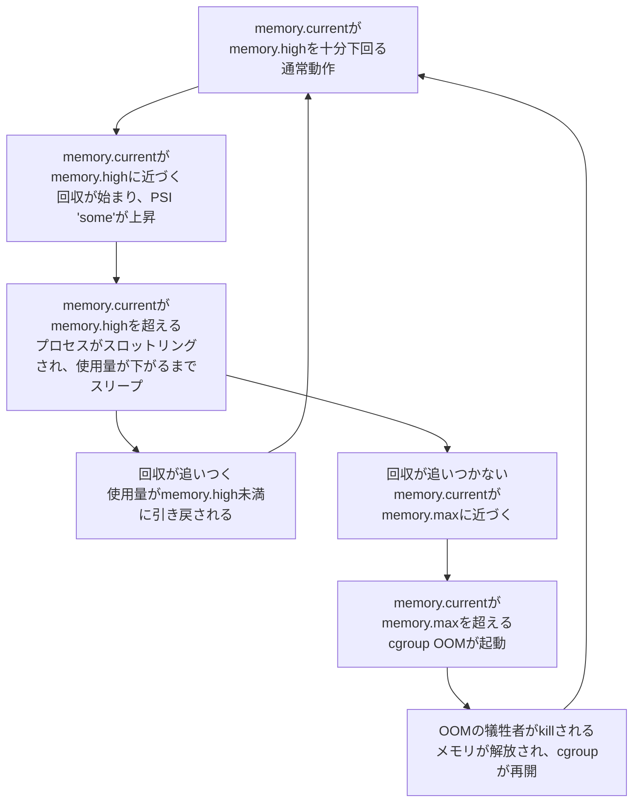
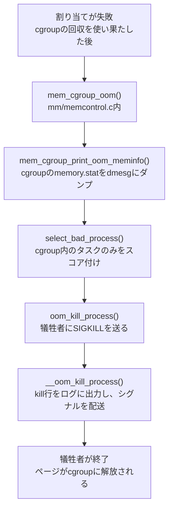

# コンテナがメモリ上限に達すると何が起きるか {#what-happens-when-a-container-hits-its-memory-limit}

> 通常動作からOOM killと回復に至るまでの一連の流れ

## 概要 {#the-story-in-brief}

コンテナのメモリ上限は、何の前触れもなく現れる壁ではない。カーネルのcgroupメモリコントローラは、何かをkillする前に段階的な介入を順に行う。`memory.high`でのソフトなスロットリング、強まっていく回収の圧力、可観測性ツールから見えるPSIシグナル、そして最後に、他のすべてが失敗した場合にのみ、グローバルなOOM killerとは完全に別個の、cgroupに限定されたOOM killが行われる。

各段階を理解しておくと、上限を賢く設定し、役に立つほど早く発火するアラートを書き、すでに起きたOOM killを診断するのに役立つ。



このページでは、この経路を一歩ずつたどる。集計の仕組みについては[Memory Cgroups](memcg.md)、上限の設定方法については[Tuning Containers](tuning-containers.md)、cgroupの外で動作するグローバルなOOMパスについては[Running out of memory](oom.md)を参照。

---

## 段階1: 通常動作（memory.high未満） {#stage-1-normal-operation-below-memoryhigh}

`memory.current`が`memory.high`未満にとどまっている間、cgroupメモリコントローラは実行中のプロセスからは事実上見えない。割り当ては通常の速度で成功し、kswapdはグローバルな圧迫に対してシステムレベルで動作し、cgroup単位のスロットリングは発生しない。

カーネルは、[`include/linux/memcontrol.h`](https://git.kernel.org/pub/scm/linux/kernel/git/torvalds/linux.git/tree/include/linux/memcontrol.h)の構造体`mem_cgroup`を通じてcgroupごとのメモリ使用量を追跡する。cgroupにチャージされるページはすべて、[`mm/memcontrol.c`](https://git.kernel.org/pub/scm/linux/kernel/git/torvalds/linux.git/tree/mm/memcontrol.c)の`mod_lruvec_state()`を介して、その構造体に付随するCPUごとのカウンタを更新する。これらのカウンタは、`memory.stat`が読み取るグローバルな`mem_cgroup->vmstats`配列に定期的に同期される。

```bash
# 現在の使用量と有効な上限を確認する
CGROUP=/sys/fs/cgroup/mycontainer
cat $CGROUP/memory.current    # 現在の使用量（バイト）
cat $CGROUP/memory.high       # ソフトリミット
cat $CGROUP/memory.max        # ハードリミット

# 通常の状態: current << high
```

この段階では、`$CGROUP/memory.pressure`にあるPSIファイルはすべて0を示す。メモリ待ちでストールしているタスクはない。

---

## 段階2: memory.highへの接近 — スロットリングの開始 {#stage-2-approaching-memoryhigh-throttling-begins}

割り当てによって`memory.current`が`memory.high`を超えそうになると、カーネルは[`mm/memcontrol.c`](https://git.kernel.org/pub/scm/linux/kernel/git/torvalds/linux.git/tree/mm/memcontrol.c)の`mem_cgroup_handle_over_high()`に入る。この関数は、タスクがユーザー空間に戻るパスから呼び出される（チャージ関数から直接呼ばれるのではない。割り当てのたびに回収を行うのを避けるため、`over_high`のチェックは遅延される）。

### スロットリングの仕組み {#the-throttling-mechanism}

`mem_cgroup_handle_over_high()`は2つのことを行う:

1. 現在のcgroupに対して**同期的な回収を起動する**。`reclaim_high()`を呼び、これが`try_to_free_mem_cgroup_pages()`を呼んでcgroupのLRUリストからページを回収する。これは単一のcgroupに限定された直接回収であり、他のcgroupには触れない。

2. 回収によって使用量が`memory.high`未満に戻らなかった場合、**割り当てを行うプロセスをスロットリングする**。プロセスは計算された数のjiffiesだけスリープさせられ、CPUを明け渡す。スリープ時間は、cgroupが`memory.high`をどれだけ超えているかに応じて変わる。わずかな超過なら短いスリープ、大幅な超過ならそれに比例して長いスリープとなる（このスケーリングはヒューリスティックであり、固定の表ではない）。

!!! note "スロットリングはcgroup単位ではなくプロセス単位"
    cgroupが`memory.high`を超えている間に割り当てを行う各プロセスは、それぞれスリープを課される。シングルスレッドのアプリケーションは、自身の割り当てが自然に直列化される。大量のスレッドを持つアプリケーションでは、多数のスレッドが同時にスリープしていることがある。

### 外部から観測できること {#what-you-observe-externally}

コンテナの外から見ると、プロセスはCPUを効率的に使えていないように見える。カーネル内でブロックしている間、実行可能状態の時間が増えるためである。PSIが値を記録し始める:

```bash
cat $CGROUP/memory.pressure
# some avg10=8.50 avg60=2.10 avg300=0.40 total=128000
# full avg10=0.00 avg60=0.00 avg300=0.00 total=0
```

少なくとも1つのタスクがメモリ待ちでストールしているため、`some`は0を上回る。cgroup内にメモリ待ちでブロックしていない実行可能なタスクが少なくとも1つある限り、`full`は0のままである。これらの計算方法については[PSI](psi.md)を参照。

`memory.events`のカウンタ`high`は、`memory.high`を超えるたびに増加する:

```bash
cat $CGROUP/memory.events
# low 0
# high 34          <- memory.highを超えた回数
# max 0
# oom 0
# oom_kill 0
```

!!! tip "memory.highを最初のアラートしきい値にする"
    `high`カウンタが増加しているのに`oom`イベントがないということは、コンテナが定常的にスロットリングパスを通っていることを意味する。状況が悪化する前に、メモリを増やすかアプリケーションをチューニングするのに最適なタイミングである。

---

## 段階3: 持続的なスロットリング — 回収、PSI、フィードバック {#stage-3-sustained-throttling-reclaim-psi-and-feedback}

ワークロードが、回収によってページが解放されるよりも速く割り当てを続けると、`memory.current`は長時間にわたって`memory.high`付近またはそれ以上にとどまる。システムは自己均衡的なループに入る:

```
Allocation attempt
       │
       ▼
mem_cgroup_handle_over_high()
       │
       ├─► try_to_free_mem_cgroup_pages()
       │         │
       │         ├─► shrink_lruvec() — walk LRU, reclaim cold pages
       │         └─► wakeup_flusher_threads() — write dirty pages back
       │
       └─► sleep (throttle if still over high)
```

`try_to_free_mem_cgroup_pages()`は[`mm/vmscan.c`](https://git.kernel.org/pub/scm/linux/kernel/git/torvalds/linux.git/tree/mm/vmscan.c)の`shrink_lruvec()`を呼び出し、これがcgroupのLRUリストを優先順にたどる。まず非アクティブなファイルキャッシュ（回収コストが最も安い）、次にアクティブなファイルキャッシュ、そして回収可能なファイルページが残っていなければ匿名ページ（スワップI/Oが必要になる場合がある）の順である。

### 何がどの順序で回収されるか {#what-gets-reclaimed-and-in-what-order}

| ページの種類 | 回収可能か | 備考 |
|-----------|-------------|-------|
| 非アクティブなファイルバック（ページキャッシュ） | 常に可能 | 最もクリーンな回収。dirtyでなければI/Oは不要 |
| dirtyなファイルバック | ライトバック後に可能 | 先にディスクへのフラッシュが必要 |
| アクティブなファイルバック | LRUのエージング後に可能 | カーネルはホットなページを保持しようとする |
| 匿名（ヒープ、スタック） | スワップが利用可能な場合のみ | スワップアウトされるとスワップI/Oが発生する |
| `memory.min`で保護されたページ | 不可 | 厳格な下限であり、決して回収されない |
| `memory.low`で保護されたページ | 危機的状況でない限り不可 | ベストエフォートの下限 |
| 共有メモリ（tmpfs、shmem） | 可能 | フォールトでそれを読み込んだcgroupにチャージされる |
| カーネルslab（kmem） | 部分的に可能 | `shrink_slab()`による回収可能なdentryとinode |

### PSIの圧力が高まる {#psi-pressure-builds}

回収がCPU時間を消費し、スワップI/Oがスロットリングされたタスクの再開を遅らせるにつれて、PSIの圧力が蓄積していく:

```bash
cat $CGROUP/memory.pressure
# some avg10=45.00 avg60=22.00 avg300=8.00 total=3200000
# full avg10=12.00 avg60=5.00 avg300=1.00 total=890000
```

`full`の値が0を超えているということは、cgroup内のすべてのタスクが同時にメモリ待ちでブロックしていた、つまり有用な処理がまったく行われていなかった瞬間があったことを意味する。これは深刻なシグナルである。

PSIは、Metaの[`oomd`](https://facebookincubator.github.io/oomd/)やsystemd-oomdのような先回り型のメモリ管理ツールの基盤である。これらは`memory.pressure`を監視し、カーネルのOOM killerが発火する前にワークロードをkillする。`memory.pressure`の通知トリガーの設定方法については[PSI](psi.md)を参照。

### 先回りして圧迫を和らげるmemory.reclaim {#memoryreclaim-for-proactive-relief}

監視によって`high`カウントの増加やPSIの圧力を検出した場合、カーネルがプロセスをスロットリングするのを待たずに、手動で先回りの回収を起動できる:

```bash
# cgroupから200MBを回収する（v5.19+、commit 94968384dde1）
echo 200M > /sys/fs/cgroup/mycontainer/memory.reclaim
```

これはShakeel Buttによる[commit 94968384dde1](https://git.kernel.org/linus/94968384dde1)（"memcg: introduce per-memcg reclaim interface"）で導入された（[LWNの記事](https://lwn.net/Articles/894849/)）。これは書き込み専用のインターフェースで、ユーザー空間から直接`try_to_free_mem_cgroup_pages()`を起動する。オーケストレータで先手を打ったメモリ管理を行うのに有用である。

---

## 段階4: memory.maxの超過 — cgroup OOM {#stage-4-exceeding-memorymax-cgroup-oom}

スロットリングパスからの回収で`memory.current`を`memory.high`未満に保てず、使用量が増え続けて`memory.max`に達すると、カーネルは別のパス、すなわちcgroup OOM killerを起動する。

### エントリポイント: mem_cgroup_out_of_memory() {#entry-point-mem_cgroup_out_of_memory}

cgroupの回収を使い果たした後に割り当てが失敗すると、[`mm/memcontrol.c`](https://git.kernel.org/pub/scm/linux/kernel/git/torvalds/linux.git/tree/mm/memcontrol.c)の`mem_cgroup_oom()`が呼び出される。これは次のことを行う:

1. `oom_memcg`を設定した状態で[`mm/oom_kill.c`](https://git.kernel.org/pub/scm/linux/kernel/git/torvalds/linux.git/tree/mm/oom_kill.c)の`out_of_memory()`を呼び出す。これはcgroupに限定されたOOMであることを示す。
2. `select_bad_process()`がcgroupの制約付きで呼び出されるため、対象cgroup内のタスクだけが候補として考慮される。
3. 犠牲者が選ばれた後、`oom_kill_process()`は`mem_cgroup_get_oom_group()`を呼び出して`memory.oom.group`が設定されているかを確認する。設定されていれば、犠牲者だけでなくcgroupのサブツリー全体がkillされる。

### cgroup OOMとグローバルOOMの違い {#how-cgroup-oom-differs-from-global-oom}

| | グローバルOOM | cgroup OOM |
|-|-----------|-----------|
| **トリガー** | 直接回収の後もシステム全体の割り当てが失敗 | cgroupの回収の後もcgroupの`memory.max`を超過 |
| **候補の範囲** | システム上のすべてのプロセス | 影響を受けたcgroup（およびその子孫）内のプロセスのみ |
| **スコアの基準** | `totalpages` = システムのRAM + スワップ | `totalpages` = cgroupの`memory.max` |
| **dmesgでのkillの接頭辞** | `Out of memory:` | `Memory cgroup out of memory:` |
| **制約フィールド** | `CONSTRAINT_NONE` | `CONSTRAINT_MEMCG` |
| **メモリダンプ** | ゾーン/ノード全体のMem-Info | `mem_cgroup_print_oom_meminfo()`によるcgroupのメモリ統計 |
| **他のコンテナへの影響** | ありうる | なし — 完全に隔離されている |

### OOM killの流れ {#the-oom-kill-sequence}



### cgroup OOMでdmesgに表示される内容 {#what-dmesg-shows-for-a-cgroup-oom}

```
[  891.112245] Memory cgroup out of memory: Killed process 12001 (myapp) \
               total-vm:2097152kB, anon-rss:1048320kB, file-rss:512kB, \
               shmem-rss:0kB, UID:1000 pgtables:2048kB oom_score_adj:0
```

グローバルOOMのログとの主な違い:

- 行が`Out of memory:`ではなく`Memory cgroup out of memory:`で始まる
- kill行の`constraint=CONSTRAINT_MEMCG`フィールドがcgroupのパスを示す
- メモリ状態のセクションには、グローバルなゾーンの統計ではなくcgroupの統計が表示される
- タスク表にはcgroup内のプロセスだけが列挙される

これらのフィールドの注釈付きの詳しい内訳については[Reading an OOM log](reading-oom-log.md)を参照。

### memory.oom.group: コンテナ全体を一度にkillする {#memoryoomgroup-kill-the-whole-container-at-once}

デフォルトでは、OOM killerはcgroup内の単一のプロセスを選ぶ。複数プロセスからなるコンテナ（ワーカープールを持つWebサーバー、サイドカーなど）では、1つのプロセスをkillすると残りが壊れた状態で取り残されることが多い。

[Commit 3d8b38eb81ca](https://git.kernel.org/linus/3d8b38eb81ca)（"mm, oom: introduce memory.oom.group"、Roman Gushchin、カーネルv4.19）は`memory.oom.group`を導入した:

```bash
echo 1 > /sys/fs/cgroup/mycontainer/memory.oom.group
```

これが設定されていると、`mem_cgroup_get_oom_group()`はcgroup階層を上にたどって`oom_group`が設定された最上位の祖先を見つけ、続いて`oom_cgroup_kill()`がそのサブツリー内のすべてのタスク（`oom_score_adj = -1000`のものを除く）にSIGKILLを送る。dmesgのログには次の行が含まれる:

```
Tasks in /myapp.slice/myapp.service are going to be killed due to memory.oom.group set
```

!!! warning "oom.groupとネストしたcgroup"
    祖先に`memory.oom.group`が設定されている場合、OOMを引き起こしたcgroupだけでなく、すべての子孫cgroup内のすべてのタスクがkillされる。重要度の異なるワークロードが親を共有している場合は、それに応じてcgroup階層を設計すること。

### OOM後のmemory.events {#memoryevents-after-an-oom}

```bash
cat /sys/fs/cgroup/mycontainer/memory.events
# low 0
# high 152
# max 8           <- memory.maxに達した回数
# oom 3           <- OOMイベント（OOMの起動1回につき1）
# oom_kill 3      <- killされた個々のプロセス
# oom_group_kill 0
```

`max`は使用量が`memory.max`に達した回数を数える。これには、OOM killを必要とする前に回収が成功した試行も含まれる。`oom`と`oom_kill`は、OOM killerが実際に動作した場合だけを数える。

---

## 段階5: OOM kill後の回復 {#stage-5-recovery-after-oom-kill}

犠牲者のプロセスが終了すると、そのページはcgroupに解放される。流れは次のとおりである:

1. プロセスがSIGKILLを受け取り、そのシグナルハンドラ（またはデフォルトの処理）によって終了する。
2. `exit_mm()`が呼ばれ、これが`mmput()`を呼び、`mm_struct`の参照カウントを減らす。
3. カウントが0になると、`__mmput()`が`exit_mmap()`を実行し、これが`unmap_vmas()`を呼んですべてのVMAをたどり、`free_pgtables()`を呼んでページテーブルを解放する。
4. 各ページはアンマップされ、`release_pages()`を介して解放される。これは`mem_cgroup_uncharge()`（現在のカーネルでは`struct folio *`を受け取る）を呼び出してcgroupのカウンタから差し引く。
5. `memory.current`が下がる。`memory.max`を下回れば、以降の割り当ては成功しうる。

### コンテナは自動的に回復するか {#will-the-container-recover-automatically}

それは何がkillされたか、そしてコンテナランタイムが何をするかによる:

**単一プロセスのコンテナ（PID 1がkillされた）**: コンテナランタイムはPID 1の終了を検出し、再起動ポリシー（例: Dockerの`--restart=always`、Kubernetesの`restartPolicy: Always`）に従ってコンテナを再起動する。

**複数プロセスのコンテナ（PID 1ではなくワーカーがkillされた）**: `memory.oom.group`が設定されていなければ、選ばれたプロセスだけが死ぬ。コンテナは機能が低下した状態で動作し続けることがある。これは最も危険なケースである。`memory.events`を明示的に監視していない限り、コンテナのヘルスチェックから見てOOM killは気付かれないためである。

**`memory.oom.group = 1`**: すべてのプロセスが死ぬ。ランタイムはPID 1の終了を検出し、クリーンな再起動を行う。

```bash
# 実行中のコンテナでOOMイベントを監視する（memory.eventsをポーリング）
watch -n 5 "cat /sys/fs/cgroup/mycontainer/memory.events | grep oom"

# あるいはinotifyを使う（cgroupfs上でサポートしていないカーネルもある）
# 多くの本番環境では、メトリクスエージェントがmemory.eventsを一定間隔でポーリングしている
```

### memory.eventsのoom_killカウンタはリセットされない {#the-memoryevents-oom_kill-counter-does-not-reset}

`memory.events`のカウンタは、cgroupが作成されて以来単調に増加する。OOM killが起きたときや、コンテナが再起動したとき（cgroupが再利用される限り）にもリセットされない。再起動時にcgroupを作り直して新しい基準値を与えるオーケストレータもあれば、再利用するものもある。イベント数の絶対値に基づいてアラートを構築する前に、使っているランタイムがどちらの挙動なのかを確認すること。

!!! tip "絶対数ではなく発生率でアラートを出す"
    カウンタの生の値ではなく、単位時間あたりの`oom_kill`イベント（例: 5分間の発生率）に基づいてアラートを構築すること。3週間前に一度OOM killがあったコンテナが、恒久的にアラート状態になるべきではない。

---

## 全体の流れを一目で {#the-full-sequence-at-a-glance}

```
memory.current (grows ───────────────────────────────────────────────►)

│ Normal operation              │ Throttle zone         │ OOM zone
│ (below memory.high)           │ (above memory.high)   │ (above memory.max)
│                               │                       │
│ Fast allocations              │ - Reclaim runs        │ - mem_cgroup_oom()
│ No PSI pressure               │ - Process sleeps      │ - select_bad_process()
│ memory.events unchanged       │ - PSI 'some' rises    │ - SIGKILL to victim
│                               │ - high counter rises  │ - oom/oom_kill++
│                               │                       │
├───────────────────────────────┼───────────────────────┼──────────────────────
                          memory.high              memory.max
```

---

## 実践的な設定 {#practical-configuration}

`memory.high`と`memory.max`の間の幅がスロットリングゾーンである。適切に設定されたコンテナは、負荷時に`memory.high`に達し、スロットリングされて回収により引き戻され、決して`memory.max`には達しない。この設計については[Tuning Containers](tuning-containers.md)で説明している。

```bash
CGROUP=/sys/fs/cgroup/mycontainer

# まずプロファイルする: 現実的な負荷の下でmemory.peakを観測する（v5.19+）
cat $CGROUP/memory.peak     # これまでに観測されたmemory.currentの最大値

# maxを観測したピークの約1.5倍に設定する（ヒューリスティック: スパイクのための余裕を残す）
echo 1500M > $CGROUP/memory.max

# highをmaxの約80%に設定する（ヒューリスティック: OOMの前にスロットリングゾーンを設ける）
echo 1200M > $CGROUP/memory.high

# クリーンな再起動のため、OOM時にグループごとkillする
echo 1 > $CGROUP/memory.oom.group

# highとmaxの間にスワップのバッファを設ける
echo 512M > $CGROUP/memory.swap.max
```

!!! note "80%と1.5倍という数字はヒューリスティックである"
    `memory.high`と`memory.max`の間の幅に、普遍的に正しい値はない。適切な値は、アプリケーションの割り当てのバーストサイズと、回収パスの速さに依存する。負荷の下で`memory.pressure`と`memory.events`を観測して調整すること。

---

## 主要なカーネル関数（mm/memcontrol.c） {#key-kernel-functions-mmmemcontrolc}

| 関数 | 役割 |
|----------|-------------|
| `mem_cgroup_charge()` | ページ割り当てのたびに呼ばれ、cgroupのカウンタを更新して上限をチェックする |
| `mem_cgroup_handle_over_high()` | high上限によるスロットリングのエントリポイント。`reclaim_high()`を呼んでからスリープする |
| `reclaim_high()` | `try_to_free_mem_cgroup_pages()`を呼んでcgroupからページを解放する |
| `mem_cgroup_oom()` | max上限によるOOMのエントリポイント。犠牲者を選び、`out_of_memory()`を起動する |
| `mem_cgroup_get_oom_group()` | OOMの対象となるcgroupを決定する（`memory.oom.group`を尊重する） |
| `mem_cgroup_print_oom_meminfo()` | OOM時にcgroupのメモリ統計をdmesgにダンプする |
| `mem_cgroup_uncharge()` | ページの解放時に呼ばれ、cgroupのカウンタから差し引く |

---

## 参考文献 {#further-reading}

- [Memory Cgroups](memcg.md) — 集計の仕組みと、何がチャージされるか
- [Tuning Containers](tuning-containers.md) — memory.high、memory.max、memory.minを正しく設定する方法
- [Reading an OOM log](reading-oom-log.md) — cgroup OOM killによるdmesg出力を読み解く方法
- [Running out of memory](oom.md) — グローバルなOOMパス: ウォーターマーク、kswapd、直接回収
- [PSI](psi.md) — pressure stall informationの計算方法と、アラートへの活用方法
