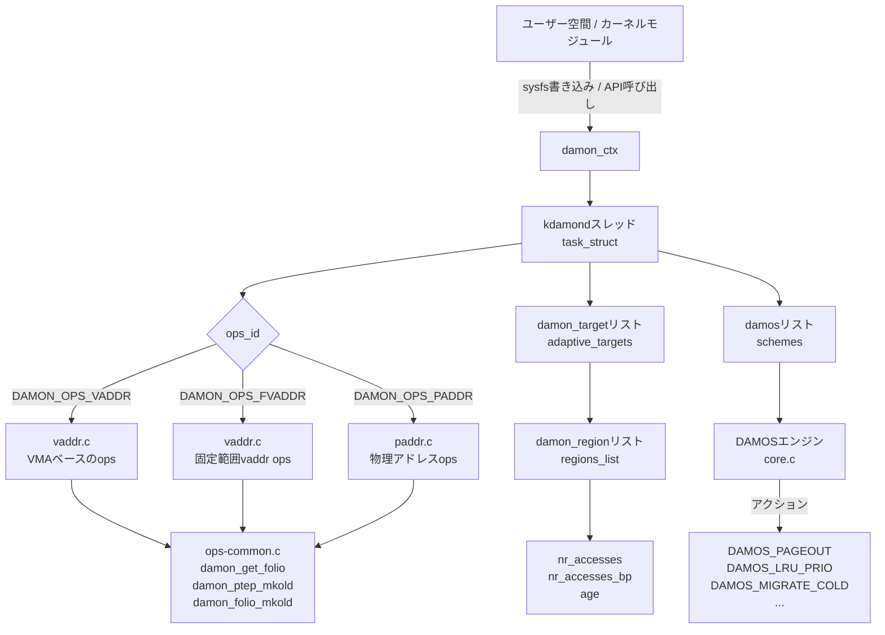

# DAMON: データアクセス監視 {#damon-data-access-monitoring}

> メモリがどのようにアクセスされているかを観測し、その知見に基づいて行動するための、軽量・高精度・スケーラブルなカーネルフレームワーク

## DAMONとは何か {#what-is-damon}

DAMON（Data Access MONitoring）は、各メモリ領域が実行時にどれくらいの頻度でアクセスされているかを追跡するカーネルサブシステムである。DAMONはそれ自体では回収ポリシーでは**ない**。そうではなく、アクセス頻度のデータを生成する監視フレームワークであり、他のサブシステム — 最も重要なのはDAMOS（DAMON-based Operation Schemes） — がそのデータに基づいて行動できる。

主要な設計目標は次のとおりである。

- **精度**: アクセス頻度はpage単位ではなく領域単位で追跡されるが、有用な判断を下せる程度には実態に近い値を保つ
- **スケーラビリティ**: O(n)のpageスキャンコストなしに、任意のサイズのアドレス空間で動作する
- **適応性**: 領域は自動的に拡大・縮小し、重要な場所に監視の労力を集中させる

```
DAMONなし:                            DAMONあり:
                                      ┌──────────────────────────────┐
カーネルはLRUの経過時間だけで         │  カーネルはアクセスパターンを│
pageを回収する — どの領域が本当に     │  時間をかけて観測し、DAMOS   │
コールドかは分からない。              │  で正確にコールド領域を狙う  │
                                      │                              │
                                      └──────────────────────────────┘
```

!!! note "DAMON対DAMOS"
    DAMONはデータを収集する。DAMOSはそのデータを使ってアクション（コールドなメモリのページアウト、ホットなメモリの昇格など）を起動する。両方ともsysfsインターフェース経由で一緒に設定する。

---

## 中核となる概念 {#core-concepts}

### 領域: 監視の単位 {#regions-the-unit-of-monitoring}

DAMONは監視対象のアドレス空間を`struct damon_region`オブジェクトのリストに分割する。各領域は連続したアドレス範囲`[ar.start, ar.end)`を表し、次の情報を持つ。

- `nr_accesses` — 現在の集約ウィンドウにおいて、いくつのサンプリング間隔でアクセスが検出されたか
- `nr_accesses_bp` — サンプリング間隔ごとに更新されるベーシスポイント（1/10,000）単位の移動平均版。完全な集約が終わるのを待てない場合に有用
- `age` — 領域のアクセス頻度がほぼ同じままでいる集約間隔の数。アクセス頻度が大きく変化するとゼロにリセットされる
- `sampling_addr` — 次の間隔でアクセスの有無がチェックされる、領域内の特定のアドレス

仮想アドレスの監視（`DAMON_OPS_VADDR`）では、DAMONはプロセスのVMAから領域を初期化する。物理アドレスの監視（`DAMON_OPS_PADDR`）では、対象の物理アドレス範囲をカバーするように領域が初期化される。

### サンプリング: アクセスを捉える {#sampling-catching-accesses}

`sample_interval`マイクロ秒ごと（フィールド`damon_attrs.sample_interval`）に、kdamondスレッドは次を行う。

1. 各領域内の`sampling_addr`が前回のサンプル以降にアクセスされたかをチェックする（ページテーブルエントリのaccessed/youngビットをテストしてクリアすることによる）
2. アクセスが見つかれば`nr_accesses`をインクリメントする
3. 次の間隔のために、領域内で新しい`sampling_addr`をランダムに選ぶ

デフォルトの`sample_interval`は5,000 µs（5 ms）である。

### 集約: 全体像を組み立てる {#aggregation-building-the-picture}

`aggr_interval`マイクロ秒ごと（`damon_attrs.aggr_interval`）に、DAMONは次を行う。

1. 各領域について蓄積された`nr_accesses`のカウントを報告する（またはそれに基づいて行動する）
2. `nr_accesses`をゼロにリセットする
3. 各領域の`age`を更新する
4. 適応的な領域サイズ調整ロジック（分割/統合）を実行する

デフォルトの`aggr_interval`は100,000 µs（100 ms）であり、報告される各`nr_accesses`の値は直近20回のサンプリング間隔（`100 ms / 5 ms`）で観測されたアクセスを表す。

### 適応的な領域サイズ調整 {#adaptive-region-sizing}

DAMONは`damon_attrs.min_nr_regions`と`damon_attrs.max_nr_regions`の境界（デフォルト: 10と1,000）を維持する。各集約の後、領域を調整する。

- **分割**: 不均一にアクセスされた領域（一部のサブ範囲はホットで、他はコールド）は、その勾配を捉えるために小さな領域に分割される
- **統合**: アクセス頻度が似ている隣接領域は、オーバーヘッドを減らすために統合される

これにより、領域の総数を境界内に保ちながら、アクセスパターンが変化する場所に解像度を集中させる。

!!! tip "最小の領域サイズ"
    `DAMON_MIN_REGION_SZ`は`PAGE_SIZE`である。1 pageより小さい領域は存在できない。フィールド`damon_ctx.min_region_sz`がこの下限を保持する。

### 間隔の自動チューニング {#intervals-auto-tuning}

DAMONは`sample_interval`と`aggr_interval`を一緒に自動チューニングできる。目標は`struct damon_intervals_goal`として表現される。

| フィールド | 意味 |
|---|---|
| `access_bp` | 観測されたアクセスイベントの理論上の最大値に対する目標比率（ベーシスポイント（1/10,000）単位） |
| `aggrs` | その比率を達成する対象となる集約ウィンドウの数 |
| `min_sample_us` | 結果として得られるサンプリング間隔の下限 |
| `max_sample_us` | 結果として得られるサンプリング間隔の上限 |

`aggrs`がゼロの場合、自動チューニングは無効になる。sysfs経由では、これらのフィールドは`monitoring_attrs/intervals/intervals_goal/`の下に現れる。

---

## アーキテクチャ {#architecture}



### `damon_ctx`構造体 {#the-damon_ctx-structure}

すべての監視セッションは`struct damon_ctx`（`include/linux/damon.h`）を起点とする。

```c
struct damon_ctx {
    struct damon_attrs attrs;         /* sample/aggr/update間隔、nr_regions */
    struct damon_operations ops;      /* 差し替え可能なopsセット（vaddr/paddr） */
    unsigned long addr_unit;          /* coreからopsへのアドレス変換のスケール係数 */
    unsigned long min_region_sz;      /* 最小の領域サイズ（DAMON_MIN_REGION_SZ） */
    struct list_head adaptive_targets;/* damon_targetのリスト */
    struct list_head schemes;         /* damosのリスト */
    struct task_struct *kdamond;      /* 監視スレッド */
    /* ... プライベートなフィールド ... */
};
```

### kdamondスレッド {#the-kdamond-thread}

各`damon_ctx`はちょうど1つのカーネルスレッド — kdamond — を持つ。そのメインループ（`mm/damon/core.c`内）は次のように動作する。

```
while (!should_stop):
    ops.prepare_access_checks(ctx)     # pageをoldとマークする（accessedビットをクリア）
    sleep(sample_interval)
    ops.check_accesses(ctx)            # accessedビットを再読み取り → nr_accesses
    if aggregation_interval_elapsed:
        report / apply DAMOS schemes
        adaptive_merge_regions()
        adaptive_split_regions()
        reset nr_accesses
    if ops_update_interval_elapsed:
        ops.update(ctx)                # VMAなどを更新する
```

スレッドは`damon_start()`で開始され、`damon_stop()`で停止される。実行中は、`damon_ctx`の内部への外部からのアクセスはすべて、kdamondループと直列化するために`damon_call()`または`damos_walk()`を経由しなければならない。

### 操作セット（`damon_operations`） {#operations-sets-damon_operations}

DAMONは`struct damon_operations`によって、監視アルゴリズムをアドレス空間固有の部分から分離している。

```c
struct damon_operations {
    enum damon_ops_id id;                           /* DAMON_OPS_VADDR / _FVADDR / _PADDR */
    void (*init)(struct damon_ctx *context);
    void (*update)(struct damon_ctx *context);
    void (*prepare_access_checks)(struct damon_ctx *context);
    unsigned int (*check_accesses)(struct damon_ctx *context);
    int (*get_scheme_score)(struct damon_ctx *context,
                            struct damon_target *t,
                            struct damon_region *r,
                            struct damos *scheme);
    unsigned long (*apply_scheme)(struct damon_ctx *context,
                                  struct damon_target *t,
                                  struct damon_region *r,
                                  struct damos *scheme,
                                  unsigned long *sz_filter_passed);
    bool (*target_valid)(struct damon_target *t);
    void (*cleanup_target)(struct damon_target *t);
};
```

| `damon_ops_id` | sysfs名 | 説明 |
|---|---|---|
| `DAMON_OPS_VADDR` | `vaddr` | プロセスの仮想アドレス空間を監視する。VMAから領域を初期化する。`CONFIG_DAMON_VADDR`が必要 |
| `DAMON_OPS_FVADDR` | `fvaddr` | `vaddr`と同様だが、VMA全体ではなくユーザーが指定した固定アドレス範囲のみを監視する |
| `DAMON_OPS_PADDR` | `paddr` | システム全体の物理アドレス空間を監視する。`CONFIG_DAMON_PADDR`が必要。`DAMON_RECLAIM`と`DAMON_LRU_SORT`が使用する |

`vaddr`と`paddr`はどちらも、ページテーブルのdirtyビットを変更せずにアクセスを検出するために、page idleフラグ（`PAGE_IDLE_FLAG`）を使う。

---

## DAMOS: データアクセス監視に基づく操作スキーム {#damos-data-access-monitoring-based-operation-schemes}

DAMOSは、DAMONの監視データの上に重ねられたポリシーエンジンである。DAMOSスキーム（`struct damos`）は次を指定する。

1. どの領域に対して行動するか（アクセスパターンフィルタ）
2. どのアクションを実行するか
3. どれだけ積極的に行動するか（クォータ）
4. どのようなシステム状態で有効化するか（ウォーターマーク）

### アクセスパターン {#access-pattern}

`struct damos_access_pattern`は、メトリクスが次のすべての範囲に収まる領域を選択する。

| フィールド | 意味 |
|---|---|
| `min_sz_region` / `max_sz_region` | 領域のバイトサイズの範囲 |
| `min_nr_accesses` / `max_nr_accesses` | 直近の集約ウィンドウで観測されたアクセス数 |
| `min_age_region` / `max_age_region` | パターンが安定している集約間隔の数 |

DAMONの開始以来一度もアクセスされていないコールドな領域は、`nr_accesses == 0`で大きな`age`を持つ。頻繁にアクセスされるホットな領域は、`nr_accesses`が高く、`age`が頻繁にリセットされる。

### アクション {#actions}

`enum damos_action`の値とその効果は次のとおりである。

| アクション | 効果 |
|---|---|
| `DAMOS_WILLNEED` | `madvise(MADV_WILLNEED)` — 領域をプリフェッチする |
| `DAMOS_COLD` | `madvise(MADV_COLD)` — pageを非アクティブ化する（LRUの末尾方向へ移動） |
| `DAMOS_PAGEOUT` | 領域を回収（ページアウト）する |
| `DAMOS_HUGEPAGE` | `madvise(MADV_HUGEPAGE)` — THPに昇格させる |
| `DAMOS_NOHUGEPAGE` | `madvise(MADV_NOHUGEPAGE)` — THPから降格させる |
| `DAMOS_LRU_PRIO` | 領域をそのLRUリスト上で優先する（activeへ移動） |
| `DAMOS_LRU_DEPRIO` | 領域をそのLRUリスト上で劣後させる（inactiveへ移動） |
| `DAMOS_MIGRATE_HOT` | 領域をより高速なNUMAノードへマイグレーションする（よりホットな領域から先に） |
| `DAMOS_MIGRATE_COLD` | 領域をより低速なNUMAノードへマイグレーションする（よりコールドな領域から先に） |
| `DAMOS_STAT` | アクションなし — 統計カウンタのみを更新する |

!!! warning "DAMOS_PAGEOUTは降格を行わない"
    `DAMOS_PAGEOUT`はpageをスワップへ回収する。より低速なNUMA階層への降格は**行わない**。階層型メモリでの降格には`DAMOS_MIGRATE_COLD`を使う。

### クォータ {#quotas}

制限がなければ、DAMOSは毎秒ギガバイト単位のメモリにアクションを適用しかねない。`struct damos_quota`はそれをレート制限する。

| フィールド | 意味 |
|---|---|
| `reset_interval` | クォータを計上するウィンドウ（ミリ秒単位） |
| `ms` | スキームが`reset_interval`ごとに費やしてよい最大CPU時間（ミリ秒） |
| `sz` | アクションを`reset_interval`ごとに適用してよい最大バイト数 |
| `esz` | 実効サイズクォータ（`ms`、`sz`、および目標から内部的に計算される） |
| `weight_sz` | 領域サイズに対する優先度付けの重み |
| `weight_nr_accesses` | アクセス頻度に対する優先度付けの重み |
| `weight_age` | 領域のageに対する優先度付けの重み |

クォータに達すると、DAMONは`reset_interval`の残りの期間アクションの適用を停止し、`damos_stat.qt_exceeds`をインクリメントする。

#### 目標によるクォータの自動チューニング {#quota-auto-tuning-with-goals}

固定の`ms`/`sz`上限の代わりに（またはそれに加えて）、DAMOSはフィードバックループを使って実効クォータを自動チューニングできる。目標は`struct damos_quota_goal`オブジェクトとして表現される。利用可能な目標メトリクス（`enum damos_quota_goal_metric`）は次のとおりである。

| sysfs名 | 意味 |
|---|---|
| `user_input` | 手動で与えるフィードバック値（ユーザーが`current_value`を書き込む） |
| `some_mem_psi_us` | リセット間隔あたりのシステムレベルの「some」メモリPSI（µs） |
| `node_mem_used_bp` | NUMAノードのメモリ使用率（ベーシスポイント） |
| `node_mem_free_bp` | NUMAノードのメモリ空き率（ベーシスポイント） |
| `node_memcg_used_bp` | 特定のcgroupについてのNUMAノードのメモリ使用率 |
| `node_memcg_free_bp` | 特定のcgroupについてのNUMAノードのメモリ空き率 |
| `active_mem_bp` | LRUメモリ全体に対するactiveの比率（ベーシスポイント） |
| `inactive_mem_bp` | LRUメモリ全体に対するinactiveの比率（ベーシスポイント） |

DAMOSは、観測されたメトリクス値が`target_value`に収束するように実効クォータを増減させる。

### ウォーターマーク {#watermarks}

`struct damos_watermarks`は、システムレベルのメトリクスに基づいてスキームを有効にするかどうかを制御する。

| フィールド | 意味 |
|---|---|
| `metric` | `none`（常に有効）または`free_mem_rate` |
| `interval` | メトリクスをチェックする頻度（µs単位） |
| `high` | メトリクスがこの値を上回るとスキームを無効化する |
| `mid` | メトリクスが`mid`と`low`の間にあるときにスキームを有効化する |
| `low` | メトリクスがこの値を下回るとスキームを無効化する |

コンテキストのすべてのスキームが無効（ウォーターマークの条件を満たさない）のとき、kdamondは監視を停止してウォーターマークのポーリングのみを行う — オーバーヘッドを大幅に削減する。

### DAMOSフィルタ {#damos-filters}

領域にアクションを適用する前に、DAMOSは領域内の個々のpageをフィルタ（`struct damos_filter`）に照らしてテストできる。フィルタの種類（`enum damos_filter_type`）は次のとおりである。

| sysfs名 | 種類 | スコープ |
|---|---|---|
| `anon` | 匿名page | ops層 |
| `active` | active LRUのpage | core層 |
| `memcg` | 特定のcgroupに属するpage | ops層 |
| `young` | 最近アクセスされた（young）page | core層 |
| `hugepage_size` | ヒュージページの一部であるpage | core層 |
| `unmapped` | マップされていないpage | core層 |
| `addr` | 特定のアドレス範囲 | core層 |
| `target` | 特定のDAMONターゲットインデックス | core層 |

各フィルタは`matching` bool（一致するpageに適用するか一致しないpageに適用するか）と`allow` bool（一致したpageを含めるか除外するか）を持つ。

!!! note "フィルタを処理する層"
    「ops層」のフィルタ（`anon`、`memcg`）は`damon_operations`の実装によって処理され、`sz_tried`統計に計上される。core層のフィルタは`sz_tried`がインクリメントされる前に評価される。

---

## sysfsインターフェース {#the-sysfs-interface}

`CONFIG_DAMON_SYSFS`は、DAMONの完全なAPIを`/sys/kernel/mm/damon/admin/`の下に公開する。すべての監視は、この階層内のファイルを読み書きすることで制御される。

### ディレクトリツリー {#directory-tree}

```
/sys/kernel/mm/damon/admin/
└── kdamonds/
    ├── nr_kdamonds                        # Nを書き込むとN個のkdamondディレクトリを作成
    └── 0/
        ├── state                          # 書き込み: on|off|commit|update_schemes_stats|...
        ├── pid                            # 読み取り: kdamondスレッドのPID
        ├── refresh_ms                     # sysfs読み取りの自動更新間隔
        └── contexts/
            ├── nr_contexts                # 現在はkdamondあたり1コンテキストのみ
            └── 0/
                ├── avail_operations       # 読み取り: 利用可能なops（vaddr fvaddr paddr）
                ├── operations             # 書き込み: vaddr | fvaddr | paddr
                ├── addr_unit              # アドレス値のスケール係数
                ├── monitoring_attrs/
                │   ├── intervals/
                │   │   ├── sample_us      # サンプリング間隔（µs、デフォルト5000）
                │   │   ├── aggr_us        # 集約間隔（µs、デフォルト100000）
                │   │   ├── update_us      # opsの更新間隔（µs、デフォルト60000000）
                │   │   └── intervals_goal/
                │   │       ├── access_bp
                │   │       ├── aggrs
                │   │       ├── min_sample_us
                │   │       └── max_sample_us
                │   └── nr_regions/
                │       ├── min            # 領域数の最小値（デフォルト10）
                │       └── max            # 領域数の最大値（デフォルト1000）
                ├── targets/
                │   ├── nr_targets
                │   └── 0/
                │       ├── pid_target     # 監視するPID（vaddr/fvaddrのみ）
                │       ├── obsolete_target
                │       └── regions/
                │           ├── nr_regions # fvaddrの場合: 固定領域の数
                │           └── 0/
                │               ├── start  # 領域の開始アドレス
                │               └── end    # 領域の終了アドレス
                └── schemes/
                    ├── nr_schemes
                    └── 0/
                        ├── action         # willneed|cold|pageout|hugepage|nohugepage|
                        │                  # lru_prio|lru_deprio|migrate_hot|migrate_cold|stat
                        ├── target_nid     # マイグレーション系アクションの移動先NUMAノード
                        ├── apply_interval_us  # このスキームについてaggr_intervalを上書きする
                        ├── access_pattern/
                        │   ├── sz/
                        │   │   ├── min
                        │   │   └── max
                        │   ├── nr_accesses/
                        │   │   ├── min
                        │   │   └── max
                        │   └── age/
                        │       ├── min
                        │       └── max
                        ├── quotas/
                        │   ├── ms
                        │   ├── bytes
                        │   ├── reset_interval_ms
                        │   ├── effective_bytes    # 読み取り専用: 現在の実効クォータ
                        │   ├── weights/
                        │   │   ├── sz_permil
                        │   │   ├── nr_accesses_permil
                        │   │   └── age_permil
                        │   └── goals/
                        │       ├── nr_goals
                        │       └── 0/
                        │           ├── target_metric
                        │           ├── target_value
                        │           ├── current_value
                        │           ├── nid
                        │           └── path
                        ├── watermarks/
                        │   ├── metric         # none | free_mem_rate
                        │   ├── interval_us
                        │   ├── high
                        │   ├── mid
                        │   └── low
                        ├── filters/           # coreとopsのフィルタを合わせたもの
                        │   ├── nr_filters
                        │   └── 0/
                        │       ├── type        # anon|active|memcg|young|hugepage_size|
                        │       │               # unmapped|addr|target
                        │       ├── matching
                        │       ├── allow
                        │       ├── memcg_path
                        │       ├── addr_start
                        │       ├── addr_end
                        │       ├── min         # hugepage_sizeフィルタ用
                        │       ├── max
                        │       └── damon_target_idx
                        ├── dests/             # migrate_hot/coldアクション用
                        │   ├── nr_dests
                        │   └── 0/
                        │       ├── id         # 移動先NUMAノードのid
                        │       └── weight
                        ├── stats/             # 読み取り専用のカウンタ
                        │   ├── nr_tried
                        │   ├── sz_tried
                        │   ├── nr_applied
                        │   ├── sz_applied
                        │   ├── sz_ops_filter_passed
                        │   ├── qt_exceeds
                        │   ├── nr_snapshots
                        │   └── max_nr_snapshots
                        └── tried_regions/     # このスキームに一致した領域
                            ├── total_bytes
                            └── 0/
                                ├── start
                                ├── end
                                ├── nr_accesses
                                ├── age
                                └── sz_filter_passed
```

### kdamondの状態コマンド {#kdamond-state-commands}

次のいずれかの文字列を`kdamonds/0/state`に書き込む。

| コマンド | 効果 |
|---|---|
| `on` | kdamondスレッドを開始する |
| `off` | kdamondスレッドを停止する |
| `commit` | 更新したパラメータを実行中のkdamondに適用する |
| `commit_schemes_quota_goals` | 更新したクォータ目標の`current_value`フィールドをカーネルに反映する |
| `update_schemes_stats` | カーネルの状態から`stats/`ファイルを更新する |
| `update_schemes_tried_bytes` | `tried_regions/total_bytes`を更新する |
| `update_schemes_tried_regions` | 現在一致している領域で`tried_regions/`を埋める |
| `clear_schemes_tried_regions` | `tried_regions/`からすべてのエントリを削除する |
| `update_schemes_effective_quotas` | `quotas/effective_bytes`を更新する |
| `update_tuned_intervals` | 自動チューニングされた値で`intervals/`を更新する |

---

## 実践的な例 {#practical-examples}

### 1. 予防的回収: コールドなpageをページアウトする {#1-proactive-reclaim-page-out-cold-pages}

この例は、およそ120秒間アクセスされていないメモリ領域をページアウトする、物理アドレスのDAMOSスキームを設定する。これは`CONFIG_DAMON_RECLAIM`が内部で行っていることを再現したものである。

```bash
#!/bin/bash
ADMIN=/sys/kernel/mm/damon/admin

# 1つのコンテキストを持つ1つのkdamondを作成する
echo 1 > $ADMIN/kdamonds/nr_kdamonds
echo 1 > $ADMIN/kdamonds/0/contexts/nr_contexts

# 物理アドレス空間のopsを使う（システム全体、PIDは不要）
echo paddr > $ADMIN/kdamonds/0/contexts/0/operations

# 監視間隔をチューニングする
echo 5000   > $ADMIN/kdamonds/0/contexts/0/monitoring_attrs/intervals/sample_us
echo 100000 > $ADMIN/kdamonds/0/contexts/0/monitoring_attrs/intervals/aggr_us

# ターゲットは1つ（paddrはちょうど1つのターゲットが必要。pid_targetは不要）
echo 1 > $ADMIN/kdamonds/0/contexts/0/targets/nr_targets

# DAMOSスキームを1つ作成する
echo 1 > $ADMIN/kdamonds/0/contexts/0/schemes/nr_schemes
SCHEME=$ADMIN/kdamonds/0/contexts/0/schemes/0

# アクション: ページアウト
echo pageout > $SCHEME/action

# アクセスパターン: サイズ [4KB, 無制限]、nr_accesses [0,0]、age [24000,max]
# age 24000 = 24000集約間隔 × 100ms = 2,400,000ms ≈ 2400s ... 長すぎる
# より良い方法: ageは集約間隔単位。120s / 100ms = 1200集約間隔
echo 4096           > $SCHEME/access_pattern/sz/min
echo 18446744073709551615 > $SCHEME/access_pattern/sz/max
echo 0              > $SCHEME/access_pattern/nr_accesses/min
echo 0              > $SCHEME/access_pattern/nr_accesses/max
echo 1200           > $SCHEME/access_pattern/age/min
echo 18446744073709551615 > $SCHEME/access_pattern/age/max

# クォータ: CPUは最大10ms、ページアウトは毎秒最大128MiB
echo 10            > $SCHEME/quotas/ms
echo 134217728     > $SCHEME/quotas/bytes       # 128 MiB
echo 1000          > $SCHEME/quotas/reset_interval_ms
# 古い（よりコールドな）領域を優先する
echo 0 > $SCHEME/quotas/weights/sz_permil
echo 0 > $SCHEME/quotas/weights/nr_accesses_permil
echo 1000 > $SCHEME/quotas/weights/age_permil

# ウォーターマーク: 空きメモリが20%から50%の間のときだけ有効化する
echo free_mem_rate > $SCHEME/watermarks/metric
echo 5000000       > $SCHEME/watermarks/interval_us   # 5秒ごとにチェック
echo 500           > $SCHEME/watermarks/high           # 50%を超えると無効化
echo 400           > $SCHEME/watermarks/mid            # 40%で有効化
echo 200           > $SCHEME/watermarks/low            # 20%を下回ると無効化

# 監視を開始する
echo on > $ADMIN/kdamonds/0/state
```

数秒後、何が起きたかを確認する。

```bash
# 統計の更新を起動する
echo update_schemes_stats > $ADMIN/kdamonds/0/state

STATS=$ADMIN/kdamonds/0/contexts/0/schemes/0/stats
echo "Regions tried:   $(cat $STATS/nr_tried)"
echo "Bytes tried:     $(cat $STATS/sz_tried)"
echo "Regions applied: $(cat $STATS/nr_applied)"
echo "Bytes applied:   $(cat $STATS/sz_applied)"
echo "Quota exceeded:  $(cat $STATS/qt_exceeds)"
```

### 2. ワーキングセットの推定: 領域ごとのアクセスを数える {#2-working-set-estimation-count-accesses-by-region}

`DAMOS_STAT`を使うと、何のアクションも行わずにどの領域がホットかを観測できる。

```bash
ADMIN=/sys/kernel/mm/damon/admin
echo 1 > $ADMIN/kdamonds/nr_kdamonds
echo 1 > $ADMIN/kdamonds/0/contexts/nr_contexts
echo vaddr > $ADMIN/kdamonds/0/contexts/0/operations

# 特定のプロセスを監視する
echo 1 > $ADMIN/kdamonds/0/contexts/0/targets/nr_targets
echo $(pidof myapp) > $ADMIN/kdamonds/0/contexts/0/targets/0/pid_target

# スキーム: statアクション、すべての領域を捕捉する
echo 1 > $ADMIN/kdamonds/0/contexts/0/schemes/nr_schemes
SCHEME=$ADMIN/kdamonds/0/contexts/0/schemes/0
echo stat > $SCHEME/action
echo 0                       > $SCHEME/access_pattern/sz/min
echo 18446744073709551615    > $SCHEME/access_pattern/sz/max
echo 0                       > $SCHEME/access_pattern/nr_accesses/min
echo 18446744073709551615    > $SCHEME/access_pattern/nr_accesses/max
echo 0                       > $SCHEME/access_pattern/age/min
echo 18446744073709551615    > $SCHEME/access_pattern/age/max

echo on > $ADMIN/kdamonds/0/state

# 監視ウィンドウの後、一致した領域のスナップショットを取る
echo update_schemes_tried_regions > $ADMIN/kdamonds/0/state

# どの領域が一致したかを読み取る
for dir in $SCHEME/tried_regions/[0-9]*/; do
    start=$(cat $dir/start)
    end=$(cat $dir/end)
    acc=$(cat $dir/nr_accesses)
    age=$(cat $dir/age)
    printf "0x%x - 0x%x  accesses=%d  age=%d\n" $start $end $acc $age
done
```

### 3. メモリ階層化: コールドなpageを低速なNUMAメモリへ降格させる {#3-memory-tiering-demote-cold-pages-to-slow-numa-memory}

CXL接続メモリや低速なNUMAノードを持つシステムでは、`DAMOS_MIGRATE_COLD`を使ってコールドなpageを降格させる。

```bash
ADMIN=/sys/kernel/mm/damon/admin
echo 1 > $ADMIN/kdamonds/nr_kdamonds
echo 1 > $ADMIN/kdamonds/0/contexts/nr_contexts
echo paddr > $ADMIN/kdamonds/0/contexts/0/operations
echo 1 > $ADMIN/kdamonds/0/contexts/0/targets/nr_targets

echo 1 > $ADMIN/kdamonds/0/contexts/0/schemes/nr_schemes
SCHEME=$ADMIN/kdamonds/0/contexts/0/schemes/0

# コールドで大きな領域をNUMAノード2（低速階層）へ降格させる
echo migrate_cold > $SCHEME/action
echo 2 > $SCHEME/target_nid

# パターン: 任意のサイズ、アクセス0回、少なくとも60集約間隔経過（100msで6秒）
echo 0                       > $SCHEME/access_pattern/sz/min
echo 18446744073709551615    > $SCHEME/access_pattern/sz/max
echo 0                       > $SCHEME/access_pattern/nr_accesses/min
echo 0                       > $SCHEME/access_pattern/nr_accesses/max
echo 60                      > $SCHEME/access_pattern/age/min
echo 18446744073709551615    > $SCHEME/access_pattern/age/max

# 降格は毎秒最大256MiB
echo 0          > $SCHEME/quotas/ms
echo 268435456  > $SCHEME/quotas/bytes
echo 1000       > $SCHEME/quotas/reset_interval_ms

echo on > $ADMIN/kdamonds/0/state
```

!!! tip "複数のマイグレーション先"
    複数の階層にわたる重み付き分散が有益なワークロードでは、`target_nid`の代わりにスキームの`dests/`サブディレクトリを使う。`nr_dests`個のエントリを作成し、それぞれに`id`（NUMAノード）と`weight`を設定する。

---

## 組み込みのDAMOSモジュール {#built-in-damos-modules}

### CONFIG_DAMON_RECLAIM {#config_damon_reclaim}

`DAMON_RECLAIM`（`mm/damon/reclaim.c`）は、物理アドレス空間に対して`DAMOS_PAGEOUT`スキームを実行する、あらかじめ用意されたカーネルモジュールである。軽度のメモリ圧迫下での予防的で軽量な回収を目的として設計されており、`kswapd`の事後的なスキャンを補完する。

**カーネル設定**: `CONFIG_DAMON_RECLAIM`（`CONFIG_DAMON_PADDR`に依存）

**モジュールパラメータ**（`/sys/module/damon_reclaim/parameters/`経由で読み書き可能）:

| パラメータ | デフォルト | 説明 |
|---|---|---|
| `enabled` | `N` | 実行時にDAMON_RECLAIMを有効化/無効化する |
| `commit_inputs` | `N` | `Y`に設定すると、再起動せずにすべてのパラメータを再読み込みする |
| `min_age` | 120,000,000 µs（120 s） | 回収対象となるまでのコールド領域の最小age |
| `quota_mem_pressure_us` | 0（無効） | このPSIレベル（リセット間隔あたりのµs）を達成するようにクォータを自動チューニングする |
| `quota_autotune_feedback` | 0（無効） | 自動チューニング用の手動フィードバック値（目標: 10,000） |
| `skip_anon` | `N` | `Y`の場合、匿名pageをスキップする（ファイルバックのみ） |
| `monitor_region_start` | 0 | 監視する物理アドレス範囲の開始 |
| `monitor_region_end` | 0 | 物理アドレス範囲の終了（0 = 最大のSystem RAM領域） |

デフォルトのクォータ: 1秒のウィンドウあたりCPU時間10 msと128 MiB。デフォルトのウォーターマーク: 空きメモリが20%から50%の間のときに有効化する。

```bash
# より積極的な設定でDAMON_RECLAIMを有効化する
echo Y > /sys/module/damon_reclaim/parameters/enabled

# 120秒ではなく60秒コールドなpageを回収する
echo 60000000 > /sys/module/damon_reclaim/parameters/min_age

# 再起動せずに変更を適用する
echo Y > /sys/module/damon_reclaim/parameters/commit_inputs
```

!!! warning "DAMON_RECLAIMとsysfsによる直接設定の使い分け"
    `DAMON_RECLAIM`は、システム全体の予防的回収のための粗粒度のつまみである。細かい制御 — cgroup単位の対象指定、独自のウォーターマーク、複数のスキーム、スワップではなくマイグレーション — が必要なら、sysfsインターフェース経由でDAMONを直接設定する。

### CONFIG_DAMON_LRU_SORT {#config_damon_lru_sort}

`DAMON_LRU_SORT`（`mm/damon/lru_sort.c`）は、2つのDAMOSスキームを使って、`kswapd`が見る前にLRUリストに影響を与える。ホットなpageは優先され（`DAMOS_LRU_PRIO`）、コールドなpageは劣後させられる（`DAMOS_LRU_DEPRIO`）。これにより、LRUの仕組みを迂回することなく、その後のkswapdによる回収がより正確になる。

**カーネル設定**: `CONFIG_DAMON_LRU_SORT`（`CONFIG_DAMON_PADDR`に依存）

主なモジュールパラメータ（`/sys/module/damon_lru_sort/parameters/`）:

| パラメータ | デフォルト | 説明 |
|---|---|---|
| `enabled` | `N` | 有効化/無効化 |
| `active_mem_bp` | 0（無効） | このactive/全体のLRU比率を達成するように自動チューニングする |
| `autotune_monitoring_intervals` | `N` | sample/aggr間隔を自動的にチューニングする |

### CONFIG_DAMON_STAT {#config_damon_stat}

`DAMON_STAT`（`mm/damon/stat.c`）は物理アドレス空間に対してDAMONを実行し、集約されたアクセス統計を単純なメトリクスとして公開する。メモリ管理のアクションを一切行わずに可観測性を得るのに有用である。

**カーネル設定**: `CONFIG_DAMON_STAT`

`CONFIG_DAMON_STAT_ENABLED_DEFAULT`は、起動時に自動的に開始するかどうかを制御する。

---

## DAMONとMGLRU {#damon-and-mglru}

DAMONとMulti-Generational LRU（MGLRU）はどちらもメモリアクセスパターンを追跡するが、粒度も目的も異なる。

| | DAMON | MGLRU |
|---|---|---|
| **粒度** | `damon_region`（数pageからメガバイト単位、適応的にサイズ調整） | 個々のpage（folio）の世代 |
| **仕組み** | 間隔ごとに領域あたり1つのランダムなアドレスをサンプリングする | ページテーブルを走査し、folioの世代を更新する |
| **出力** | 領域ごとの`nr_accesses`、`age` | folioごとの世代番号（0=最古） |
| **行動の手段** | DAMOSスキーム（ポリシーに依存しない） | kswapdの世代ベースの追い出し |
| **オーバーヘッド** | 間隔で設定可能。通常1%未満 | ページテーブル走査全体で償却される |
| **用途** | 独自ポリシー、階層化、プリフェッチ、ワーキングセットのサイズ推定 | 汎用的な回収順序付け |

両者は互いに補完し合う。MGLRUはLRU内で回収のためにpageを効率的に順序付け、DAMONは、MGLRUが表現できないアクション — CXLメモリへの予防的な降格、THP昇格の判断、キャパシティプランニングのためのワーキングセットのレポート — を駆動できる領域レベルのアクセスデータを提供する。

!!! note "競合しない"
    DAMONとMGLRUは同時に実行できる。DAMON_LRU_SORTは特に、世代ベースの追い出しが実行される前にLRUの優先度を操作することで、MGLRUと協調する。

---

## 性能オーバーヘッド {#performance-overhead}

DAMONのオーバーヘッドは主に3つのパラメータによって制御される。

```
overhead ≈ (nr_regions × cost_per_region) / sample_interval
```

| パラメータ | オーバーヘッドへの影響 | 精度への影響 |
|---|---|---|
| `sample_interval`（↑） | kdamondのCPU時間を減らす | サンプルが減る → 短命なアクセスを見逃す可能性がある |
| `aggr_interval`（↑） | オーバーヘッドへの直接の影響はない | ウィンドウが大きいほど一時的なスパイクが平滑化される |
| `max_nr_regions`（↑） | 領域が増える → サンプルあたりのページテーブル参照が増える | 空間的な解像度が細かくなる |

典型的な構成では、CPUオーバーヘッドは1%を十分に下回る。`DAMON_RECLAIM`のデフォルト（サンプル5ms、集約100ms、最大領域数1000）は、本番ワークロードへの影響がほぼゼロになるように設計されている。

!!! tip "オーバーヘッドのチューニング指針"
    - バックグラウンドでの可観測性（ワーキングセットのサイズ推定）には、より長い間隔を推奨する: `sample_us=50000`、`aggr_us=1000000`
    - 事後対応型のポリシー（圧迫下での予防的回収）には、デフォルトを使うか、`intervals_goal`の自動チューニングを有効にしてDAMONに動的に調整させる

---

## カーネル設定 {#kernel-configuration}

| 設定オプション | 説明 | 依存先 |
|---|---|---|
| `CONFIG_DAMON` | DAMONの中核フレームワーク | — |
| `CONFIG_DAMON_VADDR` | 仮想アドレス空間のops（`vaddr`、`fvaddr`） | `DAMON`、`MMU`、`PAGE_IDLE_FLAG`をselect |
| `CONFIG_DAMON_PADDR` | 物理アドレス空間のops（`paddr`） | `DAMON`、`MMU`、`PAGE_IDLE_FLAG`をselect |
| `CONFIG_DAMON_SYSFS` | `/sys/kernel/mm/damon/`の下のsysfsインターフェース | `DAMON`、`SYSFS` |
| `CONFIG_DAMON_RECLAIM` | 組み込みの予防的回収モジュール | `DAMON_PADDR` |
| `CONFIG_DAMON_LRU_SORT` | 組み込みのLRUソートモジュール | `DAMON_PADDR` |
| `CONFIG_DAMON_STAT` | 組み込みのアクセス統計モジュール | `DAMON_PADDR` |
| `CONFIG_DAMON_STAT_ENABLED_DEFAULT` | 起動時に`DAMON_STAT`を有効化する | `DAMON_STAT` |
| `CONFIG_DAMON_KUNIT_TEST` | DAMON coreのKUnitテスト | `DAMON`、`KUNIT=y` |
| `CONFIG_DAMON_VADDR_KUNIT_TEST` | vaddr opsのKUnitテスト | `DAMON_VADDR`、`KUNIT=y` |
| `CONFIG_DAMON_SYSFS_KUNIT_TEST` | sysfsインターフェースのKUnitテスト | `DAMON_SYSFS`、`KUNIT=y` |

---

## 主要なソースファイル {#key-source-files}

| ファイル | 役割 |
|---|---|
| `include/linux/damon.h` | すべての公開構造体と列挙型: `damon_region`、`damon_target`、`damon_ctx`、`damon_attrs`、`damon_operations`、`damos`、`damos_access_pattern`、`damos_quota`、`damos_watermarks`、`damos_filter`、`damos_stat` |
| `mm/damon/core.c` | kdamondのメインループ、領域の分割/統合、DAMOSエンジン、`damon_new_ctx()`、`damon_start()`、`damon_stop()`、`damon_register_ops()`、`damon_select_ops()` |
| `mm/damon/vaddr.c` | `DAMON_OPS_VADDR`と`DAMON_OPS_FVADDR`の実装: VMAベースの領域初期化、アクセスチェックのためのページテーブル走査 |
| `mm/damon/paddr.c` | `DAMON_OPS_PADDR`の実装: 物理アドレス領域の管理、`damon_pa_mkold()`によるfolioレベルのアクセスチェック |
| `mm/damon/ops-common.c` | 共有ヘルパー: `damon_get_folio()`、`damon_ptep_mkold()`、`damon_folio_mkold()` |
| `mm/damon/sysfs.c` | sysfsディレクトリツリー: kdamond、contexts、targets、regions、monitoring_attrs |
| `mm/damon/sysfs-schemes.c` | スキーム用のsysfs: access_pattern、quotas、watermarks、filters、stats、tried_regions |
| `mm/damon/sysfs-common.c` | 共有sysfsヘルパー: min/maxの組のための`damon_sysfs_ul_range` |
| `mm/damon/reclaim.c` | `DAMON_RECLAIM`組み込みモジュール: モジュールパラメータ、DAMOS_PAGEOUTスキームの設定 |
| `mm/damon/lru_sort.c` | `DAMON_LRU_SORT`組み込みモジュール: DAMOS_LRU_PRIOとDAMOS_LRU_DEPRIOのスキーム |
| `mm/damon/stat.c` | `DAMON_STAT`組み込みモジュール: 可観測性専用のDAMOS_STATスキーム |
| `mm/damon/modules-common.c` | 組み込みモジュール用の共有ヘルパー |
| `mm/damon/Kconfig` | すべての`CONFIG_DAMON_*`オプション |

## 参考文献 {#further-reading}

### カーネルドキュメント {#kernel-documentation}

- `Documentation/admin-guide/mm/damon/` — DAMONの概念、sysfsインターフェース、DAMOSスキームの設定、組み込みモジュール（`DAMON_RECLAIM`、`DAMON_LRU_SORT`、`DAMON_STAT`）を扱う管理者ガイド
- `Documentation/mm/damon/design.rst` — 適応的な領域ベースのサンプリングアルゴリズム、監視操作の抽象化、DAMOSエンジンを説明する設計文書
- [mm/damon/](https://git.kernel.org/pub/scm/linux/kernel/git/torvalds/linux.git/tree/mm/damon) — DAMONの完全な実装: 中核のサンプリングループ、仮想・物理アドレスのops、sysfsインターフェース、組み込みスキームモジュール

### LWNの記事 {#lwn-articles}

- [Memory-management optimization with DAMON](https://lwn.net/Articles/812707/) — DAMONの設計とアクセス監視の手法についてのJonathan Corbetによる概説（2020年）
- [Using DAMON for proactive reclaim](https://lwn.net/Articles/863753/) — `DAMON_RECLAIM`がどのように開発され、`kswapd`のみによる回収と比較評価されたか（2021年）

### 関連ドキュメント {#related-docs}

- [reclaim.md](reclaim.md) — pageの回収。DAMON_RECLAIMは、LRUの経過時間だけに頼るのではなく、DAMONが特定したコールドなpageを対象にする
- [psi.md](psi.md) — Pressure Stall Information。DAMON_RECLAIMはPSIのメモリ圧迫をフィードバックとして使ってクォータを自動チューニングできる
- [mglru.md](mglru.md) — Multi-Generational LRU。LRUリスト内の回収順序付けについて、page粒度でDAMONを補完する
