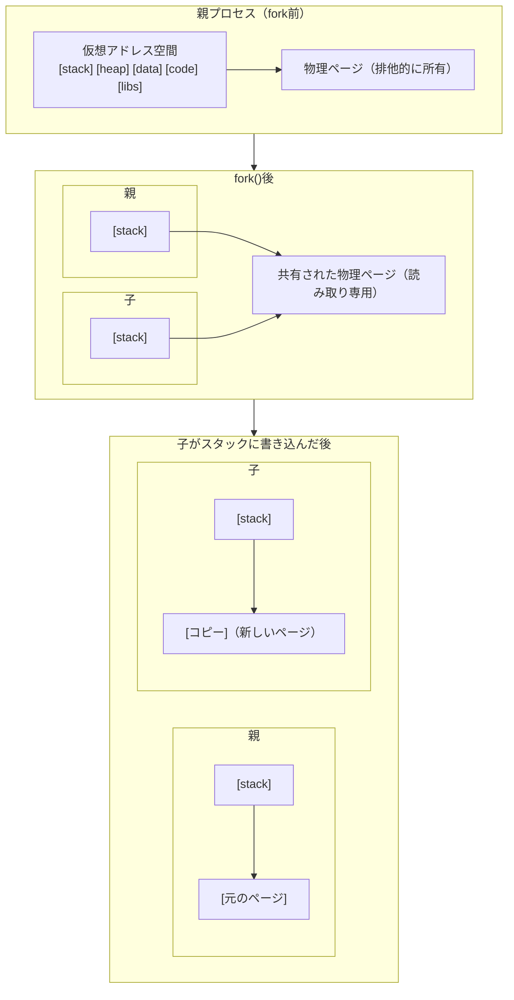
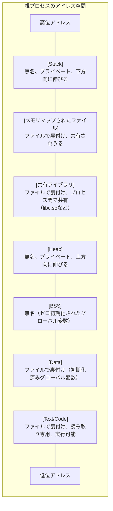
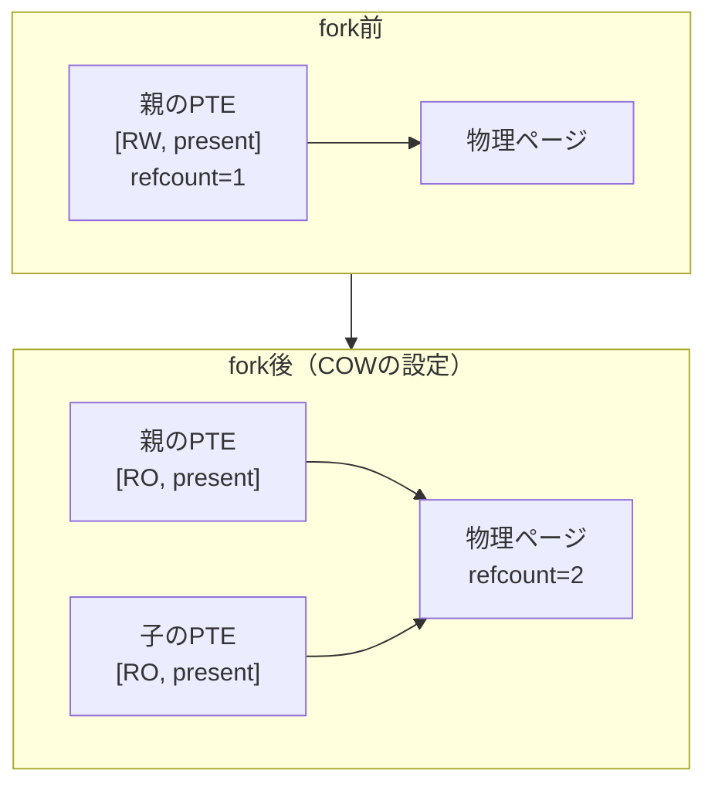
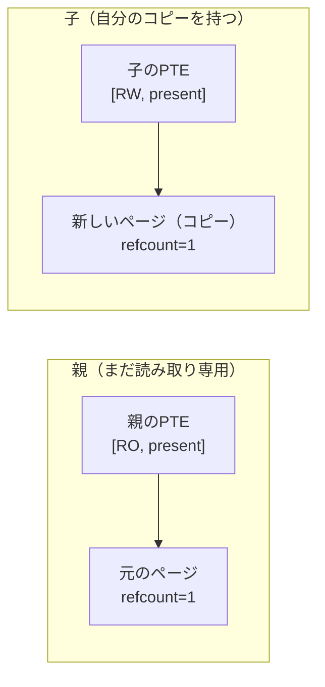
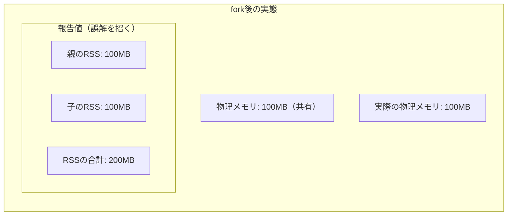
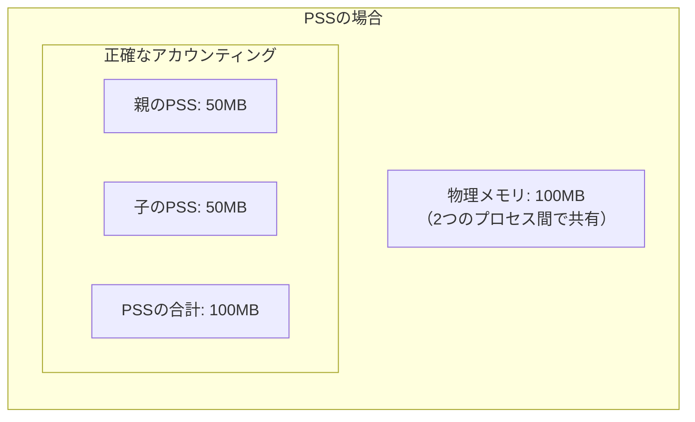
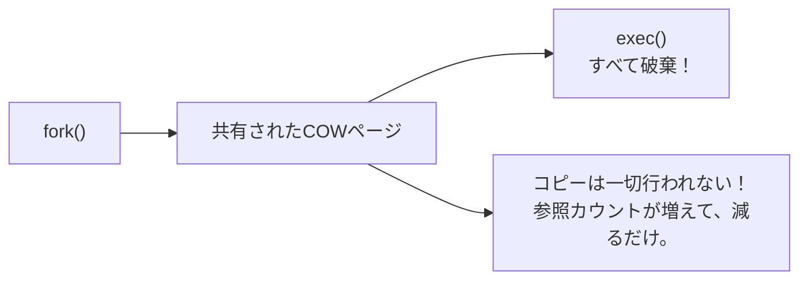
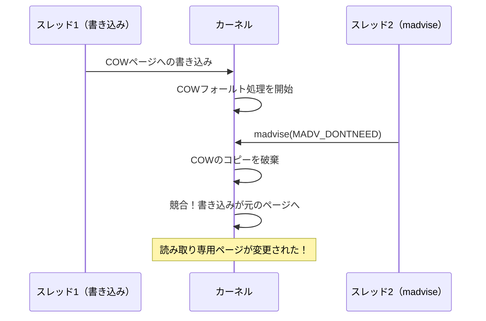
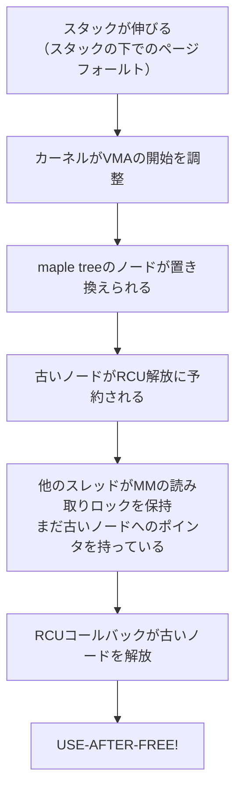

# forkすると何が起きるか {#what-happens-when-you-fork}

> プロセス生成におけるメモリの仕組み

## 30秒でわかるfork() {#fork-in-30-seconds}

プロセスが `fork()` を呼ぶと、カーネルは親プロセスのほぼ正確なコピーである子プロセスを作る。しかし、ギガバイト単位のメモリをコピーするのは遅く、無駄が多い。そこでLinuxは**コピーオンライト（COW）**を使う。親と子は、どちらかが書き込むまで同じ物理ページを共有する。



これによりfork()は高速になる。`O(使用メモリ量)` ではなく `O(ページテーブル)` で済む。

## fork前: 親のメモリ {#before-fork-the-parents-memory}

典型的なプロセスは複数のメモリ領域を持ち、それぞれ異なる方法で裏付けられている:



各領域はVMA（[Virtual Memory Area](mmap.md)）で表される。カーネルはfork中に各VMAを適切に処理しなければならない。

## forkシステムコール {#the-fork-system-call}

forkは内部的には `clone()` システムコールで実装されている:

```c
// ユーザーがfork()を呼ぶ
pid_t child = fork();

// glibcは次のように変換する:
clone(SIGCHLD, 0, NULL, NULL, 0);

// カーネルのエントリポイント: kernel/fork.c
SYSCALL_DEFINE0(fork)
{
    struct kernel_clone_args args = {
        .exit_signal = SIGCHLD,
    };
    return kernel_clone(&args);
}
```

### 何がコピーされるか {#what-gets-copied}

forkは多くのプロセス構造体のコピーを作る:

| 構造体 | 何が起きるか |
|-----------|--------------|
| `task_struct` | 子のために新しいコピーを作る |
| `mm_struct` | 新しいコピー（アドレス空間記述子） |
| VMA | 複製される（ただし同じページを参照） |
| ページテーブル | 複製される（同じ物理ページを指す） |
| 物理ページ | **共有される**（COWの設定） |
| ファイルディスクリプタ | 複製される（同じファイルを参照） |
| シグナルハンドラ | コピーされる |

決定的なポイントは、**ページテーブルはコピーされるが、物理ページはコピーされない**ということである。

## dup_mm()の内部: アドレス空間のコピー {#inside-dup_mm-copying-the-address-space}

メモリのコピーは [`dup_mm()`](https://git.kernel.org/pub/scm/linux/kernel/git/torvalds/linux.git/tree/kernel/fork.c) で行われる:

```c
// kernel/fork.c（簡略化）
static struct mm_struct *dup_mm(struct task_struct *tsk,
                                struct mm_struct *oldmm)
{
    struct mm_struct *mm;

    // 1. 新しいmm_structを割り当てる
    mm = allocate_mm();

    // 2. mm_structのフィールドをコピーする
    memcpy(mm, oldmm, sizeof(*mm));

    // 3. 新しいページテーブル（PGD）を割り当てる
    mm->pgd = pgd_alloc(mm);

    // 4. VMAとページテーブルをコピーする
    dup_mmap(mm, oldmm);

    return mm;
}
```

### VMAの複製 {#vma-duplication}

各VMAは複製されるが、扱いはその種類によって異なる:

```c
// kernel/fork.c dup_mmap()（簡略化）
static int dup_mmap(struct mm_struct *mm, struct mm_struct *oldmm)
{
    struct vm_area_struct *mpnt, *tmp;

    for_each_vma(oldmm, mpnt) {
        // DONTFORKとマークされた領域はスキップする
        if (mpnt->vm_flags & VM_DONTFORK)
            continue;

        // 子のために新しいVMAを作る
        tmp = vm_area_dup(mpnt);

        // 特殊なケースを処理する
        if (mpnt->vm_flags & VM_WIPEONFORK) {
            // 子にはゼロが見える（セキュリティ機能）
            tmp->anon_vma = NULL;
        }

        // このVMAのページテーブルをコピーする
        copy_page_range(mm, oldmm, tmp, mpnt);

        // VMAを子のアドレス空間に追加する
        insert_vm_struct(mm, tmp);
    }
}
```

### ページテーブルのコピーとCOWの設定 {#page-table-copying-and-cow-setup}

鍵となる関数は [`copy_page_range()`](https://git.kernel.org/pub/scm/linux/kernel/git/torvalds/linux.git/tree/mm/memory.c) で、親のページテーブルを走査し、子に対応するエントリを作成する:

```c
// mm/memory.c（簡略化）
int copy_page_range(struct mm_struct *dst_mm, struct mm_struct *src_mm,
                    struct vm_area_struct *dst_vma,
                    struct vm_area_struct *src_vma)
{
    // ページテーブルの階層を走査: PGD → PUD → PMD → PTE
    // 有効な各PTEについて...

    // プライベートな書き込み可能マッピングなら:
    if (is_cow_mapping(src_vma->vm_flags)) {
        // 親と子の両方のPTEを読み取り専用にする
        ptep_set_wrprotect(src_mm, addr, src_pte);
        pte = pte_wrprotect(pte);
    }

    // PTEを子にコピーする（同じ物理ページを指す）
    set_pte_at(dst_mm, addr, dst_pte, pte);

    // ページの参照カウントをインクリメントする
    page_dup_rmap(page);
}
```

**重要な詳細**: プライベートな書き込み可能マッピングでは、親と子の**両方**が読み取り専用にされる。これにより、最初に書き込んだ側（どちらのプロセスであれ）がCOWフォールトを引き起こすことが保証される。

### COWの設定の詳細 {#the-cow-setup-in-detail}



両方のPTEが同じ物理ページを指す。両方とも読み取り専用にマークされる。ページの参照カウントは2にインクリメントされる。

## COWフォールトの処理 {#cow-fault-handling}

どちらかのプロセスがCOWページに書き込むと、ページフォールトが発生する:

```c
// ユーザーコード（親または子）
buffer[0] = 'x';  // 共有ページへの書き込み

// CPU:「PTEは読み取り専用だと言っているのに、これは書き込みだ！」
// → ページフォールト → カーネルが処理する
```

カーネルはこれを [`do_wp_page()`](https://git.kernel.org/pub/scm/linux/kernel/git/torvalds/linux.git/tree/mm/memory.c) で処理する:

```c
// mm/memory.c（簡略化）
static vm_fault_t do_wp_page(struct vm_fault *vmf)
{
    struct folio *old_folio = page_folio(vmf->page);

    // このページの唯一の使用者かどうかを確認する
    if (wp_can_reuse_anon_folio(old_folio, vmf->vma)) {
        // 唯一のマッパーなので、単に書き込み可能にする
        wp_page_reuse(vmf, old_folio);
        return 0;
    }

    // 複数のマッパーがいるので、コピーが必要
    return wp_page_copy(vmf);
}

static vm_fault_t wp_page_copy(struct vm_fault *vmf)
{
    struct folio *old_folio = page_folio(vmf->page);
    struct folio *new_folio;

    // 1. 新しいページを割り当てる
    new_folio = vma_alloc_folio(GFP_HIGHUSER_MOVABLE, ...);

    // 2. 内容をコピーする（コピーオンライトの実際の「コピー」）
    copy_user_highpage(&new_folio->page, &old_folio->page, ...);

    // 3. ページテーブルを新しいページを指すよう更新する（書き込み権限付き）
    set_pte_at(vma->vm_mm, vmf->address, vmf->pte,
               mk_pte(&new_folio->page, vma->vm_page_prot));

    // 4. 古いページの参照カウントをデクリメントする
    folio_put(old_folio);

    return 0;
}
```

### COWフォールトの後 {#after-cow-fault}



**重要**: 親のPTEは、今や排他的な所有者になっているにもかかわらず読み取り専用のままである。後で親が書き込むと、`do_wp_page()` はrefcount=1を見て `wp_page_reuse()` を呼び、単にPTEを書き込み可能にする。コピーは不要である。この遅延的なアプローチにより、一度も書き込まれないかもしれないPTEを変更せずに済む。

## TLBに関する考慮事項 {#tlb-considerations}

ページテーブルを変更した後は、古いTLBエントリを無効化しなければならない。

### fork中 {#during-fork}

COWのためにPTEを読み取り専用にするとき:

```c
// 親のPTEはRWからROに変わる
// TLBは古いRWエントリをキャッシュしているかもしれない

ptep_set_wrprotect(src_mm, addr, src_pte);
// これはそのアドレスのTLBフラッシュを伴う
```

x86では、PTEを書き込み可能から読み取り専用に変更するには、そのTLBエントリをフラッシュする必要がある。そうしないと、CPUがキャッシュされた書き込み可能エントリを使い、COWフォールトを飛ばしてしまう可能性がある。

### COWフォールト中 {#during-cow-fault}

フォールトしたプロセスのPTEを更新した後:

```c
// 古いエントリ（RO）→ 新しいエントリ（RW、別の物理ページ）
// 古いTLBエントリをフラッシュする

flush_tlb_page(vma, address);
```

### マルチスレッドプロセス {#multi-threaded-processes}

forkするプロセスがマルチスレッドの場合、すべてのスレッドが同じ `mm_struct` を共有する。fork中は:

- forkするスレッドが `mmap_lock` を書き込みモードで保持する
- ページテーブルのコピー中、他のスレッドはフォールトできなくなる
- 兄弟スレッドを実行しているCPUにまたがるTLBシュートダウンが必要になることがある

これが、高度にマルチスレッドなプロセスで `fork()` が遅くなりうる理由の1つである。

## fork後のメモリアカウンティング {#memory-accounting-after-fork}

fork後、メモリのメトリクスは紛らわしくなることがある:

```bash
# 親と子の両方が次を示す:
ps -o pid,vsz,rss,comm -p $PARENT_PID,$CHILD_PID

# VSZ: 同じ（同じ仮想アドレス空間レイアウト）
# RSS: 最初は同じ、COWが起きるにつれて分岐する
```

### RSS（Resident Set Size） {#rss-resident-set-size}

RSSは、プロセスにマップされている物理ページを数える。fork後は:

- 両方のプロセスが共有ページを自分のRSSに数える
- 親と子のRSSの合計 > 実際に使われている物理メモリ
- これは想定どおりである！ RSSはプロセスごとの値であり、システム全体の値ではない



### PSS（Proportional Set Size） {#pss-proportional-set-size}

PSSは共有ページを共有しているプロセス間で按分する:



```bash
# PSSを表示する
cat /proc/$PID/smaps_rollup | grep Pss
```

### 共有とプライベート {#shared-vs-private}

`smaps` ファイルは次を区別する:

```bash
cat /proc/$PID/smaps | grep -E "^(Shared|Private)"

# Shared_Clean:  共有され、変更されていないページ
# Shared_Dirty:  共有され、変更されたページ（fork後はまれ）
# Private_Clean: プライベートで、書き込まれていないページ
# Private_Dirty: プライベートで、書き込まれたページ（COW完了）
```

fork後、ほとんどのページは `Shared_Clean` である。COWが起きるにつれ、書き込んだプロセスではそれらが `Private_Dirty` になる。

## exec()とCOWの後始末 {#exec-and-cow-cleanup}

一般的なパターンである `fork() + exec()` は高度に最適化されている:

```c
pid_t pid = fork();
if (pid == 0) {
    // 子プロセス
    exec("/bin/ls", ...);  // アドレス空間を丸ごと置き換える
}
```

`exec()` が実行されると:

1. **アドレス空間全体が破棄される**
2. COWページは一度もコピーされない（代わりに参照カウントがデクリメントされる）
3. 新しいプログラムのページが新たにマップされる



これが、シェル（絶えずfork+execする）が多くの子プロセスを作るにもかかわらず効率的である理由である。

### vfork()による最適化 {#vfork-optimization}

`vfork()` はさらに踏み込み、ページテーブルさえコピーしない:

```c
pid_t pid = vfork();
if (pid == 0) {
    // 子は親のアドレス空間を丸ごと共有する
    // 親は子が終了するかexecするまでブロックされる
    exec("/bin/ls", ...);
}
```

**警告**: `vfork()` では、子でのメモリの変更はすべて親を破壊する。直ちに `exec()` か `_exit()` する場合にのみ使うこと。

## 特殊なケース {#special-cases}

### VM_DONTFORK {#vm_dontfork}

継承されるべきでないVMAもある:

```c
// mmapの後、領域をdon't-forkとしてマークする
void *buf = mmap(NULL, size, PROT_READ | PROT_WRITE,
                 MAP_PRIVATE | MAP_ANONYMOUS, -1, 0);
madvise(buf, size, MADV_DONTFORK);
```

子にはこのマッピングが単に存在しない。DMAバッファやセキュリティ上重要な領域に使う。

### VM_WIPEONFORK {#vm_wipeonfork}

マッピングは子に存在するが、内容はゼロにされる:

```c
madvise(addr, len, MADV_WIPEONFORK);
```

子に漏れてはならないセキュリティ上重要なデータ（暗号鍵、乱数の状態）のために、カーネル4.14で追加された（[commit d2cd9ede6e19](https://git.kernel.org/linus/d2cd9ede6e19) | [LKML](https://lore.kernel.org/lkml/20170811212829.29186-3-riel@redhat.com/)）。

### ヒュージページとfork {#huge-pages-and-fork}

Transparent Huge Pages（THP）には特別なCOW処理がある:

- **以前の挙動**: 最初の書き込みで2MB全体をコピーする（高コスト！）
- **現代の挙動（v4.5以降）**: THPを4KBページに分割し、書き込まれたページだけをCOWする

詳細は[THPのドキュメント](thp.md)と[COWの解説](cow.md)を参照。

## 性能に関する考慮事項 {#performance-considerations}

### forkのレイテンシ {#fork-latency}

forkにかかる時間は次の要素に比例して増える:

1. **VMAの数**: 各VMAが複製される
2. **ページテーブルのサイズ**: すべての階層のページテーブルがコピーされる
3. **TLBフラッシュのオーバーヘッド**: 特に複数CPUで動くプロセスで

1GBのマップ済みメモリ（256Kページ）を持つプロセスでは、forkはそのすべてのページテーブルエントリを走査してコピーしなければならない。

### forkのオーバーヘッドを減らす {#reducing-fork-overhead}

1. **可能なら `posix_spawn()` を使う**: fork+execをより効率的に組み合わせる
2. **fork前に巨大なアドレス空間を避ける**: アンマップするとページテーブルのコピーが減る
3. **fork+execには `vfork()` を検討する**: ページテーブルのコピーは不要だが、危険

### forkの影響を測定する {#measuring-fork-impact}

```bash
# fork()操作の時間を計測する
perf stat -e 'syscalls:sys_enter_clone' ./your_program

# forkのレイテンシをトレースする
perf trace -e clone ./your_program

# fork後のCOWフォールトを観察する
perf stat -e page-faults ./your_program
```

## 試してみる {#try-it-yourself}

### COWの動作を観察する {#watch-cow-in-action}

```bash
cat > /tmp/cow_demo.c << 'EOF'
#include <stdio.h>
#include <stdlib.h>
#include <string.h>
#include <unistd.h>
#include <sys/wait.h>

int main() {
    // メモリを割り当てて触る
    size_t size = 100 * 1024 * 1024;  // 100MB
    char *buf = malloc(size);
    memset(buf, 'A', size);  // すべてのページをフォールトで割り当てる

    printf("Before fork - check RSS:\n");
    printf("  Parent PID: %d\n", getpid());
    char cmd[64];
    snprintf(cmd, sizeof(cmd), "ps -o pid,rss -p %d", getpid());
    system(cmd);

    pid_t pid = fork();

    if (pid == 0) {
        // 子
        printf("\nAfter fork - child PID: %d\n", getpid());
        sleep(1);  // 親に先に出力させる

        printf("\nChild writing to all pages (triggering COW)...\n");
        memset(buf, 'B', size);

        printf("\nAfter COW - check both processes:\n");
        char cmd[256];
        snprintf(cmd, sizeof(cmd), "ps -o pid,rss -p %d,%d", getppid(), getpid());
        system(cmd);

        exit(0);
    } else {
        // 親
        sleep(2);  // 子に作業させる
        wait(NULL);
    }

    return 0;
}
EOF
gcc -o /tmp/cow_demo /tmp/cow_demo.c
/tmp/cow_demo
```

### ページ共有を監視する {#monitor-page-sharing}

```bash
# 共有メモリとプライベートメモリを表示する
cat /proc/$PID/smaps_rollup

# fork前（親で）:
# Shared_Clean + Shared_Dirty ≈ 0（共有なし）
# Private_Clean + Private_Dirty ≈ RSS

# fork後（COW前）:
# Shared_Clean ≈ メモリの大部分（COWで共有）
# Private_* ≈ 小さい

# COW後:
# Private_Dirty が増える（コピーが作られた）
```

### forkシステムコールをトレースする {#trace-fork-system-call}

```bash
# 時間付きでforkをトレースする
strace -f -T -e clone,execve ./your_program

# -f: forkを追跡する
# -T: システムコールに費やした時間を表示する
```

### ページテーブルのページ数を数える {#count-page-table-pages}

```bash
# ページテーブルのメモリは/proc/PID/statusにある
grep -E "VmPTE|VmPMD" /proc/$PID/status

# VmPTE: PTEレベルのページテーブルメモリ
# VmPMD: PMDレベルのページテーブルメモリ
```

## 主要なソースファイル {#key-source-files}

| ファイル | 役割 |
|------|--------------|
| [`kernel/fork.c`](https://git.kernel.org/pub/scm/linux/kernel/git/torvalds/linux.git/tree/kernel/fork.c) | fork/cloneの実装、dup_mm() |
| [`mm/memory.c`](https://git.kernel.org/pub/scm/linux/kernel/git/torvalds/linux.git/tree/mm/memory.c) | copy_page_range()、COWフォールトの処理 |
| [`mm/mmap.c`](https://git.kernel.org/pub/scm/linux/kernel/git/torvalds/linux.git/tree/mm/mmap.c) | VMAの複製 |
| [`include/linux/mm_types.h`](https://git.kernel.org/pub/scm/linux/kernel/git/torvalds/linux.git/tree/include/linux/mm_types.h) | mm_struct、vm_area_struct |

## 歴史 {#history}

### 初期のCOW {#early-cow}

Unixにおけるコピーオンライトは、Linuxより前から存在する。Linuxは、Linus Torvaldsが1991年に最初の実装を書いたときに、Unixの伝統からこの技法を受け継いだ。

### VMAごとのロック（v6.4、2023年） {#per-vma-locks-v64-2023}

**コミット**: [5e31275cc997](https://git.kernel.org/linus/5e31275cc997)（"mm: add per-VMA lock and helper functions to control it"） | [LKML](https://lore.kernel.org/all/20230109205336.3665937-1-surenb@google.com/)

**作者**: Suren Baghdasaryan

COWのページフォールトを、グローバルな `mmap_lock` の代わりにVMAごとのロックで処理できるようになり、fork後のマルチスレッドプロセスのスケーラビリティが大きく向上した。

### VMAロック下でのCOW（v6.4以降、2023年） {#cow-under-vma-lock-v64-2023}

**コミット**: [164b06f238b9](https://git.kernel.org/linus/164b06f238b9)（"mm: call wp_page_copy() under the VMA lock"） | [LKML](https://lkml.kernel.org/r/20231006195318.4087158-3-willy@infradead.org)

**作者**: Matthew Wilcox（Oracle）

`mmap_lock` を取らずにCOWフォールトを処理するための継続的な取り組みの一部で、並行するページフォールト処理を改善する。

## 悪名高いバグとエッジケース {#notorious-bugs-and-edge-cases}

forkとCOWには、メモリマッピング、ページテーブル操作、シグナル処理の間の微妙な競合状態が絡む。これらのバグは、Linuxカーネルで最も影響の大きかった脆弱性のいくつかにつながった。

---

### ケース1: Dirty COW（CVE-2016-5195） {#case-1-dirty-cow-cve-2016-5195}

#### 何が起きたか {#what-happened}

2016年10月、Phil Oesterは、カーネル2.6.22（2007年7月）から存在していたカーネルのCOW処理の競合状態を発見した。**9年間**発見されていなかったのである。

この脆弱性により、権限のないローカルユーザーが読み取り専用のメモリマッピングへの書き込みアクセスを得られ、rootへの権限昇格が可能になった。

#### バグ {#the-bug}

[Dirty COWの公式ページ](https://dirtycow.ninja/)によれば、競合状態は次の2つの操作の間で起きる:

1. **スレッドA**: COWメモリマッピングへの書き込み（COWフォールトを引き起こす）
2. **スレッドB**: ページを破棄するために `madvise(MADV_DONTNEED)` を呼ぶ

これらが繰り返し競合すると、カーネルが混乱し、先にプライベートなコピーを作る代わりに、元の読み取り専用ページへ直接データを書き込んでしまうことがある。



#### 現実への影響 {#real-world-implications}

この脆弱性は[実際に悪用されていた](https://www.redhat.com/en/blog/understanding-and-mitigating-dirty-cow-vulnerability)。攻撃シナリオには次のものがあった:

- `/etc/passwd` を上書きしてrootアクセスを得る
- setuidバイナリを改変する
- バージョン7（Nougat）より前のAndroidデバイスをroot化する

[Red Hatの分析](https://access.redhat.com/security/vulnerabilities/DirtyCow): *"Although it is a local privilege escalation, remote attackers can use it in conjunction with other exploits that allow remote execution of non-privileged code to achieve remote root access."*（訳: ローカルの権限昇格ではあるが、リモート攻撃者は、権限のないコードのリモート実行を可能にする他のエクスプロイトと組み合わせて、リモートからのrootアクセスを得るために使える）

#### 修正 {#the-fix}

**コミット**: [19be0eaffa3a](https://git.kernel.org/linus/19be0eaffa3a)（"mm: remove gup_flags FOLL_WRITE games from __get_user_pages()"） | [LKML](https://lkml.org/lkml/2016/10/19/860)

**作者**: Linus Torvalds

Linusはこう書いている: *"This is an ancient bug that was actually attempted to be fixed once (badly) by me eleven years ago... It was then undone due to problems on s390."*（訳: これは大昔のバグで、実は11年前に私が一度（まずいやり方で）修正しようとしたものだ……その後s390での問題のために取り消された）

この修正は、競合の窓を生んでいた `FOLL_WRITE` フラグの操作を取り除いた。

#### なぜ発見されなかったか {#why-it-went-undetected}

このバグは微妙だった:

- 2つのスレッド間の正確なタイミングが必要だった
- 読み取り専用ファイルのプライベートマッピングにしか影響しなかった
- 通常のテストでは競合は起きなかった

#### 遺産 {#legacy}

Dirty COWは同様の競合の研究を生んだ。名前は "Dirty"（書き込み操作）+ "COW"（Copy-On-Write）に由来する。独自のロゴとWebサイトを持ち、競合状態の脆弱性の教科書的な例となった。

---

### ケース2: StackRot（CVE-2023-3269） {#case-2-stackrot-cve-2023-3269}

#### 何が起きたか {#what-happened_1}

2023年6月、Ruihan Li（北京大学）は、maple treeにuse-after-freeの脆弱性を発見した。maple treeは、カーネル6.1でVMA管理のために赤黒木を置き換えた新しいデータ構造である。

#### バグ {#the-bug_1}

[StackRotの公開情報](https://github.com/lrh2000/StackRot)は次のように説明している:

スタックが（`MAP_GROWSDOWN` によって）伸びるとき、カーネルはVMAの開始アドレスを調整する。この調整は、**MMの書き込みロックを保持せずに**maple treeを変更する。

maple treeはRCUセーフなので、ノードの変更では新しいノードが作られ、古いノードはRCUコールバックによる削除が予約される。しかしVMAへのアクセスにはMMの読み取りロックしか必要なく、RCUのクリティカルセクションには入らない。



#### 現実への影響 {#real-world-implications_1}

[oss-securityでの公開](https://www.openwall.com/lists/oss-security/2023/07/05/1)より:

> *"An unprivileged local user could use this flaw to compromise the kernel and escalate their privileges."*

この脆弱性はカーネル6.1から6.4に影響した。VMA管理にmaple treeを使うすべてのシステムである。

#### 修正 {#the-fix_1}

Linusは2023年6月28日、6.5のマージウィンドウ中に修正をマージし、6.1.37、6.3.11、6.4.1にバックポートされた。

Linusは技術的なアプローチを説明する[詳細なマージメッセージ](https://github.com/lrh2000/StackRot)を残した。RCU下でアクセスされうるmaple treeのノードを変更する際に、適切なロックを確実に行うというものである。

#### なぜforkにとって重要か {#why-this-matters-for-fork}

forkはVMAとそのmaple treeでの表現を複製する。maple treeの複雑さ（置き換えた、より単純な赤黒木と比べて）がこの微妙な競合をもたらした。MMコードにおけるデータ構造の変更には、極めて慎重な並行性の分析が必要であることを思い出させる事例である。

---

### ケース3: mremap()の大惨事（CVE-2004-0077） {#case-3-the-mremap-disaster-cve-2004-0077}

#### 何が起きたか {#what-happened_2}

2004年2月、Paul Starzetzは `mremap()`（メモリマッピングを移動またはリサイズするシステムコール）に重大な脆弱性を発見した。

#### バグ {#the-bug_2}

[ISECのアドバイザリ](https://isec.pl/en/vulnerabilities/isec-0014-mremap-unmap.txt)より:

> *"A critical security vulnerability was found in the Linux kernel memory management code in the mremap(2) system call due to incorrect bound checks."*

カーネルは `mremap()` の引数を適切に検証していなかった。特定の引数を細工することで、攻撃者は次のことができた:

1. ページテーブルのカウンタをオーバーフローさせる
2. 他のプロセスの仮想メモリセグメントを乗っ取る
3. そのセグメントが昇格した権限で動いていれば、その権限を得る

#### 現実への影響 {#real-world-implications_2}

任意のローカルユーザーがrootに昇格できた。この脆弱性は、公開された概念実証コードで容易に悪用できた。

アドバイザリより: *"No special privileges are required to use the mremap(2) system call, thus any process may misuse its unexpected behavior to disrupt the kernel memory management subsystem."*（訳: mremap(2)システムコールの使用には特別な権限は不要なので、どのプロセスでもその予期しない挙動を悪用してカーネルのメモリ管理サブシステムを混乱させられる）

#### 修正 {#the-fix_2}

カーネルバージョン2.4.xと2.6.xにまたがって複数のパッチが必要だった。修正はmremapのパスに適切な境界チェックを追加した。

#### 遺産 {#legacy_1}

このバグは、複雑なMMシステムコールの危険性を浮き彫りにした。mmap/mremap/mprotectのコードパスへの精査が強まり、MMシステムコールのファジング研究のきっかけとなった。

---

### ケース4: mremapにおけるTLBフラッシュの競合（CVE-2018-18281） {#case-4-tlb-flush-races-in-mremap-cve-2018-18281}

#### 何が起きたか {#what-happened_3}

2018年、Jann Horn（Google Project Zero）は `mremap()` にTLB（Translation Lookaside Buffer）の競合を発見した。

#### バグ {#the-bug_3}

Jann Hornによる[oss-securityでの公開](https://www.openwall.com/lists/oss-security/2018/10/10/5)より:

`mremap()` がマッピングを移動するとき、次のことをしなければならない:
1. ページテーブルを更新する
2. 古い変換をキャッシュしている可能性のあるすべてのCPUでTLBをフラッシュする

TLBフラッシュが不完全だったり並行アクセスと競合したりすると、CPUが古い変換を使い、誤った物理ページにアクセスする可能性がある。

#### 現実への影響 {#real-world-implications_3}

攻撃者は分離を迂回して、他のプロセスに属するメモリを読み書きできる可能性があった。

#### 修正 {#the-fix_3}

**コミット**: [eb66ae030829](https://git.kernel.org/linus/eb66ae030829)（"mremap: properly flush TLB before releasing the page"）

**作者**: Linus Torvalds

この修正は、移動元と移動先の両方のページテーブルロックを解放する前にTLBフラッシュが行われることを保証し、古いTLBエントリが再割り当てされたページにアクセスするのを防ぐ。

---

### ケース5: fork()とuserfaultfdの競合 {#case-5-fork-and-userfaultfd-races}

#### パターン {#the-pattern}

`userfaultfd` は、ユーザー空間がページフォールトを処理できるようにする。これは次の用途で非常に有用である:

- VMのライブマイグレーション
- ガベージコレクタ
- 独自のメモリ管理

しかし、これは競合状態を悪用するための強力なプリミティブでもある。ページフォールトをユーザー空間で処理することで、攻撃者は正確な瞬間に**カーネルの実行を一時停止**させられる。

#### 悪用の手法 {#exploitation-technique}

[CVE-2019-18683の分析](https://a13xp0p0v.github.io/2020/02/15/CVE-2019-18683.html)より:

1. 攻撃者がuserfaultfd付きでメモリをマップする
2. そのメモリにアクセスするカーネルのコードパスを起動する
3. カーネルはユーザー空間がフォールトを処理するのを待ってブロックする
4. カーネルが一時停止している間に、攻撃者が他のカーネル状態を操作する
5. 攻撃者がフォールトを解放する
6. カーネルは壊れた状態のまま処理を続ける

この手法は、Dirty COWの亜種を含む多くのカーネルエクスプロイトで使われてきた。

#### 緩和策 {#mitigation}

カーネル5.2以降、`/proc/sys/vm/unprivileged_userfaultfd` でuserfaultfdを特権ユーザーに制限できる:

```bash
# 非特権のuserfaultfdを無効化する（カーネルの攻撃対象領域を減らす）
echo 0 > /proc/sys/vm/unprivileged_userfaultfd
```

現在、多くのディストリビューションはデフォルトで `0` にしている。

---

### まとめ: 得られた教訓 {#summary-lessons-learned}

| バグ | 年 | 根本原因 | 影響 | 予防 |
|-----|------|------------|--------|------------|
| **Dirty COW** | 2016 | COWとmadviseの競合 | rootアクセス | カーネル更新。9年間発見されずに存在 |
| **StackRot** | 2023 | RCUとMMロックの不整合 | rootアクセス | データ構造の並行性の慎重なレビュー |
| **mremapの境界** | 2004 | 境界チェックの欠如 | rootアクセス | システムコール引数の検証 |
| **TLBフラッシュの競合** | 2018 | 不完全なTLBフラッシュ | メモリの漏洩 | 適切なフラッシュの順序 |
| **userfaultfdの競合** | 継続中 | カーネルを一時停止させるプリミティブ | さまざま | 非特権のuserfaultfdを制限する |

共通するのは、**forkとCOWにはプロセス間で共有される複雑な状態が絡む**ということである。このコードにおけるあらゆる競合状態は、プロセスの分離を破りうるため、深刻なセキュリティ上の影響を持つ。

## 参考文献 {#further-reading}

### 関連ドキュメント {#related-docs}

- [コピーオンライト](cow.md) - COWの仕組みとエッジケースの詳細
- [プロセスのアドレス空間](mmap.md) - VMAの構造と管理
- [仮想vs物理vs常駐](virtual-physical-resident.md) - メモリのメトリクスを理解する

### 外部資料 {#external-resources}

- [LWN: The price of fork()](https://lwn.net/Articles/820258/)（2020年） - 現代のシステムにおけるforkの性能分析
- [Dirty COW vulnerability page](https://dirtycow.ninja/) - 最初の公開情報と技術的詳細
- [StackRot disclosure](https://github.com/lrh2000/StackRot) - CVE-2023-3269の詳細とエクスプロイト
