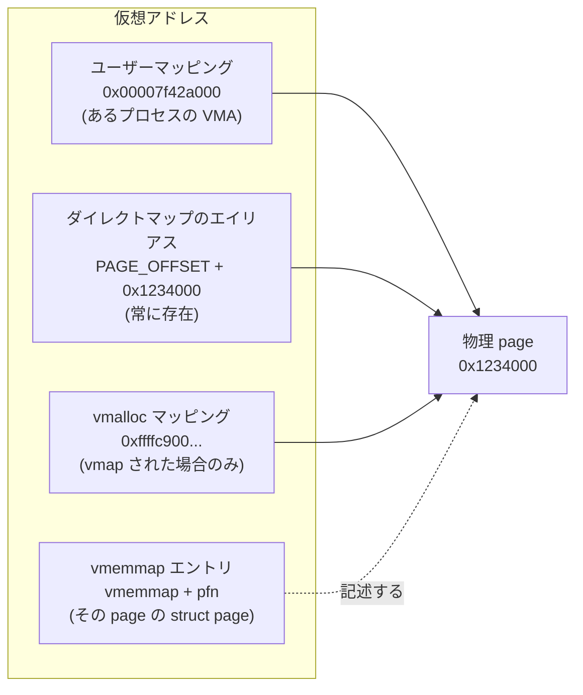

# カーネルアドレス空間 {#the-kernel-address-space}

> ダイレクトマップ、vmemmap、vmalloc空間、KASLR — アドレス空間のカーネル側の半分に何が置かれているのか、そしてなぜそのように配置されているのか

64ビットのすべてのプロセスは、半分に分割されたアドレス空間を持つ。下半分はユーザー空間に属し、コンテキストスイッチのたびに切り替わる。一方、上半分はカーネルに属し、どのプロセスでも（ほぼ）同一である。このページでは、x86-64におけるその上半分を案内する。各領域が*何のために*あるのか、各領域がなぜその位置とサイズに置かれているのか、そしてその設計にどんなコストがあるのかを見ていく。

変換の仕組み（仮想アドレスがどのように物理アドレスになるか）を知りたい場合は、先に[ページテーブル](page-tables.md)と[x86-64のページテーブル](../arch/x86/page-tables.md)を読んでほしい。このレイアウトがブート時に命令単位でどのように*構築*されるかを見たい場合は、[x86_64のブート時ページテーブルのセットアップ](boot-page-tables.md)を読んでほしい。このページで扱うのは、完成したマップとその設計根拠である。

---

## マップ {#the-map}

正規のリファレンスは[Documentation/arch/x86/x86_64/mm.rst](https://docs.kernel.org/arch/x86/x86_64/mm.html)である。4レベルページング（48ビット仮想アドレス）では、カーネル側の半分は次のようになる。

```
x86-64 kernel virtual address space (4-level paging):

ffff800000000000 ┌────────────────────────────────┐ ← start of kernel half
                 │ guard hole (8 TB, reserved     │
                 │ for hypervisors)               │
ffff880000000000 ├────────────────────────────────┤
                 │ LDT remap for KPTI (0.5 TB)    │
ffff888000000000 ├────────────────────────────────┤ ← PAGE_OFFSET
                 │ direct map of all physical     │
                 │ memory ("physmap", 64 TB)      │   __va() / __pa()
ffffc88000000000 ├────────────────────────────────┤
                 │ hole (0.5 TB guard)            │
ffffc90000000000 ├────────────────────────────────┤ ← VMALLOC_START
                 │ vmalloc / ioremap (32 TB)      │
ffffe90000000000 ├────────────────────────────────┤
                 │ hole (1 TB guard)              │
ffffea0000000000 ├────────────────────────────────┤ ← VMEMMAP_START
                 │ vmemmap: struct page array     │
                 │ (1 TB)                         │   pfn_to_page() / page_to_pfn()
ffffeb0000000000 ├────────────────────────────────┤
                 │ unused hole                    │
ffffec0000000000 ├────────────────────────────────┤
                 │ KASAN shadow (16 TB, if        │
                 │ CONFIG_KASAN)                  │
fffffe0000000000 ├────────────────────────────────┤
                 │ cpu_entry_area                 │   entry stacks, GDT, TSS
fffffe8000000000 ├────────────────────────────────┤
                 │ ESPFIX stacks, EFI runtime     │
                 │ services (with holes between)  │
ffffffff80000000 ├────────────────────────────────┤ ← __START_KERNEL_map
                 │ kernel text + data (512 MB /   │
                 │ 1 GB with KASLR)               │   .text, .rodata, .data, .bss
ffffffffa0000000 ├────────────────────────────────┤ ← MODULES_VADDR
                 │ module mapping space (~1.5 GB) │
ffffffffff000000 ├────────────────────────────────┤
                 │ fixmap + legacy vsyscall       │
ffffffffffffffff └────────────────────────────────┘
```

個々の領域に踏み込む前に、3つの点を確認しておく。

1. **すべての領域は、マップされていないガードホールで隔てられている。** ある領域の末尾をはみ出した不正なポインタは、次の領域を黙って破壊するのではなく、フォールトを起こす。
2. **各領域は途方もなく大きく取られている。** ダイレクトマップに64 TB、vmallocに32 TB — どんなマシンのRAMよりもはるかに大きい。48ビットの世界では仮想アドレス空間はほぼタダなので、レイアウトはそれを惜しみなく使い、領域の計算を単純に保ち、将来の拡張の余地を残している。
3. **同じマップがすべてのプロセスに存在する。** カーネルのマッピングはGlobalビットと共有のページテーブルpageを使う。すべてのプロセスのPGDはカーネル側の半分について同じエントリを持つので、カーネルに入ったときにどのプロセスが実行中であっても、カーネルポインタは同じものを指す。（[KPTI](../arch/x86/page-tables.md)はこれを複雑にする。ユーザー空間を実行している間は、このマップのごく一部しか存在しない。）

5レベルページング（57ビットアドレス、`CONFIG_X86_5LEVEL`）でも、同じ領域が同じ順序で存在し、単に再配置・拡大されるだけである。ダイレクトマップは32 PBに拡大し、`0xff11000000000000`に移動する。このレイアウトは、ページングの段数の選択によって変わるのが構造ではなく定数だけになるよう設計されている。

### canonicalホール {#the-canonical-hole}

有効なアドレスのビット63:48は、すべてビット47のコピー（符号拡張）でなければならない。このハードウェアの規則によって、アドレス空間は「下位」のcanonicalな半分（`0x0000...` — ユーザー空間）と「上位」のcanonicalな半分（`0xffff...` — カーネル）に分割され、その間には巨大な非canonicalの隙間ができる。カーネルが上位の半分を取るのは慣習によるものではなく、符号拡張のおかげで「上位の半分」の判定が安価になるからである。最上位ビットが立っているアドレスはすべてカーネルアドレスである。カーネルポインタがすべて`0xffff`で始まるのはこのためであり、ログファイルに漏れたポインタが一目でそれとわかるのもこのためである。

---

## ダイレクトマップ: カーネルから見たRAM {#the-direct-map-the-kernels-view-of-ram}

唯一にして最も重要な領域が**ダイレクトマップ**（*リニアマップ*または*physmap*とも呼ばれる）である。これは*すべての*物理メモリを、`PAGE_OFFSET`から順にマッピングしたものである。

```c
/* arch/x86/include/asm/page_64.h（簡略化） */
#define __va(x)  ((void *)((unsigned long)(x) + PAGE_OFFSET))
#define __pa(x)  ((unsigned long)(x) - PAGE_OFFSET)
```

### なぜRAM全体を常時マップするのか {#why-map-all-of-ram-permanently}

そうしない場合の代償が耐えがたいからである。カーネルは任意の物理pageに絶えず触れる必要がある。割り当てたばかりのpage、ディスクから内容を読み込んでいるページキャッシュのpage、ページテーブルウォーク中のページテーブルのpageなどである。常設のマッピングがなければ、こうしたアクセスのたびに一時的なマッピングを作らなければならない（32ビットカーネルがhighmemに対して`kmap()`で行っていたように。この設計はあまりに苦痛で、それをなくすことが64ビット化の大きな動機の1つだった）。ダイレクトマップがあれば、物理↔仮想の変換は加算1回で済み、ページテーブルの変更もTLBシュートダウンも要らない。

これこそが64ビット仮想アドレスの*最大の*恩恵である。32ビットカーネルは、1 GBのカーネル側の半分に約1 GBを超えるRAMをマップできなかったため、「highmem」のpageには恒久的なカーネルアドレスがなかった。x86-64ではアドレス空間が十分に大きいので、全RAMをマップしてもページテーブルのpage以外のコストはかからない。

理解しておくべき2つの帰結がある。

- **すべての物理pageは（少なくとも）2つの仮想アドレスを持つ。** あるプロセスで`0x00007f...`にマップされたpageは、ダイレクトマップの`PAGE_OFFSET + phys`*でも*見える。`kmalloc()`はダイレクトマップのアドレスを返す。`virt_to_phys()`がkmallocのメモリには使えて、vmallocのメモリには使えないのはこのためである。
- **ダイレクトマップのページテーブルは共有され、巨大なページを使う。** カーネルは可能な限り1 GBと2 MBのページでこれをマップする（[arch/x86/mm/init.c](https://git.kernel.org/pub/scm/linux/kernel/git/torvalds/linux.git/tree/arch/x86/mm/init.c)の`init_mem_mapping()`）。そのため、大規模なマシンのRAM全体が少数のTLBエントリに収まる。

1つの物理pageを、各領域から見るとこうなる。



### コスト: 断片化と攻撃対象領域 {#the-cost-fragmentation-and-attack-surface}

ダイレクトマップの巨大なページは、その弱点でもある。*単一の*4 KBページの権限を変更する機能 — モジュールのテキストに対する`set_memory_ro()`、[secretmem](https://lwn.net/Articles/812325/)に対する`set_memory_np()`、DEBUG_PAGEALLOC — は、カーネルにダイレクトマップの1 GBや2 MBのページを4 KBページへ分割させ、すべてのカーネルメモリアクセスにおけるTLB圧力を恒久的に増やす。ダイレクトマップの断片化はmmのメーリングリストで繰り返し取り上げられる性能上の話題であり、権限を変更するAPIが控えめにしか使われないのはこのためである。

セキュリティ面の話はさらに深刻である。*ユーザー*のpageもダイレクトマップを通して見えるので、攻撃者が制御したカーネルアドレスを参照外しさせられるカーネルのバグがあれば、ユーザーが制御するデータにカーネルアドレスで到達できる。これが*ret2dir*攻撃のファミリーである（[Kemerlis et al., USENIX Security 2014](https://www.usenix.org/conference/usenixsecurity14/technical-sessions/presentation/kemerlis)）。これへの対策が、いくつかの現代的な機能を形作った。

- `memfd_secret()`（Linux 5.14、[LWN](https://lwn.net/Articles/865256/)）は、**ダイレクトマップから完全に取り除かれた**pageをユーザー空間に与える。侵害されたカーネルでさえ、それらを容易には読めない。
- KVMの`guest_memfd`は、同じ考え方をconfidential VMのゲストメモリに適用している（[LWN: Unmapping guest_memfd from the direct map](https://lwn.net/Articles/981306/)）。
- ダイレクトマップは**実行不可**（NXが設定されている）なので、あるpageの書き込み可能な2つ目のエイリアスがあっても、それを直接コード実行に転化することはできない。

---

## vmemmap: アドレス空間のトリックとしてのstruct page配列 {#vmemmap-the-struct-page-array-as-an-address-space-trick}

カーネルは物理的な4 KBのpageをすべて`struct page`で追跡する（[pageの一生](life-of-page.md)を参照）。1 TBのマシンではその数は2億5600万個になる。そして中核のmmコードは`pfn_to_page()`が*高速*であることを求める。これはアロケータのあらゆるホットパスで実行されるからである。

```c
/* include/asm-generic/memory_model.h — CONFIG_SPARSEMEM_VMEMMAP */
#define __pfn_to_page(pfn)  (vmemmap + (pfn))
#define __page_to_pfn(page) ((unsigned long)((page) - vmemmap))
```

加算1回である。ルックアップテーブルも境界チェックもない。これが機能するのは、意図的な錯覚のおかげである。`vmemmap`は`VMEMMAP_START`から始まる`struct page`の**仮想的に連続した**配列で、物理フレーム番号でインデックス付けされる。しかし、物理メモリが実際に存在する箇所にしか*実体が用意されない*。実際のRAMが物理的に連続していることはまれである（ファームウェアが穴を予約し、デバイスがウィンドウを占有し、NUMAノードはアラインされた境界から始まる）。そのため、平坦な物理配列では穴に対応するstruct pageでメモリが無駄になる。代わりに`SPARSEMEM_VMEMMAP`は、配列を支えるpageをセクション単位でオンデマンドにマップし、穴はマップされない仮想空間のまま残す。安価な仮想アドレスを費やすことで、*物理的な*裏付けは連続していなくても、*論理的な*配列を連続させているのである。

この領域は最悪のケースに合わせてサイズが決められている。64 TBの物理メモリ / pageあたり4 KB × `struct page`あたり64バイト = 1 TBのvmemmapである。これは[メモリホットプラグ](memory-hotplug.md)を扱いやすくしている仕組みでもある。新しいDIMMを挿すとvmemmapの新たな一片に実体が用意され、`pfn_to_page()`の計算は決して変わらない。Mike Rapoportによる[メモリモデルに関するLWNの概説](https://lwn.net/Articles/789304/)は、FLATMEMとDISCONTIGMEMがこの設計に敗れた経緯を伝えている。

---

## vmalloc領域 {#the-vmalloc-arena}

3つ目の主要な領域は`VMALLOC_START`から`VMALLOC_END`までで、**仮想的には連続し、物理的には散在する**割り当てのための32 TBの空間である。アロケータそのものは[vmalloc](vmalloc.md)のページで扱っている。アドレス空間の観点から重要なのは、*なぜこれが別の領域なのか*である。

- **物理的な連続性からの逃げ道である。** ブート後は、物理的に連続した大きな割り当ては当てにならなくなる（[コンパクション](compaction.md)を参照）。vmallocはTLB効率（ダイレクトマップの巨大なページとは異なり4 KBのマッピング）と引き換えに、大きなサイズでも確実に成功することを保証する。
- **RAM以外のマッピングが置かれる場所である。** `ioremap()`はデバイスのMMIOをここに配置し、`vmap()`は任意のpageの集合をつなぎ合わせて連続した範囲にする。
- **動的なper-CPUメモリを収容する。** ブート時のper-CPU領域が満杯になると、`pcpu_alloc()`はvmalloc空間から新しいチャンクを確保する。`/proc/vmallocinfo`に`pcpu_alloc`のエントリが現れるのはこのためである。
- **ガードページがタダで得られる。** 各vmalloc領域は次の領域とマップされないpageで隔てられているので、線形のオーバーフローはフォールトを起こす。まさにこれが、カーネルスタックがvmalloc空間に移された理由である（`CONFIG_VMAP_STACK`、Linux 4.9、[LWN: Virtually mapped kernel stacks](https://lwn.net/Articles/692208/)）。スタックオーバーフローは、隣接するものを黙って破壊するのではなく、ガードページに当たってきれいにoopsするようになった。

この領域の微妙なコストとして、vmallocのマッピングは共有されたカーネルのページテーブルをPGDレベルで遅延的に変更する。歴史的にこれには`vmalloc_fault()`が必要だった。これは、最初に触れたときに別のプロセスの最上位エントリを埋めるページフォールトのパスである。現代のカーネルは、この種のフォールトを完全に避けるため、ブート時に領域全体の共有エントリを事前に埋めている（[commit 6eb82f994026](https://git.kernel.org/pub/scm/linux/kernel/git/torvalds/linux.git/commit/?id=6eb82f994026)、Linux 5.9）。

---

## 最上位の2 GB: カーネルテキストとモジュール {#the-top-2-gb-kernel-text-and-modules}

カーネルのコードはダイレクトマップからは実行されない。アドレス空間の最上部`__START_KERNEL_map = 0xffffffff80000000`に専用のエイリアスを持ち、その直後にモジュールが続く。この配置は見た目の問題ではなく、ABI上の制約によるものである。

- カーネルは`-mcmodel=kernel`でコンパイルされる。これによりコンパイラは、すべてのシンボルが**符号拡張された32ビット即値**に収まる、すなわちアドレス空間の最上位2 GBにあると仮定できる。その結果、すべてのグローバル参照は64ビット定数のロードではなく短い命令になる。
- モジュールは**カーネルテキストから±2 GB以内**になければならない。そうすれば、直接の`call`命令（32ビットの相対変位）が間接参照なしにカーネルのシンボルに届く。モジュール領域がカーネルイメージにぴったり接しているのも、他のすべての領域がテラバイト単位で測られる空間でそれが「わずか」約1.5 GBしかないのも、このためである。

したがって、カーネルテキストには*3つの*アドレスがある。物理アドレス、ダイレクトマップのエイリアス、そして`__START_KERNEL_map`のエイリアスである。テキストのアドレスに対する`__pa()`は、ダイレクトマップのアドレスに対するものとは異なる計算を必要とする（`__phys_addr()`が両方のケースを扱う）。

---

## KASLR: マップのシャッフル {#kaslr-shuffling-the-map}

ここまでの説明はすべて*コンパイル時の*レイアウトである。`CONFIG_RANDOMIZE_BASE`と`CONFIG_RANDOMIZE_MEMORY`（どちらもデフォルトで有効）があると、ブート時のKASLRが次のものをそれぞれ独立にランダム化する。

| 対象 | 粒度 | エントロピーの元になる領域 |
|------|-------------|----------------------|
| カーネルテキスト（物理ロードアドレス） | 2 MB | RAMが許す任意の場所 |
| カーネルテキスト（仮想） | 2 MB | `__START_KERNEL_map`の1 GBのウィンドウ |
| ダイレクトマップのベース | 1 GB（PUD） | 領域内でシャッフル |
| vmallocのベース | 1 GB（PUD） | 領域内でシャッフル |
| vmemmapのベース | 1 GB（PUD） | 領域内でシャッフル |
| モジュールのロードベース | 4 KB | モジュール領域の先頭での小さなオフセット |

領域のランダム化は[arch/x86/mm/kaslr.c](https://git.kernel.org/pub/scm/linux/kernel/git/torvalds/linux.git/tree/arch/x86/mm/kaslr.c)にある。ダイレクトマップ、vmalloc、vmemmapは*順序*を保ったまま、利用可能な空間内でベースが配り直される。そのため、ダイレクトマップのポインタを漏洩させた攻撃者も、vmallocやカーネルイメージがどこに置かれたかについては何もわからない。

この設計の率直な評価（[LWN: Kernel address space layout randomization](https://lwn.net/Articles/569635/)）: KASLRはハードルを「アドレスを計算する」から「まず情報漏洩を見つける」へと引き上げる。しかしカーネルポインタの漏洩は十分にありふれている（`%p`のハッシュ化、`kptr_restrict`、`dmesg_restrict`はいずれもそれに対抗するために存在する）ので、KASLRは境界ではなく1つの防御層として理解するのが最善である。ランダム化に抵抗するものもある。`cpu_entry_area`の*領域*は固定のベースに置かれたままである。システムコール／割り込みのエントリコードは、ランダム化されたベースを読み込む前に自分のスタックを見つけなければならないからである。またfixmap領域は、まさに初期ブートや特殊な機能にコンパイル時定数のアドレスを与えるために存在する。固定の`cpu_entry_area`は実際にKASLRのバイパスとして悪用された。それを受けて、Linux 6.2以降は領域*内の*per-CPU領域がシャッフルされるようになっている（[x86/mm: Randomize per-cpu entry area](https://lkml.org/lkml/2022/10/21/1130)、CVE-2023-0597）。

---

## arm64ではどう異なるか {#how-arm64-does-it-differently}

arm64（[arm64のメモリモデル](../arch/arm64/memory-model.md)）にも同じ概念が現れるが、ハードウェアに1つ洗練された違いがある。両方の半分をカバーする1つのページテーブルルート（CR3）の代わりに、arm64には**2つ**ある。低位（ユーザー）の半分用の`TTBR0_EL1`と、高位（カーネル）の半分用の`TTBR1_EL1`である。カーネル側の半分はコンテキストスイッチで決して変わらないので、プロセスの切り替えではTTBR0にしか触れない。またarm64版のKPTI（ユーザー空間にいる間カーネルをアンマップする）は、ペアのPGDを維持するのではなく、TTBR1を最小限のテーブルに向けるだけで済む。arm64のレイアウトでは、リニアマップがカーネル側の半分の*最下部*に、カーネルイメージがvmalloc空間に置かれる。材料は同じで、盛り付けが違うのである。

---

## 自分で試す {#try-it-yourself}

```bash
# 実行中のカーネルの正式なマップ
sudo cat /sys/kernel/debug/page_tables/kernel     # CONFIG_PTDUMP_DEBUGFS
# カーネルのすべてのマッピングをサイズ（4K/2M/1G）と権限付きで、
# 領域のマーカー（vmalloc、vmemmap など）とともに表示する — モジュールを
# ロードした後にダイレクトマップの巨大なページが分割される様子を観察できる

# 今回のブートで KASLR はどこに配置したか?
sudo grep -E "startup_64|_text" /proc/kallsyms     # カーネルテキストのベース
# （root 以外が読むと 0000000000000000 と表示される — kptr_restrict が機能している）

# ダイレクトマップの巨大なページによるカバー範囲（DirectMap4k の増加 = 断片化を監視する）
grep DirectMap /proc/meminfo

# vmalloc 領域の使用状況（pcpu_alloc エントリに注目 — per-CPU チャンク）
sudo cat /proc/vmallocinfo | head -20

# struct page のオーバーヘッド — つまり vmemmap を支える RAM の量（6.11 以降）
grep memmap /proc/vmstat
# 古いカーネルでは見積もる: MemTotal / 4096 * 64 バイト ≈ RAM の 1.6%

# kmalloc がダイレクトマップにあり、vmalloc はそうでないことを確かめる:
sudo cat /proc/vmallocinfo | awk '{print $1}' | head -3   # 0xffffc9...（vmalloc）
# kmalloc のポインタ（slabinfo のデバッグで見える）は 0xffff888... で始まる（ダイレクトマップ）
```

---

## よくある問題 {#common-issues}

**`DirectMap4k`が増え続ける。** モジュールやBPFプログラムのロード／アンロード、および`set_memory_*()`を使うあらゆるものがダイレクトマップの巨大なページを分割し、分割は（ほとんどの場合）二度とマージされない。長時間稼働するマシンでは、これは実在する測定可能なTLB圧力のリグレッションである。BPFやモジュールの割り当てが共有の実行可能メモリプールへと移行した理由の1つでもある。

**64ビットでの「vmalloc: allocation failure」。** 実際に空間（32 TB）が枯渇していることはほぼない。たいていは、より厳しい制約を持つ*サブ*領域（モジュール空間）の断片化か、裏付けとなるpageの割り当て中のメモリ圧力である。アドレス空間の枯渇を疑う前に`/proc/vmallocinfo`を確認し、[vmalloc](vmalloc.md)も参照してほしい。

**oopsのアドレスから領域がわかる。** `0xffff888...` — ダイレクトマップ（おそらくslab／ページアロケータのメモリ。[SLUBの内部](slab-internals.md)を参照）。`0xffffc9...` — vmalloc/ioremap。`0xffffea...` — vmemmap。誰かが`pfn_to_page()`に不正なpfnを渡したことを意味する。`0xffffffff8...`/`a...` — カーネルテキストまたはモジュール。おそらく関数ポインタがおかしくなっている。4つのプレフィックスを覚えておくだけで、生のoopsダンプが地図に変わる。（KASLRはこれらのベースをずらすが、分類するにはたいていプレフィックスで十分である。）

**NULLに近いが非canonicalなポインタによるフォールト。** 不正な参照外しでページフォールトではなく「general protection fault」が起きた場合、アドレスが*非canonical*だったことを意味する。多くの場合、部分的に上書きされたポインタである（例: エラーコード由来の`0xffffffffffffffff`の下位ビット、あるいは`0x6b6b6b6b6b6b6b6b`のようなuse-after-freeのポイズン値）。canonicalホールは診断において非常に貴重な手がかりである。

---

## バージョンに関する注記 {#version-notes}

| 変更 | Linuxバージョン | ここでの重要性 |
|--------|--------------|---------------------|
| ダイレクトマップ + 高位カーネルテキストを持つx86-64移植 | 2.4/2.5の時代 | レイアウトの基本形 |
| `SPARSEMEM_VMEMMAP` | 2.6.24 | 仮想配列によるO(1)の`pfn_to_page()` |
| カーネルテキストのKASLR（`RANDOMIZE_BASE`） | 3.14 | テキストのベースをランダム化 |
| メモリ領域のKASLR（`RANDOMIZE_MEMORY`） | 4.8 | ダイレクトマップ/vmalloc/vmemmapのベースをランダム化 |
| 仮想マップされたスタック（`VMAP_STACK`） | 4.9 | ガードページのためにスタックをvmallocへ移動 |
| KPTI | 4.15 | ユーザー空間にいる間カーネル側の半分を隠す |
| `memfd_secret()` | 5.14 | ユーザーのpageをダイレクトマップから除去可能に |
| cpu_entry_areaのランダム化 | 6.2 | KASLRバイパス（CVE-2023-0597）を受けてper-CPU領域をシャッフル |
| 5レベルページングのレイアウト | 4.14以降 | 同じ構造、より大きな定数 |

---

## 参考文献 {#further-reading}

### カーネルソースとドキュメント {#kernel-source-documentation}

- [Documentation/arch/x86/x86_64/mm.rst](https://docs.kernel.org/arch/x86/x86_64/mm.html) — 正規のメモリマップの表（4レベルと5レベルの両方）
- [arch/x86/mm/kaslr.c](https://git.kernel.org/pub/scm/linux/kernel/git/torvalds/linux.git/tree/arch/x86/mm/kaslr.c) — メモリ領域のランダム化。非常に読みやすい約100行
- [arch/x86/mm/init_64.c](https://git.kernel.org/pub/scm/linux/kernel/git/torvalds/linux.git/tree/arch/x86/mm/init_64.c) — ダイレクトマップとvmemmapの構築
- [include/asm-generic/memory_model.h](https://git.kernel.org/pub/scm/linux/kernel/git/torvalds/linux.git/tree/include/asm-generic/memory_model.h) — メモリモデルごとの`pfn_to_page()`
- [Documentation/arch/arm64/memory.rst](https://docs.kernel.org/arch/arm64/memory.html) — arm64版のマップ

### 関連ページ {#related-pages}

- [x86-64のページテーブル](../arch/x86/page-tables.md) — このマップの下にある変換の仕組み、KPTI、PCID
- [x86_64のブート時ページテーブルのセットアップ](boot-page-tables.md) — このレイアウトがブート時にどう構築されるか
- [vmalloc](vmalloc.md) — vmalloc領域を管理するアロケータ
- [ページテーブル](page-tables.md) — アーキテクチャ非依存の視点
- [メモリホットプラグ](memory-hotplug.md) — 実行時のvmemmapへの実体の用意
- [物理メモリモデル](memory-model.md) — vmemmap配列が存在する理由: FLATMEM、SPARSEMEM、memdesc
- [Getting User Pages（GUP）](gup.md) — ダイレクトマップのpageがDMAのためにどう固定されるか
- [arm64のメモリモデル](../arch/arm64/memory-model.md) — TTBR0/TTBR1の分割の詳細

### LWNの記事 {#lwn-articles}

- [Memory: the flat, the discontiguous, and the sparse](https://lwn.net/Articles/789304/) — vmemmapが勝った理由。メモリモデルの歴史
- [Kernel address space layout randomization](https://lwn.net/Articles/569635/) — KASLRの設計とその率直な限界
- [Virtually mapped kernel stacks](https://lwn.net/Articles/692208/) — スタックがvmalloc空間に移された理由
- [Keeping secrets in memfd areas](https://lwn.net/Articles/812325/) — `memfd_secret()`となった提案: ダイレクトマップからpageを取り除く
