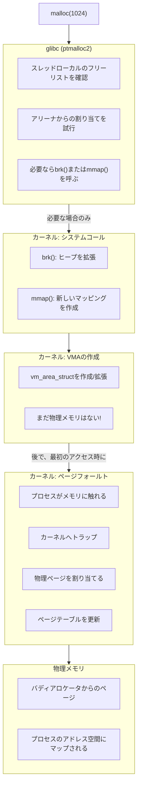
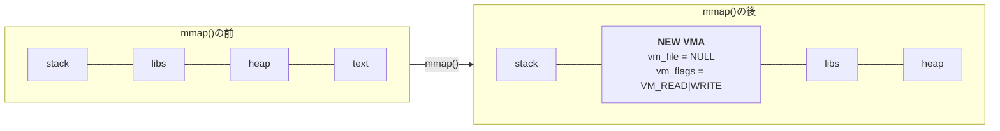
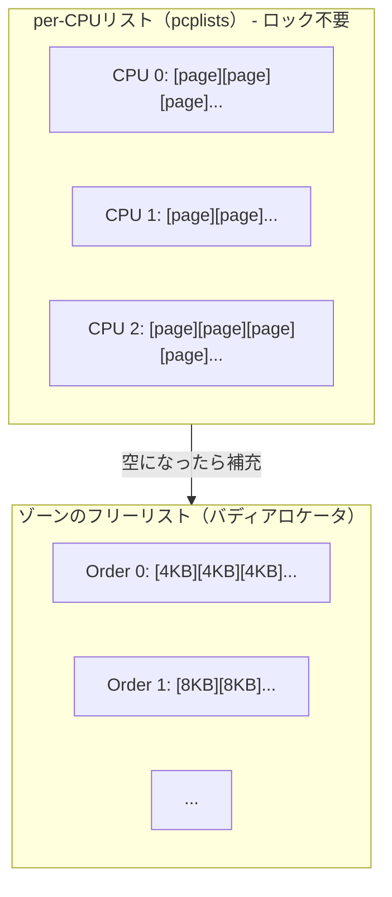
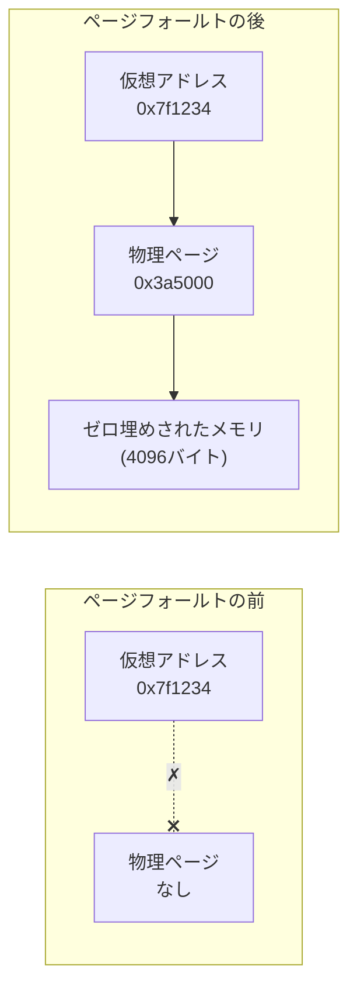

# mallocの一生 {#life-of-a-malloc}

> ユーザー空間のメモリ割り当てを`malloc()`から物理ページまで追跡する

## mallocを呼ぶと何が起きるか {#what-happens-when-you-call-malloc}

プログラムが`malloc(1024)`を呼んだとき、実際には何が起きているのか。答えには複数のソフトウェア層が関わっており、それぞれが異なる目標に向けて最適化されている。



重要な洞察は、**mallocは物理メモリを割り当てない** ということである。mallocが確保するのは仮想アドレス空間である。物理ページは後で、最初のアクセス時に、デマンドページングによって割り当てられる。

## ステージ1: ユーザー空間（glibc） {#stage-1-userspace-glibc}

### アロケータの仕事 {#the-allocators-job}

`malloc()`はライブラリ関数であり、システムコールではない。glibcはこれを[ptmalloc（dlmallocから派生）](https://sourceware.org/glibc/manual/latest/html_node/The-GNU-Allocator.html)で実装している。アロケータの目標はただ1つ、必要以上にカーネルを呼び出すことなくメモリ要求を満たすことである。

```c
void *malloc(size_t size);
```

割り当てのたびに、ptmalloc2は次を確認する。

1. **スレッドローカルキャッシュ**: 各スレッドは、最近解放された小さなチャンクを保持するtcacheを持つ。最速の経路であり、ロックは不要。

2. **fastbin**: アリーナごとの、解放済みの小さなチャンクのリスト（デフォルトで約160バイトまで）。高速なLIFOアクセス。

3. **small/large bin**: 解放済みチャンクのソート済みリスト。最適なものが探索される。

4. **トップチャンク**: 「wilderness」とも呼ばれる、ヒープ末尾の未使用領域。切り出して使える。

5. **システムコール**: ほかのすべてが失敗したときにだけ、glibcはカーネルに追加のメモリを要求する。

### glibcがカーネルを呼ぶとき {#when-glibc-calls-the-kernel}

glibcはカーネルからメモリを得るために2つのシステムコールを使う。

| 方法 | 使われる場面 | 典型的な閾値 |
|--------|-----------|-------------------|
| `brk()` | 小さな割り当て、ヒープの拡張 | < [128KB](https://man7.org/linux/man-pages/man3/mallopt.3.html)（`M_MMAP_THRESHOLD`で調整可能） |
| `mmap()` | 大きな割り当て | >= 128KB |

この閾値は[適応的](https://man7.org/linux/man-pages/man3/mallopt.3.html)であり、大きなブロックが解放されるとglibcはそれを引き上げる。`mallopt(M_MMAP_THRESHOLD, bytes)`で上書きできる。

**なぜ2つの方法があるのか**

- `brk()`はヒープを連続的に拡張する。単純だが、解放されたメモリは、それより上にあるものがすべて解放されるまでカーネルに返せない。
- `mmap()`は独立したマッピングを作る。`munmap()`ですぐにカーネルへ返せるが、オーバーヘッドが大きい。

トレードオフの完全な分析は[brkとmmap](brk-vs-mmap.md)を参照。

## ステージ2: カーネルへの進入 {#stage-2-kernel-entry}

### brk()の経路 {#the-brk-path}

glibcが`brk()`を呼ぶとき、それはカーネルにプログラムブレーク（ヒープの終端）を移動するよう求めている。

```c
// ユーザー空間（glibc）
void *new_mem = sbrk(4096);  // brk()のラッパー
```

カーネルはこれを[`mm/mmap.c`](https://git.kernel.org/pub/scm/linux/kernel/git/torvalds/linux.git/tree/mm/mmap.c)で処理する。

```c
// 疑似コード - 実際の実装にはより多くの検証がある
SYSCALL_DEFINE1(brk, unsigned long, brk)
{
    struct mm_struct *mm = current->mm;

    // 検証: 既存のマッピングに食い込むような縮小でないこと、
    // RLIMIT_DATAを超えないこと、など

    // ヒープのVMAを拡張または縮小する
    if (brk > mm->brk)
        do_brk_flags(...);  // VMAを作成/拡張する

    mm->brk = brk;
    return brk;
}
```

カーネルはプロセスの`mm_struct`を更新してヒープのVMAを拡張する。まだ物理メモリは割り当てられておらず、仮想アドレス範囲が確保されるだけである。

### mmap()の経路 {#the-mmap-path}

より大きな割り当てには、glibcは`MAP_ANONYMOUS`付きの`mmap()`を使う。

```c
// ユーザー空間（glibcを簡略化）
void *ptr = mmap(NULL, size, PROT_READ | PROT_WRITE,
                 MAP_PRIVATE | MAP_ANONYMOUS, -1, 0);

// カーネル: mm/mmap.c
SYSCALL_DEFINE6(mmap, ...)
{
    // 空いている仮想アドレス範囲を探す
    // 新しいVMAを作成する
    // アドレスをユーザー空間に返す
}
```

ここでもまだ物理メモリはない。カーネルはマッピングを記述するVMAを作成して戻る。ページテーブルエントリもまだ存在せず、それらは最初のアクセス時に遅延して作成される。

## ステージ3: VMAの作成 {#stage-3-vma-creation}

`brk()`と`mmap()`のどちらも、VMA（Virtual Memory Area）の作成または変更をもたらす。

```c
// include/linux/mm_types.hより
struct vm_area_struct {
    unsigned long vm_start;     // 開始アドレス
    unsigned long vm_end;       // 終了アドレス（この値は含まない）
    struct mm_struct *vm_mm;    // 所有するアドレス空間
    pgprot_t vm_page_prot;      // アクセス権
    unsigned long vm_flags;     // VM_READ、VM_WRITEなど
    struct file *vm_file;       // 匿名メモリではNULL
    // ...
};
```

`mmap()`を引き起こす`malloc()`の場合は次のようになる。



新しいVMAはプロセスのmaple tree（v6.1より前のカーネルでは赤黒木）に追加される。VMAの構成の詳細は[プロセスのアドレス空間](mmap.md)を参照。

**要点**: `malloc()`が戻ったとき、有効なポインタは手に入るが、それを裏付ける物理メモリは存在しない。この領域のページテーブルエントリもまだ存在せず、CPUがフォールトする最初のアクセス時に作成される。

## ステージ4: ページフォールト {#stage-4-page-fault}

物理メモリは最初のアクセス時に割り当てられる。プログラムがmallocしたメモリを読み書きすると、次のようになる。

```c
char *ptr = malloc(4096);
ptr[0] = 'x';  // 最初のアクセス - ページフォールトを引き起こす
```

CPUは有効なページテーブルエントリを見つけられず、ページフォールト例外を発生させる。カーネルがそれを処理する。

```c
// mm/memory.cを簡略化
static vm_fault_t handle_pte_fault(struct vm_fault *vmf)
{
    // PTEが空 - これは新しいページ
    if (pte_none(vmf->orig_pte)) {
        if (vma_is_anonymous(vmf->vma))
            return do_anonymous_page(vmf);  // 今回の経路
        else
            return do_fault(vmf);  // ファイルベース
    }
    // ... その他のケース（COW、スワップなど）
}
```

### 匿名ページの割り当て {#anonymous-page-allocation}

匿名メモリ（ヒープ、スタック）では、[`do_anonymous_page()`](https://git.kernel.org/pub/scm/linux/kernel/git/torvalds/linux.git/tree/mm/memory.c)が実行される。

```c
// mm/memory.cを簡略化
static vm_fault_t do_anonymous_page(struct vm_fault *vmf)
{
    struct folio *folio;

    // 1. 物理ページ（folio）を割り当てる
    //    folioはstruct pageに代わる現代的な抽象であり、1つ以上の
    //    連続したページを1つの単位として表す。ほとんどの匿名
    //    割り当てでは、これは単一の4KBページである。
    folio = vma_alloc_zeroed_movable_folio(vmf->vma, vmf->address);

    // 2. ページテーブルエントリを準備する
    entry = mk_pte(&folio->page, vma->vm_page_prot);
    if (vma->vm_flags & VM_WRITE)
        entry = pte_mkwrite(pte_mkdirty(entry), vma);

    // 3. ページテーブルに設定する
    set_pte_at(vma->vm_mm, vmf->address, vmf->pte, entry);

    // 4. 逆マッピングに追加する（回収のため）
    folio_add_new_anon_rmap(folio, vma, vmf->address);

    return 0;
}
```

ここでようやく物理メモリが割り当てられる。

## ステージ5: ページアロケータ {#stage-5-page-allocator}

`vma_alloc_zeroed_movable_folio()`の呼び出しは、最終的にバディアロケータに到達する。

```c
// 呼び出しの連鎖（簡略化）:
vma_alloc_zeroed_movable_folio()
  → folio_alloc()
    → __folio_alloc()
      → __alloc_pages()  // バディアロケータの中核の入口
```

[`__alloc_pages()`](https://git.kernel.org/pub/scm/linux/kernel/git/torvalds/linux.git/tree/mm/page_alloc.c)は、Linuxのメモリ割り当ての心臓部である。

```c
// mm/page_alloc.c（大幅に簡略化）
struct page *__alloc_pages(gfp_t gfp, unsigned int order, int nid, nodemask_t *nodemask)
{
    // 1. 高速パス: per-CPUリストを試す
    page = get_page_from_freelist(gfp, order, ...);
    if (page)
        return page;

    // 2. 低速パス: kswapdを起こし、より強く試みる
    page = __alloc_pages_slowpath(gfp, order, ...);
    return page;
}
```

### 高速パス {#fast-path}

ほとんどの割り当ては、per-CPUのページリストかゾーンのフリーリストから即座に成功する。



単一ページの割り当て（ページフォールトでは典型的）では、カーネルはまずper-CPUリストを確認する。これはロックを必要とせず、非常に高速である。

### 低速パス {#slow-path}

空きページが少ない場合は次のようになる。

1. **kswapdを起こす**: バックグラウンドの回収デーモン
2. **直接回収**: 割り当てを行っているプロセス自身がいくつかのページを解放する
3. **コンパクション**: 高オーダーの割り当てのためにメモリをデフラグする
4. **OOM killer**: 最後の手段 - プロセスを殺してメモリを解放する

メモリ圧迫の処理の詳細は[ページ回収](reclaim.md)を参照。

## ステージ6: ユーザー空間への復帰 {#stage-6-return-to-userspace}

ページフォールトハンドラが成功した後は次のようになる。

1. **ページテーブルの更新**: PTEが物理ページを指すようになる
2. **TLBエントリの作成**: CPUが仮想→物理のマッピングをキャッシュする
3. **実行の再開**: フォールトした命令が再試行される



プログラムは、複雑な舞踏が行われたばかりであることを知らずに処理を続ける。プログラムから見れば、`ptr[0] = 'x'`は単にうまく動いただけである。

## なぜデマンドページングか {#why-demand-paging}

この遅延割り当て戦略には大きな利点がある。

### 1. mallocが高速 {#1-fast-malloc}

`malloc()`は即座に戻る。カーネルの作業は、実際に必要になるまで遅延される。

### 2. 疎な割り当てが安価 {#2-sparse-allocations-are-cheap}

プログラムは1GBを割り当てて4KBしか使わないこともできる。支払うのは触れた分だけである。

```c
// 1GBを「割り当てる」
char *huge = malloc(1024 * 1024 * 1024);

// 4KBだけ使う - 割り当てられる物理ページは1つだけ
huge[0] = 'a';
```

### 3. オーバーコミットが機能する {#3-overcommit-works}

カーネルは物理的に存在する以上のメモリを約束できる。ほとんどのプログラムは要求した分をすべて使うわけではない。[メモリのオーバーコミット](overcommit.md)を参照。

### 4. fork()が高速 {#4-fork-is-fast}

子プロセスは[コピーオンライト](cow.md)によって親とページを共有する。物理的なコピーは、どちらかのプロセスが書き込んだときにだけ発生する。

## 自分で試す {#try-it-yourself}

### mallocの動作を観察する {#watch-malloc-in-action}

```bash
# 簡単な割り当てのシステムコールをトレースする
strace -e brk,mmap,munmap -f sh -c 'head -c 1M /dev/zero > /dev/null'

# ページフォールトを確認する
perf stat -e page-faults,minor-faults,major-faults ./your_program
```

### デマンドページングを観察する {#observe-demand-paging}

```bash
# 割り当てるがメモリに触れないプログラムを作る
cat > /tmp/lazy.c << 'EOF'
#include <stdio.h>
#include <stdlib.h>
#include <unistd.h>

int main() {
    printf("PID: %d\n", getpid());
    printf("Before malloc...\n");
    getchar();

    char *p = malloc(100 * 1024 * 1024);  // 100MB
    printf("After malloc, before touch...\n");
    getchar();

    for (int i = 0; i < 100 * 1024 * 1024; i += 4096)
        p[i] = 'x';  // Touch each page
    printf("After touching all pages...\n");
    getchar();

    return 0;
}
EOF
gcc -o /tmp/lazy /tmp/lazy.c
/tmp/lazy

# 別のターミナルで、RSSが増えるのを観察する:
watch -n 1 'ps -o pid,vsz,rss,comm -p $(pgrep lazy)'
# VSZはmalloc後に跳ね上がり、RSSは触れた後にだけ跳ね上がる
```

### mallocの閾値を調べる {#examine-the-malloc-threshold}

```bash
# glibcのmmap閾値の挙動を確認する
cat > /tmp/mmap_test.c << 'EOF'
#include <stdio.h>
#include <stdlib.h>

int main() {
    // Small allocation - likely uses brk()
    void *small = malloc(1024);
    printf("Small (1KB): %p\n", small);

    // Large allocation - likely uses mmap()
    void *large = malloc(256 * 1024);
    printf("Large (256KB): %p\n", large);

    // Notice the address ranges are very different
    return 0;
}
EOF
gcc -o /tmp/mmap_test /tmp/mmap_test.c
strace -e brk,mmap /tmp/mmap_test
```

### カーネル内のページフォールトをトレースする {#trace-page-faults-in-the-kernel}

```bash
# ページフォールトのトレーシングを有効にする（root権限とdebugfsのマウントが必要）
echo 1 > /sys/kernel/debug/tracing/events/exceptions/page_fault_user/enable
cat /sys/kernel/debug/tracing/trace_pipe &

# プログラムを実行する - フォールトをリアルタイムで確認できる
./your_program

# 終わったら無効にする
echo 0 > /sys/kernel/debug/tracing/events/exceptions/page_fault_user/enable
```

## よくある誤解 {#common-misconceptions}

### 「mallocはメモリを割り当てる」 {#malloc-allocates-memory}

厳密にはそうではない。mallocはアドレス空間を確保する。物理ページは後でページフォールトを通じてやってくる。

### 「malloc(1GB)が成功したので、プログラムは1GBを使っている」 {#my-program-uses-1gb-because-malloc1gb-succeeded}

VSZ（Virtual Size）ではなくRSS（Resident Set Size）を確認すること。VSZは確保されたすべてのアドレス空間を含み、RSSは実際に使われている物理メモリである。

```bash
ps -o pid,vsz,rss,comm -p <pid>
```

### 「ページフォールトは悪いものだ」 {#page-faults-are-bad}

マイナーフォールト（デマンドページング）は正常であり、想定されたものである。メジャーフォールト（ディスクからの読み込み）は高コストである。カーネルはマイナーフォールトが高速になるよう最適化している。

## 主要なソースファイル {#key-source-files}

| ファイル | 役割 |
|------|--------------|
| [`mm/mmap.c`](https://git.kernel.org/pub/scm/linux/kernel/git/torvalds/linux.git/tree/mm/mmap.c) | brk()、mmap()の実装 |
| [`mm/memory.c`](https://git.kernel.org/pub/scm/linux/kernel/git/torvalds/linux.git/tree/mm/memory.c) | ページフォールト処理、do_anonymous_page() |
| [`mm/page_alloc.c`](https://git.kernel.org/pub/scm/linux/kernel/git/torvalds/linux.git/tree/mm/page_alloc.c) | バディアロケータ、__alloc_pages() |
| [`include/linux/mm_types.h`](https://git.kernel.org/pub/scm/linux/kernel/git/torvalds/linux.git/tree/include/linux/mm_types.h) | vm_area_struct、mm_structの定義 |

## 歴史 {#history}

### デマンドページングの起源 {#demand-paging-origins}

デマンドページングはLinuxの当初から存在する。仮想アドレスを、アクセスされるまで物理メモリの裏付けなしにマップするという基本的な仕組みは、Unix系システムの根幹である。

### VMA管理の進化 {#vma-management-evolution}

上の **ステージ3** で`mmap()`が新しいVMAを作成すると、後で（例えばページフォールト時に）検索できるよう、それをプロセスのVMAコレクションに挿入しなければならない。このためのデータ構造は進化してきた。

**赤黒木（初期のLinux）**: VMAは`O(log n)`で検索できるようrb-treeで構成されていた。単純だが、慎重なロックが必要だった。

**maple tree（v6.1、2022年）**: VMAはmaple treeに移行した。これはキャッシュ局所性とRCU安全な操作のために最適化されたBツリーの変種である。これにより`mmap_lock`を保持せずに並行してVMAを検索できるようになり、ページフォールトのスケーラビリティが向上した。

**コミット**: [d4af56c5c7c6](https://git.kernel.org/linus/d4af56c5c7c6)（"mm: start tracking VMAs with maple tree"） | [LKML](https://lore.kernel.org/linux-mm/20220906194824.2110408-9-Liam.Howlett@oracle.com/)

**作者**: Liam Howlett（Oracle）

### folioへの変換（v5.16以降） {#folio-conversion-v516}

上の **ステージ4** で、`do_anonymous_page()`は生の`struct page`ではなく`struct folio`を割り当てる。folioはメモリのための現代的な抽象である。

- **それは何か**: folioは、1つの単位として管理される、1つ以上の物理的に連続したページを表す
- **なぜ存在するか**: 古い`struct page`のAPIは曖昧だった。関数は、受け取ったのがヘッドページなのか、テイルページなのか、単一ページなのかを知らなかった。folioはこのセマンティクスを明示的にする。
- **今回の流れでは**: `vma_alloc_zeroed_movable_folio()`はfolioを割り当てる。匿名フォールトでは、これは通常単一の4KBページである（有効であれば2MBのtransparent huge page）

**コミット**: [7b230db3b8d3](https://git.kernel.org/linus/7b230db3b8d3)（"mm: Introduce struct folio"） | [LKML](https://lore.kernel.org/linux-mm/20210622121551.3398730-3-willy@infradead.org/)

**作者**: Matthew Wilcox（Oracle）

## 悪名高いバグとエッジケース {#notorious-bugs-and-edge-cases}

mallocの経路はユーザー空間（glibc）とカーネル（brk/mmap、ページフォールト）にまたがる。どちらのレベルのバグも、メモリ破壊や権限昇格につながりうる。

---

### ケース1: glibcのヒープオーバーフロー（CVE-2023-6246） {#case-1-glibc-heap-overflow-cve-2023-6246}

#### 何が起きたか {#what-happened}

2024年1月、Qualysは、ローカルでの権限昇格に悪用可能な、glibcの`__vsyslog_internal()`関数におけるヒープバッファオーバーフローを発見した。

#### バグ {#the-bug}

[Qualysの公開情報](https://medium.com/@elpepinillo/heap-heap-hooray-unveiling-glibc-heap-overflow-vulnerability-cve-2023-6246-0c6412423069)より:

glibcの`__vsyslog_internal()`関数は、特別に細工された入力を処理する際にヒープバッファをオーバーフローさせることがあった。そのバッファは（glibcのptmalloc2が管理する）ヒープに格納されており、オーバーフローすると隣接するヒープのメタデータが破壊される。

#### 現実世界への影響 {#real-world-implications}

ローカルアクセス権を持つ攻撃者は、`syslog()`を使うプログラムを悪用してrootへ昇格できた。

#### なぜmallocにとって重要か {#why-this-matters-for-malloc}

`malloc()`を呼ぶと、glibcのptmalloc2が内部でヒープを管理する。今回のようなヒープ破壊の脆弱性は次のものを悪用する。

1. **チャンクのメタデータ**: ptmallocはサイズやフラグをユーザーデータに隣接して格納する
2. **フリーリストのポインタ**: これを破壊すると任意書き込みのプリミティブにつながる
3. **tcache/fastbin**: 現代のglibcの緩和策は悪用を難しくするが、排除はしない

#### 修正 {#the-fix}

**コミット**: [6bd0e4efcc78](https://sourceware.org/git/?p=glibc.git;a=commit;h=6bd0e4efcc78f3c0115e5ea9739a1642807450da)（glibc）

glibc 2.39で修正された。この脆弱性は、glibc 2.37でコミット`52a5be0df411`によって混入した。

#### 緩和策 {#mitigations}

現代のglibcには次のものが含まれる。

- **Safe-linking**: fastbin/tcacheでのポインタの難読化
- **チャンクサイズの検証**: 破壊されたサイズフィールドを検出する
- **トップチャンクの整合性チェック**: wildernessの破壊を防ぐ

---

### ケース2: Stack Clash（2017年） {#case-2-the-stack-clash-2017}

#### 何が起きたか {#what-happened_1}

Qualysは、スタックとヒープの間の隙間を飛び越えられることを発見した。これにより、スタックからヒープ、あるいはヒープからスタックへの破壊が可能になった。

#### バグ {#the-bug_1}

カーネルは「スタックガードページ」、すなわちスタックとほかのマッピングの間にあるマップされていないページを維持している。前提は、このページへのアクセスは必ずセグメンテーションフォールトを引き起こすというものだった。

しかし、（`alloca()`やVLAによる）大きな割り当ては、ガードページを飛び越えられる。

```c
void vulnerable() {
    char buf[HUGE_SIZE];  // HUGE_SIZEがガードギャップより大きければ...
    buf[0] = 'A';         // ...ヒープ/mmap領域に着地する
}
```

#### 現実世界への影響 {#real-world-implications_1}

多くのLinuxディストリビューションでローカルの権限昇格が可能だった。この脆弱性は次のものに影響した。

- Linux（CVE-2017-1000364）
- FreeBSD、OpenBSD、NetBSD、Solaris
- 大きなスタック割り当てを使うプログラム

#### 修正 {#the-fix_1}

**コミット**: [1be7107fbe18](https://git.kernel.org/linus/1be7107fbe18)（"mm: larger stack guard gap, between vmas"）

カーネルはスタックガードギャップを、デフォルトで1ページ（4KB）から1MBに拡大した。

ガードギャップのデフォルトは256ページ（4KBページのシステムで1MB）であり、カーネルブートパラメータ`stack_guard_gap=`で設定できる（`Documentation/admin-guide/kernel-parameters.txt`を参照）。

#### なぜmallocにとって重要か {#why-this-matters-for-malloc_1}

（`brk()`による）ヒープとスタックは互いに向かって伸びる。このバグは、両者の境界を慎重に保護しなければならないことを示した。

---

### ケース3: mmap_min_addrの迂回（CVE-2009-2695） {#case-3-mmap_min_addr-bypass-cve-2009-2695}

#### 何が起きたか {#what-happened_2}

カーネル内のNULLポインタ参照のバグが、アドレス0にメモリをマップすることで悪用可能だった。

#### バグ {#the-bug_2}

多くのカーネルバグはNULLポインタの参照を伴う。通常これはクラッシュするだけである。しかし攻撃者がアドレス0にメモリをマップしてその内容を制御できれば、NULL参照をコード実行に変えられる。

カーネルは低アドレスへのマッピングを防ぐために`mmap_min_addr`を追加した。しかしSELinuxの`unconfined_t`ドメインはこの制限を迂回していた。

[Red Hatのアドバイザリ](https://access.redhat.com/articles/17995)より:

> *"A system with SELinux enforced was found to be more permissive in allowing local users in the unconfined_t domain to map low memory areas even if the mmap_min_addr restriction is enabled."*

（訳: SELinuxを強制モードにしたシステムが、mmap_min_addrの制限が有効であっても、unconfined_tドメインのローカルユーザーに低位メモリ領域のマップを許すという、より緩い挙動を示すことが判明した。）

#### 修正 {#the-fix_2}

複数のコミットがSELinuxポリシーを修正し、`mmap_min_addr`の強制を強化した。

- [9c0d9010](https://git.kernel.org/linus/9c0d9010)
- [8cf948e7](https://git.kernel.org/linus/8cf948e7)

```bash
# 現在のmmapの最小アドレスを確認する
cat /proc/sys/vm/mmap_min_addr
# デフォルト: 65536（64KB） - security/KconfigのLSM_MMAP_MIN_ADDRで設定される
```

#### なぜmallocにとって重要か {#why-this-matters-for-malloc_2}

`malloc()`が大きな割り当てに`mmap()`を使うとき、アドレスを選ぶのはカーネルである。`mmap_min_addr`は、カーネルが危険なほど低いアドレスに決してマップしないことを保証する。

---

### ケース4: ptmallocのスレッドアリーナの枯渇 {#case-4-ptmalloc-thread-arena-exhaustion}

#### 何が起きたか {#what-happened_3}

並行する大量の割り当ての下で、glibcのptmallocが過剰なアリーナを作成し、メモリを浪費することがあった。

#### バグ {#the-bug_3}

ptmallocはロック競合を減らすためにスレッドごとのアリーナを作る。しかしデフォルトの上限（`8 * num_cpus`）は次の事態を招きうる。

1. 多数のスレッドがそれぞれ自分のアリーナを得る
2. 各アリーナが自分のヒープセグメントを持つ
3. 断片化とメモリの浪費が爆発的に増える

#### 現実世界への影響 {#real-world-implications_2}

多数のスレッドを持つアプリケーション（例えばJavaアプリケーションやWebサーバー）は、アリーナのオーバーヘッドにより、想定の2〜3倍のメモリを使うことがあった。

#### 緩和策 {#mitigation}

```bash
# アリーナ数を制限する（プログラムの実行前に設定する）
export MALLOC_ARENA_MAX=2

# あるいは別のアロケータを使う
# jemalloc、tcmallocはマルチスレッドでの挙動がより良い
```

---

### ケース5: brkのランダム化の弱さ {#case-5-brk-randomization-weaknesses}

#### 何が起きたか {#what-happened_4}

ASLR（Address Space Layout Randomization）はmmapをランダム化するが、歴史的にbrkは予測可能なまま残されていた。

#### バグ {#the-bug_4}

`brk()`が常に同じアドレスを返すなら、ヒープの悪用は容易になる。攻撃者はヒープのデータがどこにあるかを知っているからである。

初期のASLR実装がランダム化していたのは次のものである。

- スタックの位置 ✓
- mmapのベース ✓
- brk/ヒープの位置 - **部分的に、あるいはまったく行われない**

#### 現在の状況 {#modern-status}

現代のカーネルは`CONFIG_COMPAT_BRK=n`でbrkをランダム化する。

```bash
# brkのランダム化が有効か確認する
cat /proc/sys/kernel/randomize_va_space
# 2 = brkを含む完全なASLR
```

---

### まとめ: 得られた教訓 {#summary-lessons-learned}

| バグ | 年 | 層 | 影響 | 予防策 |
|-----|------|-------|--------|------------|
| **glibcのヒープオーバーフロー** | 2024 | ユーザー空間 | root権限の取得 | glibcを更新する |
| **Stack Clash** | 2017 | カーネル | root権限の取得 | より大きなガードギャップ |
| **mmap_min_addrの迂回** | 2009 | カーネル/SELinux | root権限の取得 | カーネルで修正済み |
| **アリーナの枯渇** | 継続中 | ユーザー空間 | メモリの浪費 | `MALLOC_ARENA_MAX` |
| **brkの予測可能性** | 過去の問題 | カーネル | 悪用が容易になる | 完全なASLR |

共通するのは、**mallocはメモリ安全性の基盤である** ということである。ヒープ管理（glibc）や仮想メモリの設定（カーネル）のバグは、深刻なセキュリティ上の影響を持つ。

## 参考文献 {#further-reading}

### 関連ドキュメント {#related-docs}

- [プロセスのアドレス空間](mmap.md) - VMA、mmapの詳細
- [ページアロケータ](page-allocator.md) - バディシステムの内部
- [メモリのオーバーコミット](overcommit.md) - なぜデマンドページングがオーバーコミットを可能にするか
- [brkとmmap](brk-vs-mmap.md) - glibcがそれぞれの方法を使う場面
- [ページ回収](reclaim.md) - メモリが不足したときに何が起きるか

### 外部リソース {#external-resources}

- [glibc malloc internals](https://sourceware.org/glibc/wiki/MallocInternals) - glibcの公式ドキュメント
- [The Stack Clash](https://blog.qualys.com/vulnerabilities-threat-research/2017/06/19/the-stack-clash) - Qualysの研究論文
- [Heap exploitation techniques](https://github.com/shellphish/how2heap) - 教育用のヒープ悪用の例
