# pageの一生 {#life-of-a-page}

> 物理pageを割り当てから回収、そして再利用まで追いかける

## pageの旅路 {#the-journey-of-a-page}

Linuxの物理pageは波乱に満ちた一生を送る。buddyアロケータの中で生まれ、プロセスやキャッシュのために割り当てられ、アクティビティを追跡され、最終的にはメモリが不足したときに回収される。本ドキュメントはその旅路を追う。

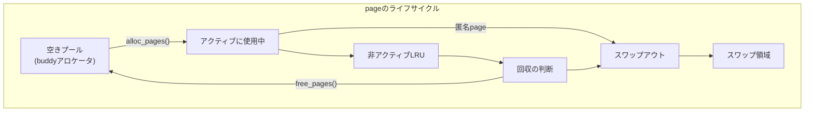

## 誕生: pageの割り当て {#birth-page-allocation}

すべてのpageの一生はbuddyアロケータのフリーリストから始まる。カーネルがpageを必要とするとき（プロセス用、ページキャッシュ用、カーネルのデータ構造用など）、[`alloc_pages()`](https://git.kernel.org/pub/scm/linux/kernel/git/torvalds/linux.git/tree/mm/page_alloc.c)を呼び出す:

```c
struct page *alloc_pages(gfp_t gfp, unsigned int order);
```

### フリーリストから割り当て済みへ {#from-free-list-to-assigned}

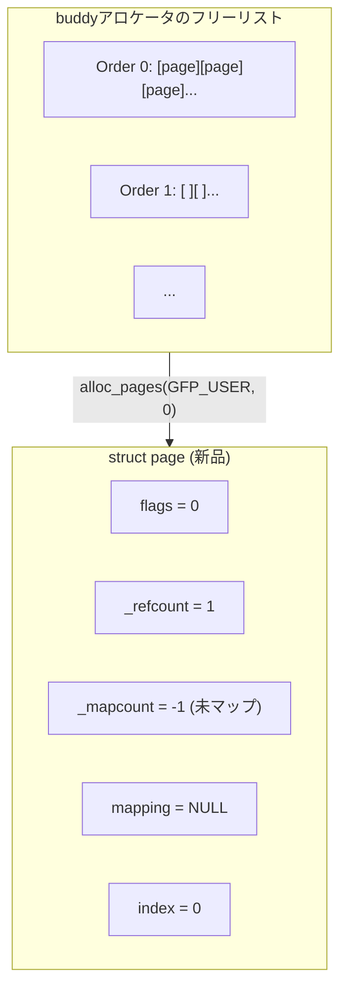

pageはまっさらな状態から始まる。refcountは1（アロケータが保持している）、マッピングはなく、特別な状態を示すフラグも立っていない。

### pageの初期化 {#page-initialization}

用途に応じて、pageは異なる方法で初期化される:

| 用途 | 初期化 |
|----------|----------------|
| 匿名（ヒープ/スタック） | ゼロクリアされ、匿名rmapに追加される |
| ページキャッシュ | ファイルのaddress_spaceにリンクされる |
| slabオブジェクト | slabキャッシュのフリーリストに追加される |
| カーネルバッファ | ゼロクリアされる場合もされない場合もある |

匿名page（[malloc](life-of-malloc.md)から生じる最も一般的なケース）では、カーネルはpageをゼロクリアし、逆マッピングを設定する:

```c
// mm/memory.c の do_anonymous_page() より
folio = vma_alloc_zeroed_movable_folio(vma, addr);
folio_add_new_anon_rmap(folio, vma, addr);
folio_add_lru(folio);  // 追跡のためにLRUに追加
```

## page構造体 {#the-page-structure}

すべての物理ページフレームは`struct page`（複合pageの場合は`struct folio`）で表現される:

```c
// include/linux/mm_types.h を簡略化
struct page {
    unsigned long flags;        // pageの状態フラグ (PG_locked, PG_dirty など)
    atomic_t _refcount;         // 参照カウント
    atomic_t _mapcount;         // このpageをマップしているページテーブルの数
    struct address_space *mapping;  // 所有者 (ファイルまたは anon_vma)
    pgoff_t index;              // マッピング内のオフセット
    struct list_head lru;       // LRUリストへのリンク
    // ... unionを介したさらに多くのフィールド
};
```

### 主要なpageフラグ {#key-page-flags}

フラグはライフサイクルを通じてpageの状態を追跡する:

| フラグ | 意味 |
|------|---------|
| `PG_locked` | I/Oなどの排他的操作のためにpageがロックされている |
| `PG_referenced` | pageが最近アクセスされた |
| `PG_uptodate` | pageの内容が有効である |
| `PG_dirty` | pageが変更されており、ライトバックが必要 |
| `PG_lru` | pageがLRUリスト上にある |
| `PG_active` | pageがアクティブLRUリスト上にある |
| `PG_swapbacked` | pageをスワップできる（匿名） |
| `PG_swapcache` | pageがスワップキャッシュ内にある |
| `PG_writeback` | pageをディスクに書き込み中 |
| `PG_reclaim` | pageを回収中 |

debugfsでpageのフラグを確認する:

```bash
# 特定のPFN (ページフレーム番号) について
cat /sys/kernel/debug/page_owner  # CONFIG_PAGE_OWNER が有効な場合
```

### 参照カウント {#reference-counting}

pageの`_refcount`は、何人の利用者がpageを保持しているかを追跡する:

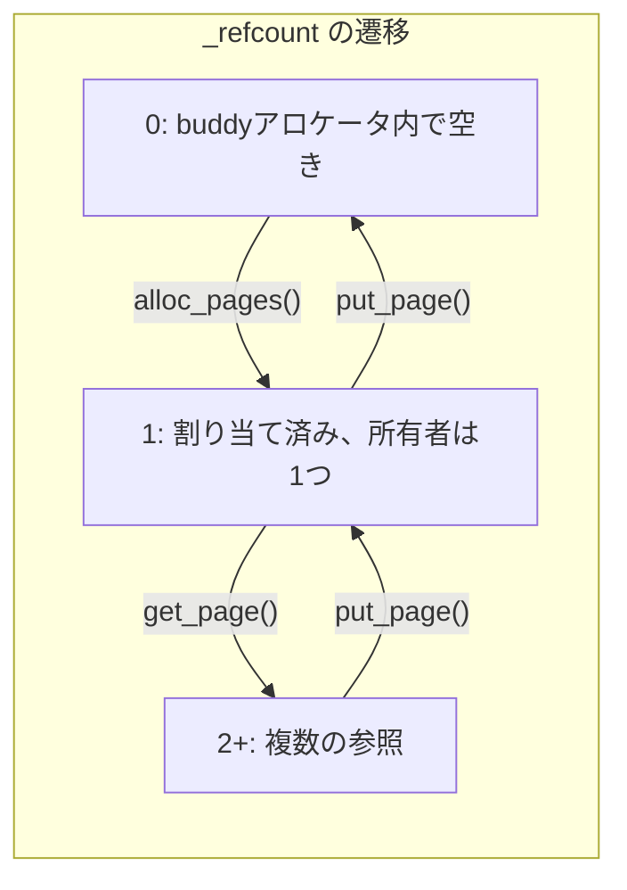

[`_mapcount`](https://lwn.net/Articles/974223/)は特にページテーブルのマッピングを追跡する（[`include/linux/mm.h`](https://git.kernel.org/pub/scm/linux/kernel/git/torvalds/linux.git/tree/include/linux/mm.h)を参照）:

- `-1`: どのページテーブルにもマップされていない
- `0`: ちょうど1つのページテーブルにマップされている
- `N`: N+1個のページテーブルにマップされている（共有）

## アクティブな使用: ワーキングセット {#active-use-working-set}

割り当てられてマップされると、pageはワーキングセットに入る。カーネルは後の回収判断のためにアクセスパターンを追跡する。

### LRUリスト {#lru-lists}

pageはメモリノードごとのLRU（Least Recently Used）リストに整理される:

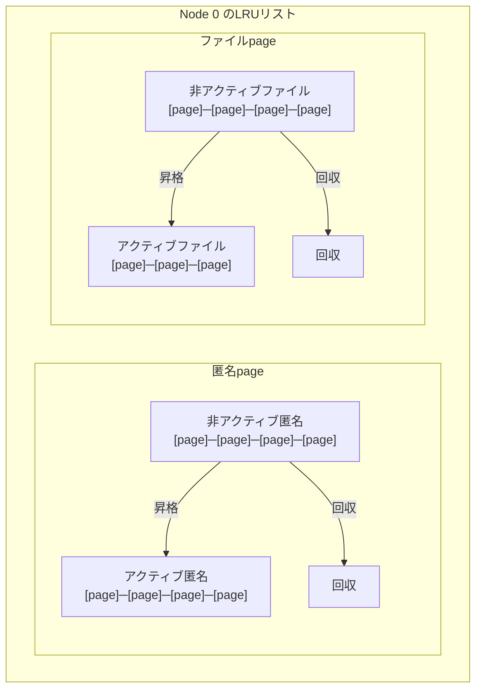

pageはアクセス状況に応じてリスト間を移動する:

1. **新しいpage**: 非アクティブリストから始まる
2. **非アクティブ上でアクセスされた**: `PG_referenced`フラグがセットされる
3. **再びアクセスされた**: アクティブリストに昇格する
4. **アクティブだがアクセスされない**: 非アクティブに降格する
5. **非アクティブでアクセスされない**: 回収の候補になる

### referencedフラグのダンス {#the-referenced-flag-dance}

`PG_referenced`フラグはセカンドチャンスアルゴリズムを実装している:

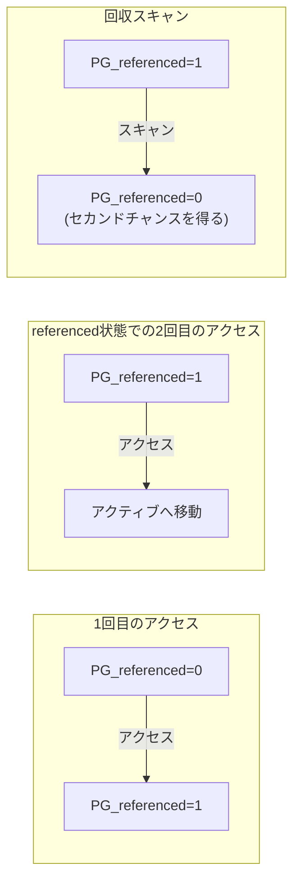

これにより、1回きりのアクセスでコールドなpageがメモリに居座ることを防ぎつつ、本当にホットなpageは保護される。

### Multi-Gen LRU (MGLRU) {#multi-gen-lru-mglru}

カーネルv6.1は、従来の2リストモデルの代替として[MGLRU](https://docs.kernel.org/admin-guide/mm/multigen_lru.html)を導入した（[commit ec1c86b25f4b](https://git.kernel.org/linus/ec1c86b25f4b)、[LWNの記事](https://lwn.net/Articles/910608/)）:

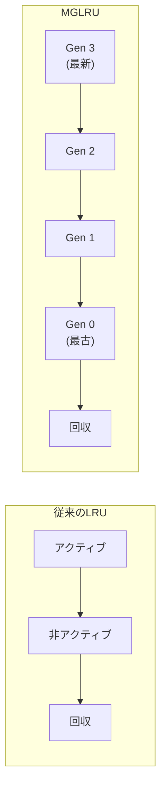

MGLRUは2つのリストの代わりに複数の世代を使い、よりきめ細かいエイジングとメモリ逼迫時のより良い性能を提供する。

```bash
# MGLRU が有効か確認する
cat /sys/kernel/mm/lru_gen/enabled
# 0x0007 = 完全に有効
```

MGLRUの詳細は[page回収](reclaim.md)を参照。

## 回収: pageの黄昏 {#reclaim-the-pages-twilight}

メモリが不足すると、カーネルはpageを回収しなければならない。pageの運命はその種類と状態によって決まる。

### 回収の決定木 {#the-reclaim-decision-tree}

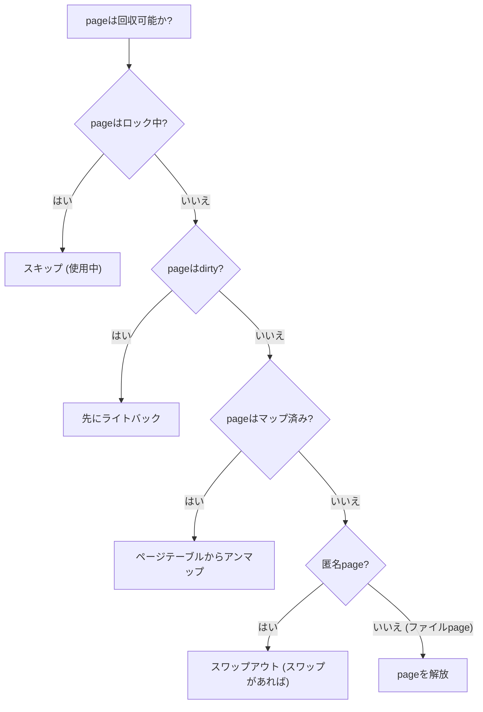

### ファイルバックpage: 回収は簡単 {#file-backed-pages-easy-reclaim}

ファイルpage（ページキャッシュ）は比較的簡単に回収できる:

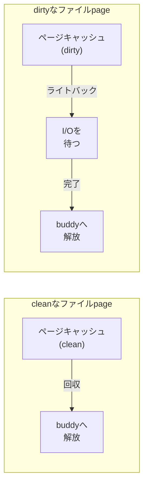

*後で必要になればディスクから再読み込みできる*

再び必要になれば、pageはいつでもバッキングファイルから再読み込みできる。

### 匿名page: スワップか死か {#anonymous-pages-swap-or-die}

匿名page（ヒープ、スタック）にはバッキングファイルがない。スワップがなければ回収できない:

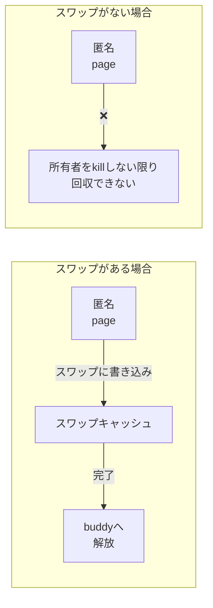

*pageの内容はスワップ領域に保存される*

これが、スワップなしで動かすと「空いている」ファイルキャッシュpageがあってもOOM killに至りうる理由である。

### スワップアウトの過程 {#the-swap-out-process}

匿名pageがスワップアウト対象に選ばれると:

```c
// mm/vmscan.c の shrink_folio_list() を簡略化
static unsigned int shrink_folio_list(struct list_head *folio_list, ...)
{
    // リスト上の各folioについて...

    // 1. すべてのページテーブルからアンマップを試みる
    try_to_unmap(folio, ...);

    // 2. 匿名でアンマップ済みなら、スワップに追加
    if (folio_test_anon(folio) && !folio_mapped(folio)) {
        if (!add_to_swap(folio))
            goto activate_locked;  // 失敗、pageを保持する

        // 3. スワップデバイスに書き込む
        pageout(folio, ...);
    }

    // 4. ライトバックが完了していれば、pageを解放
    if (!folio_test_writeback(folio))
        free_unref_folios(...);
}
```

ページテーブルエントリはスワップエントリに置き換えられる:

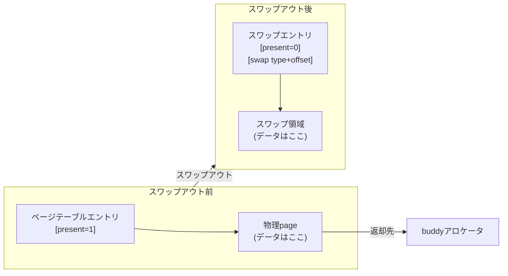

## 復活: スワップイン {#resurrection-swap-in}

プロセスがスワップアウトされたpageにアクセスすると、ページフォールトがそれを呼び戻す:

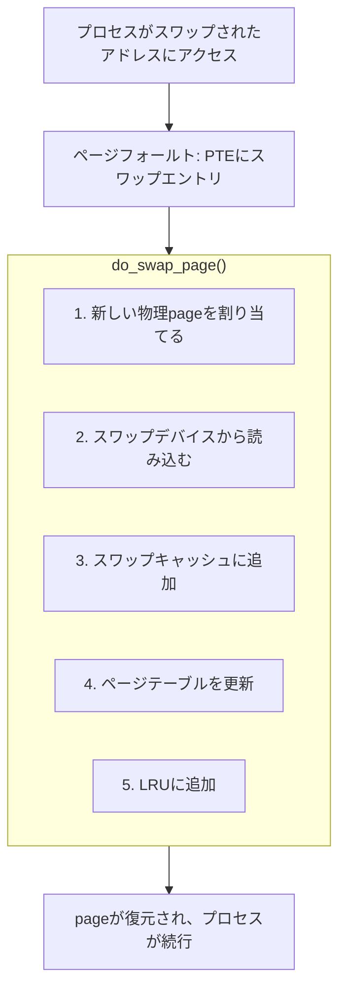

### スワップキャッシュ {#swap-cache}

スワップキャッシュは、複数のプロセスがスワップされたpageを共有する場合の冗長なI/Oを回避する:

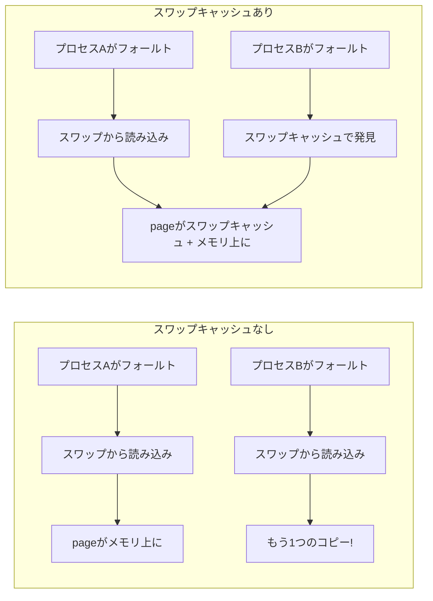

pageは次のいずれかまでスワップキャッシュに留まる:

- すべてのプロセスがプライベートコピーを持つ（COW後）
- またはスワップスロットが必要になる

## 死と再生 {#death-and-rebirth}

やがて、pageの内容は不要になる。pageはbuddyアロケータに戻る:

```c
// 最終パス
put_page(page);  // refcount をデクリメント
  → folio_put()
    → if (refcount == 0)
        → free_unref_page()
          → per-CPUフリーリストまたはbuddyに戻す
```

### pageの再利用 {#page-reuse}

解放されたpageが空いたままでいる時間は長くない:

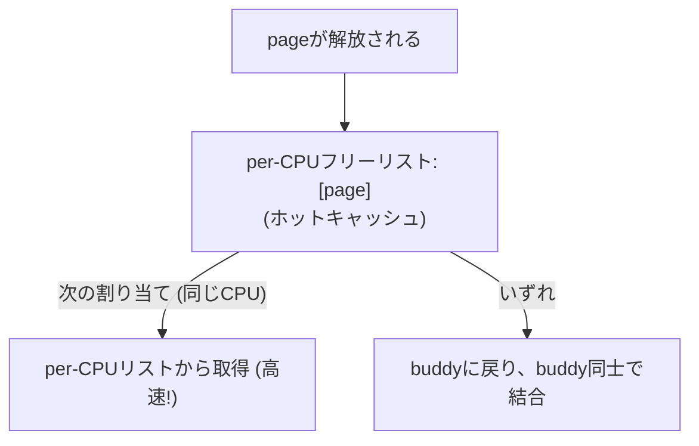

per-CPUリストは、最近解放されたpageをキャッシュ上でホットに保ち、すぐに再利用できるようにする。

## ライフサイクルの全体像 {#the-complete-lifecycle}

典型的な匿名pageについてすべてをまとめると:

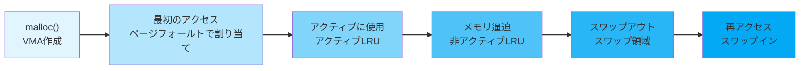

**状態遷移**:

| 段階 | refcount | mapcount |
|-------|----------|----------|
| ページフォールトでの割り当て | 1→2 | -1→0 |
| アクティブ/非アクティブLRU | 2 | 0 |
| スワップアウト | 0 | -1 |
| スワップイン | 1→2 | -1→0 |

## 試してみる {#try-it-yourself}

### pageの状態変化を観察する {#watch-page-state-changes}

```bash
# システム全体のpage統計を表示
cat /proc/vmstat | grep -E "^pg|^ps"

# 主要なメトリクス:
# pgalloc_*     - 割り当てられたpage
# pgfree        - 解放されたpage
# pgactivate    - アクティブリストへ移動したpage
# pgdeactivate  - 非アクティブリストへ移動したpage
# pswpin/pswpout - スワップの動き
```

### LRUの動きを監視する {#monitor-lru-activity}

```bash
# LRUリストのサイズを監視
watch -n 1 'cat /proc/meminfo | grep -E "Active|Inactive"'

# ノードごとのLRU統計
cat /sys/devices/system/node/node0/meminfo
```

### pageライフサイクルのイベントをトレースする {#trace-page-lifecycle-events}

```bash
# page割り当てのトレースを有効化
echo 1 > /sys/kernel/debug/tracing/events/kmem/mm_page_alloc/enable
echo 1 > /sys/kernel/debug/tracing/events/kmem/mm_page_free/enable

# 割り当てと解放を監視
cat /sys/kernel/debug/tracing/trace_pipe

# 終わったら無効化
echo 0 > /sys/kernel/debug/tracing/events/kmem/mm_page_alloc/enable
echo 0 > /sys/kernel/debug/tracing/events/kmem/mm_page_free/enable
```

### スワップの挙動を観察する {#observe-swap-behavior}

```bash
# スワップの動きをリアルタイムで監視
vmstat 1

# si/so 列は1秒あたりのスワップイン/アウトを示す

# スワップの詳細情報
cat /proc/swaps
swapon --show

# プロセスごとのスワップ使用量
for pid in /proc/[0-9]*; do
    name=$(cat $pid/comm 2>/dev/null)
    swap=$(grep VmSwap $pid/status 2>/dev/null | awk '{print $2}')
    [ -n "$swap" ] && [ "$swap" != "0" ] && echo "$name: ${swap}kB"
done | sort -t: -k2 -n -r | head
```

### 回収を強制してpageライフサイクルを観察する {#force-reclaim-to-observe-page-lifecycle}

```bash
# cleanなキャッシュを破棄 (匿名pageには影響しない)
echo 1 > /proc/sys/vm/drop_caches  # ページキャッシュ
echo 2 > /proc/sys/vm/drop_caches  # dentry と inode
echo 3 > /proc/sys/vm/drop_caches  # 両方

# メモリ逼迫を強制する (本番環境では注意!)
stress --vm 1 --vm-bytes 90% --vm-keep &
watch -n 1 'cat /proc/meminfo | grep -E "MemFree|SwapUsed|Active|Inactive"'
```

## 主要なソースファイル {#key-source-files}

| ファイル | 役割 |
|------|--------------|
| [`include/linux/mm_types.h`](https://git.kernel.org/pub/scm/linux/kernel/git/torvalds/linux.git/tree/include/linux/mm_types.h) | struct page、struct folioの定義 |
| [`include/linux/page-flags.h`](https://git.kernel.org/pub/scm/linux/kernel/git/torvalds/linux.git/tree/include/linux/page-flags.h) | PG_*フラグの定義 |
| [`mm/page_alloc.c`](https://git.kernel.org/pub/scm/linux/kernel/git/torvalds/linux.git/tree/mm/page_alloc.c) | buddyアロケータ、pageの割り当て |
| [`mm/vmscan.c`](https://git.kernel.org/pub/scm/linux/kernel/git/torvalds/linux.git/tree/mm/vmscan.c) | page回収、LRU管理 |
| [`mm/swap_state.c`](https://git.kernel.org/pub/scm/linux/kernel/git/torvalds/linux.git/tree/mm/swap_state.c) | スワップキャッシュ |
| [`mm/rmap.c`](https://git.kernel.org/pub/scm/linux/kernel/git/torvalds/linux.git/tree/mm/rmap.c) | 逆マッピング、ページテーブルエントリの探索 |

## 歴史 {#history}

### struct pageの進化 {#struct-page-evolution}

`struct page`は長年にわたって大きく成長し、変化してきた:

**初期のLinux**: 基本的なpageの状態を追跡する単純な構造体。

**v2.5/2.6**: 逆マッピング（rmap）のサポートが追加された。これはpageを指すすべてのページテーブルエントリを見つける能力であり、回収に不可欠である。

**v4.x-5.x**: 複合page（1つの単位として扱われる複数pageの割り当て）の利用が増加した。

**v5.16 (2022)**: 複合pageの扱いを形式化するために`struct folio`が導入された:

**コミット**: [7b230db3b8d3](https://git.kernel.org/linus/7b230db3b8d3) ("mm: Introduce struct folio") | [LKML](https://lore.kernel.org/linux-mm/20210622121551.3398730-3-willy@infradead.org/)

**作者**: Matthew Wilcox (Oracle)

上で見たライフサイクル全体を通じて、現代のコードでは`page`ではなく`folio`が使われている:

- **ステージ1**: `vma_alloc_zeroed_movable_folio()`がfolioを割り当てる
- **ステージ4**: `shrink_folio_list()`が回収中にfolioを処理する
- **なぜ重要か**: folioは1つ以上の連続したpageを1つの単位として明示的に表現するので、関数が受け取るのがhead pageなのかtail pageなのか単一pageなのかという曖昧さがなくなる

### LRUの進化 {#lru-evolution}

ステージ2（pageの追跡）で説明したLRUシステムは大きく進化してきた:

**従来のLRU**（v2.6.28より前）: すべてのpageに対して単一のアクティブ/非アクティブリスト。

**分割LRU**（v2.6.28、2008年）: 上の図に示したように、匿名pageとファイルpageで別々のリスト。

**MGLRU**（v6.1、2022年）: Multi-generational LRU（上のMGLRUの節で扱った）は、2つのリストを複数の世代で置き換え、よりきめ細かいエイジングを実現する。

**コミット**: [ac35a4902374](https://git.kernel.org/linus/ac35a4902374) ("mm: multi-gen LRU: minimal implementation") | [LKML](https://lore.kernel.org/linux-mm/20220815071332.627393-1-yuzhao@google.com/)

**作者**: Yu Zhao (Google)

MGLRUは、有用なpageが過度に積極的に追い出される「refault」問題を回避することで、メモリ逼迫時の性能を大きく改善する。

## 悪名高いバグとエッジケース {#notorious-bugs-and-edge-cases}

pageのライフサイクル管理には、参照カウント、LRUの追跡、ライトバックの協調が関わる。ここでのバグはuse-after-free、データ破損、システムクラッシュを引き起こす。

---

### ケース1: pageのrefcountのアンダーフロー/オーバーフロー {#case-1-page-refcount-underflowoverflow}

#### 何が起きたか {#what-happened}

pageの参照カウントのバグは、カーネルの脆弱性の尽きない発生源である。refcountが負になる（アンダーフロー）か一周して戻る（オーバーフロー）と、[use-after-freeにつながる](https://lwn.net/Articles/786044/)。

#### バグ {#the-bug}

[Project Zeroの研究](https://projectzero.google/2021/10/how-simple-linux-kernel-memory.html)より:

> *"A bug allowing probabilistic skewing of the refcount of a struct pid down was documented, where colliding TIOCSPGRP calls from two threads repeatedly could mess up the refcount."*

（訳: 2つのスレッドからTIOCSPGRP呼び出しを繰り返し衝突させることでrefcountを狂わせ、struct pidのrefcountを確率的に減らす方向へずらせるバグが報告された。）

パターン:
1. バグによりrefcountが余分に1回デクリメントされる
2. refcountが早すぎるタイミングで0になる
3. まだ使用中なのにpageが解放される
4. 別の割り当てがそのpageを再利用する
5. 元の利用者が「解放済み」pageに書き込む → **メモリ破損**

#### 現実世界への影響 {#real-world-implications}

[復旦大学の研究](https://yuanxzhang.github.io/paper/cid-security21.pdf)は次のことを明らかにした:

> *"UAF vulnerabilities from refcount bugs can be exploited for local privilege escalation... such vulnerabilities can be stealthy - hiding in the kernel for about 4 years until discovered, affecting tens of millions of Linux PCs/servers including 66% of Android devices."*

（訳: refcountバグに起因するUAF脆弱性はローカル権限昇格に悪用されうる……こうした脆弱性は発見されにくく、発見されるまで約4年間カーネル内に潜み、Androidデバイスの66%を含む数千万台のLinux PC/サーバーに影響する。）

#### 緩和策 {#mitigations}

- **`refcount_t`型**: 一周する代わりに、オーバーフロー/アンダーフローで飽和する
- **KASAN**: デバッグビルドでuse-after-freeを検出する
- **Page poisoning**: 解放されたpageをパターンで埋め、誤用を検出する

---

### ケース2: large folioによるデータ消失（2023年） {#case-2-large-folio-data-loss-2023}

#### 何が起きたか {#what-happened_1}

large folio機能（カーネル6.1以降）が、XFSなどのファイルシステムで静かなデータ消失を引き起こすバグを持ち込んだ。

#### バグ {#the-bug_1}

[LKMLの報告](https://lore.kernel.org/linux-mm/CAHk-=wjty_0NfiZn2HVzT0Ye-RR09+Rqbd1azwJLOTJrX+V5MQ@mail.gmail.com/T/)より:

> *"At least 16 instances of data loss in a fleet of 1.5k VMs... happens mostly on nodes running database or storage-oriented workloads, including PostgreSQL, MySQL, RocksDB."*

（訳: 1.5k台のVM群で少なくとも16件のデータ消失……主にPostgreSQL、MySQL、RocksDBなどデータベースやストレージ指向のワークロードを動かすノードで起きている。）

large folioは、ライトバックパスを通じたpageの追跡方法を変えた。このバグにより、実際にはdirtyなpageがcleanとしてマークされた。


#### 現実世界への影響 {#real-world-implications_1}

Metaは自社カーネルでlarge folioを無効化した。Jens Axboeは次のように述べている: *"Meta ran into this issue and have been reverting it since our 5.19 release."*（訳: Metaはこの問題に遭遇し、5.19リリース以降これをrevertしている。）

#### 修正 {#the-fix}

**コミット**: [a48d5bdc877b](https://git.kernel.org/linus/a48d5bdc877b) ("mm: fix for negative counter: nr_file_hugepages")

**作者**: Stefan Roesch

---

### ケース3: LRUリストの破損 {#case-3-lru-list-corruption}

#### 何が起きたか {#what-happened_2}

pageはLRUリストに正しく追加・削除されなければならない。このコードのバグはリストの破損を引き起こし、クラッシュや回収中の無限ループにつながる。

#### バグの類型 {#the-bug-class}

よくあるパターン:

- pageをLRUに2回追加する
- LRU上にないpageを削除する
- LRUの追加/削除とpageの解放との間の競合

[Red Hatのバグ報告](https://access.redhat.com/solutions/5773601)より:

> *"kernel BUG at mm/filemap.c:240!"* - 破損したページキャッシュの状態によって引き起こされた。

#### なぜ難しいか {#why-its-hard}

LRU操作は複数のコンテキストから行われる:

- pageの割り当て（LRUに追加）
- pageの回収（LRUから削除）
- pageのマイグレーション（LRU間で移動）
- メモリcgroupの変更（LRUのreparent）

これらすべてが正しく協調しなければならず、しかもシステムがすでに負荷を受けているメモリ逼迫時に行われることが多い。

#### 緩和策 {#mitigations_1}

- **LRUロック**: ノードごとのロックがLRUリストを保護する
- **pageフラグ**: `PG_lru`フラグがLRUへの所属を追跡する
- **デバッグチェック**: `CONFIG_DEBUG_VM`がアサーションを有効にする

---

### ケース4: 逆マッピング（rmap）のバグ {#case-4-reverse-mapping-rmap-bugs}

#### 何が起きたか {#what-happened_3}

逆マッピングは、どのページテーブルエントリがpageを指しているかを追跡する。ここでのバグはアンマップ漏れやページテーブルの破損を引き起こす。

#### バグ {#the-bug_2}

pageを回収するとき、カーネルは次のことをしなければならない:
1. （rmapを介して）pageを指すすべてのPTEを見つける
2. 各PTEをアンマップする
3. その後で初めてpageを解放する

rmapが破損していたり不完全だったりすると:

- PTEが解放済みpageを指す → **use-after-free**
- pageを回収できない → **メモリリーク**

#### 歴史的な例 {#historical-example}

初期のrmap実装にはスケーラビリティの問題があった。1000個のプロセスにマップされたpageは、1000個のエントリをたどる必要があった。これは次のことにつながった:

- 長い回収レイテンシ
- ロック競合
- 逼迫時のライブロック

#### 現代の解決策 {#modern-solutions}

- **Anonymous VMA (anon_vma)**: 匿名pageを効率的に追跡するためのチェーン構造
- **オブジェクトベースの逆マッピング**: ファイルpageはaddress_spaceを介して追跡される
- **バッチ操作**: 複数のpageをまとめて処理する

---

### ケース5: hwpoisonとpageのrefcount {#case-5-hwpoison-and-page-refcount}

#### 何が起きたか {#what-happened_4}

メモリのハードウェアエラー（hwpoison）には特別な扱いが必要である。訂正不能なエラーを持つpageは、他のデータを破損させることなく隔離されなければならない。

#### バグ {#the-bug_3}

`mm/hwpoison`に対するカーネルの修正より:

> *"After trying to drain pages from pagevec/pageset, the reference count of the page was not reduced if the page was still not on the LRU list."*

（訳: pagevec/pagesetからpageをドレインしようとした後、pageがまだLRUリスト上にない場合、pageの参照カウントが減らされていなかった。）

hwpoisonはさまざまな状態のpageを扱わなければならない:

- LRU上にあり、通常どおり隔離できる
- pagevec内にある（バッチ化されており、まだLRU上にない）
- マイグレーション中
- ユーザー空間にマップされている

各ケースで異なる扱いが必要であり、どれか1つでも漏れるとrefcountのリークや早すぎる解放につながる。

#### 修正 {#the-fix_1}

**コミット**: [4f32be677b12](https://git.kernel.org/linus/4f32be677b12) ("mm/hwpoison: fix page refcount of unknown non LRU page")

**作者**: Wanpeng Li

この修正は、ドレイン後もpageがまだLRUリスト上にない場合に、`__get_any_page()`で取得したpage参照を落とすための`put_page()`を追加する。

#### なぜ重要か {#why-this-matters}

ハードウェアエラーはまれだが、発生した場合は:

- pageを直ちに隔離しなければならない
- そのpageをマップしているプロセスには`SIGBUS`が必要
- pageを二度と再割り当てしてはならない

これを誤ると、データ破損（不良メモリの再利用）かメモリリーク（正常なメモリが永久に不良とマークされる）のどちらかになる。

---

### まとめ: 得られた教訓 {#summary-lessons-learned}

| バグ | 根本原因 | 影響 | 予防策 |
|-----|------------|--------|------------|
| **refcountのバグ** | インクリメント/デクリメントの不一致 | use-after-free | `refcount_t`、KASAN |
| **large folioのライトバック** | dirty追跡のエラー | データ消失 | カーネル更新、large folioの無効化 |
| **LRUの破損** | 競合状態 | クラッシュ、メモリリーク | 適切なロック、デバッグチェック |
| **rmapの破損** | 不完全な追跡 | use-after-free | 注意深い監査 |
| **hwpoisonの処理** | エッジケースの扱いの誤り | データ破損 | 網羅的なテスト |

共通点は、**pageは多くの状態とサブシステムを通過する**ということである。あらゆる遷移が潜在的なバグの発生箇所となる。

## 参考文献 {#further-reading}

### 関連ドキュメント {#related-docs}

- [Pageアロケータ](page-allocator.md) - buddyシステムの詳細
- [page回収](reclaim.md) - 回収メカニズムの詳細
- [スワップ](swap.md) - スワップサブシステムの詳細
- [mallocの一生](life-of-malloc.md) - ユーザー空間のためにpageがどのように割り当てられるか

### LWNの記事 {#lwn-articles}

- [The folio pull request](https://lwn.net/Articles/849538/) (2021) - folioが導入された理由
- [Multi-generational LRU: the basics](https://lwn.net/Articles/851184/) (2021) - MGLRUの設計
- [A deep dive into CMA](https://lwn.net/Articles/486301/) (2012) - 連続メモリとpageマイグレーション
