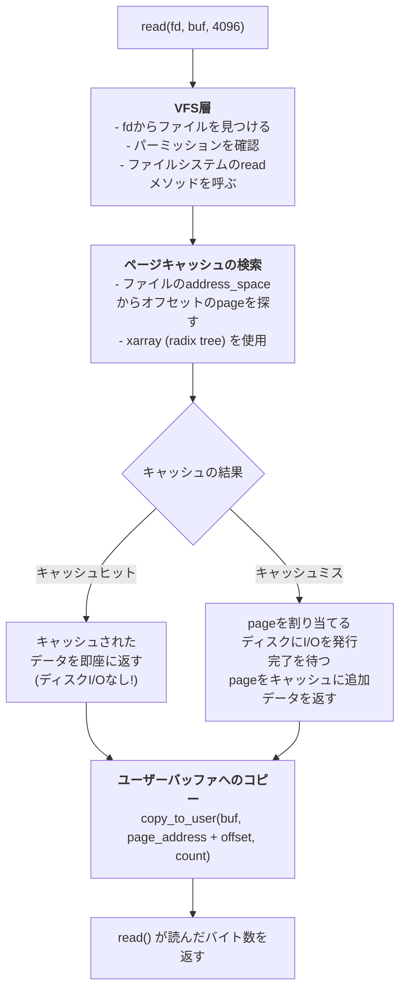
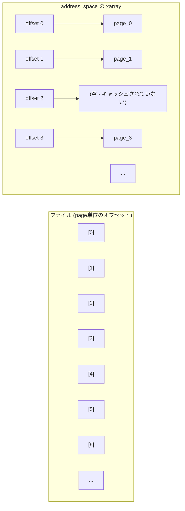
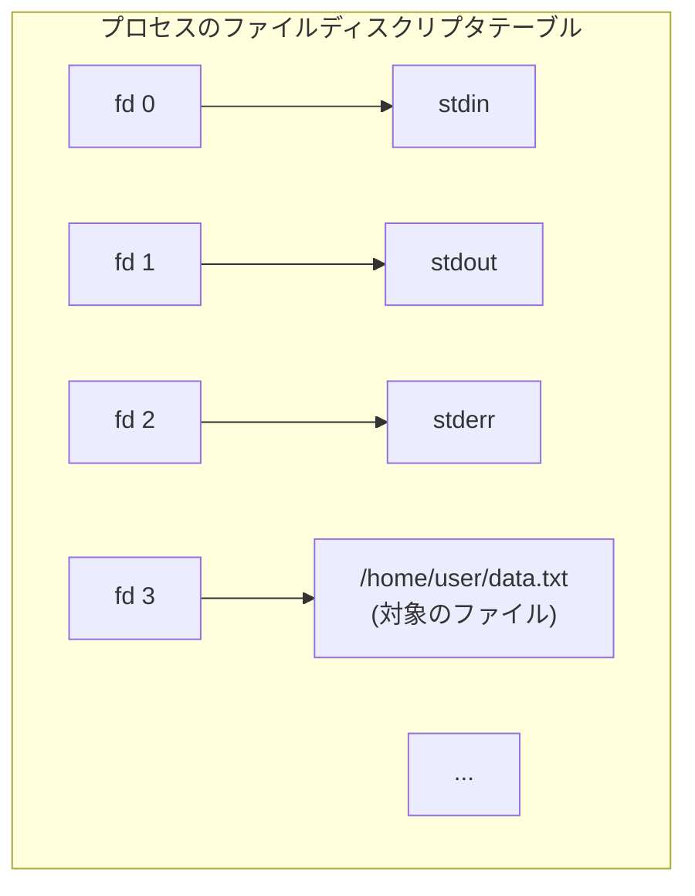
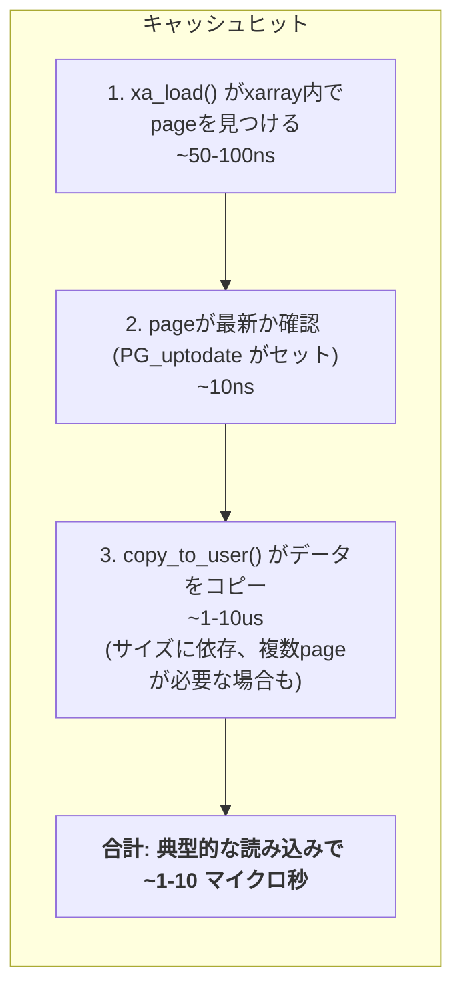
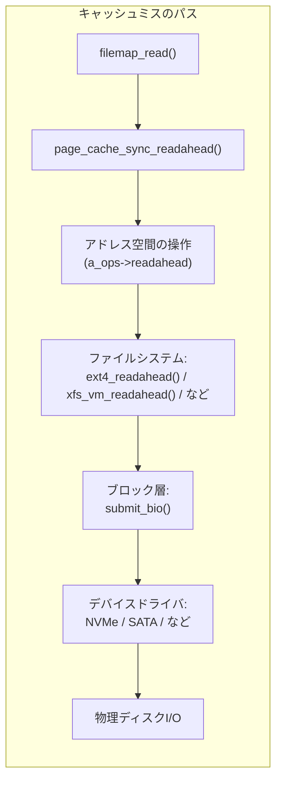
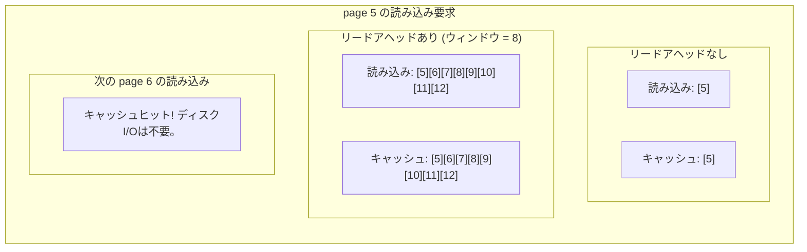
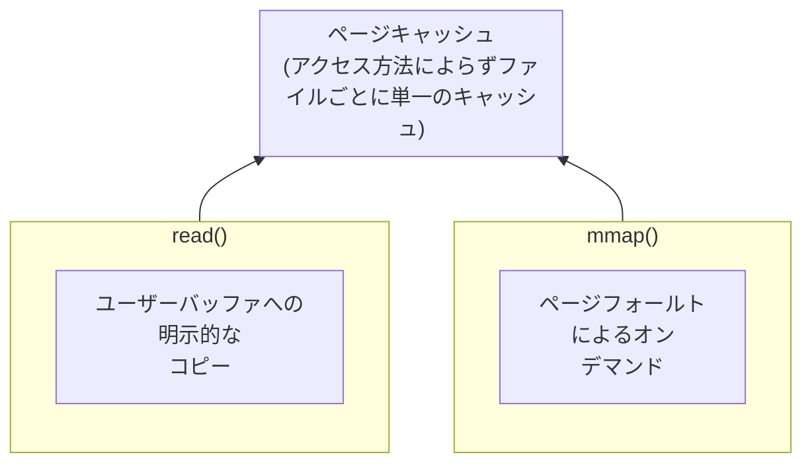
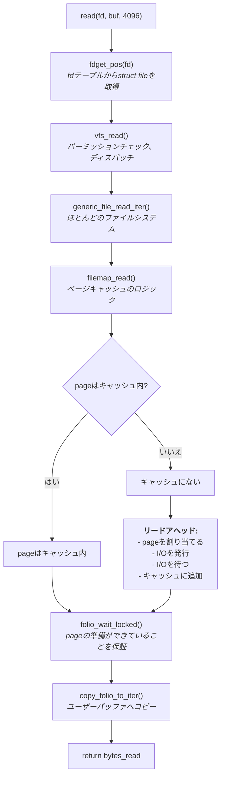

# ファイル読み込みの一生 {#life-of-a-file-read}

> read()システムコールをページキャッシュを通して追跡する

## ファイルを読むと何が起きるか? {#what-happens-when-you-read-a-file}

プログラムがファイルを読むとき、データがディスクから直接来ることはめったにない。カーネルは**ページキャッシュ**、すなわちファイルデータのメモリ上のキャッシュを維持している。ほとんどの読み込みは、ディスクにまったく触れることなくこのキャッシュから満たされる。



重要なポイントは、**ページキャッシュがほとんどの読み込みを高速にする**ということである。カーネルはシーケンシャルなパターンを検出すると、[pageを非同期にプリフェッチ](https://lwn.net/Articles/888715/)するので、後続の読み込みのほとんどはディスクではなくキャッシュから提供される。定常状態では、シーケンシャルなワークロードに対してリードアヘッドは[90%を超える](https://lwn.net/Articles/155510/)キャッシュヒット率を達成しうる。

## ページキャッシュ {#the-page-cache}

ページキャッシュは、カーネルによるファイル内容のキャッシュである。すべてのファイル読み込みはここを通る。

### なぜファイルデータをキャッシュするか? {#why-cache-file-data}

| 操作 | レイテンシ |
|-----------|---------|
| メモリアクセス | 約100ナノ秒 |
| SSDの読み込み | 約100マイクロ秒（1000倍遅い） |
| HDDの読み込み | 約10ミリ秒（100,000倍遅い） |

（桁数レベルの数値は[Latency Numbers Every Programmer Should Know](https://colin-scott.github.io/personal_website/research/interactive_latency.html)より。元はJeff DeanのものをPeter Norvigが紹介したもの。）

高速なSSDであっても、メモリは桁違いに速い。ページキャッシュは時間的局所性、つまり一度読まれたデータはすぐにまた読まれる可能性が高いという性質を利用する。

### ページキャッシュの構成 {#page-cache-organization}

開かれた各ファイルは、キャッシュされたpageを管理する`address_space`を持つ:

```c
// include/linux/fs.h より
struct address_space {
    struct inode *host;           // 所有する inode
    struct xarray i_pages;        // キャッシュされた page (xarray/radix tree)
    atomic_t i_mmap_writable;     // 書き込み可能なマッピング
    struct rb_root_cached i_mmap; // プライベート/共有マッピングのツリー
    unsigned long nrpages;        // キャッシュされた page の数
    const struct address_space_operations *a_ops;  // 操作
    // ...
};
```

pageはファイルオフセットでインデックス付けされる:



## ステージ1: システムコールへの進入 {#stage-1-system-call-entry}

ユーザープログラムが`read()`を呼ぶ:

```c
// ユーザー空間
ssize_t n = read(fd, buffer, 4096);

// カーネルへの入口: fs/read_write.c
SYSCALL_DEFINE3(read, unsigned int, fd, char __user *, buf, size_t, count)
{
    struct fd f = fdget_pos(fd);

    // ... パーミッションチェック ...

    ret = vfs_read(f.file, buf, count, &pos);

    fdput_pos(f);
    return ret;
}
```

### fdからfileへ {#from-fd-to-file}

カーネルはファイルディスクリプタを`struct file`に変換する:



```c
struct file {
    struct path f_path;           // dentry とマウント
    struct inode *f_inode;        // inode (ファイルのメタデータ)
    const struct file_operations *f_op;  // read/write 操作
    loff_t f_pos;                 // 現在のファイル位置
    struct address_space *f_mapping;  // ページキャッシュ
    // ...
};
```

## ステージ2: VFSによるreadのディスパッチ {#stage-2-vfs-read-dispatch}

`vfs_read()`はファイルシステムのread実装を呼び出す:

```c
// fs/read_write.c
ssize_t vfs_read(struct file *file, char __user *buf,
                 size_t count, loff_t *pos)
{
    // 読み込み可能か確認
    if (!(file->f_mode & FMODE_READ))
        return -EBADF;

    // バッファが有効なユーザーメモリか確認
    if (!access_ok(buf, count))
        return -EFAULT;

    // ファイルシステムの read メソッドを呼ぶ
    if (file->f_op->read)
        ret = file->f_op->read(file, buf, count, pos);
    else if (file->f_op->read_iter)
        ret = new_sync_read(file, buf, count, pos);

    return ret;
}
```

ほとんどのファイルシステムは汎用の`read_iter`パスを使い、これは`generic_file_read_iter()`を通る:

```c
// mm/filemap.c
ssize_t generic_file_read_iter(struct kiocb *iocb, struct iov_iter *iter)
{
    if (iocb->ki_flags & IOCB_DIRECT)
        return mapping_direct_IO(...);  // キャッシュをバイパス

    return filemap_read(iocb, iter, 0);  // 通常のパス
}
```

## ステージ3: ページキャッシュの検索 {#stage-3-page-cache-lookup}

ファイル読み込みの中核は[`filemap_read()`](https://git.kernel.org/pub/scm/linux/kernel/git/torvalds/linux.git/tree/mm/filemap.c)である:

```c
// mm/filemap.c (簡略化)
ssize_t filemap_read(struct kiocb *iocb, struct iov_iter *iter,
                     ssize_t already_read)
{
    struct file *file = iocb->ki_filp;
    struct address_space *mapping = file->f_mapping;
    pgoff_t index = iocb->ki_pos >> PAGE_SHIFT;  // オフセットから page インデックスを求める

    for (;;) {
        // 1. キャッシュ内の page を探す
        folio = filemap_get_folio(mapping, index);

        if (IS_ERR(folio)) {
            // キャッシュミス - ディスクから読む必要がある
            folio = page_cache_sync_readahead(...);
        }

        // 2. page が最新になるのを待つ
        folio_wait_locked(folio);
        if (!folio_test_uptodate(folio))
            goto error;

        // 3. データをユーザーバッファにコピー
        copied = copy_folio_to_iter(folio, offset, bytes, iter);

        folio_put(folio);
        index++;
    }
}
```

### xarrayの検索 {#the-xarray-lookup}

キャッシュ内のpageを見つけるにはxarray（radix treeから発展したもの）を使う:

```c
// インデックスの page を見つける
struct folio *filemap_get_folio(struct address_space *mapping,
                                 pgoff_t index)
{
    return __filemap_get_folio(mapping, index, FGP_ENTRY, 0);
}

struct folio *__filemap_get_folio(struct address_space *mapping,
                                   pgoff_t index, fgf_t fgp_flags,
                                   gfp_t gfp)
{
    struct folio *folio;

    // xarray でのロックフリーな検索
    folio = xa_load(&mapping->i_pages, index);

    if (!folio || xa_is_value(folio))
        return ERR_PTR(-ENOENT);  // キャッシュにない

    // 見つかった - 参照をインクリメント
    folio_get(folio);
    return folio;
}
```

この検索は実用的なファイルサイズでは事実上`O(1)`である。[`xarray`](https://docs.kernel.org/core-api/xarray.html)は平衡木ではなく高さが制限されたradix treeであるため、pageが増えても性能は劣化しない。

## ステージ4: キャッシュヒット（高速パス） {#stage-4-cache-hit-fast-path}

pageがキャッシュ内にあり最新である場合、読み込みは高速である（桁数レベルの見積もり。実際のレイテンシはCPUとワークロードに依存する）:



ディスクI/Oも待ちもなく、メモリコピーだけである。

### ユーザー空間へのコピー {#the-copy-to-userspace}

```c
// カーネルの page からユーザーバッファへコピー
size_t copy_folio_to_iter(struct folio *folio, size_t offset,
                          size_t bytes, struct iov_iter *i)
{
    // page を一時的にマップする
    // バイトをユーザーバッファにコピーする
    // 部分的な page (page 内のオフセット) を扱う
}
```

これがキャッシュされた読み込みの主なコスト、すなわちカーネルメモリからユーザーメモリへのデータのコピーである。

## ステージ5: キャッシュミス（低速パス） {#stage-5-cache-miss-slow-path}

pageがキャッシュにない場合、カーネルはディスクから読まなければならない:

```c
// page がキャッシュにない - 割り当てて読む
static struct folio *page_cache_sync_readahead(...)
{
    // 1. 新しい folio を割り当てる
    folio = filemap_alloc_folio(gfp, 0);

    // 2. ページキャッシュに追加
    error = filemap_add_folio(mapping, folio, index, gfp);

    // 3. ディスクから読むためにI/Oを発行
    folio_mark_uptodate(folio);  // I/O完了後

    return folio;
}
```

### I/Oの発行 {#io-submission}

実際のディスク読み込みはファイルシステムとブロック層を通る:



プロセスはI/Oが完了するまでブロックする（非同期I/Oを使っていない場合）。

### I/Oを待つ {#waiting-for-io}

```c
// page の準備ができるまでブロック
folio_wait_locked(folio);

// 正常に完了したか確認
if (!folio_test_uptodate(folio)) {
    folio_put(folio);
    return -EIO;
}
```

## ステージ6: リードアヘッド {#stage-6-readahead}

カーネルは要求されたpageだけを読むのではない。後続のpageも必要になると予測して先読みする:



### リードアヘッドのアルゴリズム {#readahead-algorithm}

カーネルは適応的なリードアヘッドアルゴリズムを使う:

```c
// mm/readahead.c (簡略化)
void page_cache_sync_readahead(struct address_space *mapping,
                                struct file_ra_state *ra,
                                struct file *file,
                                pgoff_t index,
                                unsigned long req_count)
{
    // シーケンシャルなアクセスパターンか確認
    if (index == ra->prev_pos + 1) {
        // シーケンシャル - リードアヘッドのウィンドウを拡大
        ra->size = min(ra->size * 2, ra->ra_pages);
    } else {
        // ランダム - ウィンドウを縮小
        ra->size = 4;  // 小さく始める
    }

    // リードアヘッドのI/Oを発行
    do_page_cache_ra(ractl, ra->size, ra->async_size);
}
```

### リードアヘッドの状態 {#readahead-state}

各ファイルは、アクセスパターンを追跡するリードアヘッドの状態を持つ:

```c
struct file_ra_state {
    pgoff_t start;          // リードアヘッドの開始位置
    unsigned int size;      // 現在のウィンドウサイズ
    unsigned int async_size;// 非同期部分 (次のリードアヘッドのトリガー)
    unsigned int ra_pages;  // 最大ウィンドウ
    unsigned int mmap_miss; // mmap でのキャッシュミス
    loff_t prev_pos;        // 前回の読み込み位置
};
```

### リードアヘッドのチューニング {#tuning-readahead}

```bash
# デフォルトのリードアヘッドサイズを表示 (512バイトセクタ単位)
cat /sys/block/sda/queue/read_ahead_kb

# 調整する (例: シーケンシャルなワークロード向け)
echo 256 > /sys/block/sda/queue/read_ahead_kb

# posix_fadvise によるファイルごとのリードアヘッド
posix_fadvise(fd, 0, 0, POSIX_FADV_SEQUENTIAL);  // ヒント: シーケンシャル
posix_fadvise(fd, 0, 0, POSIX_FADV_RANDOM);      // ヒント: ランダム
```

## mmapとread {#mmap-vs-read}

ファイルを読むもう1つの方法として、`mmap()`によるメモリマッピングがある:

```c
// read() のアプローチ
char buf[4096];
read(fd, buf, 4096);

// mmap() のアプローチ
char *ptr = mmap(NULL, file_size, PROT_READ, MAP_PRIVATE, fd, 0);
// ptr に直接アクセス - ページフォールトがデータをロードする
```

どちらも同じページキャッシュを使う:



**read()**: ページキャッシュからユーザーバッファへの明示的なコピー。
**mmap()**: ページキャッシュのpageをプロセスのアドレス空間に直接マップする。コピーは不要。

詳細は[ページキャッシュ](page-cache.md)と[プロセスのアドレス空間](mmap.md)を参照。

## ダイレクトI/O {#direct-io}

ページキャッシュを完全にバイパスしたい場合もある:

```c
// O_DIRECT で開く
int fd = open("file.dat", O_RDONLY | O_DIRECT);

// 読み込みはページキャッシュをバイパスし、ユーザーバッファと直接やり取りする
read(fd, aligned_buffer, size);
```

**ダイレクトI/Oを使うべきとき**:

- データベースエンジン（独自のキャッシュを持つ）
- 非常に大きなシーケンシャル読み込み（キャッシュが無駄になる）
- 予測可能なI/Oタイミングが必要なとき

**要件**:

- バッファはアラインされていなければならない（通常は512バイトまたは4KB）
- オフセットとサイズもアラインが必要なことが多い

## 全体像 {#the-complete-picture}

`read()`呼び出しの完全な流れは次のとおり:



## 試してみる {#try-it-yourself}

### キャッシュヒット率を観察する {#watch-cache-hit-ratio}

```bash
# ページキャッシュをクリア (root が必要)
echo 3 > /proc/sys/vm/drop_caches

# ファイルを読む
cat /path/to/large/file > /dev/null

# キャッシュ統計を確認
cat /proc/vmstat | grep -E "pgpg|pgfault"
# pgpgin  - ディスクから読まれた page
# pgpgout - ディスクに書かれた page
```

### キャッシュあり/なしの読み込みを比較する {#compare-cached-vs-uncached-reads}

```bash
# 1回目の読み込み (コールドキャッシュ)
time cat /path/to/large/file > /dev/null

# 2回目の読み込み (ウォームキャッシュ)
time cat /path/to/large/file > /dev/null

# 2回目の読み込みははるかに速いはず
```

### リードアヘッドを監視する {#monitor-readahead}

```bash
# リードアヘッドの動きを監視
cat /proc/vmstat | grep -E "pgread|pgalloc"

# リードアヘッドのイベントをトレース
echo 1 > /sys/kernel/debug/tracing/events/filemap/mm_filemap_add_to_page_cache/enable
cat /sys/kernel/debug/tracing/trace_pipe
```

### ファイルのキャッシュ内容を見る {#view-cache-contents-for-a-file}

```bash
# fincore を使う (util-linux の一部)
fincore /path/to/file

# ファイルのどの page がキャッシュ内にあるかを表示する

# vmtouch を使う (サードパーティ製ツール)
vmtouch -v /path/to/file
```

### ダイレクトI/Oを試す {#test-direct-io}

```bash
# ダイレクトI/Oで読む (キャッシュをバイパス)
dd if=/path/to/file of=/dev/null bs=4096 iflag=direct

# バッファードI/Oと比較
dd if=/path/to/file of=/dev/null bs=4096

# ダイレクトI/Oのタイミングはより安定しているが、キャッシュ済みの
# データに対しては遅くなる可能性がある
```

### ページキャッシュのサイズを観察する {#observe-page-cache-size}

```bash
# 現在のキャッシュ使用量
cat /proc/meminfo | grep -E "Cached|Buffers"

# ファイルを読むにつれて増えていく様子を観察
watch -n 1 'cat /proc/meminfo | grep -E "Cached|Buffers"'

# 別のターミナルで大きなファイルを読む
cat /path/to/large/file > /dev/null
```

## 主要なソースファイル {#key-source-files}

| ファイル | 役割 |
|------|--------------|
| [`mm/filemap.c`](https://git.kernel.org/pub/scm/linux/kernel/git/torvalds/linux.git/tree/mm/filemap.c) | ページキャッシュの操作、filemap_read() |
| [`mm/readahead.c`](https://git.kernel.org/pub/scm/linux/kernel/git/torvalds/linux.git/tree/mm/readahead.c) | リードアヘッドのアルゴリズム |
| [`fs/read_write.c`](https://git.kernel.org/pub/scm/linux/kernel/git/torvalds/linux.git/tree/fs/read_write.c) | VFSのread/writeの入口 |
| [`include/linux/fs.h`](https://git.kernel.org/pub/scm/linux/kernel/git/torvalds/linux.git/tree/include/linux/fs.h) | struct address_space、ファイル操作 |
| [`include/linux/pagemap.h`](https://git.kernel.org/pub/scm/linux/kernel/git/torvalds/linux.git/tree/include/linux/pagemap.h) | ページキャッシュのAPI |

## 歴史 {#history}

### ページキャッシュの進化 {#page-cache-evolution}

**初期のLinux**: 手動のリードアヘッドを持つ単純なページキャッシュ。

**v2.4**: バッファキャッシュとページキャッシュが統合された。

**v2.6**: ページキャッシュ検索のためのradix tree、適応的リードアヘッド。

**v4.20 (2018)**: ページキャッシュのインデックス付けでXArrayがradix treeを置き換えた。

**コミット**: [4c7472c0df2f](https://git.kernel.org/linus/4c7472c0df2f) ("page cache: Convert find_get_entry to XArray") | [LKML](https://lore.kernel.org/linux-mm/20181205145239.17953-1-willy@infradead.org/)

**作者**: Matthew Wilcox

上の流れでは、`filemap_get_folio()`が`xarray`を使って、ファイルオフセットによってキャッシュされたpageを検索する。`xarray`は置き換えられたradix treeよりも優れたキャッシュ利用効率を提供し、キャッシュヒットのパスを高速化する。

### folioへの変換（v5.16以降） {#folio-conversion-v516}

上の流れでは、`filemap_get_folio()`や`filemap_read()`などの関数は、生の`struct page`ではなく`struct folio`を扱う:

**コミット**: [7b230db3b8d3](https://git.kernel.org/linus/7b230db3b8d3) ("mm: Introduce struct folio") | [LKML](https://lore.kernel.org/linux-mm/20210622121551.3398730-3-willy@infradead.org/)

**作者**: Matthew Wilcox

- **何が可能になるか**: ページキャッシュがファイルのためにlarge folio（例: 64KB以上）を保持できるようになり、メタデータのオーバーヘッドが減り、大きなシーケンシャル読み込みのI/O効率が向上する
- **我々の流れでは**: `read()`がキャッシュミスを起こすと、`filemap_alloc_folio()`がlarge folioを割り当てることがあり、リードアヘッドは複数page分のファイルデータを1回のI/O操作でそこに埋める

## 悪名高いバグとエッジケース {#notorious-bugs-and-edge-cases}

ページキャッシュと読み込みパスには、ファイルシステム、メモリ管理、I/Oの間の複雑な相互作用が関わる。ここでのバグはデータ破損、古いデータの読み込み、クラッシュを引き起こす。

---

### ケース1: filemap_fault()の競合状態 {#case-1-filemap_fault-race-conditions}

#### 何が起きたか {#what-happened}

`filemap_fault()`関数は、メモリマップされたファイルのページフォールトを処理する。無効化とフォールト処理の間の競合状態が、複数のバグを引き起こしてきた。

#### バグ {#the-bug}

[カーネルの議論](https://linux.kernel.narkive.com/8lKSc68j/potential-fix-to-filemap-fault)より:

競合は次の間で起こりうる:
1. **スレッドA**: ページフォールトを処理し、ファイルデータをページキャッシュに読み込んでいる
2. **スレッドB**: ファイルを無効化/truncateしている

スレッドAがpageをフォールトインしている間にスレッドBがファイルをtruncateすると、スレッドAは新しいファイル末尾より先にpageを設置したり、古いデータを見たりする可能性がある。

> *"We see a blank page from time to time, when we should be seeing valid data."*

（訳: 有効なデータが見えるべきところで、ときどき空白のpageが見える。）

#### 現実世界への影響 {#real-world-implications}

mmapされたファイルを使うアプリケーション（データベース、VMなど）は次のような事態に遭遇しうる:

- truncate後の古いデータ
- 空白のpage
- 不正なアクセスによるクラッシュ

#### 緩和策 {#mitigations}

- フォールトパスとtruncateパスの間の適切なpageロックの順序
- 書き込み可能なマッピングのための`page_mkwrite()`による協調
- ファイルシステム固有のロック（例: i_rwsem）

---

### ケース2: 9pの読み込み破損（2025年） {#case-2-9p-read-corruption-2025}

#### 何が起きたか {#what-happened_1}

[最近のLKMLの議論](https://lkml.org/lkml/2025/12/19/689)で、9pファイルシステムとmmapされた内容での読み込み破損が報告された。

#### バグ {#the-bug_1}

9pファイルシステムのsplice実装には、データ転送中のpageのピン留めがページキャッシュの操作と競合しうるバグがあり、次のことを引き起こした:

- 誤ったデータの読み込み
- 誤ったファイル位置にデータが現れる
- エラーなしの静かな破損

#### なぜ重要か {#why-this-matters}

独自のI/Oパス（splice、ダイレクトI/O、io_uring）を実装するファイルシステムは、ページキャッシュと慎重に協調しなければならない。この協調におけるバグは、次の理由で検出が難しい:

1. 特定のタイミングを必要とする
2. 破損が静かに起こる
3. 標準的なI/Oテストでは発生しない

---

### ケース3: poisonされたページキャッシュによるデータ消失 {#case-3-poisoned-page-cache-data-loss}

#### 何が起きたか {#what-happened_2}

ハードウェアのメモリエラー（hwpoison）がページキャッシュのpageに影響すると、カーネルは静かなデータ消失を避けるために慎重に扱わなければならない。

#### バグ {#the-bug_2}

[カーネルパッチの議論](https://www.spinics.net/lists/linux-fsdevel/msg204546.html)より:

> *"Solve silent data loss caused by poisoned page cache (shmem/tmpfs)"*

（訳: poisonされたページキャッシュ（shmem/tmpfs）が引き起こす静かなデータ消失を解決する）

ページキャッシュ内のpageがハードウェアエラーを受けると:
1. pageはpoisonedとマークされる
2. しかし読み込み側はまだキャッシュされた（破損している可能性のある）データを見るかもしれない
3. 書き込みが静かに失敗するかもしれない

tmpfs/shmemには回復元となるバッキングストアがないので、データは単に失われる。

#### 現実世界への影響 {#real-world-implications_1}

ページキャッシュに使われるRAMのハードウェアエラーは次を引き起こしうる:

- データベースの破損
- ユーザーデータの消失
- ファイルシステムの不整合な状態

#### 緩和策 {#mitigation}

パッチは次を保証する:

- poisonされたpageは直ちにキャッシュから追い出される
- 後続の読み込みは（ファイルバックであれば）ディスクに行く
- エラーはユーザー空間に適切に伝播される

---

### ケース4: リードアヘッドウィンドウの爆発 {#case-4-readahead-window-explosion}

#### 何が起きたか {#what-happened_3}

適応的リードアヘッドアルゴリズムはアクセスパターンを予測しようとする。そのヒューリスティクスのバグは過剰なI/Oを引き起こしうる。

#### バグ {#the-bug_3}

リードアヘッドがシーケンシャルアクセスを誤って予測すると:
1. カーネルが多数のpageを先読みする
2. アプリケーションはそれらを使わない
3. 場所を空けるために有用なpageが追い出される
4. アプリケーションは追い出されたpageのためにさらにI/Oを引き起こす
5. メモリに余裕があるにもかかわらずシステムがスラッシングする

#### 歴史的な例 {#historical-examples}

- **大きなファイルへのランダムアクセス**: リードアヘッドはシーケンシャルを仮定し、帯域を浪費する
- **複数のストリーム**: リードアヘッドは読み手ごとの状態をうまく追跡できない（最近のカーネルで改善された）
- **SSDとHDD**: 最適なリードアヘッドは異なり、デフォルトはしばしば不適切

#### チューニング {#tuning}

```bash
# デフォルトのリードアヘッドを確認 (KB)
blockdev --getra /dev/sda
# 典型的には: 256 (KB)

# ランダムなワークロード向けに減らす
blockdev --setra 64 /dev/sda

# アプリケーションでのファイルごとのヒント
posix_fadvise(fd, 0, 0, POSIX_FADV_RANDOM);
```

---

### ケース5: ダイレクトI/Oとのページキャッシュのコヒーレンシ {#case-5-page-cache-coherency-with-direct-io}

#### 何が起きたか {#what-happened_4}

バッファードI/O（ページキャッシュ）とダイレクトI/Oを混在させるアプリケーションは、古いデータを見ることがある。

#### バグ {#the-bug_4}

```c
// スレッドA: バッファード書き込み
write(fd, "AAAA", 4);

// スレッドB: ダイレクト読み込み (ページキャッシュをバイパス)
char buf[4];
pread(fd_dio, buf, 4, 0);  // 古いデータが見えるかもしれない!

// 理由: ページキャッシュは dirty だがまだディスクに書かれていない
// ダイレクトI/Oはディスクから読むので、古いデータが見える
```

#### 現実世界への影響 {#real-world-implications_2}

データベースはしばしば次を使う:

- データファイルにはダイレクトI/O（予測可能なレイテンシ）
- ログにはバッファードI/O（小さな書き込みの性能が良い）

慎重に協調しないと、一方のサブシステムが他方から古いデータを見てしまう。

#### 緩和策 {#mitigation_1}

```c
// ダイレクト読み込みの前に、バッファードの書き込みをフラッシュする
fsync(fd);  // ページキャッシュがディスクに書かれたことを保証

// または書き込みに O_DSYNC を使う
int fd = open(path, O_WRONLY | O_DSYNC);

// またはダイレクト読み込みの前にキャッシュを無効化する
posix_fadvise(fd, 0, 0, POSIX_FADV_DONTNEED);
```

---

### ケース6: BDI（Backing Device Info）のライトバックのバグ {#case-6-bdi-backing-device-info-writeback-bugs}

#### 何が起きたか {#what-happened_5}

BDIはデバイスごとのライトバックの状態を追跡する。BDIの扱いにおけるバグは、ライトバックの停滞やデータ消失を引き起こしてきた。

#### バグ {#the-bug_5}

[カーネルのBUG報告](https://access.redhat.com/solutions/5773601)より:

> *"Kernel panic in __delete_from_page_cache() with a message 'kernel BUG at mm/filemap.c:240!'"*

（訳: __delete_from_page_cache()で'kernel BUG at mm/filemap.c:240!'というメッセージとともにカーネルパニック）

dirty pageが存在する間にデバイスが取り外されると:
1. BDI構造体が解放される可能性がある
2. ライトバックワーカーがまだそれを参照している
3. use-after-free → クラッシュ

#### なぜ重要か {#why-this-matters_1}

ホットプラグ可能なストレージ（USB、SATAホットプラグ、NVMeのホットリムーブ）は、ページキャッシュと協調しなければならない。ページキャッシュはデバイスのdirtyデータを保持している可能性があり、適切な同期なしにデバイスを取り外すと次を引き起こす:

- dirtyデータの消失
- カーネルのクラッシュ
- ファイルシステムの破損

---

### まとめ: 得られた教訓 {#summary-lessons-learned}

| バグ | 根本原因 | 影響 | 予防策 |
|-----|------------|--------|------------|
| **filemap_faultの競合** | truncateとフォールトの競合 | 古いデータ | 適切なロック順序 |
| **9pのsplice破損** | pageのピン留めのバグ | データ破損 | 慎重なsplice実装 |
| **poisonされたページキャッシュ** | hwpoisonの扱い | 静かなデータ消失 | エラーの伝播 |
| **リードアヘッドの爆発** | 誤ったヒューリスティクス | スラッシング | リードアヘッドの調整、fadviseの使用 |
| **DIOのキャッシュコヒーレンシ** | バッファードとダイレクトの混在 | 古いデータの読み込み | DIO前のfsync |
| **BDIの取り外し** | デバイスのホットリムーブの競合 | クラッシュ、データ消失 | 適切な破棄手順 |

共通点は、**ページキャッシュは複雑さを増す重要な性能最適化である**ということである。キャッシュをバイパスしたり、無効化したり、キャッシュと競合したりする操作はすべて、潜在的なバグの発生箇所となる。

## 参考文献 {#further-reading}

### 関連ドキュメント {#related-docs}

- [ページキャッシュ](page-cache.md) - ページキャッシュの内部
- [mallocの一生](life-of-malloc.md) - 匿名メモリとの対比
- [pageの一生](life-of-page.md) - キャッシュpageを含むpageのライフサイクル
- [プロセスのアドレス空間](mmap.md) - read()の代替としてのmmap

### LWNの記事 {#lwn-articles}

- [Readahead: the theory](https://lwn.net/Articles/155510/) (2005) - リードアヘッドの概念
- [The XArray data structure](https://lwn.net/Articles/745073/) (2017) - radix treeの置き換え
- [Filesystem I/O and the page cache](https://lwn.net/Articles/712467/) (2016) - 概要
- [Fixing page-writeback races](https://lwn.net/Articles/326552/) (2009) - ライトバックの協調
