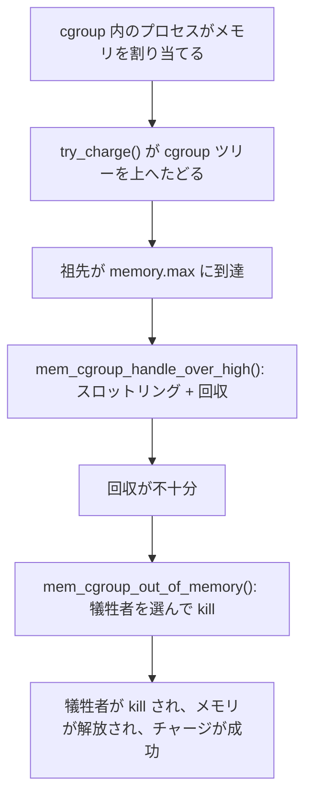

# cgroup の OOM コントローラ {#cgroup-oom-controller}

> cgroup がメモリを使い果たしたとき、カーネルはどのようにプロセスを kill するのか

## cgroup OOM とグローバル OOM {#cgroup-oom-vs-global-oom}

カーネルには2つの OOM パスがある。グローバル OOM killer は、回収を尽くしたあともシステム全体として割り当てを満たせないときに発動する。cgroup の OOM コントローラは、単一の cgroup が、その cgroup 内での回収を尽くしたあとも `memory.max` を超えるときに発動する。ホストシステムに何ギガバイトも空きがあっても、cgroup OOM は意に介さない。

| | グローバル OOM | cgroup OOM |
|---|---|---|
| きっかけ | システム全体での割り当て失敗 | 回収後も cgroup の `memory.max` を超過 |
| 候補の母集団 | システム上のすべてのプロセス | cgroup（とその子孫）内のプロセス |
| スコア計算の `totalpages` | システムの RAM + スワップ | cgroup の `memory.max` |
| ログの接頭辞 | `Out of memory:` | `Memory cgroup out of memory:` |
| `constraint` フィールド | `CONSTRAINT_NONE` | `CONSTRAINT_MEMCG` |
| ホストへの影響 | 深刻になりうる | cgroup 内に隔離される |

どちらのパスも、同じ犠牲者選択関数である [`mm/oom_kill.c`](https://git.kernel.org/pub/scm/linux/kernel/git/torvalds/linux.git/tree/mm/oom_kill.c) の `oom_badness()` に合流する。違いは渡される `totalpages` の値である。そして `totalpages` は `oom_score_adj` の計算の分母なので、cgroup のサイズが重要になる。

## 何が cgroup OOM を引き起こすのか {#what-triggers-a-cgroup-oom}

通常の動作から OOM kill に至るまでの流れは4つのステップからなる:



1. **チャージ**: すべてのページ割り当ては、[`mm/memcontrol.c`](https://git.kernel.org/pub/scm/linux/kernel/git/torvalds/linux.git/tree/mm/memcontrol.c) の `try_charge()` を通じて cgroup にチャージされる。これは cgroup ツリーを上へたどり、各祖先の制限をチェックする。

2. **回収**: 制限に達すると、カーネルは cgroup 内での回収を試みる。cgroup 内のプロセスに属する回収可能なページ（ページキャッシュ、回収可能な slab、スワップがある場合の匿名ページ）を解放しようとする。

3. **OOM の判断**: 繰り返し試みても回収で十分なメモリを解放できない場合、`mem_cgroup_out_of_memory()` が呼ばれる。これはグローバルパスで使われるのと同じ `out_of_memory()` 関数を、memcg の制約付きで呼び出す。

4. **kill**: 犠牲者が選ばれ、`SIGKILL` が送られる。メモリが解放され、元の割り当てが再試行される。

### `memory.high` のパスは別物 {#the-memoryhigh-path-is-separate}

`memory.high` は OOM を引き起こさない。cgroup が `memory.high` を超えると、カーネルは割り当て中のプロセスをスロットリングし、積極的に回収するが、プロセスが kill されることはない。OOM が引き起こされるのは、`memory.max` に達して回収が失敗したときだけである。違いについては [Tuning memory for containers](tuning-containers.md) を参照。

## cgroup の文脈での犠牲者選択 {#victim-selection-in-a-cgroup-context}

[`mm/oom_kill.c`](https://git.kernel.org/pub/scm/linux/kernel/git/torvalds/linux.git/tree/mm/oom_kill.c) の関数 `oom_badness()` は、各プロセスのスコアを計算する:

```
score = (rss_anon + rss_file + rss_shmem + swapents + pgtables_pages)
      + (oom_score_adj × totalpages / 1000)
```

cgroup OOM では、`totalpages` はシステムの総 RAM ではなく、cgroup の `memory.max`（またはスコア計算に適切なほうとして現在の使用量）である。これにより `oom_score_adj` の影響が変わる:

**例**: `memory.max = 512M` の cgroup と、`oom_score_adj = 500` のプロセス。

- システムの RAM = 16G → `totalpages` ≈ 4M ページ → 調整値 = 4M × 500/1000 = 2M ページ（約8G のペナルティ）
- cgroup の `memory.max` = 512M → `totalpages` ≈ 128K ページ → 調整値 = 128K × 500/1000 = 64K ページ（約256M のペナルティ）

cgroup の場合、`totalpages` が小さいため、`oom_score_adj` の絶対的な影響はずっと小さくなる。システムレベルでは大きくペナルティを受けているように見えるプロセスも、小さな cgroup 内では中程度のペナルティしか受けないことがある。相対的な順序が変わることもある。

### 候補の列挙 {#candidate-enumeration}

cgroup OOM では、影響を受けた cgroup（とその子孫）内のプロセスだけが候補になる。`select_bad_process()` は `mem_cgroup_scan_tasks()` を使って対象の memcg 階層内のタスクだけを走査し、各候補について `oom_evaluate_task()` を呼ぶ。

`oom_score_adj = -1000` のプロセスは常にスキップされる（免除）。カーネルスレッドも常にスキップされる。OOM を引き起こしたプロセスが自動的に犠牲者になるわけではなく、他のプロセスと同様にスコアで競う。

## memory.oom.group: cgroup 全体を kill する {#memoryoomgroup-killing-the-whole-cgroup}

デフォルトでは、OOM killer は1つのプロセスを選んで kill する。コンテナ化されたアプリケーションでは、ワーカープロセスを1つ kill するとコンテナが壊れた状態で残ることが多い。オーケストレータからはコンテナがまだ動作しているように見えるが、重要なサブプロセスは死んでいる。

`memory.oom.group` は、OOM が起きたときに cgroup 内のすべてのプロセスをまとめて kill することでこれを解決する。

**コミット**: [3d8b38eb81ca](https://git.kernel.org/linus/3d8b38eb81ca)（"mm, oom: introduce memory.oom.group"） | [LKML](https://lore.kernel.org/all/20180730180100.25079-4-guro@fb.com/)

**作者**: Roman Gushchin（カーネル v4.19、2018年）

```bash
# cgroup のグループ kill を有効化
echo 1 > /sys/fs/cgroup/mycontainer/memory.oom.group
```

### グループ kill の仕組み {#how-group-kill-works}

OOM killer が犠牲者を選び、その犠牲者の cgroup（または `oom_group` が設定された任意の祖先）に `memory.oom.group = 1` が設定されている場合、[`mm/memcontrol.c`](https://git.kernel.org/pub/scm/linux/kernel/git/torvalds/linux.git/tree/mm/memcontrol.c) の `mem_cgroup_get_oom_group()` が `oom_group = 1` を持つ最上位の祖先 cgroup を返す。次に、その cgroup のサブツリー内のすべてのプロセスについて `oom_kill_memcg_member()` が呼ばれる。

`oom_score_adj = -1000` のプロセスは、グループ kill の際でもスキップされる。

kill のログには追加の行が含まれる:

```
[  891.112295] Tasks in /myapp.slice/myapp.service are going to be killed due to memory.oom.group set
[  891.112296] Memory cgroup out of memory: Killed process 12001 (worker-1) ...
[  891.112297] Memory cgroup out of memory: Killed process 12002 (worker-2) ...
[  891.112298] Memory cgroup out of memory: Killed process 12003 (worker-3) ...
```

### memory.oom.group を使うべきとき {#when-to-use-memoryoomgroup}

| ユースケース | 推奨 |
|----------|----------------|
| 単一プロセスのコンテナ | デフォルト（オフ）で問題ない |
| 複数プロセスのコンテナ（Web サーバー + ワーカー） | 有効にする — 部分的な kill は壊れた状態を残す |
| サイドカー付きのマイクロサービス | 有効にする — アプリを kill してプロキシを残すとゾンビ状態になる |
| 対話的なシェルセッション | 有効にしない — 1つの悪いコマンドのためにセッション全体が kill される |

## oom_score_adj と cgroup OOM の相互作用 {#oomscoreadj-interaction-with-cgroup-oom}

`oom_score_adj` はプロセスごとに（`/proc/<pid>/oom_score_adj` を介して）設定され、範囲は -1000 から +1000 である。これは計算された OOM スコアを修正する:

```bash
# このプロセスを kill されにくくする
echo -200 > /proc/$(pgrep myapp)/oom_score_adj

# このプロセスを免除する（OOM で決して kill されない）
echo -1000 > /proc/$(pgrep critical-daemon)/oom_score_adj

# このプロセスを優先的な犠牲者にする
echo 1000 > /proc/$(pgrep disposable-worker)/oom_score_adj
```

!!! warning "免除されたプロセスは OOM ループを引き起こしうる"
    cgroup 内のすべてのプロセスが `oom_score_adj = -1000` の場合、OOM killer は犠牲者を選べない。何かを kill する代わりに、割り当てが `-ENOMEM` で失敗する。これにより、OOM を引き起こしたプロセスで `ENOMEM` エラーや割り当てのハングが起こりうる。

### systemd と oom_score_adj {#systemd-and-oomscoreadj}

systemd はユニットファイルで `OOMScoreAdjust` を設定し、これは `/proc/<pid>/oom_score_adj` に直接対応する。システムにとって重要なサービス（journald、udevd）はデフォルトで -1000 に設定されている。コンテナのワークロードでは、サービスごとに `OOMScoreAdjust` を設定して、cgroup 内での犠牲者の優先度を制御する。

```ini
# /etc/systemd/system/myapp.service
[Service]
MemoryMax=1G
MemoryHigh=800M
OOMScoreAdjust=200      # 他よりもこのサービスを犠牲者として優先する
MemoryOOMPolicy=kill    # デフォルト: プロセスを kill する（v253+）
```

## kill のシーケンス: 関数とログ出力 {#the-kill-sequence-functions-and-log-output}

チャージの失敗からプロセスの kill までの完全な呼び出しパス:

```
try_charge()                         [mm/memcontrol.c]
  → mem_cgroup_oom()
    → mem_cgroup_out_of_memory()     [mm/memcontrol.c]
      → out_of_memory()              [mm/oom_kill.c]
        → select_bad_process()       [mm/oom_kill.c]
          → oom_evaluate_task()
            → oom_badness()
        → oom_kill_process()         [mm/oom_kill.c]
          → mem_cgroup_get_oom_group() [mm/memcontrol.c]  (if oom.group)
          → __oom_kill_process()
            → do_send_sig_info()     [SIGKILL]
```

### 何がログに記録されるか {#what-gets-logged}

ログ出力は [`mm/oom_kill.c`](https://git.kernel.org/pub/scm/linux/kernel/git/torvalds/linux.git/tree/mm/oom_kill.c) の `dump_header()` と `oom_kill_process()` によって生成され、cgroup 固有のメモリ統計は [`mm/memcontrol.c`](https://git.kernel.org/pub/scm/linux/kernel/git/torvalds/linux.git/tree/mm/memcontrol.c) の `mem_cgroup_print_oom_meminfo()` から出力される。

完全な cgroup OOM のログは次のセクションからなる:

```
# 1. きっかけの行
[  891.112200] worker-1 invoked oom-killer: gfp_mask=0x140cca(...), order=0, oom_score_adj=0

# 2. スタックトレース（誰がアロケータを呼んだか）
[  891.112210]  <TASK>
[  891.112215]  oom_kill_process+0x101/0x170
[  891.112220]  out_of_memory+0x116/0x570
[  891.112225]  mem_cgroup_out_of_memory+0x7b/0xa0
[  891.112230]  try_charge_memcg+0x5c4/0x6b0
[  891.112235]  mem_cgroup_charge+0x92/0x1e0

# 3. cgroup のメモリ統計（システム全体の統計ではない）
[  891.112245] Memory cgroup stats for /myapp.slice/myapp.service:
[  891.112248] anon 536346624
[  891.112248] file 262144
[  891.112248] kernel 2158592
[  891.112248] ...

# 4. タスク表（cgroup 内のプロセスのみ）
[  891.112260] Tasks state (memory values in pages):
[  891.112262] [  pid  ]   uid  tgid total_vm  rss  ...  oom_score_adj name
[  891.112268] [  12001]  1000 12001   524288  130048 ...           0  worker-1
[  891.112275] [  12002]  1000 12002   524288  131072 ...           0  worker-2

# 5. kill の行
[  891.112285] oom-kill:constraint=CONSTRAINT_MEMCG,nodemask=(null),memcg=/myapp.slice/myapp.service,task_memcg=/myapp.slice/myapp.service,task=worker-2,pid=12002,uid=1000
[  891.112290] Memory cgroup out of memory: Killed process 12002 (worker-2) total-vm:2097152kB, anon-rss:524288kB, file-rss:0kB, shmem-rss:0kB, UID:1000 pgtables:1024kB oom_score_adj:0
```

グローバル OOM のログとの主な違い:

- セクション3には、ゾーンベースの `Mem-Info:` ダンプではなく、名前付きのバイトカウンタを伴う `Memory cgroup stats for <path>:` が表示される
- セクション4には cgroup 内のプロセスだけが列挙される
- セクション5には `constraint=CONSTRAINT_MEMCG` と `Memory cgroup out of memory:` が表示される

各フィールドの注釈付きの詳しい解説は [Reading an OOM log](reading-oom-log.md) を参照。

## cgroup OOM の挙動の設定 {#configuring-cgroup-oom-behavior}

### memory.high を設定して OOM を防ぐ {#prevent-oom-by-setting-memoryhigh}

cgroup OOM を避ける最も効果的な方法は、アプリケーションがハードリミット（`memory.max`）に達する前にスロットリング（`memory.high`）に遭遇するようにすることである。両者の間の差が、カーネルに回収する余地を与え、監視システムに対応する時間を与える。

```bash
# high と max の間に200MB の差を設ける
echo 800M > /sys/fs/cgroup/myapp/memory.high
echo 1G   > /sys/fs/cgroup/myapp/memory.max
```

### スワップをバッファとして許可する {#allow-swap-as-a-buffer}

スワップが利用可能なら、cgroup にスワップの使用を許可することで、`memory.high` のスロットリングゾーンと `memory.max` の OOM ゾーンの間にバッファができる。詳細は [Swap accounting in cgroups](memcg-swap.md) を参照。

```bash
echo 512M > /sys/fs/cgroup/myapp/memory.swap.max
```

### OOM イベントを事前に監視する {#monitor-oom-events-proactively}

```bash
# OOM イベントを監視
watch -n 5 cat /sys/fs/cgroup/myapp/memory.events

# イベント駆動の監視には memory.events に inotify を設定する
# （systemd-oomd は代わりに memory.pressure に inotify を使う）
```

### memory.events のフィールド {#memoryevents-fields}

```bash
cat /sys/fs/cgroup/myapp/memory.events
# low 0          # 使用量が memory.low を下回った回数（回収圧力）
# high 152       # memory.high を超えた回数
# max 3          # memory.max に達した回数
# oom 1          # 引き起こされた OOM イベント
# oom_kill 1     # cgroup OOM で kill されたプロセス
# oom_group_kill 0  # グループ kill のイベント（memory.oom.group）
```

`oom` は OOM イベントの数を数える。`oom_kill` は kill されたプロセスの数を数える。`memory.oom.group = 1` の場合、1回の OOM イベントで `oom_kill` が複数回増えることがある。

## cgroup v1 と v2 の OOM の挙動 {#cgroup-v1-vs-v2-oom-behavior}

| 挙動 | cgroup v1 | cgroup v2 |
|----------|-----------|-----------|
| OOM を引き起こすファイル | `memory.limit_in_bytes` | `memory.max` |
| memsw（メモリ+スワップ）の制限 | `memory.memsw.limit_in_bytes` | 別個の `memory.swap.max` |
| グループ kill | `memory.oom_control`（OOM の無効化のみ） | `memory.oom.group` |
| OOM の無効化 | `echo 1 > memory.oom_control` | 相当するものはない — 推奨されない |
| OOM の通知 | `memory.oom_control` 上の eventfd | `memory.events`（poll/inotify） |
| OOM ログの接頭辞 | `Memory cgroup out of memory:` | 同じ |
| カーネルメモリ | 別個の `memory.kmem.limit_in_bytes` | `memory.max` に統合 |

!!! warning "v1 での memory.oom_control による無効化は危険"
    cgroup v1 で `memory.oom_control = 1` を設定すると、その cgroup の OOM killer が無効になる。cgroup が制限を超えると、OOM を引き起こす代わりに割り当てが無期限にブロックする。プロセスは死ぬのではなくハングする。これは設計上の判断として cgroup v2 から削除された。kill せずに割り当てを失敗させたい場合は、`memory.oom.group` と、[systemd-oomd](https://www.freedesktop.org/software/systemd/man/systemd-oomd.service.html) や [Meta's oomd](https://facebookincubator.github.io/oomd/) のようなユーザー空間の OOM デーモンを併用する。

## systemd-oomd: カーネルが発動する前のユーザー空間 OOM {#systemd-oomd-userspace-oom-before-the-kernel-fires}

[systemd-oomd](https://www.freedesktop.org/software/systemd/man/systemd-oomd.service.html) は cgroup ごとの PSI（Pressure Stall Information）を監視し、カーネルの OOM killer が発動する前に、持続的なメモリ圧力下にある cgroup を kill する。プロセスレベルではなく cgroup レベルで動作する（cgroup 全体を kill する）。

```bash
# systemd-oomd の状態を確認
systemctl status systemd-oomd

# oomd の kill 履歴を表示
journalctl -u systemd-oomd

# /etc/systemd/oomd.conf でしきい値を設定
[OOM]
SwapUsedLimit=90%           # スワップが90%を超えたら kill
DefaultMemoryPressureLimit=60%  # DefaultMemoryPressureDurationSec の間 PSI が60%を超えたら kill
DefaultMemoryPressureDurationSec=30
```

PSI に基づく kill は、一般にカーネルの OOM kill より望ましい。より早い段階で（割り当て失敗の後ではなく、高い圧力がかかっている間に）動作し、cgroup の境界で kill するからである。

## 試してみる {#try-it-yourself}

### cgroup OOM を引き起こしてログを観察する {#trigger-a-cgroup-oom-and-observe-the-log}

```bash
# 小さな制限を持つ cgroup を作成
sudo mkdir -p /sys/fs/cgroup/oom-test
echo "+memory" | sudo tee /sys/fs/cgroup/cgroup.subtree_control
echo 64M | sudo tee /sys/fs/cgroup/oom-test/memory.max
echo 1   | sudo tee /sys/fs/cgroup/oom-test/memory.oom.group

# 現在のシェルをその中に移動
echo $$ | sudo tee /sys/fs/cgroup/oom-test/cgroup.procs

# 制限を超える量を割り当てる
python3 -c "x = bytearray(100 * 1024 * 1024)"
# このプロセスは OOM kill される

# ログを確認
dmesg | grep -A 30 "Memory cgroup out of memory"
```

### oom_score_adj の影響を比較する {#compare-oomscoreadj-impact}

```bash
# cgroup 内に2つのプロセスを置き、どちらが選ばれるかを観察
sudo mkdir -p /sys/fs/cgroup/score-test
echo 128M | sudo tee /sys/fs/cgroup/score-test/memory.max

# 2つのバックグラウンドプロセスを起動
python3 -c "import time; x = bytearray(30 * 1024 * 1024); time.sleep(300)" &
PID_A=$!
python3 -c "import time; x = bytearray(30 * 1024 * 1024); time.sleep(300)" &
PID_B=$!

# 両方を cgroup に移動
echo $PID_A | sudo tee /sys/fs/cgroup/score-test/cgroup.procs
echo $PID_B | sudo tee /sys/fs/cgroup/score-test/cgroup.procs

# 一方のプロセスにペナルティを与える
echo 500 > /proc/$PID_B/oom_score_adj

# ここで OOM を引き起こす — PID_B が先に kill されるはず
python3 -c "x = bytearray(80 * 1024 * 1024)" &
echo $! | sudo tee /sys/fs/cgroup/score-test/cgroup.procs

# どの PID が kill されたかを確認
dmesg | tail -5
```

## 主要なソースファイル {#key-source-files}

| ファイル | 関連する関数 |
|------|--------------------|
| [`mm/memcontrol.c`](https://git.kernel.org/pub/scm/linux/kernel/git/torvalds/linux.git/tree/mm/memcontrol.c) | `mem_cgroup_out_of_memory()` — cgroup OOM のエントリポイント、`mem_cgroup_get_oom_group()` — kill するグループを探す、`mem_cgroup_print_oom_meminfo()` — ログ出力、`try_charge()` — チャージと制限の強制 |
| [`mm/oom_kill.c`](https://git.kernel.org/pub/scm/linux/kernel/git/torvalds/linux.git/tree/mm/oom_kill.c) | `out_of_memory()` — 共通の OOM ロジック、`oom_badness()` — スコア計算、`select_bad_process()` — 候補の列挙、`oom_kill_process()` — kill とログ、`__oom_kill_process()` — 実際の SIGKILL |
| [`include/linux/memcontrol.h`](https://git.kernel.org/pub/scm/linux/kernel/git/torvalds/linux.git/tree/include/linux/memcontrol.h) | `struct mem_cgroup`、oom_group フィールド |

## 歴史 {#history}

### cgroup の OOM 通知（cgroup v1、v3.8、2013年） {#cgroup-oom-notification-cgroup-v1-v38-2013}

cgroup v1 は、eventfd ベースの OOM 通知を伴う `memory.oom_control` を導入した。このインターフェースにより、OOM が起きたときにユーザー空間へ通知することができ、オプションで OOM killer を完全に無効化する（代わりに割り当てをブロックする）こともできた。これは有用だったが脆弱で、OOM kill を無効にするとプロセスがハングした。

### memory.oom.group（v4.19、2018年） {#memoryoomgroup-v419-2018}

**コミット**: [3d8b38eb81ca](https://git.kernel.org/linus/3d8b38eb81ca)（"mm, oom: introduce memory.oom.group"） | [LKML](https://lore.kernel.org/all/20180730180100.25079-4-guro@fb.com/)

**作者**: Roman Gushchin

OOM 時に cgroup 内のすべてのプロセスをまとめて kill できるようにし、部分的に kill されたコンテナを再起動するための外部のウォッチドッグを不要にした。

### cgroup v2 の OOM（v4.5+） {#cgroup-v2-oom-v45}

cgroup v2 は、設計上の判断として `memory.oom_control` の無効化機能を削除した。v2 の考え方は、プロセスはハングさせるよりも kill すべきだというものである。`memory.events` ファイルが、eventfd による通知を、ポーリングに適した単純なカウンタファイルで置き換えた。

## 参考資料 {#references}

### 主要なコード {#key-code}

| ファイル | 説明 |
|------|-------------|
| [`mm/memcontrol.c`](https://git.kernel.org/pub/scm/linux/kernel/git/torvalds/linux.git/tree/mm/memcontrol.c) | cgroup のメモリコントローラ |
| [`mm/oom_kill.c`](https://git.kernel.org/pub/scm/linux/kernel/git/torvalds/linux.git/tree/mm/oom_kill.c) | OOM killer: スコア計算、選択、kill |

### カーネルドキュメント {#kernel-documentation}

- [`Documentation/admin-guide/cgroup-v2.rst`](https://docs.kernel.org/admin-guide/cgroup-v2.html) — メモリのインターフェースファイル、oom.group
- [`Documentation/filesystems/proc.rst`](https://docs.kernel.org/filesystems/proc.html) — `/proc/<pid>/oom_score_adj` と `oom_score` のセマンティクス

### LWN の記事 {#lwn-articles}

- [Toward better OOM killing](https://lwn.net/Articles/391222/) — OOM スコアリングモデルの背景
- [Group-kill for memory-cgroup OOM](https://lwn.net/Articles/761118/) — memory.oom.group の設計

### 関連項目 {#related}

- [Memory Cgroups](memcg.md) — memcg の基礎
- [Reading an OOM log](reading-oom-log.md) — 注釈付きの OOM ログ解説
- [Running out of memory](oom.md) — グローバル OOM のパス
- [Hierarchical memory limits](memcg-hierarchy.md) — cgroup ツリー内で制限がどう伝播するか
- [Swap accounting in cgroups](memcg-swap.md) — スワップを使って OOM を避ける

## 参考文献 {#further-reading}

- [mm/memcontrol.c](https://git.kernel.org/pub/scm/linux/kernel/git/torvalds/linux.git/tree/mm/memcontrol.c) — `mem_cgroup_out_of_memory()`（cgroup OOM のエントリポイント）、`mem_cgroup_get_oom_group()`（グループ kill のための祖先の走査）、`mem_cgroup_print_oom_meminfo()`（cgroup ごとのログ出力）
- [mm/oom_kill.c](https://git.kernel.org/pub/scm/linux/kernel/git/torvalds/linux.git/tree/mm/oom_kill.c) — `oom_badness()` によるスコア計算、`mem_cgroup_scan_tasks()` を使う `select_bad_process()`、`oom_kill_process()` によるログ生成 — グローバルと cgroup の OOM パスで共有される
- `Documentation/admin-guide/cgroup-v2.rst` — `memory.oom.group` と `memory.events` のセマンティクス。`oom`、`oom_kill`、`oom_group_kill` のフィールド定義を含む
- `Documentation/admin-guide/oom-kill.rst` — `oom_score_adj` の範囲、セマンティクス、プロセスのスコア計算との相互作用
- [LWN: Group-kill for memory-cgroup OOM](https://lwn.net/Articles/761118/) — `memory.oom.group` の設計に関する議論と動機。これが解決するコンテナ再起動の問題を含む
- [LWN: Toward better OOM killing](https://lwn.net/Articles/391222/) — OOM スコアリングモデルの背景と、`oom_score_adj` が導入された理由
- [memcg](memcg.md) — memcg の基礎。`memory.max` と `memory.high` の違いや、OOM のグループ kill フラグを含む
- [memcg-hierarchy](memcg-hierarchy.md) — 子の `memory.max` に達していなくても、祖先の制限によって cgroup OOM が引き起こされうる仕組み
- [memcg-swap](memcg-swap.md) — スワップを許可することで、`memory.high` のスロットリングゾーンと `memory.max` の OOM の間にバッファができる仕組み
