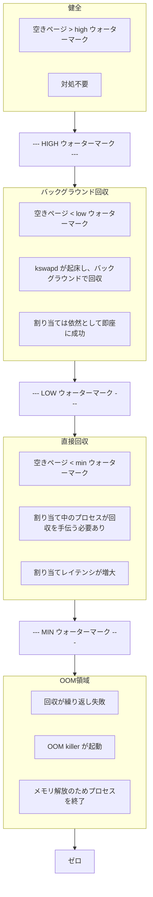
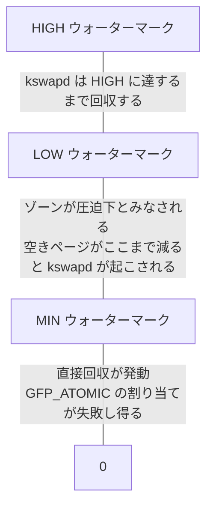
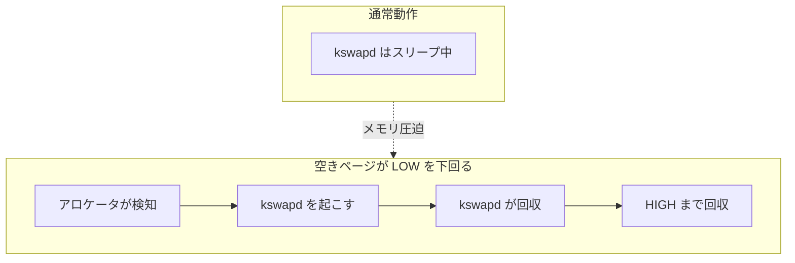
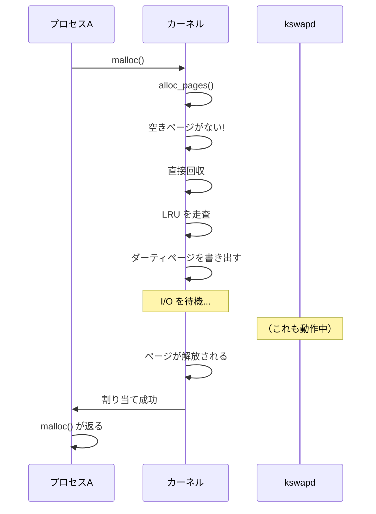
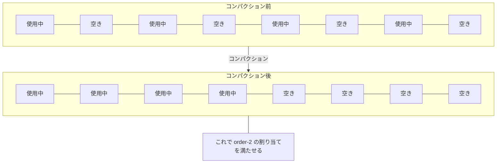
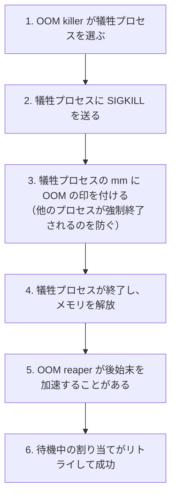
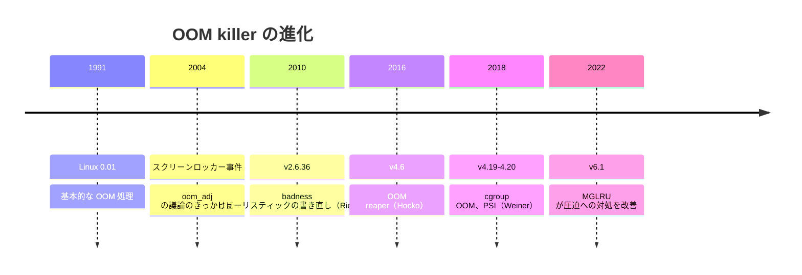
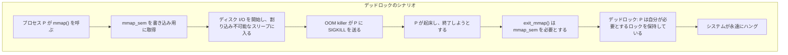

# メモリ不足に陥るとき {#running-out-of-memory}

> 健全なシステムからOOM killまでの進行

## OOMへの道筋 {#the-path-to-oom}

メモリが不足しても、カーネルはすぐにパニックするわけではない。プロセスを強制終了するという最終手段に頼る前に、段階的にエスカレートする介入を経て、メモリを解放しようとする。この進行を理解すれば、自分のプロセスがなぜ強制終了されたのか、そしてどうすれば防げるのかを診断できる。



## 段階1: ウォーターマークと圧迫の検知 {#stage-1-watermarks-and-pressure-detection}

各メモリゾーンには、回収の挙動を制御する3つのウォーターマークがある。

```c
// include/linux/mmzone.h より
enum zone_watermarks {
    WMARK_MIN,    // これを下回ると: 直接回収、割り当てが失敗し得る
    WMARK_LOW,    // これを下回ると: kswapd を起こす
    WMARK_HIGH,   // kswapd が到達を目指す目標値
    WMARK_PROMO,  // 階層型メモリの昇格用
    NR_WMARK
};
```

### ウォーターマークの計算方法 {#how-watermarks-are-calculated}

ウォーターマークは[`vm.min_free_kbytes` と `vm.watermark_scale_factor`](https://docs.kernel.org/admin-guide/sysctl/vm.html)から導出される。

```bash
# 現在の設定を表示
cat /proc/sys/vm/min_free_kbytes
cat /proc/sys/vm/watermark_scale_factor

# min_free_kbytes は MIN ウォーターマークの基準値を決める
# watermark_scale_factor（デフォルト 10 = 0.1%）は LOW と HIGH を調整する
# 正確な計算は mm/page_alloc.c の __setup_per_zone_wmarks() にある
```



### ウォーターマークの確認 {#viewing-watermarks}

```bash
# ウォーターマークを含むゾーンの詳細情報
cat /proc/zoneinfo | grep -A 20 "zone   Normal"

# 主なフィールド:
#   pages free     - 現在の空きページ数
#   min            - min ウォーターマーク
#   low            - low ウォーターマーク
#   high           - high ウォーターマーク
```

## 段階2: バックグラウンド回収（kswapd） {#stage-2-background-reclaim-kswapd}

空きページがlowウォーターマークを下回ると、`kswapd` が起床し、バックグラウンドでページを回収する。

### kswapdの仕組み {#kswapd-mechanics}



kswapdはノードごとのカーネルスレッドである。

```bash
# kswapd スレッドを表示
ps aux | grep kswapd
# kswapd0 - ノード 0 用
# kswapd1 - ノード 1 用（NUMA システムの場合）
```

### kswapdが回収するもの {#what-kswapd-reclaims}

kswapdはinactive LRUリストを走査し、回収可能なページを探す。

| ページの種類 | 回収時の処理 |
|-----------|----------------|
| クリーンなファイルページ | 即座に破棄（ディスクから再読み込み可能） |
| ダーティなファイルページ | ライトバックしてから破棄 |
| 匿名ページ | スワップアウト（スワップがあれば） |
| slabキャッシュ | shrinker経由で縮小 |

```c
// mm/vmscan.c より簡略化
static void shrink_node(pg_data_t *pgdat, struct scan_control *sc)
{
    // LRU リストを走査して回収
    shrink_node_memcgs(pgdat, sc);

    // slab キャッシュを縮小
    shrink_slab(sc->gfp_mask, pgdat->node_id, ...);
}
```

### swappiness {#swappiness}

`vm.swappiness` パラメータは、ファイルページの回収と匿名ページのスワップのバランスを制御する。

```bash
# 現在の swappiness を表示
cat /proc/sys/vm/swappiness
# デフォルト: 60

# 低い値 = ファイルキャッシュの破棄を優先
# 高い値 = スワップをより積極的に行う
sysctl vm.swappiness=10  # スワップを最小化
```

| swappiness | 挙動 |
|------------|----------|
| 0 | どうしても必要な場合を除きスワップを避ける |
| 1-59 | ファイルページの回収を優先 |
| 60 | デフォルトのバランス |
| 61-100 | 匿名ページのスワップを優先 |
| 101-200 | MGLRUのみ: より細かいスワップ積極度の調整 |

**注**: 100を超える値は、[MGLRU](https://docs.kernel.org/admin-guide/mm/multigen_lru.html)が有効な場合（カーネル6.1以降）にのみ効果がある。古いカーネルやMGLRUが無効な場合、値は実質的に0-100に制限される。

## 段階3: 直接回収 {#stage-3-direct-reclaim}

kswapdが追いつかず、空きページがminウォーターマークを下回ると、割り当てを行うプロセス自身がページの回収を手伝わなければならない。

### 割り当ての低速パス {#the-allocation-slowpath}

```c
// mm/page_alloc.c の __alloc_pages()（簡略化）
struct page *__alloc_pages(gfp_t gfp, unsigned int order, ...)
{
    struct page *page;

    // 高速パス: 即座に割り当てを試みる
    page = get_page_from_freelist(gfp, order, ...);
    if (page)
        return page;

    // 低速パス: 手間をかける必要がある
    return __alloc_pages_slowpath(gfp, order, ...);
}

static struct page *__alloc_pages_slowpath(...)
{
    // 1. kswapd を起こす
    wake_all_kswapds(...);

    // 2. kswapd が動いている状態で再試行
    page = get_page_from_freelist(...);
    if (page)
        return page;

    // 3. 直接回収 - 自分で作業を行う
    page = __alloc_pages_direct_reclaim(...);
    if (page)
        return page;

    // 4. 高次の割り当てではコンパクションを試みる
    page = __alloc_pages_direct_compact(...);
    if (page)
        return page;

    // 5. 最終手段: OOM killer
    page = __alloc_pages_may_oom(...);
    return page;
}
```

### 直接回収の影響 {#direct-reclaim-impact}

直接回収は、割り当てを行うプロセスをブロックする。



これは大きなレイテンシスパイクを引き起こし得る。メモリ圧迫中に割り当てを行うアプリケーションでは、数ミリ秒の遅延が発生することがある。

### 直接回収の監視 {#monitoring-direct-reclaim}

```bash
# 直接回収イベントを数える
cat /proc/vmstat | grep allocstall
# allocstall_dma
# allocstall_dma32
# allocstall_normal
# allocstall_movable

# リアルタイム監視
watch -n 1 'grep -E "allocstall|pgsteal_direct|pgscan_direct" /proc/vmstat'
```

## 段階4: 回収の失敗とリトライ {#stage-4-reclaim-failures-and-retries}

回収で十分なメモリを解放できないこともある。カーネルは必死さを増しながらリトライする。

### リトライのロジック {#retry-logic}

```c
// 割り当ては __GFP_RETRY_MAYFAIL などのフラグに応じてリトライする

// リトライ条件（簡略化）:
// 1. 進捗はあったか?（いくらかのページを解放できたか）
// 2. リトライしすぎていないか?（MAX_RECLAIM_RETRIES）
// 3. 諦めるべきか?（GFP フラグ次第）

#define MAX_RECLAIM_RETRIES 16
```

（[`mm/page_alloc.c`](https://git.kernel.org/pub/scm/linux/kernel/git/torvalds/linux.git/tree/mm/page_alloc.c)で定義されている。）

### 回収が失敗する原因は? {#what-causes-reclaim-to-fail}

| 原因 | 説明 |
|-------|-------------|
| すべてのページが回収不能 | ロック、ピン留め、または使用中 |
| スワップ領域がない | 匿名ページをスワップアウトできない |
| I/Oのボトルネック | ライトバックが遅すぎる |
| スラッシング | 回収したページがすぐにまた必要になる |
| メモリの断片化 | 空きページはあるが、ゾーンやオーダーが合わない |

### コンパクションによるフォールバック {#the-compaction-fallback}

高次の割り当て（複数の連続したページ）では、コンパクションがメモリのデフラグを試みる。



```bash
# 手動でコンパクションを起動
echo 1 > /proc/sys/vm/compact_memory

# コンパクションを監視
cat /proc/vmstat | grep compact
```

## 段階5: OOM killer {#stage-5-the-oom-killer}

あらゆる回収の努力が失敗すると、OOM（Out Of Memory）killerがプロセスを終了させてメモリを解放する。

### OOM killerの起動 {#oom-killer-invocation}

```c
// mm/page_alloc.c（簡略化）
static struct page *__alloc_pages_may_oom(...)
{
    // OOM killer を起動すべきか確認
    if (should_reclaim_retry(...))
        return NULL;  // リトライを続ける

    // OOM killer を起動
    if (oom_killer_disabled)
        return NULL;

    out_of_memory(&oc);

    // OOM killer が動作し、うまくいけばメモリが解放される
    // 割り当てをリトライ
    return get_page_from_freelist(...);
}
```

### OOMが犠牲プロセスを選ぶ方法 {#how-oom-selects-a-victim}

OOM killerは、プロセスを「badness（悪さ）」、つまりどれだけメモリを使っていて、どれだけ強制終了しやすいかでスコア付けする。

```c
// mm/oom_kill.c（簡略化）
long oom_badness(struct task_struct *p, ...)
{
    long points;

    // 基本スコア: RSS + スワップ使用量
    points = get_mm_rss(p->mm) + get_mm_counter(p->mm, MM_SWAPENTS);

    // oom_score_adj（-1000 〜 +1000）で調整
    adj = p->signal->oom_score_adj;
    if (adj == OOM_SCORE_ADJ_MIN)  // -1000
        return LONG_MIN;  // 決して強制終了しない（他に選択肢がない場合を除く）

    // 調整値を割合として適用
    points += (points * adj) / 1000;

    return points;
}
```

### OOMスコアの構成要素 {#oom-score-components}

| 要素 | 影響 |
|--------|--------|
| RSS（常駐サイズ） | 主要因 - 大きいほど不利 |
| スワップ使用量 | プロセスに不利に計上される |
| `oom_score_adj` | 手動調整（-1000 〜 +1000） |
| rootプロセス | 3%のボーナスがあった（[v4.17で削除](https://git.kernel.org/linus/d46078b28889)） |
| 子プロセスのメモリ | 親を強制終了した方が多く解放できる場合に考慮される |

### OOMの挙動の制御 {#controlling-oom-behavior}

```bash
# OOM スコアを表示（高いほど強制終了されやすい）
cat /proc/$PID/oom_score

# 調整値を表示
cat /proc/$PID/oom_score_adj

# 重要なプロセスを保護
echo -1000 > /proc/$PID/oom_score_adj  # 決して強制終了しない（ほぼ）
echo -500 > /proc/$PID/oom_score_adj   # 強制終了されにくくする

# プロセスを OOM の標的にする
echo 1000 > /proc/$PID/oom_score_adj   # これを最初に強制終了
```

### OOM killのメッセージ {#the-oom-kill-message}

OOMによる強制終了が起きたら、`dmesg` を確認する。

```bash
dmesg | grep -i "out of memory"

# 典型的な出力:
# [timestamp] Out of memory: Killed process 12345 (myapp) total-vm:1234567kB,
#             anon-rss:123456kB, file-rss:1234kB, shmem-rss:0kB,
#             UID:1000 pgtables:1234kB oom_score_adj:0
```

このログからは次のことがわかる。

- どのプロセスが強制終了されたか
- メモリ使用量の内訳（vm、rss、file、shmem）
- ユーザーID
- ページテーブルのメモリ
- OOM調整値

## 段階6: OOM後の回復 {#stage-6-post-oom-recovery}

OOMがプロセスを強制終了した後の流れは次のとおり。



### OOM reaper {#oom-reaper}

OOM reaper（v4.6以降）は、強制終了されたプロセスからのメモリ解放を加速する。

```c
// 犠牲プロセスが通常どおり終了するのを待つ代わりに、
// OOM reaper はプロセスが終了しつつある間にページをアンマップすることで、
// 匿名メモリを即座に回収できる
```

これは、犠牲プロセスが（例えば割り込み不可能なI/Oで）停止していて、すぐに終了できない場合に役立つ。

## メモリcgroupとOOM {#memory-cgroups-and-oom}

cgroupを使うと、OOMの範囲をコンテナに限定できる。

```bash
# cgroup のメモリ上限を設定
echo 500M > /sys/fs/cgroup/memory/mygroup/memory.max

# cgroup が上限を超えると:
# - cgroup レベルの OOM（cgroup 内で強制終了）
# - cgroup 外のプロセスには影響しない
```

cgroupのOOMイベント:

```bash
# cgroup の OOM イベントを監視
cat /sys/fs/cgroup/mygroup/memory.events
# oom           - OOM killer の起動回数
# oom_kill      - OOM により強制終了されたプロセス数
# oom_group_kill - cgroup 全体が強制終了された回数（cgroup v2）
```

詳細は[メモリcgroup](memcg.md)を参照。

## OOMの予防 {#preventing-oom}

### ウォーターマークの調整 {#tune-watermarks}

```bash
# min_free_kbytes を増やして kswapd を早めに介入させる
sysctl vm.min_free_kbytes=131072  # 128MB

# トレードオフ: 予約メモリが増え、アプリケーションが使えるメモリは減る
```

### スワップの追加 {#add-swap}

スワップがなければ、匿名ページは回収できない。小さなスワップでも、緊急時の余裕を生む。

```bash
# 現在のスワップを確認
free -h

# スワップファイルを作成
dd if=/dev/zero of=/swapfile bs=1G count=4
chmod 600 /swapfile
mkswap /swapfile
swapon /swapfile
```

### 重要なプロセスの保護 {#protect-critical-processes}

```bash
# データベースを OOM から保護
echo -1000 > /proc/$(pidof postgres)/oom_score_adj

# または systemd のユニットファイルで
# [Service]
# OOMScoreAdjust=-1000
```

### メモリcgroupの利用 {#use-memory-cgroups}

メモリ上限でワークロードを隔離する。

```bash
# コンテナを 4GB に制限
echo 4G > /sys/fs/cgroup/mycontainer/memory.max

# システム全体に影響する前にコンテナが OOM に達する
```

## 自分で試す {#try-it-yourself}

### OOMへの進行を観察する {#watch-oom-progression}

```bash
# ターミナル 1: メモリの状態を監視
watch -n 1 'cat /proc/meminfo | grep -E "MemFree|MemAvailable|SwapFree|Active|Inactive"'

# ターミナル 2: OOM になるまでメモリを消費
stress --vm 1 --vm-bytes 99% --vm-keep

# ターミナル 3: OOM を監視
dmesg -w | grep -i oom
```

### メモリ圧迫の段階をシミュレートする {#simulate-memory-pressure-stages}

```bash
# 圧迫中のウォーターマークを観察
watch -n 1 'cat /proc/zoneinfo | grep -A 15 "zone   Normal" | head -20'

# kswapd の起床を確認
vmstat 1  # 'si'、'so'、'wa' 列を見る
```

### 回収の活動を監視する {#monitor-reclaim-activity}

```bash
# 包括的な回収統計
cat /proc/vmstat | grep -E "pgscan|pgsteal|allocstall|oom"

# 回収イベントをトレース
echo 1 > /sys/kernel/debug/tracing/events/vmscan/mm_vmscan_direct_reclaim_begin/enable
cat /sys/kernel/debug/tracing/trace_pipe
```

### OOMスコアの調整を試す {#test-oom-score-adjustment}

```bash
# テスト用プロセスを作成
sleep 3600 &
PID=$!

# OOM スコアを表示
cat /proc/$PID/oom_score

# 調整してスコアの変化を見る
echo 500 > /proc/$PID/oom_score_adj
cat /proc/$PID/oom_score
```

## 主要なソースファイル {#key-source-files}

| ファイル | 役割 |
|------|--------------|
| [`mm/vmscan.c`](https://git.kernel.org/pub/scm/linux/kernel/git/torvalds/linux.git/tree/mm/vmscan.c) | ページ回収、kswapd、直接回収 |
| [`mm/oom_kill.c`](https://git.kernel.org/pub/scm/linux/kernel/git/torvalds/linux.git/tree/mm/oom_kill.c) | OOM killer、犠牲プロセスの選択 |
| [`mm/page_alloc.c`](https://git.kernel.org/pub/scm/linux/kernel/git/torvalds/linux.git/tree/mm/page_alloc.c) | ウォーターマーク、割り当ての低速パス |
| [`include/linux/mmzone.h`](https://git.kernel.org/pub/scm/linux/kernel/git/torvalds/linux.git/tree/include/linux/mmzone.h) | ゾーンとウォーターマークの定義 |

## 歴史 {#history}

OOM killerは30年以上にわたり、本番環境での障害やワークロードの変化に突き動かされて大きく進化してきた。

### 年表 {#timeline}



### 第1期: 無法時代（1991-2010） {#era-1-the-wild-west-1991-2010}

初期のLinuxには、粗いヒューリスティックに基づく単純なOOM killerしかなかった。しばしば誤ったプロセスを強制終了し、重要なシステムデーモンのこともあれば、ユーザーのスクリーンロッカーのこともあった（前述の[事例1](#case-1-the-screen-locker-incident-2004)を参照）。

スコア付けは恣意的だった。プロセスはメモリ使用量に基づいて点数を得たが、その式は場当たり的で調整が難しかった。管理者には重要なプロセスを保護する手段がなかった。

### 第2期: Rientjesによる書き直し（2010） {#era-2-the-rientjes-rewrite-2010}

David Rientjes（Google）は、筋の通ったスコア付けの仕組みでOOM killerを書き直した。

| 以前 | 以後 |
|--------|-------|
| 恣意的な点数制 | メモリ使用量に比例 |
| `/proc/<pid>/oom_adj`（-17 〜 +15） | `/proc/<pid>/oom_score_adj`（-1000 〜 +1000） |
| 犠牲プロセスの予測が困難 | スコアが `/proc/<pid>/oom_score` で見える |

**コミット**: [a63d83f427fb](https://git.kernel.org/linus/a63d83f427fb)（"oom: badness heuristic rewrite"） | [LKML](https://lore.kernel.org/lkml/alpine.DEB.2.00.1007271806310.22908@chino.kir.corp.google.com/)

**作者**: David Rientjes（Google）

新しい `oom_score_adj` インターフェースにより、管理者はようやく、重要なプロセスを `-1000`（決して強制終了しない）で保護したり、犠牲にしてよいプロセスを `+1000`（最初に強制終了）と指定したりできるようになった。

### 第3期: 信頼性の修正（2016） {#era-3-the-reliability-fixes-2016}

Michal Hocko（SUSE）は、Tetsuo Handaが発見したデッドロック問題に取り組んだ（前述の[事例2](#case-2-the-mmap_sem-deadlock-2010-2016)を参照）。

**OOM reaper** - 強制終了されたプロセスの終了を待たずに、そのメモリを回収する専用のカーネルスレッド。

**コミット**: [aac453635549](https://git.kernel.org/linus/aac453635549)（"mm, oom: introduce oom reaper"） | [LKML](https://lore.kernel.org/linux-mm/1455813292-18614-2-git-send-email-mhocko@kernel.org/)

**作者**: Michal Hocko（SUSE）

これにより、本番システムを悩ませていた「OOMが発動したのにシステムがハングしたまま」という問題が解決した。

### 第4期: コンテナとプロアクティブな監視（2018） {#era-4-containers-and-proactive-monitoring-2018}

現代的なワークロードに対応するため、2つの大きな追加が行われた。

#### cgroup単位のOOM（v4.19） {#per-cgroup-oom-v419}

Roman Gushchin（Facebook）は、cgroupを意識したOOM処理を追加した。コンテナには隔離されたOOMが必要である。あるコンテナのメモリ大食いプロセスが、別のコンテナのプロセスを強制終了させてはならない。

主要な機能は `memory.oom.group` である。これが設定されていると、OOM killerはcgroupを分割不可能な単位として扱う。つまり、すべてのタスクがまとめて強制終了されるか、どれも強制終了されないかのどちらかになる。

**コミット**: [3d8b38eb81ca](https://git.kernel.org/linus/3d8b38eb81ca)（"mm, oom: introduce memory.oom.group"） | [LKML](https://lore.kernel.org/all/20180730180100.25079-4-guro@fb.com/)

**作者**: Roman Gushchin（Facebook）

```bash
# cgroup を単位とした OOM 挙動を有効化
echo 1 > /sys/fs/cgroup/mycontainer/memory.oom.group

# cgroup レベルの OOM イベント
cat /sys/fs/cgroup/mycontainer/memory.events
# oom 0
# oom_kill 0
```

#### PSI - Pressure Stall Information（v4.20） {#psi-pressure-stall-information-v420}

Johannes Weiner（Facebook）は、OOMの*前に*圧迫を検知するためにPSIを追加した（前述の[事例3](#case-3-the-thrashing-livelock-2010-mitigated-2018)を参照）。

**コミット**: [eb414681d5a0](https://git.kernel.org/linus/eb414681d5a0)（"psi: pressure stall information for CPU, memory, and IO"） | [LKML](https://lore.kernel.org/linux-mm/20180529093107.13939-1-hannes@cmpxchg.org/)

**作者**: Johannes Weiner（Facebook）

```bash
# 現在の圧迫状況を表示
cat /proc/pressure/memory
# some avg10=0.00 avg60=0.00 avg300=0.00 total=0
# full avg10=0.00 avg60=0.00 avg300=0.00 total=0

# "some" = 少なくとも1つのタスクがメモリ待ちでストール
# "full" = アイドルでないすべてのタスクがメモリ待ちでストール
```

PSIにより、ユーザー空間のOOMデーモン（`systemd-oomd`、`earlyoom`）は、単なる空きメモリ量ではなく実際の圧迫に基づいてプロセスを強制終了できるようになった。

### 主要コミットのまとめ {#summary-of-major-commits}

| バージョン | 年 | 変更 | 作者 | コミット |
|---------|------|--------|--------|--------|
| v2.6.36 | 2010 | badnessヒューリスティックの書き直し | David Rientjes | [a63d83f427fb](https://git.kernel.org/linus/a63d83f427fb) |
| v4.6 | 2016 | OOM reaper | Michal Hocko | [aac453635549](https://git.kernel.org/linus/aac453635549) |
| v4.19 | 2018 | cgroup単位のOOM（`memory.oom.group`） | Roman Gushchin | [3d8b38eb81ca](https://git.kernel.org/linus/3d8b38eb81ca) |
| v4.20 | 2018 | PSI | Johannes Weiner | [eb414681d5a0](https://git.kernel.org/linus/eb414681d5a0) |

## 悪名高いバグとエッジケース {#notorious-bugs-and-edge-cases}

OOM killerの歴史には、カーネル開発者に痛い教訓を与えたエッジケースが散らばっている。これらを理解すると、現在の設計がなぜ存在するのか、そして今どのような安全策が講じられているのかがわかる。

---

### 事例1: スクリーンロッカー事件（2004） {#case-1-the-screen-locker-incident-2004}

#### 何が起きたか {#what-happened}

2004年9月、開発者のThomas Habetsが自分のLinuxワークステーションに戻ると、ロックが解除されていた。メモリ不足の間にOOM killerが `xlock` スクリーンロッカーを終了させ、通りかかった誰にでもセッションがさらされる状態になっていたのである。

Habetsは[LKMLにこう書いた](https://lwn.net/Articles/104145/): *"I just got a very uncomfortable surprise when found my box unlocked thanks to this."*（訳: これのせいでマシンのロックが解除されているのを見つけ、非常に不快な驚きを味わった。）

#### 現実世界への影響 {#real-world-implications}

これは単なる不便ではなく、**セキュリティ侵害**だった。スクリーンロッカー、認証デーモン、その他セキュリティ上重要なプロセスは、メモリ圧迫下であっても決して強制終了されてはならない。物理的にアクセスできる攻撃者なら、OOMを引き起こしてワークステーションのロックを解除できてしまう。

#### 提案された修正 {#the-proposed-fix}

Habetsは[oom_pardonパッチ](https://lwn.net/Articles/104145/)を投稿し、決して強制終了してはならない実行ファイルのリストを受け付ける `/proc/sys/vm/oom_pardon` というsysctlを提案した。

> *"How about a sysctl that does 'for the love of kbaek, don't ever kill these processes when OOM. If nothing else can be killed, I'd rather you panic.' Examples for this list would be /usr/bin/vlock and /usr/X11R6/bin/xlock."*

（訳: 「頼むから、OOM時にこれらのプロセスだけは絶対に殺さないでくれ。他に殺せるものがないなら、むしろパニックしてくれ」というsysctlはどうだろう。このリストの例としては /usr/bin/vlockや /usr/X11R6/bin/xlockがある。）

#### コミュニティの反応 {#community-response}

[LWN](https://lwn.net/Articles/104179/)とLKMLでの議論は白熱した。Alan Coxは、本当の問題はオーバーコミットだと[指摘した](https://lwn.net/Articles/104179/)。

> *"The rest of us just turn on 'no overcommit' in /proc/sys. That way we get told before takeoff that there isn't enough memory instead."*

（訳: 我々は /proc/sysで「オーバーコミットなし」を有効にしている。そうすれば、離陸前にメモリが足りないと教えてもらえる。）

Andries Brouwerは印象的な[たとえ話](https://lwn.net/Articles/104179/)を披露した。

> *"An aircraft company discovered that it was cheaper to fly its planes with less fuel on board... On rare occasions however the amount of fuel was insufficient, and the plane would crash. This problem was solved by the engineers of the company by the development of a special OOF (out-of-fuel) mechanism."*

（訳: ある航空会社は、燃料を少なめに積んで飛ばす方が安上がりだと気づいた……しかしまれに燃料が足りず、飛行機が墜落することがあった。この問題は、同社の技術者が特別なOOF（燃料切れ）機構を開発することで解決された。）

実は、SUSEはすでに、管理者がプロセスごとにOOMスコアを調整できる同様のパッチを持っていた。

#### 何が修正されたか {#what-was-fixed}

`oom_pardon` パッチ自体はマージされなかったが、議論は次の成果につながった。

1. **`/proc/<pid>/oom_adj`**（v2.6.11）: プロセスのOOMスコアの調整（-17 〜 +15）を可能にした
2. **`/proc/<pid>/oom_score_adj`**（v2.6.36）: よりすっきりしたインターフェース（-1000 〜 +1000）。-1000は「決して強制終了しない」を意味する

**コミット**: [a63d83f427fb](https://git.kernel.org/linus/a63d83f427fb)（"oom: badness heuristic rewrite"） - David Rientjes, 2010

#### 将来への備え {#future-proofing}

```bash
# 現在の方法で重要なプロセスを保護
echo -1000 > /proc/$(pidof xscreensaver)/oom_score_adj

# または systemd のユニットファイルで
[Service]
OOMScoreAdjust=-1000
```

---

### 事例2: mmap_semのデッドロック（2010-2016） {#case-2-the-mmap_sem-deadlock-2010-2016}

#### 何が起きたか {#what-happened_1}

粘り強いカーネルデバッガーであるTetsuo Handaは、OOM killerが発動するのに決してメモリが解放されないワークロードを[実演した](https://lwn.net/Articles/666024/)。システムは無期限にハングした。

問題はこうである。OOMの犠牲として選ばれたプロセスが、`mmap_sem`（現在の `mmap_lock`）を書き込み用に保持しているかもしれない。例えば `mmap()` や `munmap()` の途中である。そのプロセスが `SIGKILL` を受け取ると:

1. シグナルは保留状態になるが、プロセスは割り込み不可能なスリープ中（例: ディスクI/O待ち）である
2. 割り込み不可能なスリープ中はSIGKILLで起こせないため、プロセスは停止したままとなり、メモリを解放する `exit_mmap()` を決して呼ばない
3. OOMの犠牲プロセスがメモリを解放するのを待っている他のアロケータも停止する
4. システムがハングする。これは1つのタスク内のデッドロックではなく、どこも進捗できないライブロックである



その間、メモリを割り当てようとする他のプロセスは、この犠牲プロセスが終了してメモリを解放するのを待っているが、それは決して起こらない。

#### 現実世界への影響 {#real-world-implications_1}

メモリを大量に使うワークロードを動かすサーバーは完全にハングした。OOM killerは発動していた（dmesgで確認できる）が、メモリは一切解放されなかった。復旧手段はハードリブートしかなかった。

Handaは、*"not hard to construct workloads which break the core assumption... the OOM victim might take unbounded amount of time to exit."*（訳: 中核となる前提を崩すワークロードを構築するのは難しくない……OOMの犠牲プロセスは終了に際限のない時間がかかり得る）ことを[示した](https://lore.kernel.org/linux-mm/1469734954-31247-1-git-send-email-mhocko@kernel.org/)。

#### 修正: OOM reaper（v4.6） {#the-fix-oom-reaper-v46}

Michal Hocko（SUSE）は、Mel Gorman（LSFMM 2015）とOleg Nesterovのアイデアに基づいて[OOM reaper](https://lwn.net/Articles/666024/)を開発した。

鍵となる洞察: *"It is not necessary to wait for the targeted process to die before stripping it of much of its memory. That process has received a SIGKILL signal, meaning it will not run again in user mode. That, in turn, means that it will no longer access any of its anonymous pages. Those pages can be reclaimed immediately."*（訳: 標的のプロセスからメモリの大部分を剥ぎ取るのに、その死を待つ必要はない。そのプロセスはSIGKILLシグナルを受け取っており、ユーザーモードで再び実行されることはない。それはつまり、もはや自分の匿名ページにアクセスしないということだ。それらのページは即座に回収できる。）

**コミット**: [aac453635549](https://git.kernel.org/linus/aac453635549)（"mm, oom: introduce oom reaper"） | [LKML](https://lore.kernel.org/linux-mm/1455813292-18614-2-git-send-email-mhocko@kernel.org/)

**作者**: Michal Hocko

reaperは次のことを行う専用のカーネルスレッドである。
1. `mmap_sem` を（書き込みではなく）**読み込み**用に取得する - 競合がはるかに少ない
2. 犠牲プロセスのVMAを走査し、匿名ページをアンマップする
3. 犠牲プロセスの終了を待たずにメモリを解放する

#### 追加の安全策（v4.8） {#additional-safeguards-v48}

Hockoは `MMF_OOM_SKIP` フラグを追加した。reaperが複数回試みても `mmap_sem` を取得できない場合、とにかくそのmmを「回収済み」と印を付け、OOM killerが別の犠牲プロセスを選べるようにする。

**コミット**: [11a410d516e8](https://git.kernel.org/linus/11a410d516e8)（"mm, oom_reaper: do not attempt to reap a task more than twice"）

#### 並行して進んだ作業: killableなmmap_sem {#concurrent-work-killable-mmap_sem}

`mmap_sem` を書き込み用に保持する多くのコードパスが `down_write_killable()` を使うように変換され、`SIGKILL` で中断できるようになった。これにより、デッドロックが起きる窓が小さくなった。

---

### 事例3: スラッシングによるライブロック（2010、2018年以降に緩和） {#case-3-the-thrashing-livelock-2010-mitigated-2018}

#### 何が起きたか {#what-happened_2}

メモリが逼迫しているが枯渇はしていないとき、システムは、技術的には生きているのに数分から数時間にわたって完全に応答しなくなるという病的な状態に陥ることがある。

Mandeep Singh Baines（Google/ChromeOS）は[2010年にこれを記録した](https://lore.kernel.org/lkml/20101028191523.GA14972@google.com/)。

> *"On ChromiumOS, we do not use swap. When memory is low, the only way to free memory is to reclaim pages from the file list. This results in a lot of thrashing... We see the system become unresponsive for minutes before it eventually OOMs."*

（訳: ChromiumOSではスワップを使わない。メモリが少ないとき、メモリを解放する唯一の方法はファイルリストからページを回収することだ。これは大量のスラッシングを招く……最終的にOOMになるまで、システムが数分間応答しなくなるのが見られる。）

病態は次のとおり。

1. メモリ圧迫によりページキャッシュが追い出される
2. 共有ライブラリ（`libc.so` など）やプログラムのテキストが追い出される
3. コンテキストスイッチのたびに、コードページを再読み込みするディスクI/Oが発生する
4. システムは時間の99%をI/O待ちに費やし、有用な作業は1%しかしない
5. 技術的には「空き」メモリがある（絶えず追い出されては再読み込みされているだけ）ため、OOM killerは決して発動しない
6. ユーザーから見ると、システムはフリーズしている

#### 現実世界への影響 {#real-world-implications_2}

これはデスクトップユーザーに深刻な影響を与えた。Fedora Workstationワーキンググループは、*"better interactivity in low-memory situations"*（訳: 低メモリ状況での対話性の向上）について何か月も[議論した](https://fedoraproject.org/wiki/Changes/EnableEarlyoom)。

> *"In certain use cases, typically compiling, if all RAM and swap are completely consumed, system responsiveness becomes so abysmal that a reasonable user can consider the system 'lost', and resorts to forcing a power off. This is objectively a very bad UX."*

（訳: 特定のユースケース、典型的にはコンパイルで、RAMとスワップがすべて完全に消費されると、システムの応答性があまりにひどくなり、まともなユーザーならシステムは「失われた」とみなして強制電源オフに頼る。これは客観的に見て非常に悪いUXである。）

[le9-patch](https://github.com/hakavlad/le9-patch)リポジトリにはこう記されている: *"The kernel may crash due to OOM even with files present in the page cache, just because it cannot reclaim pages quickly enough to keep up with the allocations... due to memory shortage, the system drops the cache for shared libraries and even for the program text of running processes."*（訳: ページキャッシュにファイルが存在していても、割り当てに追いつけるほど速くページを回収できないというだけで、カーネルはOOMでクラッシュすることがある……メモリ不足のため、システムは共有ライブラリのキャッシュや、実行中のプロセスのプログラムテキストのキャッシュさえ破棄してしまう。）

#### 修正と緩和策 {#fixes-and-mitigations}

**1. PSI - Pressure Stall Information（v4.20）**

Johannes Weiner（Facebook）は、OOMの前に圧迫を検知するために[PSI](https://lwn.net/Articles/759781/)を開発した。

> *"When CPU, memory or IO devices are contended, workloads experience latency spikes, throughput losses, and run the risk of OOM kills. Without an accurate measure of such contention, users are forced to either play it safe and under-utilize their hardware resources, or roll the dice."*

（訳: CPU、メモリ、IOデバイスが競合すると、ワークロードはレイテンシスパイクやスループットの低下を経験し、OOM killの危険にさらされる。そうした競合を正確に測る手段がなければ、ユーザーは安全策をとってハードウェア資源を使い切らずにおくか、賭けに出るかのどちらかを強いられる。）

**コミット**: [eb414681d5a0](https://git.kernel.org/linus/eb414681d5a0)（"psi: pressure stall information for CPU, memory, and IO"） | [LKML](https://lore.kernel.org/linux-mm/20180529093107.13939-1-hannes@cmpxchg.org/)

**作者**: Johannes Weiner（Facebook）

PSIはすでにFacebook社内で使われていた: *"We now log and graph pressure for the containers in our fleet and can trivially link latency spikes and throughput drops to shortages of specific resources."*（訳: 現在、我々のフリートのコンテナについて圧迫を記録・グラフ化しており、レイテンシスパイクやスループット低下を特定の資源の不足に容易に結び付けられる。）

**2. earlyoom（ユーザー空間、2017年以降）**

[rfjakobのearlyoom](https://github.com/rfjakob/earlyoom)デーモンは、メモリを頻繁にポーリングし、システムが応答しなくなる前にプロセスを強制終了する。

Red HatのChris Murphyは、Fedora 32で[earlyoomをデフォルトで有効にすること](https://fedoraproject.org/wiki/Changes/EnableEarlyoom)を提案した。

> *"The idea is to recover from out of memory situations sooner, rather than the typical complete system hang in which the user has no other choice but to force power off."*

（訳: 狙いは、ユーザーが強制電源オフ以外に選択肢のない典型的なシステムの完全ハングに陥るのではなく、メモリ不足の状況からもっと早く回復することだ。）

**Fedora 32以降では、Workstationでearlyoomがデフォルトで有効になっている。**

**3. le9パッチ（ChromeOS、ツリー外）**

[le9パッチ](https://github.com/hakavlad/le9-patch)は、ファイルを背後に持つページを追い出しから保護する。

> *"With this patch and min_filelist_kbytes set to 50000, there is very little block layer activity during low memory. The system stays responsive under low memory and browser tab switching is fast."*

（訳: このパッチを適用しmin_filelist_kbytesを50000に設定すると、低メモリ時のブロック層の活動はごくわずかになる。システムは低メモリ下でも応答性を保ち、ブラウザのタブ切り替えも速い。）

ChromeOSは同様のファイル保護パッチを10年近く使ってきたが、それらはアップストリームにマージされていない。

```bash
# PSI でスラッシングを確認
cat /proc/pressure/memory
# full avg10=45.00 avg60=30.00 ...  # 時間の 45% が完全にストール = スラッシング

# デスクトップの保護に earlyoom を使う
earlyoom -m 5 -s 5  # メモリ <5% かつスワップ <5% で強制終了
```

---

### 事例4: フォーク爆弾との競争（2011） {#case-4-the-fork-bomb-race-2011}

#### 何が起きたか {#what-happened_3}

フォーク爆弾は、OOM killerが強制終了するよりも速くプロセスを生成する。

```c
while(1) fork();
```

KAMEZAWA Hiroyukiは[問題を指摘した](https://lwn.net/Articles/433509/)。

> *"If there is a quick fork-bomb and it locks memory... users feel very bad response and will not be able to recover because fork-bomb tend to be faster than killall and oom-kill."*

（訳: 高速なフォーク爆弾があってメモリをロックすると……フォーク爆弾はkillallやoom-killよりも速い傾向があるため、ユーザーは非常に悪い応答性を感じ、回復できなくなる。）

ここでは、OOM killerのプロセス単位のスコア付けが機能しない。
1. 新しいプロセスはそれぞれメモリ使用量が少ない（COWページはまだコピーされていない）
2. OOM killerはすべてのプロセスを走査し、「最悪」のものを見つける
3. それを強制終了し、終了を待ち、メモリが解放される
4. その間にフォーク爆弾はさらに1000個のプロセスを生成する
5. これが永遠に繰り返される

#### 現実世界への影響 {#real-world-implications_3}

悪意のある（あるいはバグのある）ユーザー1人で、マルチユーザーシステムをダウンさせることができた。シェルがほとんどCPU時間を得られないため、rootでさえリブートなしには回復できなかった。

#### フォーク爆弾キラーのパッチ {#the-fork-bomb-killer-patch}

Hiroyukiはヒューリスティックを用いた[フォーク爆弾キラー](https://lwn.net/Articles/435917/)を提案した。

> *"This can kill a fork-bomb when threads in a bomb are enough young (10min) and the number of new processes are enough large (10)."*

（訳: これは、爆弾内のスレッドが十分に若く（10分）、新しいプロセスの数が十分に多い（10）場合に、フォーク爆弾を強制終了できる。）

このパッチは、プロセスの履歴を木構造で追跡した。

> *"The fork bomb killer will perform a depth-first traversal of the process history tree... At the end, the process with the highest score is examined; if there are at least ten processes in the history below the high scorer, it is deemed to be a fork bomb."*

（訳: フォーク爆弾キラーはプロセス履歴の木を深さ優先で走査する……最後に、最高スコアのプロセスが調べられ、その下の履歴に少なくとも10個のプロセスがあれば、フォーク爆弾とみなされる。）

検知されると:

- フォーク爆弾内のすべてのタスクが強制終了される
- そのセッションでの新たな `fork()` は30秒間 `-ENOMEM` を返す

#### 実際にマージされたもの: cgroupのpidsコントローラ（v4.3） {#what-was-actually-merged-cgroups-pids-controller-v43}

カーネル内のヒューリスティックの代わりに採用された解決策は、[pidsコントローラ](https://docs.kernel.org/admin-guide/cgroup-v1/pids.html)だった。

> *"The process number controller is used to allow a cgroup hierarchy to stop any new tasks from being fork()'d or clone()'d after a certain limit is reached. Since it is trivial to hit the task limit without hitting any kmemcg limits in place, PIDs are a fundamental resource."*

（訳: プロセス数コントローラは、一定の上限に達した後、cgroup階層が新しいタスクのfork() やclone() を止められるようにするために使われる。設定済みのkmemcgの上限に達することなくタスク数の上限に達するのは容易なので、PIDは基本的な資源である。）

**コミット**: [49b786ea146f](https://git.kernel.org/linus/49b786ea146f)（"cgroup: add pids controller"）

**作者**: Aleksa Sarai

```bash
# cgroup でフォーク爆弾を防ぐ
echo 1000 > /sys/fs/cgroup/mygroup/pids.max

# または ulimit で
ulimit -u 500  # このユーザーのプロセスを最大 500 に制限
```

---

### 事例5: CVE-2012-4398 - OOMデッドロックによるサービス拒否 {#case-5-cve-2012-4398-oom-deadlock-denial-of-service}

#### 何が起きたか {#what-happened_4}

Tetsuo Handa（mmap_semのデッドロックを発見したのと同じ開発者）は、ローカルの非特権ユーザーがOOM killerでデッドロックを引き起こせることを発見した。

#### バグ {#the-bug}

[Red HatのCVEページ](https://access.redhat.com/security/cve/CVE-2012-4398)はこう説明している。

> *"A deadlock could occur in the Out of Memory (OOM) killer. A process could trigger this deadlock by consuming a large amount of memory, and then causing request_module() to be called."*

（訳: Out of Memory（OOM）killerでデッドロックが発生する可能性があった。プロセスは大量のメモリを消費し、その後request_module() を呼び出させることで、このデッドロックを引き起こせた。）

攻撃パターン:
1. 大量のメモリを割り当ててOOM状態を引き起こす
2. カーネルモジュールをロードしようとする `request_module()` を発動させる
3. モジュールのロードにはメモリが必要だが、OOMが進行中である
4. デッドロック: OOMはメモリを待ち、メモリはOOMの完了を待つ

#### 現実世界への影響 {#real-world-implications_4}

ローカルの非特権ユーザーが、過剰なメモリ消費とシステムハングによってサービス拒否を引き起こせた。Red Hatはこれを深刻度「Moderate」と評価した。

#### 修正 {#the-fix}

**Red Hatのエラッタ**: [RHSA-2013:1348](https://access.redhat.com/errata/RHSA-2013:1348)

この修正は、OOM killerとモジュールロードのパスの間で適切なロック順序を保証することで、デッドロックを防いだ。

[Red HatはTetsuo Handaをこの問題の報告者としてクレジットした](https://access.redhat.com/security/cve/CVE-2012-4398)。

#### 将来への備え {#future-proofing_1}

このCVEは、OOM処理が**セキュリティ上センシティブ**であることを浮き彫りにした。以降のOOM関連の作業は、ローカルの攻撃者による悪用の可能性について、より慎重にレビューされるようになった。

---

### 事例6: systemdによるcgroup大量殺戮（2022） {#case-6-systemd-cgroup-massacre-2022}

#### 何が起きたか {#what-happened_5}

cgroups v2とsystemdのスコープ管理によって、新たな問題が浮上した。カーネルのOOM killerがユーザーセッション内の1つのプロセスを終了させると、systemdがそのcgroupスコープ内の**すべての**プロセスを強制終了してしまうのである。

[GitHub Issue #25376](https://github.com/systemd/systemd/issues/25376)にはこう記録されている。

> *"The expected behavior is normal kernel OOM killer behavior... However, systemd will kill an entire user slice's scope unit when a process under the scope is OOM killed by the kernel, wrecking everything the user was doing instead of limiting the damage to a single offending process."*

（訳: 期待される挙動は通常のカーネルOOM killerの挙動だ……しかしsystemdは、スコープ配下のプロセスがカーネルにOOM killされると、ユーザースライスのスコープユニット全体を強制終了し、被害を問題のある単一プロセスに限定する代わりに、ユーザーが行っていたすべてを台無しにしてしまう。）

シナリオの例:
1. ユーザーがFirefox、Chrome、VS Code、ターミナルを動かしている
2. Chromeのタブの1つがOOMを引き起こし、カーネルがそのプロセスを強制終了する
3. systemdは、あるプロセスがOOMで死んだことを検知する
4. systemdはセッションスコープ全体を強制終了する - Firefox、VS Code、ターミナル、すべて
5. 保存していない作業はすべて失われる

#### 現実世界への影響 {#real-world-implications_5}

systemd-oomdがデフォルトで有効なFedora、Arch、その他のディストリビューションのユーザーは、予期しないセッション終了を経験した。[あるブロガーはこう書いた](https://utcc.utoronto.ca/~cks/space/blog/linux/SystemdOomdNowDisabled): *"I've now disabled systemd-oomd on my Fedora desktops."*（訳: 自分のFedoraデスクトップではsystemd-oomdを無効にした。）

[関連するissue #25853](https://github.com/systemd/systemd/issues/25853)は次のように要望している。

> *"Add systemd-oomd option to kill single, largest process instead of entire cgroup."*

（訳: cgroup全体ではなく、最大の単一プロセスを強制終了するオプションをsystemd-oomdに追加してほしい。）

#### 設計判断 {#the-design-decision}

[systemd-oomdのドキュメント](https://www.freedesktop.org/software/systemd/man/latest/systemd-oomd.service.html)は、その根拠を説明している。

> *"If the configured limits are exceeded, systemd-oomd will select a cgroup to terminate, and send SIGKILL to all processes in it."*

（訳: 設定された上限を超えると、systemd-oomdは終了させるcgroupを選び、その中のすべてのプロセスにSIGKILLを送る。）

これは意図的なものである。systemdはcgroupを資源管理の単位として扱う。しかしユーザーセッションにとっては、多くの場合これは不適切な粒度である。

#### 修正 {#the-fix_1}

[GitHub PR #25385](https://github.com/systemd/systemd/pull/25385)は、スコープユニットで `OOMPolicy=` をサポートし、ユーザーセッションにおけるカーネルのOOMイベントにsystemdがどう対応するかをユーザーが制御できるようにした。

```bash
# 現代的な解決策: スコープユニットで OOMPolicy を設定
[Scope]
OOMPolicy=continue  # 1つのプロセスが OOM になっても兄弟プロセスを強制終了しない

# またはサービスごとに設定
[Service]
OOMPolicy=continue  # 兄弟プロセスを強制終了しない

# システム全体のデフォルト
# /etc/systemd/system.conf にて:
DefaultOOMPolicy=continue
```

#### 従来の回避策（修正前） {#legacy-workarounds-pre-fix}

```bash
# systemd-oomd を完全に無効化（カーネルの OOM を好むなら今でも有用）
sudo systemctl disable --now systemd-oomd

# 重要なアプリを別のスコープで実行
systemd-run --user --scope firefox
```

---

### まとめ: 得られた教訓 {#summary-lessons-learned}

| 時期 | 問題 | 根本原因 | 修正 | 現在の予防策 |
|-----|---------|------------|-----|------------------|
| 2004 | スクリーンロッカーが強制終了された | プロセスを保護する手段がない | `oom_score_adj` | 重要なプロセスに `-1000` を設定 |
| 2010 | badnessヒューリスティックが不適切 | スコア付けが恣意的 | ヒューリスティックの書き直し（Rientjes） | メモリに比例したスコア付けを使う |
| 2010-2016 | 犠牲プロセスが終了できない | `mmap_sem` のデッドロック | OOM reaper（Hocko） | カーネル4.6以降にはreaperがある |
| 2010+ | スラッシングによるライブロック | OOMの発動が遅すぎる | PSI、earlyoom | `earlyoom` やPSI監視を使う |
| 2011 | フォーク爆弾が勝つ | プロセス単位のスコア付けが機能しない | cgroupのpidsコントローラ | cgroupで `pids.max` を設定 |
| 2012 | CVE-2012-4398 | OOMの競合が悪用可能 | カーネルの堅牢化 | カーネルを最新に保つ |
| 2022 | systemdがセッションを強制終了 | cgroup粒度での強制終了 | スコープユニットでの `OOMPolicy=` | systemd PR #25385で修正済み |

共通するのは、**OOM処理は見た目よりも難しい**ということである。プロセスはすぐに終了する、空きメモリがあればシステムは健全である、プロセス単位のスコア付けで十分である――こうした「自明な」前提はどれも、本番環境で誤りであることが証明されてきた。

## 参考文献 {#further-reading}

### 関連ドキュメント {#related-docs}

- [ページ回収](reclaim.md) - 回収の仕組みの詳細
- [メモリのオーバーコミット](overcommit.md) - 「空き」メモリがあるのにOOMが起きる理由
- [メモリcgroup](memcg.md) - コンテナのメモリ上限
- [ページの一生](life-of-page.md) - ページのライフサイクルと回収

### LWNの記事 {#lwn-articles}

- [The OOM killer](https://lwn.net/Articles/317814/)（2008） - 定番の概説
- [Respite from the OOM killer](https://lwn.net/Articles/104179/)（2004） - スクリーンロッカー事件
- [Toward more predictable and reliable out-of-memory handling](https://lwn.net/Articles/668126/)（2016） - OOM reaperの動機
- [PSI - Pressure Stall Information](https://lwn.net/Articles/759781/)（2018） - プロアクティブな圧迫監視
