# スワップ時に何が起こるか {#what-happens-during-swapping}

> メモリからディスクへ、そして再びメモリへと戻るpageの旅

## スワップとは何か {#what-is-swapping}

メモリが不足すると、カーネルは匿名page（ヒープ、スタック、プライベートマッピング）をスワップデバイス — ディスクパーティションまたはスワップファイル — に移動できる。これにより、pageの内容を保持したまま、物理メモリを他の用途のために解放できる。

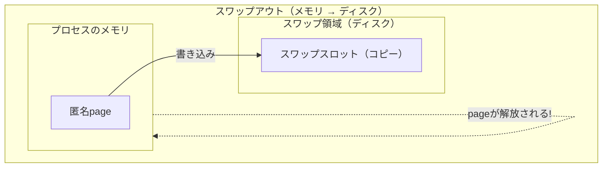

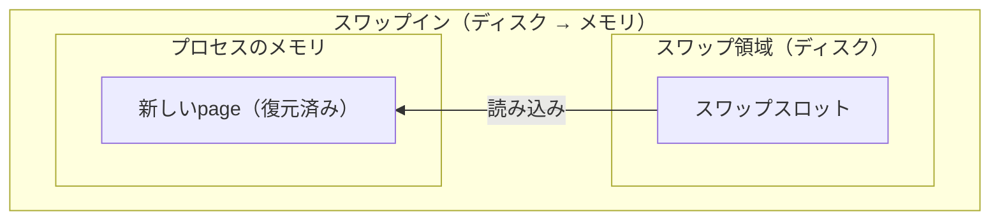

ファイルpage（バッキングファイルから再読み込みできる）とは異なり、匿名pageにはスワップ領域以外に行き場がない。

## なぜこのpageが選ばれたか {#why-this-page-was-chosen}

カーネルはスワップするpageをランダムに選ぶわけではない。[LRU（Least Recently Used）](reclaim.md)リストを使ってコールドなpage — 最近アクセスされていないpage — を見つける。

### 選択の過程 {#the-selection-process}

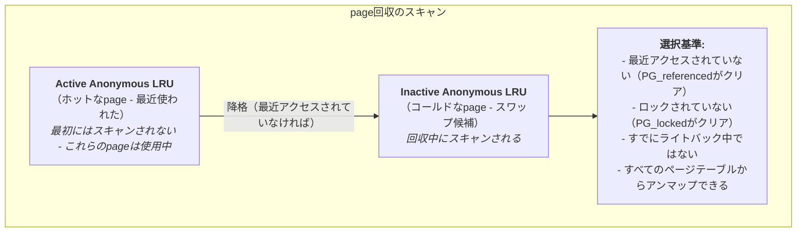

### referencedフラグのチェック {#the-referenced-flag-check}

pageはreferencedフラグによって「セカンドチャンス」を得る。

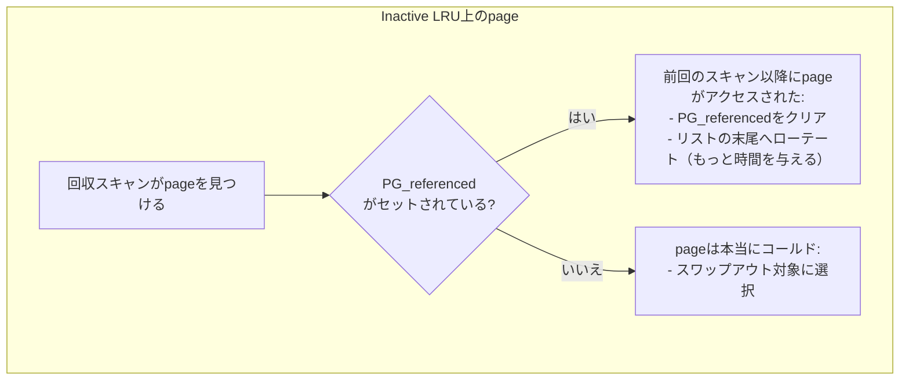

これにより、まだ時折使われているpageがスワップアウトされるのを防ぐ。

## スワップ領域の構成 {#swap-space-organization}

Linuxは2種類のスワップをサポートする。

| 種類 | デバイス | 特徴 |
|------|--------|-----------------|
| スワップパーティション | `/dev/sda2` | 専用、固定サイズ |
| スワップファイル | `/swapfile` | 柔軟、サイズ変更可能、管理が容易 |

現代のカーネル（2.6以降）では、カーネルは[swapon時にスワップファイルのブロックをディスクセクタにマップし](https://lwn.net/Articles/2668/)、[ファイルシステムのコードをすべて迂回して直接ブロックI/Oを行う](https://lkml.org/lkml/2005/7/7/326)。COWでないファイルシステム（ext4、XFS）上の断片化していないファイルであれば、パーティションとファイルのスワップの性能は実質的に同じである。SSDでは、シークのペナルティがないため、断片化したスワップファイルでもオーバーヘッドは無視できる程度である。

### スワップ領域の構造 {#swap-area-structure}

```c
// include/linux/swap.h より
struct swap_info_struct {
    unsigned long flags;        // SWP_USED、SWP_WRITEOKなど
    signed char prio;           // 優先度（高いほど先に使われる）
    struct file *swap_file;     // スワップファイル/デバイス
    struct block_device *bdev;  // ブロックデバイス（パーティションの場合）
    unsigned long *swap_map;    // スロットごとの使用カウント
    unsigned long lowest_bit;   // 最適化: 最初の空きスロットのヒント
    unsigned long highest_bit;  // 最適化: 最後に使われたスロット
    unsigned int pages;         // この領域の総スロット数
    unsigned int inuse_pages;   // 現在使用中のスロット数
    // ...
};
```

### スワップスロット {#swap-slots}

スワップ領域はpageサイズのスロットに分割されている。

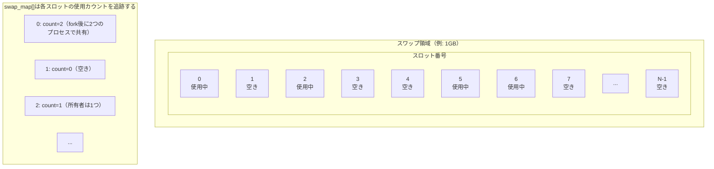

### スワップの状態を確認する {#viewing-swap-status}

```bash
# スワップ領域を表示する
cat /proc/swaps
# Filename          Type        Size      Used    Priority
# /dev/nvme0n1p3    partition   8388604   12345   -2

# 詳細なスワップ情報
swapon --show

# システム全体のスワップ使用量
free -h
```

## 段階1: スワップスロットの割り当て {#stage-1-swap-slot-allocation}

カーネルがpageをスワップアウトすると決めると、まずスロットを割り当てる。

```c
// mm/swap_slots.c / mm/swapfile.c（簡略化）
swp_entry_t folio_alloc_swap(struct folio *folio)
{
    struct swap_info_struct *si;
    swp_entry_t entry;

    // 空きスロットのあるスワップ領域を探す
    // 優先度の高い領域から先にチェックされる
    si = swap_info[...];  // 優先度に基づく

    // スロットを割り当てる
    offset = scan_swap_map_slots(si, ...);

    // スワップエントリを作成する（type + offsetをエンコード）
    entry = swp_entry(si->type, offset);

    return entry;
}
```

### スワップエントリのエンコーディング {#swap-entry-encoding}

スワップエントリは、スワップ領域のtypeとoffsetを1つの値に詰め込む。

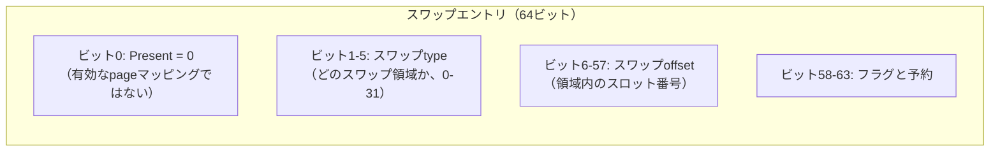

このエントリは、pageが書き出された後にページテーブルエントリ（PTE）を置き換える。

## 段階2: スワップへの書き込み {#stage-2-writing-to-swap}

スロットが割り当てられると、pageの内容がスワップデバイスに書き込まれる。

```c
// mm/vmscan.c shrink_folio_list()（簡略化）
static unsigned int shrink_folio_list(struct list_head *folio_list, ...)
{
    // 各folioについて...

    // 1. まずすべてのページテーブルからアンマップする
    //    （書き込み中に誰もアクセスできないように）
    try_to_unmap(folio, TTU_BATCH_FLUSH);

    // 2. 匿名pageでスワップ可能なら...
    if (folio_test_anon(folio)) {
        if (!add_to_swap(folio))
            goto activate;  // スワップできない、メモリに残す

        // 3. pageをスワップデバイスに書き込む
        pageout(folio, mapping);
    }
}
```

### add_to_swap()関数 {#the-addtoswap-function}

```c
// mm/swap_state.c
bool add_to_swap(struct folio *folio)
{
    swp_entry_t entry;

    // 1. スワップスロットを取得する
    entry = folio_alloc_swap(folio);
    if (!entry.val)
        return false;  // 利用可能なスワップ領域がない

    // 2. folioをスワップ用に設定する
    folio_set_swapcache(folio);
    folio->swap = entry;

    // 3. スワップキャッシュに追加する（I/O中に他から見つけられるように）
    __folio_set_swap_entry(folio, entry);
    xa_store(&swap_address_space->i_pages, ...);

    return true;
}
```

### ディスクへの書き込み {#writing-to-disk}

```c
// 簡略化したI/Oパス
static int pageout(struct folio *folio, struct address_space *mapping)
{
    // スワップデバイスへの書き込みI/Oを発行する
    // これは非同期 - ここでは待たない

    struct writeback_control wbc = {
        .sync_mode = WB_SYNC_NONE,  // 待たない
    };

    return mapping->a_ops->writepage(&folio->page, &wbc);
}
```

実際のI/Oはブロック層を通る。

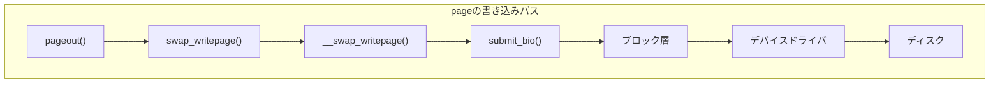

## 段階3: ページテーブルの更新 {#stage-3-page-table-update}

書き込みが完了すると、PTEはpageマッピングの代わりにスワップエントリを持つように更新される。

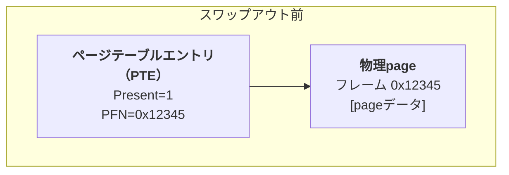

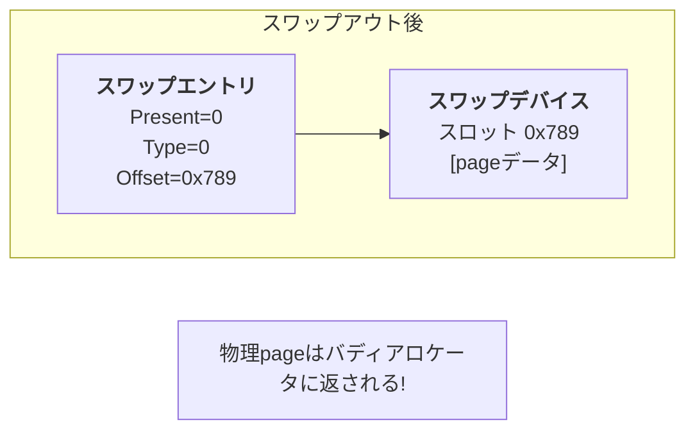

### スワップキャッシュ {#the-swap-cache}

I/O中、pageは**スワップキャッシュ** — 処理中のpageを見つけられるようにするアドレス空間 — に留まる。

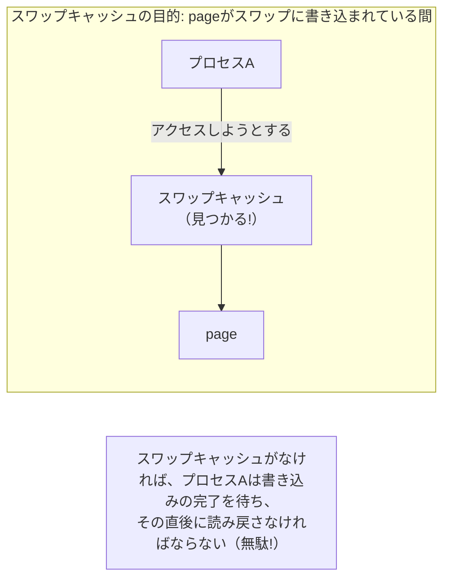

I/Oが正常に完了した後:

- pageはスワップキャッシュから削除される
- 物理pageは解放される
- データを持つのはスワップスロットだけになる

## 段階4: プロセスがスワップされたpageにアクセスする {#stage-4-process-accesses-swapped-page}

後でプロセスがスワップアウトされたアドレスにアクセスすると、ページフォールトによってpageが戻される。

### フォールトハンドラがスワップエントリを検出する {#the-fault-handler-detects-a-swap-entry}

```c
// arch/x86/mm/fault.c → mm/memory.c
static vm_fault_t handle_pte_fault(struct vm_fault *vmf)
{
    pte_t entry = vmf->orig_pte;

    if (!pte_present(entry)) {
        if (pte_none(entry))
            return do_anonymous_page(vmf);  // 新しいpage

        // PTEはスワップエントリを持っている
        return do_swap_page(vmf);  // ← ここが今回のパス!
    }

    // ... 他のケースを処理する
}
```

### do_swap_page()がpageを戻す {#doswappage-brings-the-page-back}

```c
// mm/memory.c（簡略化）
vm_fault_t do_swap_page(struct vm_fault *vmf)
{
    swp_entry_t entry = pte_to_swp_entry(vmf->orig_pte);
    struct folio *folio;

    // 1. まずスワップキャッシュをチェックする（別のスレッドがすでにフォールトしたかもしれない）
    folio = swap_cache_get_folio(entry, ...);

    if (!folio) {
        // 2. キャッシュにない - スワップから読む必要がある
        folio = swapin_readahead(entry, ...);
    }

    // 3. pageの準備ができるのを待つ
    folio_lock(folio);

    // 4. スワップエントリがまだ有効か確認する（競合チェック）
    // ...

    // 5. ページテーブルを更新する: スワップエントリ → pageマッピング
    pte = mk_pte(&folio->page, vmf->vma->vm_page_prot);
    if (vmf->flags & FAULT_FLAG_WRITE)
        pte = pte_mkwrite(pte_mkdirty(pte), vmf->vma);

    set_pte_at(vmf->vma->vm_mm, vmf->address, vmf->pte, pte);

    // 6. LRUを更新する
    folio_add_lru(folio);

    // 7. スワップスロットを解放する（最後の利用者であれば）
    swap_free(entry);

    return 0;
}
```

### スワップインのリードアヘッド {#swap-in-readahead}

ファイルのリードアヘッドと同様に、カーネルは近くのスワップされたpageにもアクセスするかもしれないと予測する。

```c
// mm/swap_state.c
struct folio *swapin_readahead(swp_entry_t entry, gfp_t gfp_mask,
                                struct vm_fault *vmf)
{
    struct page *page;

    // 要求されたpageを読む
    page = read_swap_cache_async(entry, ...);

    // 近くのpageも読む（リードアヘッド）
    if (should_readahead(...)) {
        for (offset = -readahead_win; offset <= readahead_win; offset++) {
            swp_entry_t ra_entry = swp_entry(type, entry_offset + offset);
            read_swap_cache_async(ra_entry, ...);
        }
    }

    return page_folio(page);
}
```

## 段階5: スワップスロットの解放 {#stage-5-swap-slot-freed}

スワップインが成功した後、スワップスロットは解放できる。

```c
// mm/swapfile.c
void swap_free(swp_entry_t entry)
{
    struct swap_info_struct *si = swap_info[swp_type(entry)];

    // 使用カウントをデクリメントする
    // （COWがスロットを共有していれば1より大きい可能性がある）
    count = swap_map[swp_offset(entry)]--;

    if (count == 0) {
        // スロットは再利用可能になった
        si->inuse_pages--;
    }
}
```

### スワップスロットとCOW {#swap-slots-and-cow}

プロセスがスワップされたpageを共有している場合（fork + スワップの後）:

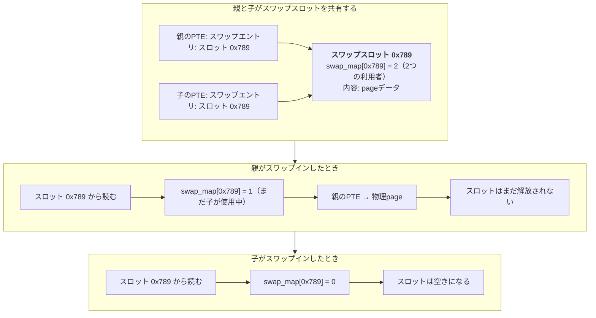

## スワップサイクルの全体 {#the-complete-swap-cycle}

すべてをまとめると次のようになる。

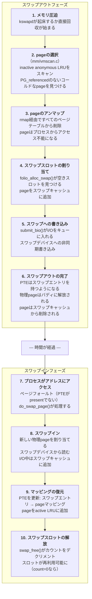

## スワップのチューニング可能なパラメータ {#swap-tunables}

### swappiness {#swappiness}

カーネルがどれだけ積極的にスワップするかを制御する。

```bash
# 現在の値を表示する
cat /proc/sys/vm/swappiness
# デフォルト: 60

# スワップを減らす（ファイルキャッシュの回収を優先する）
sysctl vm.swappiness=10

# スワップをほぼ完全に避ける
sysctl vm.swappiness=1
```

| 値 | 効果 |
|-------|--------|
| 0 | OOMを避けるためだけにスワップする |
| 1-30 | ファイルキャッシュの回収を優先する |
| 60 | デフォルトのバランス |
| 100 | 積極的にスワップする |

### スワップの優先度 {#swap-priority}

複数のスワップ領域にそれぞれ異なる優先度を設定できる。

```bash
# 優先度が高い = 先に使われる
swapon -p 10 /dev/fast_ssd     # 優先度10（先に使われる）
swapon -p 5 /dev/slow_hdd      # 優先度5（fastが満杯のときに使われる）

# 同じ優先度 = ラウンドロビン
swapon -p 10 /dev/ssd1
swapon -p 10 /dev/ssd2         # 両方にストライプされる
```

### VFSキャッシュ圧力 {#vfs-cache-pressure}

ファイルキャッシュの回収とスワップのバランスに影響する。

```bash
cat /proc/sys/vm/vfs_cache_pressure
# デフォルト: 100

# 低い = ファイルキャッシュを長く保持する（スワップが増える）
# 高い = ファイルキャッシュをより積極的に破棄する（スワップが減る）
```

## スワップの性能に関する考慮事項 {#swap-performance-considerations}

### SSD対HDD {#ssd-vs-hdd}

| 指標 | HDD | SSD |
|--------|-----|-----|
| ランダム読み取り | 約10ms | 約0.1ms |
| シーケンシャル読み取り | 約100MB/s | 約500-3000MB/s |
| 書き込み耐久性 | 無制限 | 有限（ただし通常は問題ない） |

SSDはスワップの性能を劇的に向上させ、スワップの苦痛を大幅に軽減する。

### スワップのスラッシング {#swap-thrashing}

ワーキングセットがRAMを超えると、システムは絶えずpageをスワップインおよびスワップアウトする。

```mermaid
flowchart LR
    subgraph Thrashing["スラッシング"]
        direction TB
        TimeArrow["時間 →"]

        subgraph PageA["page A"]
            A1["メモリ上"] --> A2["スワップアウト"] --> A3["スワップイン"] --> A4["スワップアウト"] --> A5["..."]
        end

        subgraph PageB["page B"]
            B1["スワップイン"] --> B2["スワップアウト"] --> B3["スワップイン"] --> B4["スワップアウト"] --> B5["..."]
        end

        subgraph PageC["page C"]
            C1["スワップアウト"] --> C2["スワップイン"] --> C3["スワップアウト"] --> C4["スワップイン"] --> C5["..."]
        end

        Result["システムは有用な仕事よりもスワップに多くの時間を費やす!"]
    end
```

**スラッシングの兆候**:

- 高いスワップI/O（`vmstat`のsi/so列）
- カーネル内の高いCPU時間（`top`でsy/waが高い）
- アプリケーションの応答性が劇的に低下する

**解決策**:

- RAMを増設する
- メモリ使用量を減らす
- 圧縮のためにzswapまたはzramを使う

### zswapとzram {#zswap-and-zram}

**zswap**: スワップデバイスに書き込む前にpageを圧縮する。

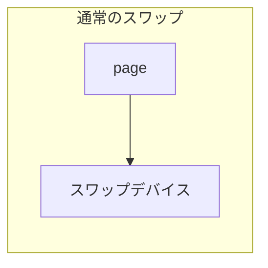

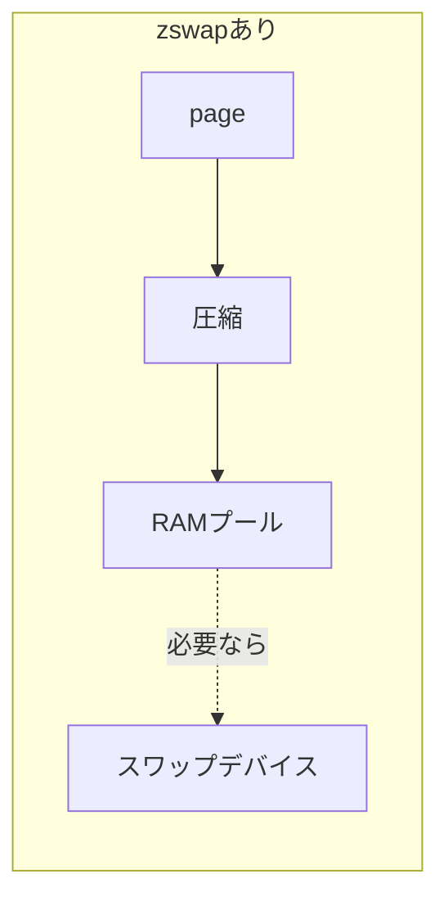

**zram**: 圧縮されたRAMディスクをスワップとして作成する。

```bash
# zramを有効にする
modprobe zram
echo lz4 > /sys/block/zram0/comp_algorithm
echo 2G > /sys/block/zram0/disksize
mkswap /dev/zram0
swapon -p 100 /dev/zram0  # 高い優先度
```

## 試してみる {#try-it-yourself}

### スワップの活動を監視する {#monitor-swap-activity}

```bash
# リアルタイムのスワップI/O
vmstat 1
# si = スワップイン（KB/s）
# so = スワップアウト（KB/s）

# 詳細なスワップ統計
cat /proc/vmstat | grep -E "pswp|swap"
# pswpin  - スワップインされたpage数
# pswpout - スワップアウトされたpage数
```

### スワップ操作を観察する {#watch-a-swap-operation}

```bash
# 端末1: スワップを監視する
watch -n 1 'free -h; echo; cat /proc/swaps'

# 端末2: スワップを強制する
stress --vm 1 --vm-bytes 90% --vm-keep &

# 端末3: 特定プロセスのスワップ使用量を観察する
for pid in $(pgrep stress); do
    echo "PID $pid: $(grep VmSwap /proc/$pid/status)"
done
```

### スワップイベントをトレースする {#trace-swap-events}

```bash
# スワップのトレーシングを有効にする
echo 1 > /sys/kernel/debug/tracing/events/vmscan/mm_vmscan_writepage/enable
echo 1 > /sys/kernel/debug/tracing/events/swap/swap_readpage/enable

# イベントを観察する
cat /sys/kernel/debug/tracing/trace_pipe
```

### スワップの内容を調べる {#examine-swap-contents}

```bash
# プロセスごとのスワップ使用量
for pid in /proc/[0-9]*; do
    comm=$(cat $pid/comm 2>/dev/null)
    swap=$(grep VmSwap $pid/status 2>/dev/null | awk '{print $2}')
    [ "$swap" != "0" ] && [ -n "$swap" ] && echo "$comm: ${swap}kB"
done | sort -t: -k2 -n -r | head -10
```

### スワップイン/アウトを明示的にテストする {#test-swap-inout-explicitly}

```bash
# メモリを割り当ててスワップを強制する
cat > /tmp/swap_test.c << 'EOF'
#include <stdio.h>
#include <stdlib.h>
#include <string.h>
#include <unistd.h>

int main() {
    size_t size = 200 * 1024 * 1024;  // 200MB
    char *buf = malloc(size);

    // すべてのpageに触れる
    memset(buf, 'A', size);
    printf("Allocated and touched %zuMB\n", size / 1024 / 1024);
    printf("Press Enter to trigger memory pressure...\n");
    getchar();

    // システムにスワップアウトさせる
    printf("Sleeping - watch with vmstat...\n");
    sleep(30);

    // 再びアクセスする（スワップイン）
    printf("Accessing memory (swap in)...\n");
    volatile char c = buf[0];  // アクセスを強制する

    printf("Done. Press Enter to exit.\n");
    getchar();
    return 0;
}
EOF
gcc -o /tmp/swap_test /tmp/swap_test.c
/tmp/swap_test
```

## 主要なソースファイル {#key-source-files}

| ファイル | 役割 |
|------|--------------|
| [`mm/swapfile.c`](https://git.kernel.org/pub/scm/linux/kernel/git/torvalds/linux.git/tree/mm/swapfile.c) | スワップ領域の管理、スロットの割り当て |
| [`mm/swap_state.c`](https://git.kernel.org/pub/scm/linux/kernel/git/torvalds/linux.git/tree/mm/swap_state.c) | スワップキャッシュの操作 |
| [`mm/page_io.c`](https://git.kernel.org/pub/scm/linux/kernel/git/torvalds/linux.git/tree/mm/page_io.c) | スワップのI/O操作 |
| [`mm/memory.c`](https://git.kernel.org/pub/scm/linux/kernel/git/torvalds/linux.git/tree/mm/memory.c) | do_swap_page() - スワップインの処理 |
| [`mm/vmscan.c`](https://git.kernel.org/pub/scm/linux/kernel/git/torvalds/linux.git/tree/mm/vmscan.c) | page回収、スワップアウトのパス |
| [`include/linux/swap.h`](https://git.kernel.org/pub/scm/linux/kernel/git/torvalds/linux.git/tree/include/linux/swap.h) | スワップのデータ構造 |

## 歴史 {#history}

### スワップの進化 {#swap-evolution}

**初期のLinux**: 当初から基本的なスワップをサポート。

**v2.6**: シーケンシャルI/Oを改善するためのスワップクラスタリング。

**v3.11（2013年）**: zswap - 圧縮スワップキャッシュ。

**コミット**: [2b2811178e85](https://git.kernel.org/linus/2b2811178e85)（"zswap: add to mm/"） | [LKML](https://lore.kernel.org/lkml/1368636374-13292-1-git-send-email-sjenning@linux.vnet.ibm.com/)

**作者**: Seth Jennings (IBM)

スワップアウトの流れ（上記の段階2-3）において、zswapはpageがスワップデバイスに到達する前に横取りする。pageを圧縮してRAMプールに格納する。プールが満杯になったときだけ、pageが実際のスワップデバイスに書き込まれる。これにより、圧縮可能なワークロードではスワップI/Oが劇的に減少する。

**v3.14（2014年）**: zramがstagingからメインラインに移動。

**コミット**: [cd67e10ac699](https://git.kernel.org/linus/cd67e10ac699)（"zram: promote zram from staging"）

**作者**: Minchan Kim (LG Electronics)

（実際のスワップデバイスの手前でキャッシュする）zswapとは異なり、zramはスワップデバイス*そのもの* — 圧縮されたRAMディスク — である。上記のスワップの流れはすべて起こるが、「ディスク」は実際には圧縮されたメモリである。これはAndroidスマートフォンやChromebookのようなメモリ制約のあるシステムで広く使われている。

**v5.8（2020年）**: SSDの性能のためのスワップスロット割り当ての改善。

**コミット**: [490705888107](https://git.kernel.org/linus/490705888107)（"swap: reduce lock contention on swap cache from swap slots allocation"）

**作者**: Huang Ying (Intel)

上記の段階1（スロットの割り当て）において、カーネルは現在スワップスロットキャッシュを使ってスロット割り当てをバッチ化し、スワップI/Oが高速なため割り当てのオーバーヘッドが無視できなくなるSSDでの競合を減らしている。

### 現代のスワップの改善 {#modern-swap-improvements}

スワップサブシステムは、SSDのより良い活用とレイテンシ削減のために進化を続けている。

- より良いスロット割り当てアルゴリズム
- スワップリードアヘッドの改善
- cgroup単位のスワップ計上のためのメモリcgroupとの統合

## 悪名高いバグとエッジケース {#notorious-bugs-and-edge-cases}

スワップには、ページテーブル、スワップスロット、キャッシュの間の複雑な相互作用が関わる。このコードにおける競合状態は、データ破損やセキュリティ脆弱性を引き起こし得る。

---

### ケース1: スワップスロットのABA問題（CVE-2024-26759） {#case-1-the-swap-slot-aba-problem-cve-2024-26759}

#### 何が起きたか {#what-happened}

2024年初め、Huang Ying（Intel）は、「skip swapcache」最適化パスにおいて、データ破損を引き起こし得る競合状態を発見した。

#### バグ {#the-bug}

[LKMLでの議論](https://lkml.org/lkml/2024/2/16/426)がABA問題を説明している。

`SWP_SYNCHRONOUS_IO`が有効な場合（高速なNVMeドライブでは一般的）、カーネルは性能のためにスワップキャッシュをスキップする。しかしこれは競合を生む。

1. **スレッドT0**: エントリXのスワップインを開始し、page Aを割り当てる
2. **スレッドT1**: 同じくエントリX（同じエントリ）のスワップインを開始し、page Bを割り当てる
3. **スレッドT1**: 先に完了し、page Bをインストールし、`swap_free()`でエントリXを解放する
4. **スレッドT1**: 後で*変更された*pageをスワップアウトし、エントリXを**再利用**する
5. **スレッドT0**: 完了し、PTEが変わっていない（まだエントリXを指している）のを見る
6. **スレッドT0**: **古い**page AをPTEにインストールする

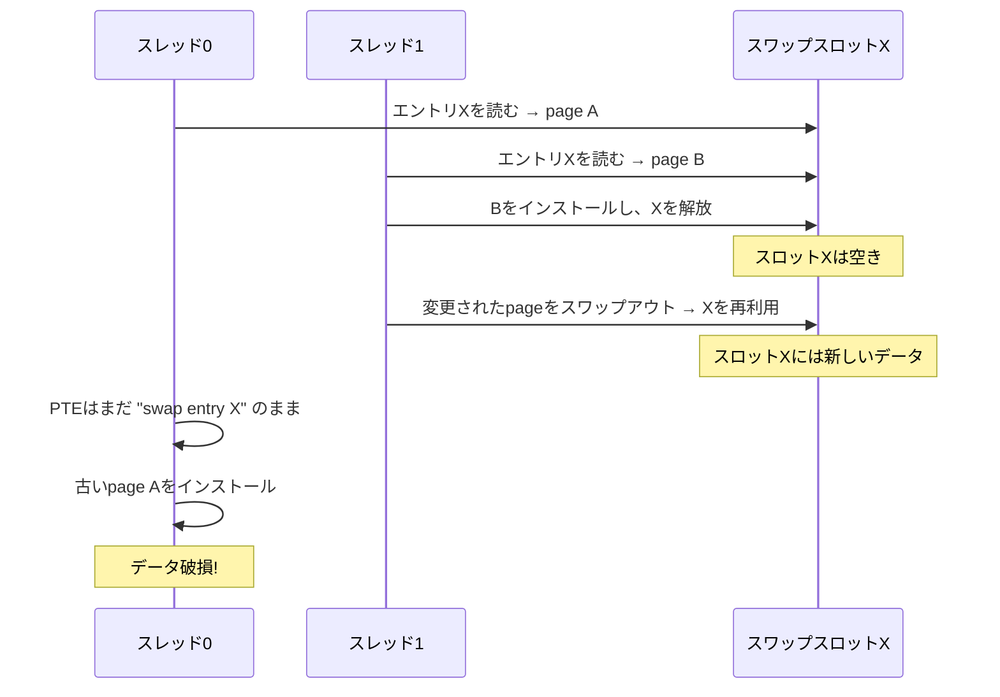

PTEの値は変わっていない（スロットXに対する`swp_entry_t`のまま）ので`pte_same()`チェックは通るが、データはまったく異なる。

#### 現実世界への影響 {#real-world-implications}

これは**サイレントなデータ破損**である — アプリケーションは現在のデータではなく古いデータを見ることになり、エラーは一切報告されない。データベース、ファイルシステム、あるいはデータの一貫性に依存するあらゆるアプリケーションが影響を受け得る。

#### 修正 {#the-fix}

**コミット**: [13ddaf26be32](https://git.kernel.org/linus/13ddaf26be32)（"mm/swap: fix race when skipping swapcache"）

**作者**: Kairui Song

この修正は、スワップキャッシュを迂回するときにABAのシナリオを防ぐため、適切なロックと検証を追加する。

修正対象のコミット: [0bcac06f27d7](https://git.kernel.org/linus/0bcac06f27d7)（"mm, swap: skip swapcache for swapin of synchronous device"）

---

### ケース2: ZSWAPの競合状態 {#case-2-zswap-race-conditions}

#### 何が起きたか {#what-happened_1}

zswapの圧縮スワップキャッシュは、並行性の課題をもたらした。[LKMLのバグ報告](https://linux.kernel.narkive.com/0AHtSnDW/bug-report-zswap-theoretical-race-condition-issues)は理論上の競合を記録している。

#### バグ {#the-bug_1}

重複したストアと回収が並行して起きると:

1. オフセットAを持つエントリXがzswapに存在する
2. **スレッド0**: エントリXの回収を開始する
3. **スレッド1**: オフセットAに*新しい*pageをストアし、新しいエントリYを割り当てる
4. **スレッド0**: `zswap_get_swap_cache_page()`を呼び出すが、古いデータを得る

スワップキャッシュには、オフセットAについて新しいデータではなく古いデータが入ることになる。

#### 現実世界への影響 {#real-world-implications_1}

`do_swap_page()`がスワップキャッシュからpageを取得すると、古いデータを返す — これもサイレントな破損のシナリオである。

#### 緩和策 {#mitigations}

zswapは、これらの競合に対処するために何度もロックの改善を受けてきた。次のものの間の相互作用は、

- zswapエントリのライフサイクル
- スワップキャッシュの操作
- pageのライトバック

...すべて慎重な同期を必要とする。

---

### ケース3: NFS上のスワップの不安定性 {#case-3-swap-over-nfs-instability}

#### 何が起きたか {#what-happened_2}

NFSへのスワップは歴史的に問題が多かった。システムがメモリ圧迫下にあってスワップする必要があるとき、ネットワークI/Oのためにもメモリが必要になる。

#### バグ {#the-bug_2}

古典的なデッドロックのシナリオ:

1. システムがメモリ圧迫下にある
2. カーネルがpageをNFSにスワップアウトしようとする
3. NFSはネットワークパケットのためにメモリを割り当てる必要がある
4. メモリ割り当てがさらなる回収を引き起こす
5. デッドロック: ネットワークなしにメモリを解放できず、メモリなしにネットワークを使えない

#### 緩和策 {#mitigations_1}

**`PF_MEMALLOC`とメモリ予約**: カーネルは重要なI/Oパスのためにメモリを予約している。スワップI/Oを行うプロセスは予約領域を使える。

**Swap-over-NBDパッチ**: 長年にわたる複数のパッチがネットワークスワップの信頼性を向上させた。

**実践的な助言**: 本番環境ではNFSにスワップしないこと。ローカルのスワップかzramを使う。

---

### ケース4: スワップパーティション対スワップファイルの競合 {#case-4-swap-partition-vs-swap-file-races}

#### 何が起きたか {#what-happened_3}

スワップファイルはファイルシステム層が関与するため、スワップパーティションに比べて複雑さが増す。

#### バグ {#the-bug_3}

スワップファイルでは、`swap_writepage()`はファイルシステムを経由しなければならない。これは次のものと競合し得る。

- 同じデバイス上でのファイルシステム操作
- ファイルシステムのメタデータ更新
- ジャーナルのコミット

#### 歴史的な問題 {#historical-issues}

- **XFS + スワップ**: 初期のXFSは遅延割り当てのためにスワップファイルで問題があった
- **Btrfs + スワップ**: COWの複雑さのため、スワップファイルをサポートしたのはカーネル5.0からだった
- **F2FS**: カーネル5.10でスワップファイルのサポートを追加した

#### 現在の状況 {#modern-status}

現在ほとんどのファイルシステムはスワップファイルを正しくサポートしているが、複雑さが増す分、生のパーティションに比べてバグの可能性は高くなる。

---

### ケース5: スワップリードアヘッドの罠 {#case-5-the-swap-readahead-trap}

#### 何が起きたか {#what-happened_4}

スワップリードアヘッド（スワップイン時に複数のpageを読むこと）は、裏目に出ることがある最適化である。

#### 問題 {#the-problem}

（シーケンシャルアクセスが一般的な）ファイルのリードアヘッドと異なり、スワップのアクセスパターンはしばしばランダムである — 特に多数のプロセスがあるシステムでは。積極的なスワップリードアヘッドは:

1. 使われないpageを読む
2. 有用なpageをメモリから追い出す
3. スワップI/Oを増やす
4. メモリ圧迫を悪化させる

#### バグの類型 {#the-bug-class}

リードアヘッドのチューニングの問題は、カーネルバージョンをまたいで性能のリグレッションを引き起こしてきた。「リードアヘッドすべきか?」のヒューリスティックは不完全である。

#### 緩和策 {#mitigation}

```bash
# 現在のリードアヘッドを確認する（page数）
cat /proc/sys/vm/page-cluster
# デフォルト: 3（2^3 = 8 pageのリードアヘッドを意味する）

# スワップリードアヘッドを無効にする
echo 0 > /proc/sys/vm/page-cluster

# SSDではリードアヘッドの重要性は低い（高速なランダムアクセス）
# HDDではアクセスがシーケンシャルならリードアヘッドが役立つ
```

---

### ケース6: large folio + スワップ = データ損失（2023年） {#case-6-large-folio-swap-data-loss-2023}

#### 何が起きたか {#what-happened_5}

large folioのサポート（カーネル6.1以降）は、XFSや他のファイルシステムに影響するデータ損失バグを持ち込んだ。複数の組織が本番環境での[実際のデータ損失](https://lore.kernel.org/linux-mm/CAHk-=wjty_0NfiZn2HVzT0Ye-RR09+Rqbd1azwJLOTJrX+V5MQ@mail.gmail.com/T/)を報告した。

#### バグ {#the-bug_4}

large folioは、pageの追跡とライトバックの方法を変える。スワップやライトバックのパスとの相互作用により、実際にはdirtyなpageがcleanとマークされ、データ損失が生じた。

LKMLの報告より:

> *"At least 16 instances of data loss in a fleet of 1.5k VMs... happens mostly on nodes running database or storage-oriented workloads, including PostgreSQL, MySQL, RocksDB."*

（訳: 1.5k台のVM群で少なくとも16件のデータ損失… 主にPostgreSQL、MySQL、RocksDBなど、データベースやストレージ指向のワークロードを実行しているノードで起きている。）

#### 現実世界への影響 {#real-world-implications_2}

これはデータベースやストレージシステムにとって壊滅的である。メモリに書き込まれたがまだ永続化されていないデータが、ただ消えてしまう可能性がある。

#### 修正 {#the-fix_1}

Metaなどの企業は、修正が開発される間large folioを無効にした。

**コミット**: [a48d5bdc877b](https://git.kernel.org/linus/a48d5bdc877b)（"mm: fix for negative counter: nr_file_hugepages"）

**作者**: Stefan Roesch

問題に完全に対処するには複数のパッチが必要だった。

---

### まとめ: 学んだ教訓 {#summary-lessons-learned}

| バグ | 年 | 根本原因 | 影響 | 予防策 |
|-----|------|------------|--------|------------|
| **スワップスロットのABA** | 2024 | skip-swapcacheの競合 | データ破損 | メインラインで修正済み |
| **ZSWAPの競合** | 継続中 | 圧縮 + スワップキャッシュ | データ破損 | 複数の修正 |
| **NFS上のスワップ** | 歴史的 | メモリのデッドロック | システムハング | ローカルのスワップを使う |
| **large folio + スワップ** | 2023 | ライトバックの追跡 | データ損失 | large folioを無効にするかカーネルを更新する |
| **リードアヘッドの罠** | 継続中 | 誤ったヒューリスティック | 性能 | `page-cluster`をチューニングする |

共通点: **スワップは通常のメモリパスよりもテストが少ない「低速パス」である**。システムがメモリ圧迫下にあるとき、それはすでに劣化した状態であり、スワップ処理のバグは問題をさらに悪化させる。

## 参考文献 {#further-reading}

### 関連ドキュメント {#related-docs}

- [スワップ](swap.md) - スワップの設定と管理
- [page回収](reclaim.md) - スワップ対象のpageがどのように選ばれるか
- [pageの一生](life-of-page.md) - pageのライフサイクル全体
- [メモリ不足](oom.md) - スワップが足りないときに何が起こるか

### LWNの記事 {#lwn-articles}

- [In defense of swap](https://lwn.net/Articles/690079/)（2016年） - なぜスワップが重要か
- [zswap: compressed swap caching](https://lwn.net/Articles/537422/)（2013年） - 圧縮スワップ
- [Large folios for anonymous memory](https://lwn.net/Articles/908023/)（2022年） - バグにつながったlarge folioの作業
