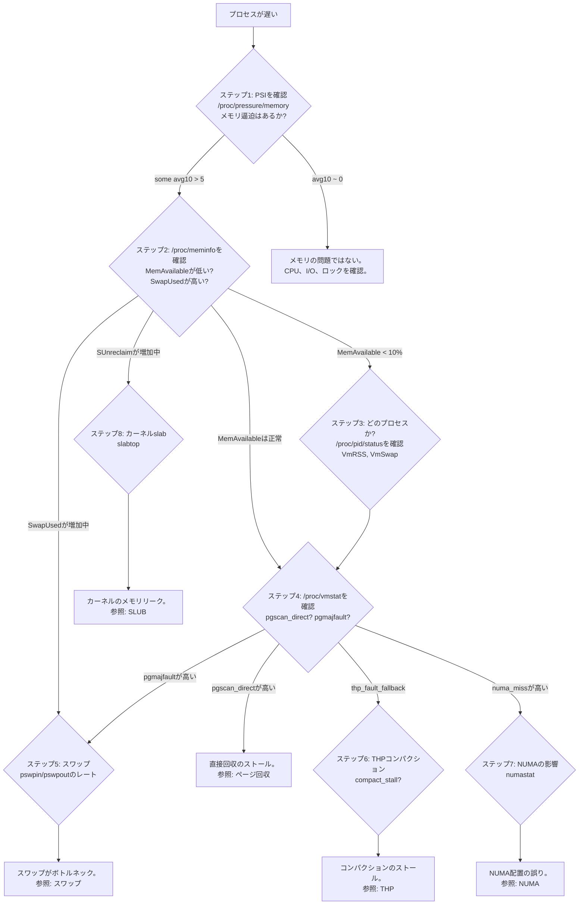

# なぜプロセスが遅いのか（メモリ診断） {#why-is-my-process-slow-memory-diagnosis}

> メモリ関連の性能問題を体系的にトラブルシューティングするためのガイド

## 問題 {#the-problem}

プロセスが遅く、メモリを疑っている。だが「メモリの問題」というのは曖昧だ -- スワップかもしれないし、回収の逼迫、NUMAの影響、THPのコンパクションによるストール、あるいはカーネルslabの増大が利用可能なメモリを食いつぶしているのかもしれない。このガイドは体系的なフローチャートを示し、推測をやめて計測を始められるようにする。

## 判断フローチャート {#decision-flowchart}

ここから始めて矢印をたどる。各ステップは問題を特定するか、さらに深く調べるよう誘導する。



## ステップ1: そもそもメモリの問題か? {#step-1-is-it-memory-at-all}

メモリの内部に踏み込む前に、メモリ逼迫が実際に存在するかを確認する。Linux 4.20（[commit 0e94682b73bf](https://git.kernel.org/linus/0e94682b73bf)）以降、PSI（Pressure Stall Information）は、タスクがメモリ待ちでストールしているかを直接教えてくれる。

```bash
cat /proc/pressure/memory
# some avg10=3.42 avg60=1.09 avg300=0.37 total=123456789
# full avg10=0.12 avg60=0.04 avg300=0.01 total=12345678
```

**数値の意味:**

| 指標 | 意味 |
|--------|---------|
| `some` | *少なくとも1つの*タスクがメモリ待ちでストールしている時間の割合 |
| `full` | *すべての*タスクがストールしている時間の割合（生産的な処理が何も行われていない） |
| `avg10` | 10秒間の移動平均 |
| `avg60` / `avg300` | 60秒間および5分間の平均 |

**解釈の仕方:**

- `some avg10 = 0`: メモリ逼迫はない。遅さの原因は別のところにある -- CPU（`/proc/pressure/cpu`）、I/O（`/proc/pressure/io`）、あるいはアプリケーションレベルの競合を確認する。
- `some avg10 > 5`: 意味のあるメモリ逼迫がある。ステップ2へ進む。
- `full avg10 > 1`: 深刻。システム全体がメモリ待ちでストールしている。

PSIは[`kernel/sched/psi.c`](https://git.kernel.org/pub/scm/linux/kernel/git/torvalds/linux.git/tree/kernel/sched/psi.c)に実装されている。タスクごとのストール状態を追跡し、時間加重平均に集約する。Facebookがロードアベレージや`MemAvailable`だけでは不十分だったためにPSIを開発した -- *実際に誰かがメモリを待っているか*を知る必要があったのである。LWNの記事を参照: [Tracking pressure-stall information](https://lwn.net/Articles/759658/)。

!!! tip "なぜPSIが最初か"
    `MemAvailable`のような従来の指標は*供給*について教えてくれる。PSIは*影響*について教えてくれる。利用可能なメモリが少なくても、ワーキングセットが残りのpageに収まっていれば問題なく動作しうる。逆に、「十分な」空きメモリがあるシステムでも、回収がスラッシングしていればストールしうる。

## ステップ2: /proc/meminfoを確認する {#step-2-check-procmeminfo}

PSIでメモリ逼迫を確認したら、メモリがどこに使われているかを把握する。

```bash
grep -E '^(MemTotal|MemFree|MemAvailable|Buffers|Cached|SwapTotal|SwapFree|SReclaimable|SUnreclaim|Active|Inactive)' /proc/meminfo
```

**主要なフィールド:**

| フィールド | わかること |
|-------|-------------------|
| `MemAvailable` | スワップせずに新たな割り当てに使えるメモリ量。これは`MemFree`*ではない* -- 回収可能なページキャッシュとslabを含む。カーネル3.14で追加された（[commit 34e431b0ae39](https://git.kernel.org/linus/34e431b0ae39)）。 |
| `SwapTotal - SwapFree` | 使用中のスワップ量。これが大きく増え続けているなら、活発にスワップしている。 |
| `Cached` | ページキャッシュのサイズ。大きな`Cached`は正常で健全である -- カーネルがファイルデータをキャッシュしていることを意味する。 |
| `SReclaimable` | 逼迫時にカーネルが解放できるslabメモリ（dentryキャッシュ、inodeキャッシュ）。 |
| `SUnreclaim` | カーネルが解放*できない*slabメモリ。これが大きく増え続けているなら、カーネルのメモリリークを疑う。 |

**解釈の仕方:**

```bash
# 簡易ヘルスチェック: メモリの何パーセントが利用可能か?
awk '/MemTotal/{t=$2} /MemAvailable/{a=$2} END{printf "Available: %.1f%%\n", a/t*100}' /proc/meminfo
```

- **MemAvailableがMemTotalの10%未満**: システムは逼迫している。カーネルは回収またはスワップを行っている可能性が高い。
- **Cachedは大きいがMemAvailableが低い**: ページキャッシュは使われていて回収可能だが、それを回収しても足りない。プロセスが匿名メモリを使いすぎている。
- **SwapTotal - SwapFree > 0かつ増加中**: 活発なスワップ。ステップ5へ飛ぶ。
- **SUnreclaimが時間とともに増加**: カーネルslabのリーク。ステップ8へ飛ぶ。

`MemAvailable`の推定値は[`mm/show_mem.c`](https://git.kernel.org/pub/scm/linux/kernel/git/torvalds/linux.git/tree/mm/show_mem.c)で（`si_mem_available()`を通じて）計算される。ゾーンのウォーターマーク、回収可能なページキャッシュ、回収可能なslabを考慮に入れている。

## ステップ3: プロセスごとのメモリを確認する {#step-3-check-per-process-memory}

次に、どのプロセスが犯人かを突き止める。

```bash
# RSS によるメモリ消費上位
ps aux --sort=-%mem | head -20

# 特定のプロセスについて詳細な内訳を得る
grep -E '^(VmSize|VmRSS|VmSwap|RssAnon|RssFile|RssShmem)' /proc/<pid>/status
```

**`/proc/<pid>/status`の主要なフィールド:**

| フィールド | 意味 |
|-------|---------|
| `VmRSS` | Resident Set Size -- このプロセスが現在使用している物理メモリ |
| `VmSwap` | このプロセスのうちスワップアウトされた量 |
| `RssAnon` | 匿名page（ヒープ、スタック） -- スワップにしか行けない |
| `RssFile` | ファイルバックのpage -- 破棄して再読み込みできる |
| `RssShmem` | 共有メモリとtmpfsのpage |

マッピングごとのより詳細な内訳には次を使う。

```bash
# 集約された要約（高速、カーネル 4.14 以降で利用可能）
cat /proc/<pid>/smaps_rollup
```

`smaps_rollup`ファイル（[commit 493b0e9d945f](https://git.kernel.org/linus/493b0e9d945f)）は、完全な`smaps`ファイルを読むオーバーヘッドなしに、全VMAにわたる合計を提供する。注目すべき主要なフィールドは次のとおり。

| フィールド | 意味 |
|-------|---------|
| `Pss` | Proportional Set Size -- 共有pageを共有者数で割って計上する |
| `Swap` | 全VMAにわたるスワップ済みpageの合計 |
| `Referenced` | 最後のクリア以降にアクセスされたpage -- ワーキングセットのサイズを示す |

!!! note "PSSとRSS"
    `RSS`は共有pageを二重に数える。2つのプロセスが100MBのライブラリを共有していれば、どちらもRSSに100MBと表示される。`PSS`は共有pageを按分するので、それぞれ約50MBと表示される。キャパシティプランニングには`PSS`の方が正確である。「このプロセスが問題か?」を判断するには、通常`RSS`で十分である。

## ステップ4: /proc/vmstatで回収活動を確認する {#step-4-check-procvmstat-for-reclaim-activity}

ここで、メモリ逼迫に対して*カーネルが何をしているか*を特定する。

```bash
# 主要なカウンタのスナップショットを取る
grep -E '^(pgscan_direct|pgscan_kswapd|pgsteal_direct|pgsteal_kswapd|allocstall|pgmajfault|pgfault)' /proc/vmstat
```

これらは累積カウンタである。2回スナップショットを取って比較する。

```bash
# 変化率を観察する
watch -d -n1 'grep -E "pgscan_direct|allocstall|pgmajfault" /proc/vmstat'
```

**主要なカウンタ:**

| カウンタ | 意味 | なぜ重要か |
|---------|---------------|----------------|
| `pgscan_direct` | 直接回収でスキャンされたpage | プロセスがメモリを解放するためにブロックしている。これがレイテンシの元凶である。 |
| `pgscan_kswapd` | kswapdがスキャンしたpage | バックグラウンド回収 -- 害は少ないが逼迫を示す。 |
| `pgsteal_direct` / `pgsteal_kswapd` | 実際に解放されたpage | `pgscan`と比較して回収効率を得る。steal/scan比が低いと、カーネルは多くのpageをスキャンしているが回収可能なものは少ないことを意味する。 |
| `allocstall` | 直接回収イベントの回数 | 1回ごとに、あるプロセスがメモリを待ってブロックしたことを意味する。 |
| `pgmajfault` | メジャーページフォールト（ディスクI/Oが必要） | 高ければ、pageがスワップやディスクからフォールトインされている。 |
| `pgfault` | すべてのページフォールト（マイナー + メジャー） | マイナーフォールトは正常。メジャーフォールトに注目する。 |

**解釈の仕方:**

- **`pgscan_direct`が増加**: 直接回収が起きている。プロセスがストールしている。回収経路の全体は[ページ回収](reclaim.md)を参照。
- **`allocstall`が増加**: 1増えるごとに、少なくとも1つの割り当てが回収を待たなければならなかったことを意味する。高いレート（>10/秒）は目に見えるレイテンシを引き起こす。
- **`pgmajfault`が高い**: pageがスワップやディスクから読まれている。プロセスが匿名pageでフォールトしているなら、スワップをスラッシングしている。
- **`pgscan_direct`が高いのに`pgsteal_direct`が低い**: 回収が非効率である。カーネルはpageをスキャンしているが解放できない -- すべて活発に使われている。これは最悪のケースで、CPUオーバーヘッドが高いのに何の効果もない。

これらのカウンタは[`mm/vmscan.c`](https://git.kernel.org/pub/scm/linux/kernel/git/torvalds/linux.git/tree/mm/vmscan.c)で管理されている。直接回収は[`mm/page_alloc.c`](https://git.kernel.org/pub/scm/linux/kernel/git/torvalds/linux.git/tree/mm/page_alloc.c)内の`__alloc_pages_direct_reclaim()`で行われる。

## ステップ5: スワップしているか? {#step-5-is-it-swapping}

プロセスが遅いとき、スワップは最初に疑われることが多く、たいていそれは正しい -- スワップI/Oはメモリアクセスより桁違いに遅い。

```bash
# 現在のスワップ活動のレート
vmstat 1 5
# 'si'（スワップイン）と 'so'（スワップアウト）の列を見る

# あるいは /proc/vmstat から（累積 page 数）
grep -E '^(pswpin|pswpout)' /proc/vmstat
```

```bash
# どのプロセスがスワップされているか?
for pid in /proc/[0-9]*; do
    swap=$(grep VmSwap "$pid/status" 2>/dev/null | awk '{print $2}')
    name=$(cat "$pid/comm" 2>/dev/null)
    if [ -n "$swap" ] && [ "$swap" -gt 0 ] 2>/dev/null; then
        echo "$swap kB $name (pid $(basename $pid))"
    fi
done | sort -rn | head -20
```

**解釈の仕方:**

- **`pswpout`が増加し、`pswpin`は安定**: カーネルがpageをスワップへ追い出している。プロセスは常駐pageを失っている。
- **`pswpin`が増加**: プロセスがpageをスワップからフォールトで戻している -- スワップアウトされたpageがまだアクセスされていることを意味する。スワップインのたびに、フォールトしたプロセスをブロックするディスクI/Oが発生する。
- **両方が高い**: 活発なスラッシング。ワーキングセットがメモリに収まらず、カーネルがRAMとスワップの間でpageを入れ替え続けている。
- **プロセスごとの`VmSwap`が大きい**: その特定のプロセスが回収の犠牲になっている。

**よくある原因と対処:**

| 原因 | 証拠 | 対処 |
|-------|----------|-----|
| ワーキングセットがRAMを超えている | すべてのプロセスでVmSwap > 0 | RAMを増やすかワークロードを減らす |
| 1つのプロセスがメモリリークしている | 1つのプロセスのVmRSS + VmSwapが巨大 | アプリケーションを修正する |
| swappinessが高すぎる | MemAvailableがあるのに`pswpout`が高い | `vm.swappiness`を調整する（[スワップ](swap.md)を参照） |

スワップされたpageのライフサイクル全体については、[スワップ中に何が起きるか](swapping.md)を参照。

## ステップ6: THPのコンパクションか? {#step-6-is-it-thp-compaction}

Transparent Huge Pageは予期しないレイテンシスパイクを引き起こすことがある。プロセスがメモリでフォールトし、カーネルが2MBのhuge pageを割り当てようとすると、メモリをコンパクションするためにストールすることがある。

```bash
grep -E '^(thp_fault_alloc|thp_fault_fallback|thp_collapse_alloc|thp_collapse_alloc_failed|compact_stall|compact_success|compact_fail)' /proc/vmstat
```

**主要なカウンタ:**

| カウンタ | 意味 |
|---------|---------|
| `thp_fault_alloc` | ページフォールト時のTHP割り当て成功 |
| `thp_fault_fallback` | THP割り当てに失敗し、4KBのpageにフォールバックした |
| `compact_stall` | プロセスがコンパクションを待ってストールした回数 |
| `compact_fail` | コンパクションを試みたがhuge pageを作れなかった |

**解釈の仕方:**

- **`compact_stall`が急増**: カーネルがpageを並べ替える間、プロセスがブロックしている。1回のストールは数ミリ秒から数十ミリ秒に及ぶ。
- **`thp_fault_fallback` >> `thp_fault_alloc`**: メモリがhuge pageには断片化しすぎている。カーネルは試行しては失敗し続けている。
- **`compact_fail`が高い**: コンパクションは動いているが効果がない。カーネルは無駄に高コストなページマイグレーションを行っている。

**緩和策:**

```bash
# 方法1: THP を madvise のみに切り替える（フォールト時の自動 THP なし）
echo madvise > /sys/kernel/mm/transparent_hugepage/enabled

# 方法2: フォールト時の THP コンパクションを無効化する（khugepaged は許可したまま）
echo never > /sys/kernel/mm/transparent_hugepage/defrag
```

コンパクションのコードは[`mm/compaction.c`](https://git.kernel.org/pub/scm/linux/kernel/git/torvalds/linux.git/tree/mm/compaction.c)にある。`defrag`ノブは、カーネルが割り当て時にストールしてコンパクションを試みるか、`khugepaged`に先送りするか、完全にスキップするかを制御する。コンパクションがどのように進化してきたかの背景は、LWNの記事[Proactive compaction](https://lwn.net/Articles/817905/)を参照。

THPの全体像については[Transparent Huge Pages](thp.md)を参照。

## ステップ7: NUMAの影響か? {#step-7-is-it-numa-effects}

マルチソケットシステムでは、メモリアクセスのレイテンシはメモリがどのノードにあるかに依存する。ノード0で動いているプロセスがノード1のメモリにアクセスすると、アクセスごとに30〜50%のレイテンシペナルティを払う。

```bash
# システム全体の NUMA 統計
numastat

# プロセスごとの NUMA 割り当て
numastat -p <pid>

# /proc/vmstat から
grep -E '^numa_' /proc/vmstat
```

**主要なカウンタ:**

| カウンタ | 意味 |
|---------|---------|
| `numa_hit` | 優先／ローカルノードから満たされた割り当て |
| `numa_miss` | 優先ノード以外に行った割り当て |
| `numa_foreign` | このノードが優先されていたが、割り当ては他所に行った |
| `numa_interleave` | インターリーブポリシーによる割り当て（意図的） |

**解釈の仕方:**

- **`numa_miss / (numa_hit + numa_miss)`が10%超**: リモートメモリアクセスが顕著である。プロセスのメモリが複数ノードに分散している。
- **`numastat -p <pid>`が非ローカルノード上のメモリを示す**: プロセスのワーキングセットが、それが動いているノードにない。

**よくある原因:**

| 原因 | 証拠 | 対処 |
|-------|----------|-----|
| プロセスがノード間で移動した | メモリは旧ノード、CPUは新ノード | `numactl --cpunodebind=N --membind=N`で固定する |
| デフォルトでメモリがインターリーブされている | ノード間に均等に分散 | `numactl --localalloc`または`--membind`を使う |
| 割り当てのあふれ | ローカルノードが満杯だった | メモリを増やすか、ワークロードをノード間で分散する |

カーネルのNUMA割り当てポリシーは[`mm/mempolicy.c`](https://git.kernel.org/pub/scm/linux/kernel/git/torvalds/linux.git/tree/mm/mempolicy.c)に実装されている。AutoNUMA（自動NUMAバランシング）はカーネル3.8で追加され（[commit 217db1ef6c47](https://git.kernel.org/linus/217db1ef6c47)）、定期的にpageをスキャンして、アクセスするCPUの近くへマイグレーションする。LWNを参照: [AutoNUMA: the other approach to NUMA scheduling](https://lwn.net/Articles/488709/)。

NUMAの全体像については[NUMAメモリ管理](numa.md)を参照。

## ステップ8: カーネルメモリの問題か? {#step-8-is-it-a-kernel-memory-issue}

問題がユーザー空間のメモリでは全くないこともある -- カーネル自身がslabキャッシュを通じてメモリを消費しているのだ。

```bash
# SUnreclaim を時系列で観察する
watch -n5 'grep SUnreclaim /proc/meminfo'

# どの slab キャッシュが最大かを確認する
sudo slabtop -o -s c | head -20

# キャッシュごとの詳細な統計
cat /proc/slabinfo | head -5
```

**主要な指標:**

- **`/proc/meminfo`の`SUnreclaim`が時間とともに増加**: カーネルオブジェクトが蓄積し、解放できない。
- **`SReclaimable`が大きいが回収されていない**: カーネルがdentry/inodeキャッシュを縮小するほどの逼迫を受けていない。通常は無害である。

**よくある犯人:**

| キャッシュ | 何か | なぜ増えるか |
|-------|-----------|--------------|
| `dentry` | ディレクトリエントリキャッシュ | 多数のファイルへのアクセス、深いディレクトリツリー |
| `inode_cache` | inodeメタデータキャッシュ | dentryと同じ |
| `kmalloc-*` | 汎用の割り当て | カーネルのメモリリークの可能性 |
| `sock_inode_cache` | ソケット構造体 | 多数のネットワーク接続 |

```bash
# カーネルに slab キャッシュを回収させる（ページキャッシュ + slab を破棄）
echo 3 > /proc/sys/vm/drop_caches
# 警告: これはページキャッシュも破棄するため、一時的な I/O スパイクを引き起こしうる。
# slab のみ（dentry + inode）を破棄するには echo 2 を使う。
```

!!! warning "drop_cachesは診断用であり、本番用ではない"
    システムを健全に保つために定期的にキャッシュを破棄する必要があるなら、リークかサイジングの問題を抱えている。根本原因を修正すること。

slabアロケータは[`mm/slub.c`](https://git.kernel.org/pub/scm/linux/kernel/git/torvalds/linux.git/tree/mm/slub.c)に実装されている。回収時のslabの縮小は、[`register_shrinker()`](https://git.kernel.org/pub/scm/linux/kernel/git/torvalds/linux.git/tree/mm/shrinker.c)で登録されたshrinkerコールバックによって処理される。背景については、LWNの記事[The slab and protected memory allocations](https://lwn.net/Articles/753154/)を参照。

slabの全体像については[slabアロケータ（SLUB）](slab.md)を参照。

## 自分で試す {#try-it-yourself}

このオールインワンの診断スクリプトを実行すると、システムのメモリの健全性のスナップショットが得られる。

```bash
#!/bin/bash
# memory-diag.sh -- メモリの健全性の簡易スナップショット

echo "=== PSI (Pressure Stall Information) ==="
if [ -f /proc/pressure/memory ]; then
    cat /proc/pressure/memory
else
    echo "PSI not available (kernel < 4.20 or CONFIG_PSI=n)"
fi

echo ""
echo "=== Memory Overview ==="
grep -E '^(MemTotal|MemAvailable|SwapTotal|SwapFree|SReclaimable|SUnreclaim)' /proc/meminfo

echo ""
echo "=== Top 10 Processes by RSS ==="
ps aux --sort=-%mem | head -11

echo ""
echo "=== Reclaim Activity (rates need two samples to compare) ==="
grep -E '^(pgscan_direct|pgscan_kswapd|allocstall|pgmajfault|pswpin|pswpout)' /proc/vmstat

echo ""
echo "=== THP / Compaction ==="
grep -E '^(thp_fault_alloc|thp_fault_fallback|compact_stall|compact_fail)' /proc/vmstat

echo ""
echo "=== NUMA (if applicable) ==="
grep -E '^numa_' /proc/vmstat 2>/dev/null || echo "No NUMA counters"

echo ""
echo "=== Top 10 Processes with Swap ==="
for pid in /proc/[0-9]*; do
    swap=$(grep VmSwap "$pid/status" 2>/dev/null | awk '{print $2}')
    name=$(cat "$pid/comm" 2>/dev/null)
    if [ -n "$swap" ] && [ "$swap" -gt 0 ] 2>/dev/null; then
        echo "$swap kB $name (pid $(basename $pid))"
    fi
done | sort -rn | head -10
```

継続的な監視には、PSIと`vmstat`を組み合わせる。

```bash
# 端末1: PSI を観察する
watch -n1 cat /proc/pressure/memory

# 端末2: vmstat を観察する（si/so = スワップイン/アウト、free = 空き page）
vmstat 1

# 端末3: 回収カウンタを観察する
watch -d -n1 'grep -E "pgscan_direct|allocstall|compact_stall" /proc/vmstat'
```

## クイックリファレンス: どの指標が何を示すか {#quick-reference-which-metric-points-where}

| 症状 | 主要指標 | 考えられる原因 | 詳細ドキュメント |
|---------|-----------|--------------|---------------|
| PSIの`some` > 0、MemAvailableが低い | `/proc/meminfo` | システム全体のメモリ不足 | [ページ回収](reclaim.md) |
| `allocstall`が増加 | `/proc/vmstat` | 直接回収のストール | [ページ回収](reclaim.md) |
| `pswpin` / `pswpout`が高い | `/proc/vmstat`、`vmstat` | 活発なスワップ | [スワップ](swapping.md) |
| `pgmajfault`が高い | `/proc/vmstat` | ディスク／スワップからのページフォールト | [スワップ](swapping.md) |
| `compact_stall`が高い | `/proc/vmstat` | THPコンパクションのレイテンシ | [THP](thp.md)、[コンパクション](compaction.md) |
| `numa_miss`が高い | `/proc/vmstat` | リモートNUMAアクセス | [NUMA](numa.md) |
| `SUnreclaim`が増加 | `/proc/meminfo` | カーネルslabのリーク | [SLUB](slab.md) |
| 1つのプロセスで`VmSwap`が大きい | `/proc/<pid>/status` | プロセスがスワップアウトされた | [スワップ](swapping.md) |

## カーネルソースリファレンス {#kernel-source-reference}

| ファイル | 内容 |
|------|-----------------|
| [`kernel/sched/psi.c`](https://git.kernel.org/pub/scm/linux/kernel/git/torvalds/linux.git/tree/kernel/sched/psi.c) | PSIの追跡と平均化 |
| [`mm/vmscan.c`](https://git.kernel.org/pub/scm/linux/kernel/git/torvalds/linux.git/tree/mm/vmscan.c) | ページ回収、直接回収、kswapd |
| [`mm/page_alloc.c`](https://git.kernel.org/pub/scm/linux/kernel/git/torvalds/linux.git/tree/mm/page_alloc.c) | ページアロケータ、ウォーターマーク、割り当てストール |
| [`mm/compaction.c`](https://git.kernel.org/pub/scm/linux/kernel/git/torvalds/linux.git/tree/mm/compaction.c) | huge pageのためのメモリコンパクション |
| [`mm/mempolicy.c`](https://git.kernel.org/pub/scm/linux/kernel/git/torvalds/linux.git/tree/mm/mempolicy.c) | NUMAメモリポリシー |
| [`mm/slub.c`](https://git.kernel.org/pub/scm/linux/kernel/git/torvalds/linux.git/tree/mm/slub.c) | SLUB slabアロケータ |
| [`fs/proc/meminfo.c`](https://git.kernel.org/pub/scm/linux/kernel/git/torvalds/linux.git/tree/fs/proc/meminfo.c) | /proc/meminfoの実装 |
| [`fs/proc/array.c`](https://git.kernel.org/pub/scm/linux/kernel/git/torvalds/linux.git/tree/fs/proc/array.c) | /proc/pid/statusの実装 |

## 参考文献 {#further-reading}

- [LWN: Tracking pressure-stall information](https://lwn.net/Articles/759658/) -- FacebookによるPSIの最初の提案
- [LWN: The state of the page in 2023](https://lwn.net/Articles/943128/) -- 現代のページ回収の概観
- [LWN: AutoNUMA: the other approach to NUMA scheduling](https://lwn.net/Articles/488709/) -- NUMAバランシングの設計
- [LWN: Proactive compaction](https://lwn.net/Articles/817905/) -- THPコンパクションの改善
- [Kernel docs: PSI](https://docs.kernel.org/accounting/psi.html) -- PSIの公式ドキュメント
- [Brendan Gregg: Linux Performance](https://www.brendangregg.com/linuxperf.html) -- より広範な性能分析の方法論
