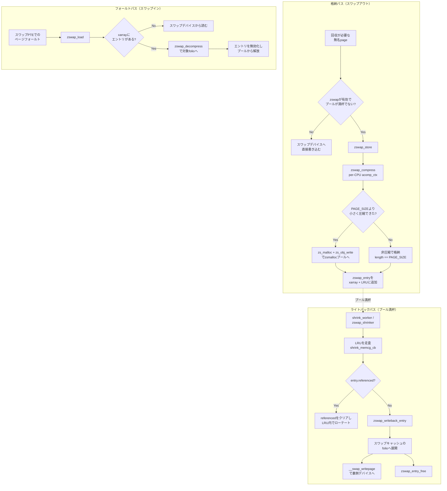
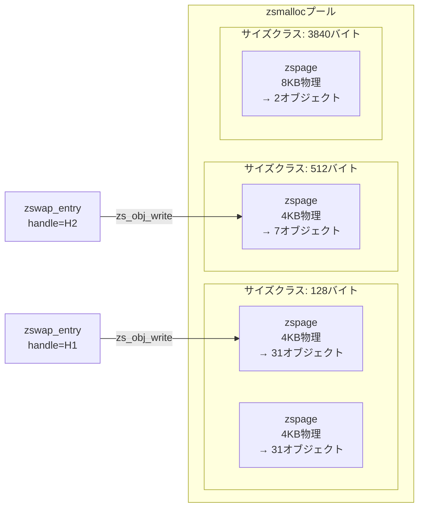
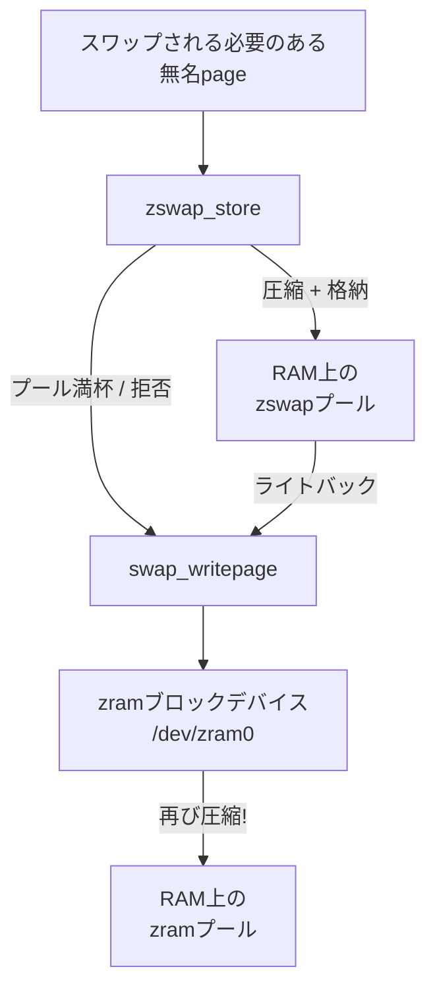

# zswapの内部構造: 圧縮スワップキャッシュ {#zswap-internals-compressed-swap-cache}

> スワップデバイスへ向かう途中のpageを横取りする、RAM上の圧縮キャッシュ。CPUサイクルと引き換えにI/Oを削減する

## zswapとは何か（そして何ではないか） {#what-zswap-is-and-is-not}

zswapは、スワップデバイスの手前に位置する**ライトバック型の圧縮キャッシュ**である。カーネルが無名pageをスワップアウトすると決めると、zswapはそのpageを横取りして圧縮し、圧縮データをRAMベースのプールに格納する。圧縮プールが満杯になると、zswapは最もコールドなエントリを裏側のスワップデバイスへ追い出す。

重要な洞察は、圧縮されたRAMからの読み出しはディスクはもちろんSSDからの読み出しと比べても桁違いに速いということである。zswapはCPUサイクルと引き換えにI/Oを削減するが、これは通常、割に合うトレードオフである。

!!! note "zswapとzramは別物である"
    この2つはしばしば混同される。

    - **zswap**: 任意のスワップデバイスの手前に置かれる圧縮*キャッシュ*。ブロックデバイスとしては現れない。裏側のスワップデバイス（ディスク、SSD、あるいはzramデバイス）は依然として存在する。
    - **zram**: それ自体がスワップデバイスとして動作する圧縮*ブロックデバイス*。スワップデバイスを完全にメモリ内で置き換える。

    両者を重ねることもできる。zramをスワップデバイスとして使い、その手前にzswapを置くのである。ただしこの場合、pageは2回圧縮される（zswapで1回、zramで1回）ことになり、追加の利益がほとんどないままCPUを浪費する。[zramとの相互作用](#interaction-with-zram)を参照。

## アーキテクチャ概要 {#architecture-overview}



!!! info "frontswapは廃止された"
    Linux 6.x以前、zswapは**frontswap**インターフェース（`frontswap_store`、`frontswap_load`など）を介してカーネルにフックしていた。このインターフェースは削除された。現在のzswapは直接統合されており、`zswap_store()`と`zswap_load()`はスワップのライトバックおよびスワップインのコードパスから明示的に呼び出される。エントリポイントは`include/linux/zswap.h`で宣言されている。

## 主要なデータ構造 {#key-data-structures}

### `struct zswap_pool` {#struct-zswap_pool}

```c
struct zswap_pool {
    struct zs_pool *zs_pool;              /* 圧縮データ用のzsmallocプール */
    struct crypto_acomp_ctx __percpu *acomp_ctx; /* per-CPUの圧縮コンテキスト */
    struct percpu_ref ref;                /* 参照カウント */
    struct list_head list;               /* グローバルなzswap_poolsリスト内のエントリ */
    struct work_struct release_work;
    struct hlist_node node;              /* cpuhpコールバック用 */
    char tfm_name[CRYPTO_MAX_ALG_NAME]; /* 圧縮器の名前 */
};
```

各プールは単一の圧縮アルゴリズムに結び付いている。実行時に圧縮器を変更すると、新しいプールが作成される。古いプールは、そのエントリがすべて追い出されるかロードされるまで存続し、その後`zswap_pool_destroy()`によって破棄される。

### `struct zswap_entry` {#struct-zswap_entry}

```c
struct zswap_entry {
    swp_entry_t swpentry;    /* スワップタイプ + オフセット — 検索キー */
    unsigned int length;     /* 圧縮後のバイト数;
                                == PAGE_SIZE は圧縮不能を意味する */
    bool referenced;         /* LRUライトバック用のセカンドチャンスビット */
    struct zswap_pool *pool; /* 所有するプール */
    unsigned long handle;    /* zsmallocの割り当てハンドル */
    struct obj_cgroup *objcg;/* cgroupへの課金 */
    struct list_head lru;    /* グローバルなzswap_list_lru内の位置 */
};
```

zswapに格納された圧縮pageごとに`zswap_entry`が1つある。エントリはスワップタイプごとのxarrayに格納され、64 MiB単位の領域にシャーディングされる。

```c
#define ZSWAP_ADDRESS_SPACE_SHIFT  14   /* 2^14 = 16384ページ = 64 MiB */
static struct xarray *zswap_trees[MAX_SWAPFILES];
```

ヘルパー`swap_zswap_tree()`は、`swp_entry_t`を適切なxarrayシャードに対応付ける。

### `struct crypto_acomp_ctx` {#struct-crypto_acomp_ctx}

```c
struct crypto_acomp_ctx {
    struct crypto_acomp *acomp; /* 非同期圧縮トランスフォーム */
    struct acomp_req    *req;   /* 事前に割り当てたリクエスト */
    struct crypto_wait   wait;  /* 完了待ち */
    u8                  *buffer;/* PAGE_SIZEの作業用バッファ */
    struct mutex         mutex; /* CPUごとに一度に1操作 */
};
```

コンテキストはプールごと・CPUごとに1つある。`acomp_ctx_get_cpu_lock()`は現在のCPUのコンテキストのmutexを獲得し、`acomp_ctx_put_unlock()`はそれを解放する。

## 圧縮パイプライン {#the-compression-pipeline}

### 格納パス: `zswap_store()` {#store-path-zswap_store}

MMサブシステムがfolioをスワップアウトしようとすると、`zswap_store(struct folio *folio)`を呼び出す。

```
zswap_store(folio)
  ├── Check zswap_enabled
  ├── obj_cgroup_may_zswap()  ← cgroup zswap.max limit
  ├── zswap_check_limits()    ← global max_pool_percent limit
  ├── zswap_pool_current_get() ← RCU-safe ref on current pool
  └── for each page in folio:
        zswap_store_page(page, objcg, pool)
          ├── zswap_entry_cache_alloc()  ← kmem_cache alloc
          ├── zswap_compress(page, entry, pool)
          │     ├── acomp_ctx_get_cpu_lock()
          │     ├── crypto_acomp_compress() + crypto_wait_req()
          │     ├── if dlen >= PAGE_SIZE and writeback enabled:
          │     │       store uncompressed (dlen = PAGE_SIZE)
          │     └── zs_malloc() + zs_obj_write()
          ├── xa_store() into swap xarray
          └── zswap_lru_add()  ← entry.referenced = true
```

何らかの理由（プール満杯、割り当て失敗、圧縮エラー）で格納に失敗した場合、そのスワップスロットに以前格納されていたエントリは`xa_erase()` + `zswap_entry_free()`によって無効化される。これにより、新しい版のpageが書き込まれた後に古い圧縮データが残って使われることを防ぐ。

### 圧縮: `zswap_compress()` {#compression-zswap_compress}

zswapはカーネルの**非同期圧縮API**（`crypto/acompress.h`）を使う。

1. 入力のscatter-gatherリストに元pageを設定する。
2. `crypto_acomp_compress()`を呼び出す。APIは非同期だが、zswapは`crypto_wait_req()`で同期的に待つ。
3. `dlen >= PAGE_SIZE`（圧縮不能）で、かつこのcgroupでライトバックが許可されている場合、pageは**非圧縮のまま**格納される（`entry->length == PAGE_SIZE`）。これによりLRUの順序が保たれ、コールドな圧縮不能pageも引き続きライトバックできる。
4. `zs_malloc()`がzsmallocプール内に領域を割り当て、`zs_obj_write()`が圧縮されたバイト列を書き込む。

!!! note "圧縮不能なpage"
    pageをPAGE_SIZE未満に圧縮できない場合、zswapは`kmap_local_page()`を使って生の内容を直接コピーして格納する。このエントリは`zswap_stored_incompressible_pages`によって圧縮不能として追跡される。このカウンタはdebugfsで公開されている。

    cgroupでライトバックが無効化されている場合（`memory.zswap.writeback=0`）、圧縮不能pageは即座に**拒否**される。決して追い出せないのであれば、圧縮不能pageを格納する意味はないからである。

### 展開: `zswap_decompress()` {#decompression-zswap_decompress}

`zswap_load()`（フォールトパス）と`zswap_writeback_entry()`（ライトバックパス）の両方から呼ばれる。

```c
zs_obj_read_sg_begin()   // zsmallocオブジェクトをscatter-gatherとしてマップ
if entry->length == PAGE_SIZE:
    memcpy_from_sglist()  // 圧縮不能: そのままコピー
else:
    crypto_acomp_decompress() + crypto_wait_req()
zs_obj_read_sg_end()
```

zsmallocのオブジェクトはpage境界をまたぐことがあるため、入力は常に1〜2エントリのscatter-gatherリストとなる。

### ロードパス: `zswap_load()` {#load-path-zswap_load}

ページフォールト時、スワップインのコードは`zswap_load(struct folio *folio)`を呼び出す。

1. xarrayで`swp_entry_t`を検索し、`zswap_entry`を得る。
2. `zswap_decompress()`を呼び出し、フォールトの対象folioへ展開する。
3. スワップキャッシュへロードする場合（一般的なケース）は、zswapエントリを直ちに**無効化**する。以後はスワップキャッシュが正式な所有者になる。
4. folioをup-to-dateとしてマークし、アンロックする。

!!! warning "large folioの制限"
    `zswap_load()`は`WARN_ON_ONCE(folio_test_large(folio))`でlarge folioを明示的に拒否し、`-EINVAL`を返す。large folioはzswapに部分的にしか格納されていない可能性があり（構成する各pageが独立に扱われる）、ロードパスはこのケースを扱わない。その結果、`do_swap_page()`から`SIGBUS`が発生する。

## プールのバックエンド: zsmalloc {#pool-backend-zsmalloc}

現在のカーネルでは、zswapはメモリアロケータとして**zsmallocのみ**を使う。古いバックエンド（zbud、z3fold）はもはやzswapでは使われない。

`CONFIG_ZSWAP`は`CONFIG_ZSMALLOC`を自動的に選択する。

### zsmallocの仕組み {#how-zsmalloc-works}

zsmallocは、圧縮pageの格納向けに設計された可変サイズのslabアロケータである。主な特性は次のとおり。

| 特性 | 詳細 |
|----------|--------|
| 割り当て粒度 | 約32バイトからPAGE_SIZEまでの、8バイト境界のサイズクラス |
| 内部構造 | **zspage**と呼ばれる物理pageのグループ |
| アドレッシング | オブジェクトは直接アドレス指定できず、不透明な`handle`を介してアクセスする |
| 断片化の制御 | 充填率（0%, 10%, …, 99%, 100%）ごとにpageをグループ化 |
| zspageあたりの最大page数 | `CONFIG_ZSMALLOC_CHAIN_SIZE`で設定可能 |

zsmallocのオブジェクトは直接アドレス指定できないため、`zs_obj_write()`と`zs_obj_read_sg_begin()`が内部でマッピングとscatter-gatherの設定を行う。



zsmallocのオブジェクト密度の高さ（特に小さな圧縮出力の場合）こそが、zbud（物理page 1つにつき2 page）やz3fold（物理page 1つにつき最大3 page）を置き換えた理由である。圧縮率の良いワークロードは大きな恩恵を受ける。

## プール管理とライトバック {#pool-management-and-writeback}

### グローバルなプールサイズ上限 {#global-pool-size-limit}

```c
static unsigned int zswap_max_pool_percent = 20;
```

プールは、圧縮ストレージとして`totalram_pages() * zswap_max_pool_percent / 100`個の物理pageに制限される。`zswap_check_limits()`は格納のたびに呼ばれる。

```c
static bool zswap_check_limits(void)
{
    unsigned long cur_pages = zswap_total_pages();
    unsigned long max_pages = zswap_max_pages();

    if (cur_pages >= max_pages) {
        zswap_pool_limit_hit++;
        zswap_pool_reached_full = true;
    } else if (zswap_pool_reached_full &&
               cur_pages <= zswap_accept_thr_pages()) {
        zswap_pool_reached_full = false;
    }
    return zswap_pool_reached_full;
}
```

プールが上限に達すると`zswap_pool_reached_full = true`となる。プールが最大値の`accept_threshold_percent`（デフォルト90%）を下回るまで減るまで、新しい格納は拒否される。このヒステリシスにより、境界付近でのスラッシングを防ぐ。

プールが満杯で格納に失敗すると、`zswap_store()`は`zswap_shrink_work`をキューに入れ、バックグラウンドのライトバックを起動する。

### グローバルLRU {#the-global-lru}

すべてのプールにまたがるすべての`zswap_entry`オブジェクトは、単一のグローバルな`list_lru`を共有する。

```c
static struct list_lru zswap_list_lru;
```

このLRUはNUMAとmemcgを認識する。エントリは格納時に`entry->referenced = true`の状態でLRUに追加される。

### シュリンカとライトバック: `shrink_worker()` {#the-shrinker-and-writeback-shrink_worker}

裏側のスワップデバイスへのライトバックを起動する仕組みは2つある。

**1. メモリ圧迫シュリンカ**（`zswap_shrinker`）:
標準的なカーネルシュリンカとして登録される（`SHRINKER_NUMA_AWARE | SHRINKER_MEMCG_AWARE`）。メモリアロケータが圧迫を検知すると、`zswap_shrinker_scan()` → `list_lru_shrink_walk()` → 各LRUエントリに対する`shrink_memcg_cb()`を呼び出す。

**2. プール満杯時のワークキュー**（`shrink_worker`）:
`zswap_pool_reached_full`がセットされた状態で格納に失敗すると、`shrink_worker()`が`zswap-shrink` workqueueにキューイングされる。これはmemcgをラウンドロビンで巡回して各memcgに対して`shrink_memcg()`を呼び出し、プールが`zswap_accept_thr_pages()`を下回るまで続ける。

### セカンドチャンスLRUアルゴリズム {#second-chance-lru-algorithm}

`shrink_memcg_cb()`は**セカンドチャンス**方式の追い出しポリシーを実装している。

```c
if (entry->referenced) {
    entry->referenced = false;
    return LRU_ROTATE;  /* もう一度チャンスを与える */
}
/* referenced == false: スワップデバイスへライトバックする */
writeback_result = zswap_writeback_entry(entry, swpentry);
```

新しいエントリは`referenced = true`で始まる。シュリンカは最初に遭遇したときにこのフラグをクリアし、エントリを末尾へローテートする。2回目に遭遇したとき（`referenced`がすでにfalseのとき）にのみライトバックが行われる。

### シュリンカの較正 {#shrinker-calibration}

`zswap_shrinker_count()`は、過剰な縮小を避けるため、縮小可能なオブジェクト数をいくつかの係数でスケーリングする。

1. **圧縮率**: `mult_frac(nr_freeable, nr_backing, nr_stored)`。プールが4:1で圧縮している場合、ライトバック1回あたりに解放される物理pageは少なくなるため、報告される候補数も少なくなる。
2. **ディスクからのスワップインのペナルティ**: `nr_disk_swapins`（`zswap_lruvec_state.nr_disk_swapins`で追跡される）が`nr_freeable`から差し引かれる。ディスクからのスワップインが観測されるということは、以前にzswapから追い出しすぎたことを意味するので、ペースを落とす。

### `zswap_writeback_entry()` {#zswap_writeback_entry}

単一エントリのライトバックは次のとおり。

```
zswap_writeback_entry(entry, swpentry)
  ├── swap_cache_alloc_folio()    ← allocate folio in swap cache
  ├── xa_load() to verify entry is still valid
  ├── zswap_decompress(entry, folio)
  ├── xa_erase() from xarray
  ├── zswap_entry_free()         ← free from pool
  ├── folio_mark_uptodate()
  └── __swap_writepage()         ← issue write to backing swap device
```

並行するスワップインが先にfolioを割り当てていた場合（`!folio_was_allocated`）、ライトバックはスキップされる。そのpageはちょうどホットになったところなので、追い出すのは誤りだからである。

## 同一値で埋められたpageの検出 {#same-filled-page-detection}

!!! info "このカーネルバージョンに関する注記"
    古いバージョン向けのアップストリームのカーネルドキュメントには、同一値で埋められた（ゼロページの）最適化が記述されている。これは圧縮前にpageの内容が均一かどうかを調べ、埋め値のパターンだけを格納するものである。しかし現在の`mm/zswap.c`のソースを調べると、この最適化は**このバージョンのコードには存在しない**。`zswap_store_page()`や`zswap_compress()`には`page_same_filled()`の呼び出しや類似のロジックはない。圧縮不能pageは扱われる（ライトバックが有効なときはPAGE_SIZEのまま非圧縮で格納される）が、同一値検出のための別経路は存在しない。

    debugfsのカウンタ`stored_incompressible_pages`は、フルサイズで格納されたpageを追跡する。

## cgroupごとの上限 {#per-cgroup-limits}

cgroup v2の3つのファイルが、cgroupごとにzswapを制御する。

| ファイル | 説明 |
|------|-------------|
| `memory.zswap.max` | このcgroupがzswapで使用できる圧縮メモリの最大バイト数。デフォルト: `max`（無制限）。 |
| `memory.zswap.current` | 読み取り専用: このcgroupが現在zswapで使用しているバイト数。 |
| `memory.zswap.writeback` | zswapからスワップデバイスへpageをライトバックできるかどうか。`0`にするとこのcgroupのライトバックが無効になる。デフォルト: `1`。 |

`obj_cgroup_may_zswap()`は格納のたびに`memory.zswap.max`を確認する。cgroupが上限を超えている場合、`zswap_store()`はまず`shrink_memcg()`でこのcgroupのpageを縮小しようとする。縮小に失敗すると格納は拒否され、folioはスワップデバイスへ直接送られる。

```bash
# cgroupのzswap使用量を512 MiBに制限する
echo 536870912 > /sys/fs/cgroup/myapp/memory.zswap.max

# cgroupのzswapライトバックを無効にする（pageはzswapに留まるか拒否される）
echo 0 > /sys/fs/cgroup/myapp/memory.zswap.writeback
```

!!! warning "writeback=0と圧縮不能page"
    `memory.zswap.writeback=0`でpageが圧縮不能な場合、zswapは**格納そのものを拒否**する（`zswap_compress()`から`false`を返す）。そのpageはスワップデバイスへと落ちていく。これはフィードバックループを引き起こしうる。同じ圧縮不能pageがzswapに繰り返し拒否され、スワップI/Oを起こし続ける可能性がある。

## sysfsのチューニング可能なパラメータ {#sysfs-tunables}

すべてのチューニング可能なパラメータは`/sys/module/zswap/parameters/`以下にある。

| パラメータ | デフォルト | 説明 |
|-----------|---------|-------------|
| `enabled` | `CONFIG_ZSWAP_DEFAULT_ON` | 実行時にzswapを有効化・無効化する。無効化すると新規の格納は止まるが、既存のエントリはフラッシュされない。 |
| `compressor` | `CONFIG_ZSWAP_COMPRESSOR_DEFAULT` (lzo) | 圧縮アルゴリズム。変更すると新しいプールが作成され、古いプールは空になった後に解放される。 |
| `max_pool_percent` | `20` | 圧縮プールが占有できる総RAMの最大割合。 |
| `accept_threshold_percent` | `90` | `max_pool_percent`に達した後、プールが最大値のこの割合まで下がったときにのみpageの受け入れを再開する。`100`に設定するとヒステリシスが無効になる。 |
| `shrinker_enabled` | `CONFIG_ZSWAP_SHRINKER_DEFAULT_ON` (off) | メモリ圧迫駆動のシュリンカを有効にする。オフの場合、ライトバックはプールが満杯のときにのみ起こる。 |

```bash
# 実行時にzswapを有効にする
echo 1 > /sys/module/zswap/parameters/enabled

# 圧縮器をzstdに切り替える（新しいプールが作られ、古いエントリはlzoプールに残る）
echo zstd > /sys/module/zswap/parameters/compressor

# プール上限をRAMの30%に引き上げる
echo 30 > /sys/module/zswap/parameters/max_pool_percent

# メモリ圧迫シュリンカを有効にする
echo Y > /sys/module/zswap/parameters/shrinker_enabled

# ヒステリシスを縮める — プールが最大値の70%になったら受け入れを再開する
echo 70 > /sys/module/zswap/parameters/accept_threshold_percent
```

あるいは、ブート時にこれらを設定することもできる。

```
zswap.enabled=1 zswap.compressor=zstd zswap.max_pool_percent=25
```

## Kconfigオプション {#kconfig-options}

| オプション | 説明 |
|--------|-------------|
| `CONFIG_ZSWAP` | zswapサポートを有効にする。`CONFIG_ZSMALLOC`を自動的に選択する。 |
| `CONFIG_ZSWAP_DEFAULT_ON` | ブート時にデフォルトでzswapを有効にする。 |
| `CONFIG_ZSWAP_SHRINKER_DEFAULT_ON` | メモリ圧迫シュリンカをデフォルトで有効にする。 |
| `CONFIG_ZSWAP_COMPRESSOR_DEFAULT_LZO` | デフォルトの圧縮器: LZO |
| `CONFIG_ZSWAP_COMPRESSOR_DEFAULT_LZ4` | デフォルトの圧縮器: LZ4 |
| `CONFIG_ZSWAP_COMPRESSOR_DEFAULT_LZ4HC` | デフォルトの圧縮器: LZ4HC |
| `CONFIG_ZSWAP_COMPRESSOR_DEFAULT_ZSTD` | デフォルトの圧縮器: zstd |
| `CONFIG_ZSWAP_COMPRESSOR_DEFAULT_DEFLATE` | デフォルトの圧縮器: deflate |
| `CONFIG_ZSWAP_COMPRESSOR_DEFAULT_842` | デフォルトの圧縮器: 842 |
| `CONFIG_ZSMALLOC` | zsmallocアロケータ（zswapに必須）。 |
| `CONFIG_ZSMALLOC_STAT` | zsmallocのサイズクラスごとの統計をdebugfs経由で公開する。 |

## 可観測性 {#observability}

### debugfs: `/sys/kernel/debug/zswap/` {#debugfs-syskerneldebugzswap}

すべてのカウンタは読み取り専用かつ近似値である（互いにアトミックに整合しているわけではないが、個々の値は`u64`として正確である）。

| ファイル | 説明 |
|------|-------------|
| `pool_total_size` | すべてのzswapプールが消費している物理RAMの総バイト数（圧縮データのみ）。 |
| `stored_pages` | 現在zswapに格納されているpage数（圧縮済み + 圧縮不能）。 |
| `stored_incompressible_pages` | フルPAGE_SIZEで格納されたpage（PAGE_SIZE未満に圧縮できなかったもの）。 |
| `pool_limit_hit` | プールが`max_pool_percent`に達していたために格納が拒否された回数。 |
| `written_back_pages` | 裏側のスワップデバイスへのライトバックに成功したpage数。 |
| `reject_reclaim_fail` | 格納拒否: プールが満杯で、バックグラウンドのライトバックが失敗した。 |
| `reject_alloc_fail` | 格納拒否: `zs_malloc()`がエラーを返した（プールの枯渇）。 |
| `reject_kmemcache_fail` | 格納拒否: `zswap_entry`メタデータの割り当てに失敗した（まれ）。 |
| `reject_compress_fail` | 格納拒否: 圧縮アルゴリズムがエラーを返した。 |
| `reject_compress_poor` | 格納拒否: 圧縮出力がアロケータに収まらなかった（ENOSPC）。 |
| `decompress_fail` | ロードまたはライトバック中に展開が失敗した（データ破損の兆候）。 |

```bash
# zswapの簡易ヘルスチェック
for f in /sys/kernel/debug/zswap/*; do
    printf "%-40s %s\n" "$(basename $f)" "$(cat $f)"
done
```

### vmstatイベント {#vmstat-events}

`/proc/vmstat`では3つのイベントが数えられる。

| イベント | 説明 |
|-------|-------------|
| `zswpout` | zswapに格納されたpage（`zswap_store()`の成功）。 |
| `zswpin` | zswapからロードされたpage（`zswap_load()`の成功）。 |
| `zswpwb` | zswapからスワップデバイスへライトバックされたpage。 |

```bash
# zswapの活動をリアルタイムで監視する
watch -n1 'grep -E "^zswp" /proc/vmstat'
```

### cgroupごとの統計 {#per-cgroup-stats}

cgroup v2では、`memory.stat`に次の項目が含まれる。

| フィールド | 説明 |
|-------|-------------|
| `zswap` | このcgroupがzswapで使用している圧縮メモリのバイト数。 |
| `zswapped` | このcgroupが現在zswapに格納しているpage数。 |

```bash
cat /sys/fs/cgroup/myapp/memory.stat | grep zswap
```

### 圧縮率の見積もり {#estimating-compression-ratio}

```bash
stored=$(cat /sys/kernel/debug/zswap/stored_pages)
pool_bytes=$(cat /sys/kernel/debug/zswap/pool_total_size)
page_size=4096

if [ "$stored" -gt 0 ]; then
    uncompressed=$((stored * page_size))
    echo "Stored pages:    $stored"
    echo "Uncompressed:    $((uncompressed / 1048576)) MiB"
    echo "Compressed:      $((pool_bytes / 1048576)) MiB"
    echo "Ratio:           $(echo "scale=2; $uncompressed / $pool_bytes" | bc):1"
fi
```

## zramとの相互作用 {#interaction-with-zram}

zswapはzramデバイスの手前に置くことができる。スタック全体は次のようになる。



!!! warning "二重圧縮"
    zswapがzramの手前にある場合、zswapプールに入らなかった（あるいはシュリンカによってライトバックされた）pageは、zramによって**2回目の**圧縮を受ける。これは次のことを意味する。

    - それらのpageについて**CPUオーバーヘッドが2倍になる**。
    - 追加の圧縮効果はごくわずかである。zswapですでに圧縮されたデータは、再圧縮してもほとんど小さくならない。
    - zswapがすでにデータを圧縮しているため、メモリ節約効果はわずかである。

    **推奨**: zswap（実際のスワップデバイスと組み合わせる）かzramのどちらか一方を使い、両方は使わないこと。ディスクI/Oを完全に避けることが目的なら、zram単体の方が単純で効率的である。スワップデバイスがあり、I/Oを減らしたいのであれば、その手前でzswapを使う。

    どうしても両方を使う必要がある場合（例: システムにzramスワップとディスクスワップの両方がある）、zramのスワップタイプに対してはzswapを無効にすることを検討すること。

## 性能上のトレードオフ {#performance-tradeoffs}

### CPU vs. メモリvs. I/O {#cpu-vs-memory-vs-io}

```
Low compression ratio (data is random, already compressed):
  → zswap stores at PAGE_SIZE (incompressible)
  → Pool fills quickly (no density gain over uncompressed swap)
  → Writeback to swap device happens soon anyway
  → Net result: CPU overhead for no benefit

High compression ratio (text, code, zeroed pages):
  → 4:1 or better compression is common
  → Pool holds 4x more pages than uncompressed
  → Significant reduction in swap I/O
  → Net result: CPU overhead well justified
```

### 圧縮器の比較 {#compressor-comparison}

| アルゴリズム | 速度 | 圧縮率 | 最適な用途 |
|-----------|-------|-------|----------|
| `lzo` | 最速 | 中程度 | 対話的なデスクトップ、レイテンシ重視 |
| `lz4` | 非常に高速 | 中程度 | 高スループットのサーバー、低オーバーヘッドな環境 |
| `lz4hc` | 中程度 | lz4より良い | バランス型。圧縮は遅いが、展開速度はlz4と同じ |
| `zstd` | 中程度 | 最良 | 強いメモリ圧迫。良い圧縮率のためにCPUコストを払う価値がある |
| `deflate` | 低速 | 良い | レガシー。一般にzstdに取って代わられている |
| `842` | ハードウェアアクセラレーション（IBM POWER） | 中程度 | ハードウェアオフロードを備えたPOWERシステム |

!!! tip "圧縮器の選び方"
    - **レイテンシ重視**のワークロード: `lzo`または`lz4`。高速な展開によりフォールトのレイテンシを低く保てる。
    - RAMの節約が最優先の**メモリ制約の厳しい**システム: `zstd`。最も高い密度が得られる。
    - デフォルトの`lzo`は、ほとんどの用途で無難な中間点である。

    圧縮器は、既存のエントリをフラッシュせずに実行時に変更できる。
    ```bash
    echo zstd > /sys/module/zswap/parameters/compressor
    ```
    古いエントリは古いプールに残り、追い出されるまで古いアルゴリズムで展開される。

### シュリンカを有効にすべきとき {#when-to-enable-the-shrinker}

デフォルト（`CONFIG_ZSWAP_SHRINKER_DEFAULT_ON=n`）では、ライトバックはプールが`max_pool_percent`に達したときにのみ起こる。つまり、上限に達するまで、コールドなpageがプール内にいつまでも溜まりうる。

シュリンカを有効にする（`shrinker_enabled=Y`）と、メモリアロケータはメモリ圧迫下で、プールが満杯になる前に、コールドなzswap pageを裏側のスワップデバイスへ先回りして書き出せるようになる。これには次の効果がある。

- プールがコールドなメモリの「ブラックホール」になるリスクを減らす。
- 持続的なメモリ圧迫下ではスワップI/Oが増える。
- 過剰な追い出しを避けるため、圧縮率とディスクからのスワップインのペナルティによって制御される。

```bash
echo Y > /sys/module/zswap/parameters/shrinker_enabled
```

### プールサイズのチューニング {#pool-size-tuning}

デフォルトの`max_pool_percent=20`は控えめである。RAMが潤沢でスワップが遅い（回転ディスク）システムでは、より大きなプールが有益である。

```bash
# 高速なRAMと低速なスワップを持つシステム向け
echo 40 > /sys/module/zswap/parameters/max_pool_percent
```

RAMがより貴重なシステム（コンテナ、組み込み）では、デフォルトのままにするか、値を減らす。

## 初期化とライフサイクル {#initialization-and-lifecycle}

zswapは`late_initcall(zswap_init)`によって遅延初期化される。これによりcryptoサブシステムが利用可能であることが保証される。

```
zswap_init()
  └── zswap_setup()
        ├── KMEM_CACHE(zswap_entry, 0)
        ├── cpuhp_setup_state_multi(CPUHP_MM_ZSWP_POOL_PREPARE,
        │       zswap_cpu_comp_prepare, zswap_cpu_comp_dead)
        ├── alloc_workqueue("zswap-shrink", WQ_UNBOUND|WQ_MEM_RECLAIM, 1)
        ├── zswap_alloc_shrinker()
        ├── list_lru_init_memcg(&zswap_list_lru, zswap_shrinker)
        ├── shrinker_register(zswap_shrinker)
        ├── __zswap_pool_create_fallback()  ← creates the initial pool
        └── zswap_debugfs_init()
```

CPUホットプラグのコールバック（`zswap_cpu_comp_prepare` / `zswap_cpu_comp_dead`）は、CPUがオンライン・オフラインになるのに合わせて、per-CPUの`crypto_acomp_ctx`を割り当て・解放する。

スワップデバイスが有効化されると（`swapon`）、`zswap_swapon()`がそのスワップタイプ用のxarrayシャードを割り当てる。無効化されると（`swapoff`）、`zswap_swapoff()`がそれらを解放する（その前に、すべてのエントリが`try_to_unuse()`によって無効化されている必要がある）。

## 主要なソースファイル {#key-source-files}

| ファイル | 目的 |
|------|---------|
| `mm/zswap.c` | zswapの主な実装: 格納、ロード、ライトバック、シュリンカ、プール管理、debugfs |
| `include/linux/zswap.h` | 公開API: `zswap_store()`、`zswap_load()`、`zswap_invalidate()`、`zswap_swapon()`、`zswap_swapoff()`。`nr_disk_swapins`を持つ`struct zswap_lruvec_state` |
| `mm/zsmalloc.c` | zsmallocアロケータ: zswapが使う可変サイズの圧縮オブジェクトプール |
| `include/linux/zsmalloc.h` | zsmallocのAPI: `zs_create_pool()`、`zs_malloc()`、`zs_obj_write()`、`zs_obj_read_sg_begin()`、`zs_free()`、`zs_destroy_pool()` |
| `mm/memcontrol.c` | cgroupごとのzswap上限: `memory.zswap.max`、`memory.zswap.current`、`memory.zswap.writeback`、`obj_cgroup_may_zswap()` |
| `mm/Kconfig` | Kconfigオプション: `CONFIG_ZSWAP`、`CONFIG_ZSWAP_DEFAULT_ON`、`CONFIG_ZSWAP_SHRINKER_DEFAULT_ON`、圧縮器のデフォルト |
| `include/linux/vm_event_item.h` | vmstatイベント: `ZSWPIN`、`ZSWPOUT`、`ZSWPWB` |
| `include/linux/memcontrol.h` | `MEMCG_ZSWAP_B`、`MEMCG_ZSWAPPED`、`obj_cgroup_may_zswap()`、`mem_cgroup_zswap_writeback_enabled()`。`struct mem_cgroup`の`zswap_max`フィールド |
| `Documentation/admin-guide/mm/zswap.rst` | アップストリームの管理者ガイド（ソースより遅れている場合がある） |

## 参考文献 {#further-reading}

- [mm/zswap.c](https://git.kernel.org/pub/scm/linux/kernel/git/torvalds/linux.git/tree/mm/zswap.c) — zswapの完全な実装: 格納、ロード、ライトバック、シュリンカ、プール管理、debugfsカウンタ
- `Documentation/admin-guide/mm/zswap.rst` — チューニング可能なパラメータ、cgroupによる制御、可観測性を扱うアップストリームの管理者ガイド
- [swap](swap.md) — スワップアーキテクチャの概要。zramやディスクスワップと並んで、zswapがスワップスタック全体の中でどう位置付けられるかを含む
- [swap-thrashing](swap-thrashing.md) — zswapやzramを有効にして圧縮pageをRAMに保持することで、I/O起因のスラッシングをどう減らせるか
- [slab](slab.md) — zswapが可変サイズの圧縮オブジェクトを高密度に格納するために内部で使うzsmallocアロケータ
- [zswap: compressed swap caching](https://lwn.net/Articles/537422/) （LWN, 2013）— v3.11でマージされた当時の、Seth JenningsによるzswapパッチについてのLWNの記事
- [Cleancache and frontswap](https://lwn.net/Articles/454795/) （LWN, 2011）— zswapが当初使っていたfrontswapインターフェース（その後、直接統合に置き換えられて削除された）の背景
