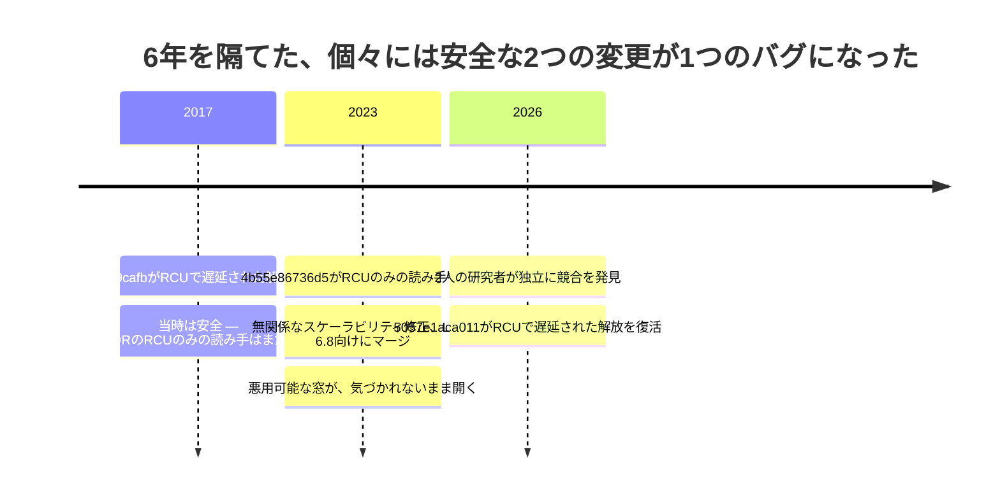
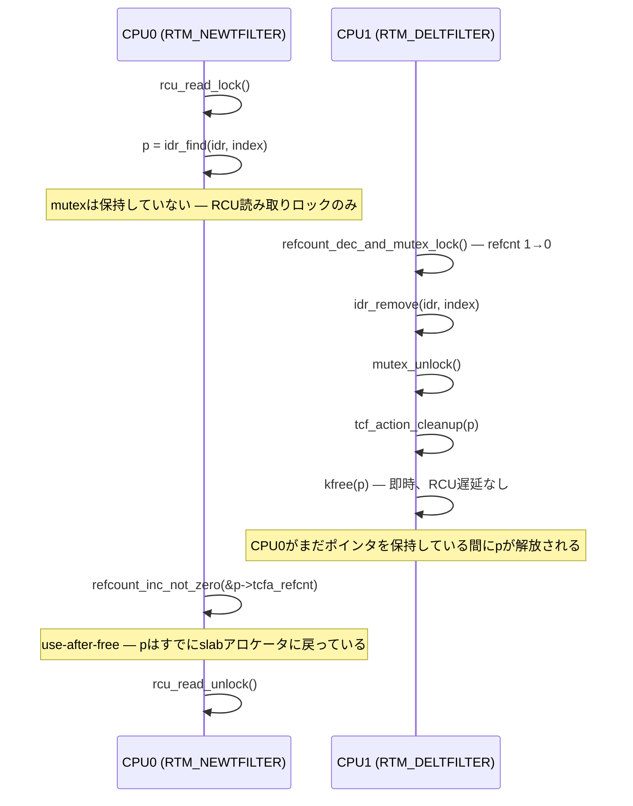
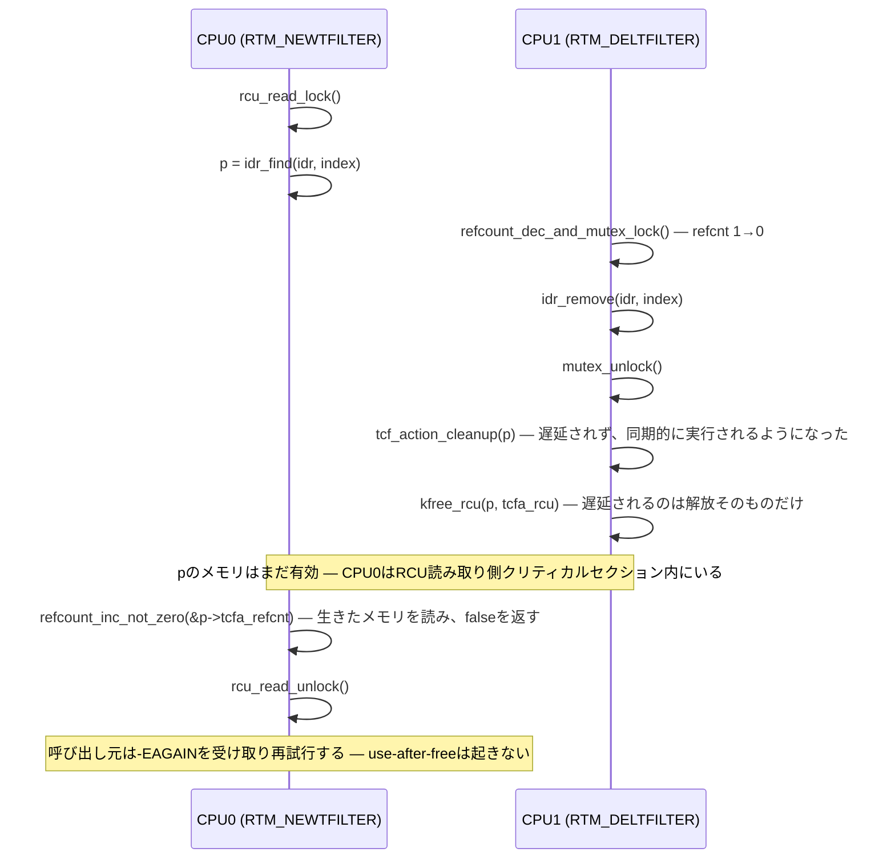

# net/sched act_apiのフィルタ削除競合 {#the-netsched-act_api-filter-delete-race}

> CVE-2026-53264 — 2017年のコメントによるRCU安全性の論証は、当時存在していたすべての読み手をカバーしていた。2023年のスケーラビリティ修正が、カバーされていなかった唯一の読み手を静かに追加し、別の研究者がその結果生じたバグを独自に発見して、新規の0-dayとして実際に動作するエクスプロイトを構築した。そのエクスプロイト開発はAIによって加速された

公開日
:   2026-06-25（LinuxカーネルCNAのレコード）。独立した0-dayエクスプロイトの解説記事は2026年7月27日に公開（STAR Labs）

報告者／発見者
:   Kyle Zeng（OpenAIのセキュリティ研究）— カーネルに対する元のバグ報告者で、修正コミットの`Reported-by`タグでクレジットされている。Lee Jia Jie（STAR Labs、シンガポール）— 同じバグを独自に発見し、0-dayとして実際に動作するエクスプロイトを構築した。本人の説明によれば、Zengがすでにアップストリームに報告していたことを知ったのは後になってからである

CVSS
:   7.8 HIGH（LinuxカーネルCNA、ベクタ`CVSS:3.1/AV:L/AC:L/PR:L/UI:N/S:U/C:H/I:H/A:H`。NVDはこれを転載しており、独自には評価していない）/ 7.0（Red Hat独自の評価、ベクタ`CVSS:3.1/AV:L/AC:H/PR:L/UI:N/S:U/C:H/I:H/A:H`）

修正バージョン
:   メインライン7.1-rc7（コミット`5057e1aca011`、2026年5月31日作成、6月1日コミット）。stable 5.10.259、5.15.210、6.1.176、6.6.143、6.12.94、6.18.36、7.0.13にそれぞれ個別にバックポート

エクスプロイトツール
:   あり — 完全なソースが公開されている: [star-sg/CVE: CVE-2026-53264](https://github.com/star-sg/CVE/tree/master/CVE-2026-53264)。Lee Jia JieのTyphoonPwn 2026への提出物であり、STAR Labsの詳細な解説記事が併せて公開されている

実際の悪用
:   確認された事例なし（ローカル専用。既存の非特権シェルが必要。本稿執筆時点でCISA KEVには未掲載）

*[事件簿: ネットワークスタックのバグとCVE](../war-stories.md)の一部。*

## 何が起きたか {#what-happened}

2人の人物が、まったく無関係な理由で、互いの発見をもとにすることなく、Linuxのトラフィック制御コードの同じバグを見つけた。OpenAIのセキュリティ研究者が、ソウルで開かれるハッキング競技会の少し前に、通常の経路でuse-after-freeをアップストリームにひっそりと報告した。シンガポールのセキュリティ企業のインターン — 同じ競技会に向けてAIの支援を受けながらカーネルのバグを探していた — は、まったく同じバグを独自に見つけ、完全なローカルroot取得エクスプロイトに仕上げていた。本人の説明によれば、アップストリームへの報告のことを知ったのは競技会が終わった後だったという。

この脆弱性CVE-2026-53264は、ロック／RCUの不整合であって、ずさんなコードではない。何年も離れて行われた、個々には妥当な2つの別々のカーネル変更が静かに組み合わさり、どちらの作者も予期する理由のなかったバグになった — ネットワークフィルタを削除すると、別のCPUがまさに使おうとしているメモリを解放してしまう窓が残ったのである。

## コードはどのように脆弱だったか {#how-the-code-was-vulnerable}

Linuxの[トラフィック制御](../tc-qdisc.md)（`tc`）のアクション — フィルタがパケットにマッチしたときに実行する`gact`、`mirred`などのオブジェクト — は参照カウントされる`struct tc_action`オブジェクトであり、アクション種別ごとにIDR（`idr_find(idr, index)`）でインデックス付けされている。これにより[netlink](../netlink.md)のリクエストが数値インデックスでアクションを検索し、新しいフィルタにアタッチしたり削除したりできる。IDRは`rcu_read_lock()`だけを取り、エントリの*削除*を保護するmutexは取らないルックアップによって走査されるため、アクションのメモリはリンク解除後少なくとも1回のRCUグレースピリオドの間は有効なままでなければならない — さもなければ、削除の直前にポインタを見つけた並行する読み手が、メモリ解放の直後にそれを参照外し（あるいは参照カウント操作）してしまう。

その仕組み — 読み取りロックしか取らないルックアップを保護するための、RCUで遅延された解放 — は現在は存在するが、常にあったわけではなく、その歴史は予想とは逆である。2017年以前は、`free_tcf()`*自体が*RCUコールバックだった — `static void free_tcf(struct rcu_head *head)`であり、`container_of()`でアクションのポインタを復元していた — そして、その2つの呼び出し元`tcf_idr_remove()`と`tcf_idr_cleanup()`が、直接呼び出す代わりに`call_rcu(&p->tcfa_rcu, free_tcf)`で解放を遅延させていた。2017年9月、Cong Wangのコミット[`d7fb60b9cafb`](https://git.kernel.org/pub/scm/linux/kernel/git/torvalds/linux.git/commit/?id=d7fb60b9cafb982cb2e46a267646a8dfd4f2e5da)（"net_sched: get rid of tcfa_rcu"）がその遅延を取り除いた。`free_tcf()`は`tc_action *`を直接受け取って即座に実行されるよう変更され、両方の呼び出し元は単に`free_tcf(p)`を呼ぶだけになった。

コミットメッセージは2つの理由を挙げている。限定的な理由は、関連する書き換えによって、ある特定の呼び出し元がその理由でグレースピリオドを待つ必要がなくなったというものである — コミットメッセージ自体はどの呼び出し元かを名指ししていない。もう1つは、このコミットが道を開こうとしていた後続パッチに対する実際の制約である — Wangは、遅延を取り除くことは*"also completely closes a race condition between action free path and filter chain add/remove path for the following patch. Because otherwise the nested RCU callback can't be caught by `rcu_barrier()`"*（訳: 後続パッチにとって、アクションの解放パスとフィルタチェーンの追加／削除パスとの間の競合状態も完全に閉じる。さもなければ、ネストしたRCUコールバックを`rcu_barrier()`で捕捉できないからだ）と書いている — 別のRCUコールバックの内部でネストした`call_rcu()`は、呼び出し元が保留中のすべてのコールバックを待つために使う`rcu_barrier()`より長く生き残ることがあり、後続の作業ではそれが起きてはならなかった。

それら2つとは別に、書き換えられた`free_tcf()`には、遅延を取り除くことがそれ自体として安全であるはずの理由を正当化するコメントが付いている — *このバグにとって*決定的に重要な主張である: *"for standalone actions, we don't need a RCU grace period either, because actions are always connected to filters and filters are already destroyed in RCU callbacks, so after a RCU grace period actions are already disconnected from filters. Readers later can not find us."*（訳: スタンドアロンのアクションについても、RCUグレースピリオドは必要ない。アクションは常にフィルタに接続されており、フィルタはすでにRCUコールバックの中で破棄されるので、RCUグレースピリオドの後にはアクションはすでにフィルタから切り離されている。後の読み手は我々を見つけられない。）この論証は1つの特定の読み手パス、すなわち*フィルタを通して*アクションに到達する者についてのものである。*IDRを通して直接*同じアクションに到達する読み手については何も言っていない — それこそが並行する`RTM_NEWTFILTER`のルックアップが行うことである。

その穴は、開いた瞬間に生きたバグになったわけではない。アクションインデックスの直接ルックアップ — 並行する`RTM_NEWTFILTER`が`tcf_idr_check_alloc()`経由で行うもの — は、Linux 6.7までは完全にmutexで保護されていた。この関数は`idr_find()`を呼ぶ前に`idrinfo->lock`を取り、`refcount_inc()`の間もそれを保持していたので、アクションIDRに対するRCUのみの読み手は一切存在せず、2017年のコメントの主張は偶然ながら安全に成り立っていた。それが2023年12月に変わった。Pedro Tammelaのコミット[`4b55e86736d5`](https://git.kernel.org/linus/4b55e86736d5)（"net/sched: act_api: rely on rcu in tcf_idr_check_alloc"）がLinux 6.8向けにマージされ、多数のフィルタが同じアクションに同時にバインドする際のmutex競合を減らすために関数を書き換えた — mutexを保持したルックアップを、`idr_find()`を囲む`rcu_read_lock()`とカウント増加のための`refcount_inc_not_zero()`に置き換え、まったく新しいスロットを割り当てるときにだけmutexにフォールバックするようにしたのである。

それはまさに2017年のコメントが考慮していなかった読み手であり、不注意によってではなく、6年後の無関係で個々には十分に考え抜かれたスケーラビリティ修正によって導入された。悪用可能な窓が開いたのはそこ、2023年末であって — 2017年ではない。（CVEレコード自体は「4.14以降影響を受ける」としているが、それは2017年のコミットを`Fixes:`の対象として挙げたことの機械的な帰結であって、独立した悪用可能性の分析ではない。いつ窓が開いたかを実際に決めるのはコードそのものである。）

読み取りパスの2つのバージョンを、ロックの違いに絞って示す（`IS_ERR(p)`の再試行分岐と新規スロット割り当てパスはどちらもここでは省略している。各タグにおける`net/sched/act_api.c`と照合済み）:

```c
/* v6.7 — ルックアップと参照カウント増加の間ずっとidrinfo->lockを保持 */
mutex_lock(&idrinfo->lock);
p = idr_find(&idrinfo->action_idr, *index);
if (p) {
    refcount_inc(&p->tcfa_refcnt);   /* 安全: mutexをまだ保持しているので、pは消えない */
    ...
}
mutex_unlock(&idrinfo->lock);
```

```c
/* v6.8、コミット4b55e86736d5 — ルックアップ自体ではmutexを取らなくなった */
rcu_read_lock();
p = idr_find(&idrinfo->action_idr, *index);
if (p) {
    if (!refcount_inc_not_zero(&p->tcfa_refcnt)) {  /* pはすでに解放途中かもしれない */
        rcu_read_unlock();
        return -EAGAIN;
    }
    ...
}
rcu_read_unlock();
```

ここにはそれ自体として間違っているものは何もない — `refcount_inc_not_zero()`は、RCUのみの読み手が使うのにまさに正しいプリミティブである。2017年のコメントがこの読み手より6年古いというだけであり、これが取り込まれたときに、誰もそのコメントを新しいコードパスに照らして再確認しなかった。

時系列を図で示す:



## 競合 {#the-race}

修正コミット自身の説明は、同じアクションインデックスに対してCPU0が`RTM_NEWTFILTER`を、CPU1が`RTM_DELTFILTER`を並行して実行する場合の競合を次のように示している:

```
0: mutex_lock()                              <-- holds the idr lock
0: rcu_read_lock()
0: p = idr_find(idr, index)                  <-- action p is valid (RCU protects IDR)
0: mutex_unlock()                            <-- releases the idr lock
1: refcount_dec_and_mutex_lock()             <-- refcnt 1->0, mutex held
1: idr_remove(idr, index)                    <-- Action removed from IDR
1: mutex_unlock()                            <-- mutex released allowing us to delete the action
1: tcf_action_cleanup(p); kfree(p)           <-- Kfrees p immediately, no deferral
0: refcount_inc_not_zero(&p->tcfa_refcnt)    <-- ouch, UAF p points to freed memory
```

この図は修正コミット自身の模式図であり、どこを単純化しているかを正確にしておく価値がある。実際の`tcf_idr_check_alloc()`のコード（修正前のv7.0タグにおける`net/sched/act_api.c`と照合済み）では、CPU0の読み取り側はmutexを一切取らない。`rcu_read_lock()`、`idr_find()`、`refcount_inc_not_zero()`、`rcu_read_unlock()`であり、その間のどこにもmutexはない — 図中のmutexはCPU1の削除パスのものであって、CPU0の読み取りのものではない。

実際の隙間は図が示唆するよりも単純である。CPU0はルックアップと参照カウント操作の一連の流れ全体を通じてRCU読み取りロックしか保持しておらず、RCU読み取りロックが保証するのは、読み手がすでにポインタを持っているメモリが、そのロックを保持している間はRCUで遅延された解放によって*回収*されないということだけである — 他の場所での並行する、遅延*されない*`kfree()`については何も言わない。CPU1の削除パスがその隙間で実行されて`p`を即座に解放すると（2017年の変更によってそうなった）、CPU0の後続の`refcount_inc_not_zero()`は、すでにslabアロケータの手に戻ったメモリに触れることになる。

実際の（模式的でない）インターリーブを図で示す:



2017年のコメントの盲点は、間違っていたことではない — その主張は、それが書かれた対象である1つの読み手パスについては正しかった。ただ、「自分が想定している読み手」という主張が、新しい読み手が追加されるたびに見直す必要のあるものだということに誰も思い至らなかっただけであり、2023年に起きたのはまさにそれである。

## どのように発見されたか {#how-it-was-found}

**元の報告。** OpenAIのセキュリティ研究者Kyle Zengがこの競合をアップストリームに報告した。この帰属は2つの独立した情報源に基づいている。修正コミット自身の`Reported-by`/`Tested-by`トレーラー（`kylebot@openai.com`）と、Lee Jia Jieの解説記事である。後者は、すでにバグを報告していた人物として、Zengの長年のハンドル名である"KyleBot"を別途名指ししている。コミットのトレーラーもLeeの記事も、Zengがどうやってそれを見つけたかは述べておらず、公開された報告スレッドもない — メンテナに直接行われた非公開の報告と整合的だが、それを裏付けるものは何もない。

修正コミットはsyzbotもクレジットしているが、それは`Tested-by`としてのみである — 完成したパッチが動作することを確認したのであって、元の競合の発見者としてクレジットしているのではない（修正の最初のバージョンでは実際のバグを見つけており、それについては後述する）。syzbotが競合そのものを見つけたことを示す`Reported-by`タグやリンクされたバグ報告はない。（Zengも完成した修正を再テストしており、`Tested-by`として二度目の登場をしている。）CVEは2026年6月25日に公開された。

**独立した0-day。** STAR Labs（シンガポール）のインターンLee Jia Jieは、**[TyphoonPwn 2026](https://typhooncon.com/typhoonpwn-2026/)** — Lee自身の説明によれば2026年5月28日に開催された複数カテゴリのエクスプロイト競技会 — に向けて、AIの支援を受けながらカーネルのバグを探していた。狙っていたのはLinuxのローカル権限昇格部門で、`net/sched`の同じ競合を独自に見つけ、競技会の前に実際に動作するローカルroot取得エクスプロイトに仕上げた。

競技会の数日後、ある人がLeeに*"KyleBot had already reported the bug 2 days before TyphoonPwn."*（訳: KyleBotはTyphoonPwnの2日前にすでにそのバグを報告していた。）と伝えた。この伝聞によれば、Zengの報告は競技会の2日前だった — これはLeeがいつバグを見つけたかについては何も語らず、それがさらに前だったということを示すだけである。

2026年7月27日に公開されたLeeの解説記事["When AI Makes 0-Days Feel Like N-Days"](https://starlabs.sg/blog/2026/07-when-ai-makes-0-days-feel-like-n-days/)は、同じ根本原因を独自に確認している: *"The vulnerability is a lock-mismatch: `tcf_idr_check_alloc()` accesses the action idr with only `rcu_read_lock()`, while actions are freed with `idrinfo->lock` and `rtnl_lock()` held, but without waiting for the RCU grace period (i.e. raw kfree)."*（訳: この脆弱性はロックの不整合である。`tcf_idr_check_alloc()`は`rcu_read_lock()`だけでアクションのidrにアクセスする一方、アクションは`idrinfo->lock`と`rtnl_lock()`を保持した状態で、しかしRCUグレースピリオドを待たずに（つまり生のkfreeで）解放される。）

Leeは、AIを使って3つの作業 — バグそのものの発見、KASANの概念実証の作成、そして競合状態全体の改善 — を加速したと述べているが、その過程のどの部分でAIが最も役立ったかは述べていない。

## 影響 {#the-impact}

完全なチェーンはUAFを引き起こすだけにとどまらなかった。解放された`tc_action`のメモリを攻撃者が制御する`user_key_payload`オブジェクトで再取得して関数ポインタを乗っ取り、制御下のヒープバッファからスタックピボットを行い、カーネルバージョン固有のROPチェーンで[`core_pattern`](https://docs.kernel.org/admin-guide/sysctl/kernel.html#core-pattern)を上書きして、コアダンプハンドラを通じてroot権限での実行を得る — 単なるクラッシュではなく、実際に動作するローカルroot取得エクスプロイトである。

非特権user namespaceが利用可能であること、`CONFIG_NET_ACT_GACT`と`CONFIG_NET_CLS_FLOWER`のカーネルオプション、そしてROPチェーン内のカーネルバージョンごとにハードコードされたオフセットが必要であるため、公開されたものはローカル権限昇格のプリミティブであって、移植性があるものでもリモートから引き起こせるものでもない。

根底にある競合に勝つまでの時間は、何度かの改良を経て大幅に短くなった。CPU0/CPU1の競合に勝とうとする素朴な試みでは15分以上かかった。`timerfd`/`epoll`の手法で窓を広げ、試行を別々のmutexを持つ別々のチェーンに分割し、専用の"binder"スレッドと"deleter"スレッドに再構成した後、実際に競合に勝つのに必要な時間は約5秒にまで下がった（Leeは、複数のアクションインデックスを使えばさらに短縮できるだろうと述べている）。

これは、完成したエクスプロイトが端から端までにかかる時間とは別の測定値である。完全なチェーンの別個の10回のベンチマーク（Intel i5-1235UのノートPC上のCentOS 9デスクトップ）では、10回すべてが成功し、所要時間は10、10、9、11、11、111、64、69、47、10秒だった。Leeは遅い外れ値をCPUの熱によるスロットリングによるものとしている。

## どのように修正されたか {#how-it-was-fixed}

**最初の試みはうまくいかなかった。** Salimの最初のパッチ（[v1](https://ratatoskr.run/netdev/2026/05/17064743/t)、2026年5月30日投稿）は、戻そうとしていたコードと同じ大まかな形をとった。明示的な`call_rcu()`コールバック`tcf_action_rcu_free()`で解放を遅延させ、グレースピリオド経過後に`tcf_action_cleanup()`を含む完全なクリーンアップを実行するというものである。

syzbotの自動テストは、数時間のうちにその設計の2つの本物の問題を検出した。`tcf_action_rcu_free()`は`__tcf_chain_put()`を呼び、これはmutexを取得しようとする — しかしRCUコールバックはスリープが許されないsoftirqコンテキストで実行されるため、"sleeping function called from invalid context"の報告が出て、そのトレースは`__tcf_chain_put()`、`net/sched/cls_api.c:694`に行き着いた。2つ目のlockdep警告は`mirred_list_lock`で発生した。これは`tcf_mirred_release()`（同じクリーンアップパスから到達する）がそれまでプロセスコンテキストからしか取得していなかったspinlockで、それがsoftirqの内部から — まさにRCUコールバックが実行されるコンテキストから — 取得されるようになっていた。

Salimの返信は短かった: *"Thanks for finding this. Will send a v2 with a fix."*（訳: 見つけてくれてありがとう。修正したv2を送る。）

[v2](https://ratatoskr.run/netdev/2026/05/17069560/t) — コミット[`5057e1aca011`](https://git.kernel.org/pub/scm/linux/kernel/git/torvalds/linux.git/commit/?id=5057e1aca011e51ef51498c940ef96f3d3e8a305)としてマージされたバージョン（Jamal Hadi Salim。2026年5月31日作成、6月1日コミット、v7.1-rc7に取り込み）— は、`tcf_action_cleanup()`を遅延パスから完全に外し、RCUで遅延された解放をスケジュールする前に同期的に実行するようにし、コールバック自体をメモリを解放する以外に何もしない単純な`kfree_rcu(p, tcfa_rcu)`にまで簡素化することでこれを修正した。出荷されたバージョンでは、mutexを必要とするものや、誤ったIRQ状態で取得されるspinlockは、RCUコールバックのコンテキストで一切実行されない。このコミットは`struct tc_action`に`struct rcu_head tcfa_rcu`を復活させ、2017年の`d7fb60b9cafb`のrevertと近代化（元のコードは明示的な`call_rcu()`コールバックを使っていたが、修正は`kfree_rcu()`を直接使う）を組み合わせたものとして明示的に位置付けられている。Suggested-byはJakub Kicinski、レビューはPedro Tammela、Eric Dumazet、Victor Nogueira、テストはKyle Zeng、syzbot、Victor Nogueiraである。

解放が遅延されると、タイミングによって次の3つのうちどれかが起きる。`idr_find()`がまだ生きているオブジェクトを見つけ、`refcount_inc_not_zero()`が通常どおり成功する。オブジェクトがすでにIDRからリンク解除されていて、`idr_find()`が正しく`NULL`を返す。あるいは — 上の図が示すケース — `idr_find()`は削除の直前に成功するが、`refcount_inc_not_zero()`が実行される時点では参照カウントがすでに0に落ちているため、正しく失敗し、呼び出し元は`-EAGAIN`で再試行する。どの場合でも、メモリ自体は、たとえどこかに古いポインタが存在していても、RCUグレースピリオドが経過するまで実際には解放されないので、参照カウント操作が解放済みメモリに触れうる窓はもう残っていない。

修正後の同じインターリーブ:



`v7.0`タグの`net/sched/act_api.c`にはまだ無条件の`kfree(p)`があり、現在のメインラインには復活した`kfree_rcu(p, tcfa_rcu)`がある — メインラインへの取り込みを`7.1-rc7`とする公開報道と整合的である。修正は影響を受ける各stableブランチに7つの別個のコミットとして個別にバックポートされた — `98b2e40879ab`、`18af5d2ef0c4`、`1f1b98fea6b9`、`8b136f18ac4b`、`5dd51e09020c`、`b60e9391142e`、`91d105d2cbe0`で、それぞれ5.10.259、5.15.210、6.1.176、6.6.143、6.12.94、6.18.36、7.0.13に対応する — 各コミットはそれぞれ`[ Upstream commit 5057e1aca011... ]`タグを持ち、`98b2e40879ab`のバックポートのsign-offチェーンは、この種のバックポートでは標準的なとおり、Sasha Levinによるstableツリーのsign-offで終わっている。

## 得られた教訓 {#what-it-taught-us}

**RCU安全性の論証は、それが書かれた時点で存在する読み手パスだけでなく、今後存在しうるすべての読み手パスをカバーしなければならない。** 2017年の推論はフィルタチェーンの走査について間違っていなかったし、IDRについても間違っていなかった — *当時は*、IDRの直接ルックアップはまだmutexで保護されていたので、前提を破るRCUのみの読み手は存在しなかった。6年後、無関係なスケーラビリティ修正がまさにその読み手を追加し、2017年のコメントの保証がまだ成り立つかどうかを誰も確認しに戻らなかった。

**正しさに関するコメントは、周囲のコードとともに静かに古びていく主張である — そのコメントを見たこともない人が変更したコードも含めて。** 2017年の変更も2023年の変更も、単独では危険に見えるところは何もなかった。どちらも作者の目の前の問題に対する妥当な修正だった。バグはそれらの交差点にだけ存在し、それはまさにどちらの作者にも探しに行く理由のなかった種類のものである。

**2つの独立した取り組みが、無関係な理由で同じバグを表面化させた。** Kyle Zengは通常の経路でアップストリームに報告し、Lee Jia Jieは競技会に向けた探索の中でAIの助けを借りて別個にそれを見つけ、同じバグがすでに報告されていたことを後になって知った。これはこのバグが特に見つけやすかったことの証拠ではない — しかし、広く使われているネットワークサブシステムで数年間開いていた競合の窓は、互いに連携することなく行われる複数の独立した探索を引き寄せうるということを思い起こさせる。

**十分に考え抜かれた修正でも本物のバグを含んだまま出荷されうるし、マージ前にそれを捉えるのは自動テストである。** Salimの最初の修正の試みは、まさにRCUコールバックで悪名高い種類の問題 — スリープやロック取得ができないコンテキストで、それができると仮定するコード — を持ち込んだ。syzbotはv1の投稿から数時間以内に両方の問題を見つけ、それがリリースされたカーネルに届くことはなかった。

**AIは0-dayの探索を、手順の面でn-dayの分析のように感じさせた — 研究者自身の言葉によれば。** Leeの説明は、AIが自律的にバグを見つけたり悪用したりしたとは主張していない。発見、概念実証、競合状態の改善を素早く繰り返せたことをAIの功績としつつも、結果を微調整するには自分自身の判断が依然として必要だったと強調している。主張は「AIがすでにパッチ済みのバグの悪用に向けて競走した」よりも狭い。AIのおかげでLeeは — Linuxカーネルに本格的に触れるのはこれが初めてだったが — サブシステムを深く研究するよりも探索のプロセスそのものに集中できた。本人の言葉では: *"In a sense, this made it feel more like I was doing n-day analysis even on new bugs."*（訳: ある意味で、新しいバグであってもn-dayの分析をしているような感覚になった。）ただし本人の但し書きは逆方向を向いている。AIが見落とすアイデアを浮かび上がらせるのは、依然としてサブシステムの深い知識だというのである。

!!! warning "注意すべきパターン"
    RCU読み取りロックを取るルックアップ（IDR、ハッシュテーブル、RCUで保護されたリスト）と、mutexで保護された削除パスの両方から到達可能な参照カウント付きオブジェクトは、*解放そのもの*を`call_rcu()`/`kfree_rcu()`で遅延させる必要がある — 削除を囲むロックは、RCU読み取りロックしか取らないルックアップの助けにはならない。遅延解放を省略することを「読み手はパスXを通してしかここに到達できず、Xはすでに安全だ」と言って正当化しているコメントがあれば、それを信頼する前に、同じオブジェクトに到達しうる他のすべてのパスを監査すること — コメントの作者が想定していたパスだけでなく。その監査は一度きりの確認でもない。後の無関係な変更が同じオブジェクトへの*新しい*読み手パスを追加した場合 — まさにここで6年後に起きたように — それは単体での正しさをレビューするだけでなく、固定された読み手の集合を前提としていた既存のすべての安全性コメントに照らして確認する必要がある。

## 関連項目 {#see-also}

- [トラフィック制御とキューイング規律](../tc-qdisc.md) — このバグが存在する`tc`のフィルタ／アクションのアーキテクチャ
- [Netlinkソケット](../netlink.md) — `RTM_NEWTFILTER`/`RTM_DELTFILTER`のリクエストがどのようにカーネルに届くか
- [ネットワークnamespace](../net-namespaces.md) — 非特権のuser+network namespaceが、このエクスプロイトが必要とするケーパビリティをどのように公開するか
- [AF_PACKET TPACKET_V3の権限昇格](af-packet.md) — 比較のための、このコレクションにあるもう1つのローカルUAFからrootへのチェーン

## 外部参考資料 {#external-references}

- [git.kernel.org: 5057e1aca011](https://git.kernel.org/pub/scm/linux/kernel/git/torvalds/linux.git/commit/?id=5057e1aca011e51ef51498c940ef96f3d3e8a305) — "net/sched: act_api: use RCU with deferred freeing for action lifecycle"
- [git.kernel.org: d7fb60b9cafb](https://git.kernel.org/pub/scm/linux/kernel/git/torvalds/linux.git/commit/?id=d7fb60b9cafb982cb2e46a267646a8dfd4f2e5da) — "net_sched: get rid of tcfa_rcu"。この修正がrevertした2017年の変更
- [git.kernel.org: 4b55e86736d5](https://git.kernel.org/linus/4b55e86736d5) — "net/sched: act_api: rely on rcu in tcf_idr_check_alloc"。2017年の変更が考慮していなかったRCUのみの読み手を導入した、2023年12月のスケーラビリティ修正
- [netdev: \[PATCH net 1/1\] net/sched: act_api: use RCU... (v1)](https://ratatoskr.run/netdev/2026/05/17064743/t) — syzbotがRCUコールバックのロックのバグを見つける前の、修正の最初の試み
- [netdev: \[PATCH net v2 1/1\] net/sched: act_api: use RCU... (v2)](https://ratatoskr.run/netdev/2026/05/17069560/t) — `5057e1aca011`としてマージされた修正版
- [STAR Labs: When AI Makes 0-Days Feel Like N-Days](https://starlabs.sg/blog/2026/07-when-ai-makes-0-days-feel-like-n-days/) — このバグを発見し、0-dayとして実際に動作するエクスプロイトを構築したLee Jia Jie自身の説明。AI支援による競合の窓のタイミングデータを含む
- [star-sg/CVE: CVE-2026-53264](https://github.com/star-sg/CVE/tree/master/CVE-2026-53264) — Lee Jia Jieが公開したエクスプロイトの完全なソース
- [The Hacker News: Researcher Says AI Helped Develop Linux Traffic-Control Race Into Root Exploit](https://thehackernews.com/2026/07/researcher-says-ai-helped-develop-linux.html) — 解説記事についての二次報道
- [Red Hat: CVE-2026-53264](https://access.redhat.com/security/cve/cve-2026-53264) — CVEの説明とRed Hat独自のCVSS評価
