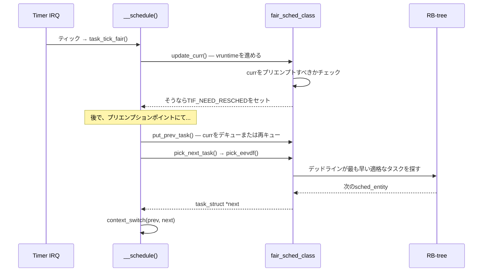

# CFS: Completely Fair Scheduler {#cfs-completely-fair-scheduler}

> 仮想実行時間、重み付き公平性、そして赤黒木

## CFSが保証するもの {#what-cfs-guarantees}

CFSは、すべてのタスクに、優先度で重み付けされた等しいCPU時間の取り分を与える。nice -5のプロセスは、nice +5のプロセスのおよそ3倍のCPUを得る。この比率はシステムが過負荷のときでも保たれる。

「完全に公平」という性質とは、同じ優先度のタスクをN個実行すると、いつ作成されたか、最後にいつ実行されたか、どれだけスリープしていたかにかかわらず、それぞれがちょうどCPUの1/Nを得るということである。

## 仮想実行時間 {#virtual-runtime}

中心となる概念は**vruntime**である。これは、タスクが消費したCPU時間を、その重みでスケールした尺度である。

```
vruntime += (real time elapsed) × (NICE_0_WEIGHT / task weight)
```

重みの大きいタスク（nice -20）はvruntimeがゆっくり進む。仮想時間の単位あたりに、より多くの実際のCPU時間を得る。重みの小さいタスク（nice +19）はvruntimeが速く進む。

スケジューラは常に**vruntimeが最小の**タスクを選ぶ。重みに基づくスケーリングと組み合わせることで、これは自動的に重み付き公平性を実現する。

### 例 {#an-example}

3つのタスク: A（nice -5、重み3121）、B（nice 0、重み1024）、C（nice +5、重み335）。

重みの合計 = 4480。理想的なCPUの取り分:

- A: 3121/4480 = 69.7%
- B: 1024/4480 = 22.9%
- C:  335/4480 =  7.5%

CFSは、vruntimeを異なる速さで進めることでこれを実現する:

- Aのvruntimeは実時間の`1024/3121`（約0.33倍）で増える
- Bのvruntimeは実時間の`1024/1024`（1.0倍）で増える
- Cのvruntimeは実時間の`1024/335`（約3.1倍）で増える

実時間で1秒経つと、3つのタスクはすべて似たようなvruntimeになるが、Aは約697ms、Bは約229ms、Cは約75ms実行している。

## 重みとnice値 {#weights-and-nice-values}

niceから重みへの対応は、カーネル内の固定テーブルである:

```c
// kernel/sched/core.c
const int sched_prio_to_weight[40] = {
 /* -20 */     88761,     71755,     56483,     46273,     36291,
 /* -15 */     29154,     23254,     18705,     14949,     11916,
 /* -10 */      9548,      7620,      6100,      4904,      3906,
 /*  -5 */      3121,      2501,      1991,      1586,      1277,
 /*   0 */      1024,       820,       655,       526,       423,
 /*   5 */       335,       272,       215,       172,       137,
 /*  10 */       110,        87,        70,        56,        45,
 /*  15 */        36,        29,        23,        18,        15,
};
```

各段階は約1.25倍である。nice -1のタスクは、nice 0より約25%多くのCPUを得る。nice -20とnice +19では比率は88761/15 ≈ 5917倍で、ほぼ6000:1の差になる。1.25倍という比率は、`nice +1`の変更でスループットに約10%の差が出るように選ばれた。[テーブルを定義したコミット](https://git.kernel.org/linus/20f9cd8e0e3b2c11b3fb576a88e8e5aef3c91a13)と`kernel/sched/core.c`のコメントを参照のこと。

## データ構造 {#data-structures}

### struct sched_entity {#struct-sched_entity}

CFSが管理するすべてのタスクは、`task_struct`に埋め込まれた`struct sched_entity`を通じて追跡される:

```c
// include/linux/sched.h
struct sched_entity {
    struct load_weight  load;             // 重み（nice値から）
    u64                 vruntime;         // 仮想実行時間
    u64                 exec_start;       // 最後に更新されたときの実時間
    u64                 sum_exec_runtime; // 消費した実際のCPU時間の合計
    u64                 deadline;         // EEVDFの仮想デッドライン
    u64                 slice;            // EEVDFのタイムスライス
    u64                 vlag;             // EEVDFのlag
    // ...
    struct rb_node      run_node;         // cfs_rqの赤黒木内の位置
    struct list_head    group_node;
    unsigned int        on_rq;            // 現在キューに入っているか？
    // ...
};
```

### struct cfs_rq {#struct-cfs_rq}

各CPUは1つのCFSランキューを持つ:

```c
// kernel/sched/sched.h
struct cfs_rq {
    struct rb_root_cached tasks_timeline; // 実行可能なタスクの赤黒木
    struct sched_entity  *curr;           // 現在実行中のエンティティ
    struct sched_entity  *next;           // buddyのヒント（起床時プリエンプション）
    unsigned int          nr_queued;      // 実行可能なタスクの数
    s64                   avg_vruntime;   // 重み付きvruntimeの合計（適格性の判定用）
    // ...
};
```

`tasks_timeline`は`rb_root_cached`である。これは最左（最小vruntime）のノードへのポインタもキャッシュする赤黒木であり、次に実行するタスクへ`O(1)`でアクセスできる。

## 中核となる関数 {#core-functions}

### update_curr() {#update_curr}

実行中のタスクについて、タイマーティックとコンテキストスイッチのたびに呼び出される:

```c
// kernel/sched/fair.c
static void update_curr(struct cfs_rq *cfs_rq)
{
    struct sched_entity *curr = cfs_rq->curr;
    u64 now = rq_clock_task(rq_of(cfs_rq));
    u64 delta_exec;

    if (unlikely(!curr))
        return;

    delta_exec = now - curr->exec_start;
    if (unlikely((s64)delta_exec <= 0))
        return;

    curr->exec_start = now;
    curr->sum_exec_runtime += delta_exec;
    curr->vruntime += calc_delta_fair(delta_exec, curr);

    // update_deadline()とavg_vruntimeの維持は省略
}
```

### enqueue_entity() / dequeue_entity() {#enqueue_entity-dequeue_entity}

タスクが起床またはブロックしたとき:

```c
// kernel/sched/fair.c（簡略化）
static void enqueue_entity(struct cfs_rq *cfs_rq,
                            struct sched_entity *se, int flags)
{
    // エンティティを赤黒木に配置する
    __enqueue_entity(cfs_rq, se);
    se->on_rq = 1;
    // 負荷追跡、avg_vruntimeなどを更新する
}

static bool dequeue_entity(struct cfs_rq *cfs_rq,
                             struct sched_entity *se, int flags)
{
    // 赤黒木から取り除く
    __dequeue_entity(cfs_rq, se);
    se->on_rq = 0;
    return true;
}
```

### pick_next_entity() {#pick_next_entity}

次に実行するタスクを選ぶ。6.6以降（[`147f3efaa241`](https://git.kernel.org/linus/147f3efaa24182a21706bca15eab2f3f4630b5fe)、[`5e963f2bd465`](https://git.kernel.org/linus/5e963f2bd4654a202a8a05aa3a86cb0300b10e6c)）、これはEEVDFに委譲されている:

```c
// kernel/sched/fair.c
static struct sched_entity *
pick_next_entity(struct rq *rq, struct cfs_rq *cfs_rq)
{
    return pick_eevdf(cfs_rq);
}
```

## スケジューリングのタイムライン {#the-scheduling-timeline}



## グループスケジューリング {#group-scheduling}

CFSはcgroupを通じた階層的なスケジューリングをサポートする。`CONFIG_FAIR_GROUP_SCHED`が有効な場合、赤黒木にはタスクだけでなく、cgroupを表す仮想的なエンティティである**グループスケジューリングエンティティ**も含まれる。

```
CPU
└── cfs_rq (top level)
    ├── task A (sched_entity)
    ├── group X (group sched_entity) → cfs_rq for group X
    │   ├── task B
    │   └── task C
    └── task D
```

各グループは1つのエンティティとしてCPU時間の取り分を得て、それをメンバー間で配分する。これにより、各コンテナのタスクが他のコンテナのタスクと直接競合することなく、コンテナごとにCPUの取り分を設定できる。

## CFSの状態を見る {#viewing-cfs-state}

```bash
# タスクごとのスケジューラ情報
cat /proc/$PID/sched
# 表示内容: vruntime、exec_start、sum_exec_runtime、prioなど

# CPUごとのシステム全体のCFS統計
cat /proc/schedstat

# perfによる詳細なタスクのスケジューラ情報
perf sched record ./workload
perf sched latency
```

## よくある誤解 {#common-misconceptions}

**「CFSはすべてのタスクに等しいCPUを与える」** — 違う。等しいCPUが与えられるのは、*優先度*が等しいタスク同士である。比率はnice値によって決まる。

**「長時間スリープしていたタスクは、起床したときにCPUのバーストを得る」** — 部分的には正しい。起床時にタスクのvruntimeは`avg_vruntime - half_slice`に配置されるので、すぐに実行されるが、CPUを独占することはない。

**「現代のカーネルでもスケジューラはCFSである」** — `fair_sched_class`はそのとおりである。しかし、`pick_next_entity()`は現在、古い最左ノードのロジックではなく`pick_eevdf()`を呼び出す。カーネル6.6で、EEVDFがCFS内部の選択の仕組みを置き換えた。

## 参考文献 {#further-reading}

- [EEVDFスケジューラ](eevdf.md) — CFSの最左ノード方式を置き換えた選択アルゴリズム
- [スケジューラクラス](scheduler-classes.md) — クラス階層におけるCFSの位置
- [ランキュー](runqueues.md) — `struct cfs_rq`を含むCPUごとの`struct rq`
- [kernel/sched/fair.c](https://git.kernel.org/pub/scm/linux/kernel/git/torvalds/linux.git/tree/kernel/sched/fair.c) — ソース（14,000行以上）
