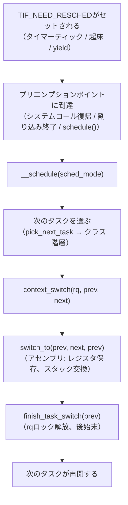
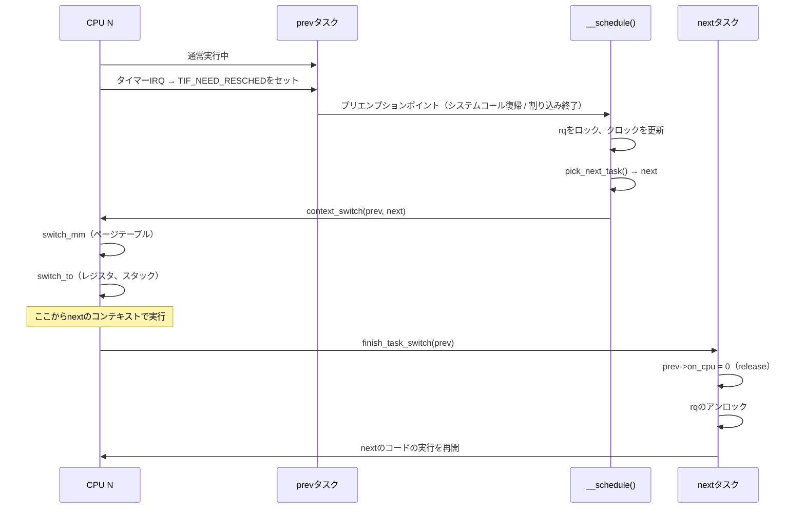

# コンテキストスイッチの一生 {#life-of-a-context-switch}

> プリエンプションから再開まで、`__schedule()`の内部で何が起きるか

## 全体像 {#the-big-picture}

コンテキストスイッチは、CPUがあるタスクの実行から別のタスクの実行へと移ることである。1秒間に何千回も発生するため可能な限り高速でなければならないが、それでいてロック、メモリバリアによる順序付け、アーキテクチャ固有のレジスタ保存、そして実行を安全に引き渡すための入念なポインタ操作を伴う。



## タスクが再スケジュール対象としてマークされる仕組み {#how-a-task-gets-marked-for-rescheduling}

コンテキストスイッチが起きる前に、何かが「現在のタスクはCPUを手放すべきだ」と判断しなければならない。その判断によって、現在のタスクに`TIF_NEED_RESCHED`がセットされる:

```c
// kernel/sched/core.c
static void resched_curr(struct rq *rq)
{
    struct task_struct *curr = rq->curr;

    if (test_tsk_need_resched(curr))
        return;

    // ...
    set_tsk_need_resched(curr);
    set_preempt_need_resched();
}
```

主なきっかけ:

- **タイマーティック**（`task_tick_fair()`）: 現在のタスクが長く実行しすぎた
- **起床**（`wakeup_preempt()`）: より優先度の高いタスクが実行可能になった
- **明示的なyield**（`sched_yield()`）: タスクが自発的にCPUを手放す
- **優先度の変更**: タスクの優先度が、実行可能な別タスクより低く下げられた

## 自発的スイッチと非自発的スイッチ {#voluntary-vs-involuntary-switches}

カーネルはタスクごとに2種類のコンテキストスイッチを追跡する:

```c
// include/linux/sched.h
unsigned long nvcsw;   /* 自発的なコンテキストスイッチ */
unsigned long nivcsw;  /* 非自発的なコンテキストスイッチ */
```

**自発的**（`nvcsw`）: タスクがやることがなくなったため — I/Oでブロック、スリープ、ロック待ち — 直接`schedule()`を呼んだ。

**非自発的**（`nivcsw`）: スケジューラがタスクをプリエンプトした — タイムスライスを使い切ったか、より優先度の高いタスクが起床した。

```bash
# プロセスの自発的/非自発的スイッチを確認する
cat /proc/$PID/status | grep ctxt
# voluntary_ctxt_switches:    1234
# nonvoluntary_ctxt_switches: 567
```

自発的スイッチに比べて非自発的スイッチの回数が多いということは、そのタスクが頻繁にプリエンプトされていることを意味する — 常にやるべき仕事を抱えているのに、他のタスクにCPUを奪われ続けているのである。

## スケジュールモード {#schedule-modes}

`__schedule()`は、何がきっかけで呼ばれたかを示すモード付きで呼び出される:

```c
// kernel/sched/core.c
#define SM_NONE           0   // 自発的（タスクがschedule()を呼んだ）
#define SM_PREEMPT        1   // 非自発的（タイマー/割り込みが強制した）
#define SM_RTLOCK_WAIT    2   // RTロックの競合（PREEMPT_RTのみ）
/* 注: SM_IDLE定数は存在しない。アイドルループは__schedule(SM_NONE)を呼ぶ */
```

これは2つのことに影響する: どちらのカウンタ（`nvcsw`か`nivcsw`）が増えるか、そしてデキューの前にタスクの状態を参照するかどうかである。

## __schedule()の内部 {#inside-__schedule}

```c
// kernel/sched/core.c（簡略化）
static void __sched notrace __schedule(int sched_mode)
{
    struct task_struct *prev, *next;
    struct rq *rq;
    int cpu;

    cpu = smp_processor_id();
    rq = cpu_rq(cpu);
    prev = rq->curr;

    // 1. IRQを無効化し、ランキューをロックする
    local_irq_disable();
    rcu_note_context_switch(sched_mode == SM_PREEMPT);
    rq_lock(rq, &rf);

    // 2. ランキューのクロックを更新する
    update_rq_clock(rq);

    // 3. 自発的スイッチで、タスクが状態を持つ（ブロックしようとしている）場合:
    //    ランキューからデキューする
    if (!(sched_mode & SM_MASK_PREEMPT) && prev->__state) {
        // タスクはスリープしようとしている — ランキューから取り除く
        try_to_block_task(rq, prev, &rf);
        switch_count = &prev->nvcsw;  // 自発的
    } else {
        switch_count = &prev->nivcsw; // 非自発的
    }

    // 4. 再スケジュールフラグをクリアする
    clear_tsk_need_resched(prev);
    clear_preempt_need_resched();

    // 5. 次に実行するタスクを選ぶ
    next = pick_next_task(rq, prev, &rf);

    // 6. 同じタスクなら何もしない
    if (likely(prev != next)) {
        rq->nr_switches++;
        rq->curr = next;
        ++*switch_count;

        // 7. スイッチ！
        context_switch(rq, prev, next, &rf);
        // --- 実行は'next'のコンテキストに移った ---
        // ここに戻ってきたとき、我々は次にこのCPUで
        // 再開したタスクとして実行されている。
    } else {
        rq_unpin_lock(rq, &rf);
        __balance_callbacks(rq);
        raw_spin_rq_unlock_irq(rq);
    }
}
```

## context_switch() {#context_switch}

`next`が選ばれると、`context_switch()`が実際のスイッチを行う:

```c
// kernel/sched/core.c
static __always_inline struct rq *context_switch(struct rq *rq, struct task_struct *prev,
                      struct task_struct *next, struct rq_flags *rf)
{
    // 1. スイッチ前の記録処理（トレーシング、perf、cgroupへの通知）
    prepare_task_switch(rq, prev, next);

    // 2. メモリマッピングを切り替える
    if (!next->mm) {
        // カーネルスレッド: prevのページテーブルを借りる（lazy TLB）
        next->active_mm = prev->active_mm;
        enter_lazy_tlb(prev->active_mm, next);
    } else {
        // ユーザータスク: nextのページテーブルを設定する
        switch_mm_irqs_off(prev->active_mm, next->mm, next);
    }

    // 3. CPUレジスタとスタックを切り替える
    switch_to(prev, next, prev);
    // ↑ この行の後、我々はnextのコンテキストで実行されている。
    //   'prev'は今や、*next*が最後にCPUを明け渡す前に
    //   実行されていたタスク（上のprevとは限らない）を指す。

    barrier();

    // 4. スイッチ後の後始末 — nextのコンテキストで実行される
    return finish_task_switch(prev);
}
```

### メモリの切り替え {#the-memory-switch}

ユーザー空間のタスクの場合、`switch_mm_irqs_off()`が新しいタスクのページテーブルを設定する。PCIDを持つx86-64では、これはPCIDビットをセットしたCR3への書き込みである — PCIDがまだキャッシュされていれば、TLBは完全にはフラッシュされない。

カーネルスレッド（`mm`を持たない）の場合は、lazy TLBにより直前のタスクの`active_mm`を借りる: ページテーブルは切り替えられないが、カーネルスレッドには「ユーザー空間のTLBエントリが有効であることを期待するな」と伝えられる。

### switch_to(): アセンブリの心臓部 {#switch_to-the-assembly-heart}

`switch_to()`はアーキテクチャ固有である。x86-64では:

```c
// arch/x86/include/asm/switch_to.h
#define switch_to(prev, next, last)             \
do {                                            \
    ((last) = __switch_to_asm((prev), (next))); \
} while (0)
```

`__switch_to_asm`（`arch/x86/entry/entry_64.S`内）は、callee-savedレジスタを保存し、スタックポインタを交換する:

```asm
// 簡略化したx86-64の__switch_to_asm
__switch_to_asm:
    // prevのcallee-savedレジスタを保存する
    pushq %rbp
    pushq %rbx
    pushq %r12
    pushq %r13
    pushq %r14
    pushq %r15

    // prevのスタックポインタをtask_struct->thread.spに保存する
    movq %rsp, TASK_threadsp(%rdi)     // rdi = prev

    // nextのスタックポインタをロードする
    movq TASK_threadsp(%rsi), %rsp     // rsi = next

    // nextのcallee-savedレジスタを復元する
    popq %r15
    popq %r14
    popq %r13
    popq %r12
    popq %rbx
    popq %rbp

    // FPU/デバッグレジスタの処理のため__switch_to（C関数）へジャンプする
    jmp __switch_to
```

`switch_to()`から戻ると、CPUは`next`のスタック上で`next`の保存済みレジスタを使って実行している。`switch_to()`以降のコードから見れば、「現在のタスク」は今や`next`である。

### prevポインタの謎 {#the-prev-pointer-puzzle}

```c
switch_to(prev, next, prev);
// この行の後、'prev'はあなたが期待するものではない。
```

`switch_to`の第3引数は、`next`がスケジュールされる前にこのCPUで実行されていた**最後のタスク**を受け取る。これが必要なのは次の理由による:

- `next`がいずれCPUを明け渡して`__schedule()`が再び実行されるとき、`next`が`prev`になる
- しかし、`next`が以前は別のCPU上にいたとしたら？ そこで実行されたとき、スケジュールアウトされたのは別のタスクである
- `last`変数によって、`switch_to()`以降のコードは`finish_task_switch()`に渡すべき正しい`prev`を得られる

## finish_task_switch() {#finish_task_switch}

`finish_task_switch()`は*新しい*タスクのコンテキストで実行され、直前にスイッチアウトされたタスクの後始末を行う:

```c
// kernel/sched/core.c
static struct rq *finish_task_switch(struct task_struct *prev)
{
    struct rq *rq = this_rq();
    struct mm_struct *mm = rq->prev_mm;

    rq->prev_mm = NULL;

    // prevがもうどのCPUでも実行されていないことを知らせる
    finish_task(prev);   // smp_store_release(&prev->on_cpu, 0)

    // ランキューのロックを解放する（pick_next_taskの前から保持していた）
    finish_lock_switch(rq);

    // 必要ならprevのmmを手放す（lazy TLBの後始末）
    if (mm)
        mmdrop_lazy_tlb_sched(mm);

    // prevが終了していれば、そのリソースを解放する
    if (unlikely(prev->__state == TASK_DEAD)) {
        // put_task_struct、cgroupの後始末など
        put_task_struct_rcu_user(prev);
    }

    return rq;
}
```

重要な順序: `prev->on_cpu = 0`は、ロックを手放す前にreleaseセマンティクスでセットされる。`prev`を起床させようとするCPUは`on_cpu`でスピンする — これにより、起床処理が`prev`を再エンキューする前に、`prev`が完全にCPUから降りていることが保証される。

## 全体のタイムライン {#the-full-timeline}



## コンテキストスイッチのコストの測定 {#measuring-context-switch-cost}

```bash
# システム全体のコンテキストスイッチ数を数える
vmstat 1 | awk '{print "cs:", $12}'

# プロセスごとのコンテキストスイッチ
cat /proc/$PID/status | grep ctxt_switches

# perfでコンテキストスイッチのレイテンシを測定する
perf stat -e context-switches,cs ./workload

# 詳細なスケジューリングイベント
perf sched record ./workload
perf sched latency --sort=avg

# スケジューラのスイッチをリアルタイムでトレースする
trace-cmd record -e sched:sched_switch sleep 5
trace-cmd report | head -50
```

## 参考文献 {#further-reading}

- [ランキュー](runqueues.md) — `struct rq`、`pick_next_task()`、`__schedule()`の構造
- [スケジューラクラス](scheduler-classes.md) — どのクラスが`next`タスクを提供するか
- [プロセスが起床するときに何が起きるか](wakeup.md) — タスクがランキューに戻る仕組み
