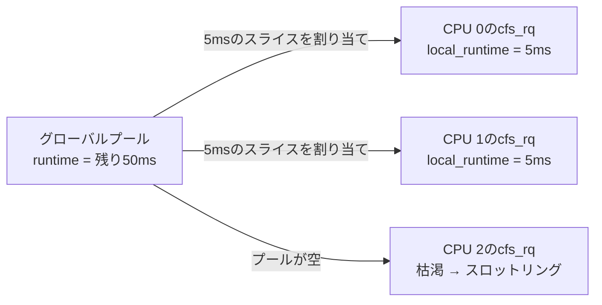

# CPU帯域制御 {#cpu-bandwidth-control}

> CFS帯域スロットリング: カーネルがCPUの厳格な上限をどう強制するか

## 帯域制御が行うこと {#what-bandwidth-control-does}

CPUの重み（shares）は、システムがビジーのときにグループが得るCPUの*割合*を制御する。帯域制御は*絶対的な*量に上限を設ける。50%に設定されたグループは、たとえCPUの残り99%がアイドルであっても、50%にスロットリングされる。

これが重要になるのは次のような場面である:

- **予測可能なレイテンシ**: グループがCPUを独占することが決してないようにする
- **マルチテナントの隔離**: あるテナントが他のテナントを飢餓状態に陥らせるのを防ぐ
- **リソースの会計**: コンテナがどれだけのCPUを使っているかを正確に把握する

## 設定方法 {#how-its-configured}

```bash
# v2のインターフェース（統合）
# 形式: "quota_us period_us"、無制限なら "max period_us"
cat /sys/fs/cgroup/mygroup/cpu.max
# 200000 100000  → 100msごとに200ms = 2 CPU分

echo "50000 100000" > /sys/fs/cgroup/mygroup/cpu.max  # 1 CPUの50%

# v1のインターフェース（別々のファイル）
echo 50000  > /sys/fs/cgroup/cpu/mygroup/cpu.cfs_quota_us
echo 100000 > /sys/fs/cgroup/cpu/mygroup/cpu.cfs_period_us
```

**帯域**は`quota / period`である。クォータが200msで周期が100msなら、グループは2つのCPUを同時に使える（使用率200%）。クォータは実時間ベースの予算であり、CPUごとのものではない。

## 帯域プール: struct cfs_bandwidth {#the-bandwidth-pool-struct-cfs_bandwidth}

各cgroupは1つのグローバルな`cfs_bandwidth`プールを持つ:

```c
// kernel/sched/sched.h
struct cfs_bandwidth {
    raw_spinlock_t   lock;
    ktime_t          period;          // 例: 100ms
    u64              quota;           // 例: 50ms（ns単位）
    u64              runtime;         // この周期の残り
    u64              burst;           // クォータを超えて許されるバースト量

    struct hrtimer   period_timer;    // 周期の終わりにruntimeを補充する
    struct hrtimer   slack_timer;     // 遅延されたスロットリング解除のバッチ処理
    struct list_head throttled_cfs_rq; // スロットリングされているCPUごとのrq

    int nr_periods;
    int nr_throttled;
    u64 throttled_time;
};
```

各周期の開始時に、`runtime`は`quota`にリセットされる。タスクが実行されるにつれて`runtime`は減っていく。`runtime`がゼロになると、このグループのタスクを実行しているすべてのCPUがスロットリングされる。

## 配分: プール → CPUごとのスライス {#distribution-pool-per-cpu-slice}

タスクはグローバルプールを直接減らすわけではない。その代わり、各CPUが必要に応じてプールから**スライス**を取得する:

```c
// kernel/sched/fair.c
static u64 sched_cfs_bandwidth_slice(void)
{
    return (u64)sysctl_sched_cfs_bandwidth_slice * NSEC_PER_USEC;
    // デフォルト: 5ms（sysctl: /proc/sys/kernel/sched_cfs_bandwidth_slice_us）
}
```



CPUのローカルの実行時間がなくなると、そのCPUは`assign_cfs_rq_runtime()`を呼び出して別のスライスを取得する。プールが空なら、そのCPUはスロットリングされる。

### assign_cfs_rq_runtime() {#assign_cfs_rq_runtime}

```c
// kernel/sched/fair.c
static void assign_cfs_rq_runtime(struct cfs_rq *cfs_rq)
{
    struct cfs_bandwidth *cfs_b = tg_cfs_bandwidth(cfs_rq->tg);

    raw_spin_lock(&cfs_b->lock);
    __assign_cfs_rq_runtime(cfs_b, cfs_rq, sched_cfs_bandwidth_slice());
    raw_spin_unlock(&cfs_b->lock);
}
```

## スロットリング: throttle_cfs_rq() {#throttling-throttle_cfs_rq}

CPUのローカルの実行時間がゼロまで減り、グローバルプールも空の場合:

```c
// kernel/sched/fair.c
static bool throttle_cfs_rq(struct cfs_rq *cfs_rq)
{
    // グループのスロットリング済みリストに追加する
    list_add_tail(&cfs_rq->throttled_list,
                  &cfs_b->throttled_cfs_rq);
    cfs_rq->throttled = 1;

    // for_each_sched_entityでグループスケジューリングの階層をたどって上がり、
    // 親のランキューからグループのsched_entityをデキューする。
    // これにより、このグループのタスクはもう選択されなくなる

    return true;
}
```

スロットリングの後、グループの`sched_entity`は親のランキューから取り除かれる。スロットリングが解除されるまで、`pick_next_task()`がこのグループのタスクを選ぶことは決してない。

## 補充: 周期タイマー {#refill-the-period-timer}

各周期の終わりに、`period_timer`が発火してプールを補充する:

```c
// kernel/sched/fair.c
static void __refill_cfs_bandwidth_runtime(struct cfs_bandwidth *cfs_b)
{
    cfs_b->runtime = cfs_b->quota;  /* 周期ごとにクォータにリセットする */

    // quota + burstを上限とする（バーストのクレジットの蓄積を許す）
    cfs_b->runtime = min(cfs_b->runtime, cfs_b->quota + cfs_b->burst);
}
```

補充の後、スロットリングされている各CPUに対して`unthrottle_cfs_rq()`が呼び出される:

```c
// kernel/sched/fair.c
static void unthrottle_cfs_rq(struct cfs_rq *cfs_rq)
{
    cfs_rq->throttled = 0;

    // for_each_sched_entityループで、グループのsched_entityを
    // 親のランキューに再エンキューする

    // タスクは再び実行できる
}
```

## バースト: 一時的なスパイクを吸収する {#burst-absorbing-transient-spikes}

`cpu.max.burst`（v2）/`cpu.cfs_burst_us`（v1）は、蓄えたクレジットを消費することで、グループが一時的にクォータを超えることを許す:

```bash
# 50msのクォータを超えて20msのバーストを許す（1周期で最大70ms）
echo "50000 100000" > /sys/fs/cgroup/mygroup/cpu.max        # quota period
echo "20000"        > /sys/fs/cgroup/mygroup/cpu.max.burst  # バースト（別ファイル）
```

これにより、バースト的な挙動（起動時やGCの停止時）を持つワークロードが、平均的なレート制限を維持しつつスロットリングを避けられる。

## スラックタイマー: スロットリング解除のバッチ処理 {#slack-timer-batching-unthrottles}

実行時間が利用可能になった途端に各CPUのスロットリングを個別に解除すると、小さなロック取得が多数発生してしまう。**スラックタイマー**はスロットリング解除をバッチ処理する:

```c
// 実行時間がプールに返却されたとき（例: タスクがスライスを使い切る前にブロックした）、
// すぐにスロットリングを解除する代わりに、スラックタイマーを5msで設定し、
// 複数のスロットリング解除をまとめて行う。
```

これにより、最大5msの余分なスロットリング時間と引き換えに、`cfs_b->lock`のロック競合が減る。

## スロットリングの診断 {#diagnosing-throttling}

### cpu.statを読む {#reading-cpustat}

```bash
cat /sys/fs/cgroup/mygroup/cpu.stat
nr_periods      100    # 経過した帯域周期
nr_throttled     23    # グループがスロットリングされた周期
throttled_usec  450000 # スロットリングされた合計時間（450ms）
nr_bursts         5    # バーストが使われた周期
burst_usec      15000  # バーストの合計時間（15ms）
```

`nr_throttled / nr_periods`の比率が高い（例えば10%超）場合、そのワークロードにとってクォータが低すぎることを示している。

### 帯域イベントのトレース {#tracing-bandwidth-events}

```bash
# スロットリング/スロットリング解除のイベントをトレースする
trace-cmd record -e sched:sched_stat_throttled \
                 -e cgroup:cgroup_throttle_cfs_rq \
                 sleep 10
trace-cmd report
```

### 予期しないスロットリングのよくある原因 {#common-causes-of-unexpected-throttling}

**マルチスレッドのワークロード**: グループに4つのスレッドがあり、すべて同時に実行されていると、それらは合計でスレッドあたりのレートの4倍を消費する。100ms/100ms = 100%のクォータは1 CPU分にすぎない。4つのスレッドは25msでそれを使い切り、75msの間スロットリングされる。

**解決策**: クォータ = `target_utilization × period × number_of_CPUs_you_want_to_use`と設定する。

```bash
# 2 CPUを許可する: クォータ200ms / 周期100ms = 2.0 CPU
echo "200000 100000" > /sys/fs/cgroup/mygroup/cpu.max
```

**短時間のバースト**: 50ms間重い処理をしてからスリープするタスクは、重いフェーズの間にスロットリングにぶつかる。バーストの予算でこれを吸収できる。

## 帯域スライスのチューニング {#bandwidth-slice-tuning}

デフォルトの5msのスライスは、次の間のトレードオフである:

- **小さすぎる**（1ms未満）: `cfs_b->lock`でのロック競合が多くなる
- **大きすぎる**（10ms超）: CPUが決して使わないかもしれない10msの予算を得てしまう。スロットリングの応答も遅い

```bash
# デフォルト: 5000 µs
cat /proc/sys/kernel/sched_cfs_bandwidth_slice_us

# レイテンシに敏感なワークロードでは、1msに減らす:
echo 1000 > /proc/sys/kernel/sched_cfs_bandwidth_slice_us
```

## 参考文献 {#further-reading}

- [CPU cgroup v1とv2](cpu-cgroup.md) — 帯域と重みのためのcgroupインターフェース
- [cpuset](cpuset.md) — 帯域が計上されるCPUを制限する
- [CFS](cfs.md) — 帯域制御が包み込んでいるfairスケジューラ
