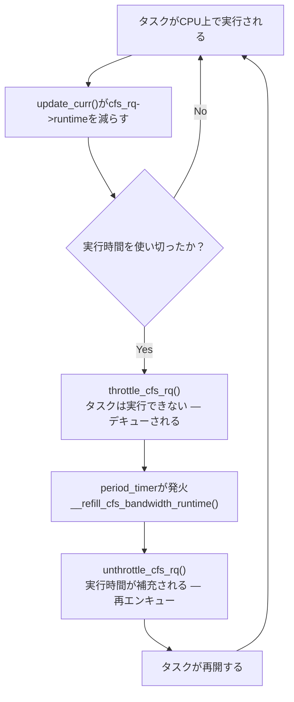

# CPU cgroup: v1とv2 {#cpu-cgroup-v1-vs-v2}

> cgroupによるCPU割り当ての制御 — shares、weight、帯域

## CPU cgroupが制御するもの {#what-cpu-cgroups-control}

CPU cgroupは2つの独立した制御を提供する:

1. **重み**（比例配分）: 「両方がビジーのとき、このグループはあのグループの2倍のCPUを得る」
2. **帯域**（厳格な上限）: 「このグループは周期ごとに最大で1 CPUの50%までしか使えない」

これらは直交している。重みの高いグループでも、帯域の上限に達すればスロットリングされる。

## インターフェースの違い {#the-interface-difference}

cgroup v1とv2は、同じ基盤の仕組みを異なるインターフェースで公開している:

| 制御 | v1のファイル | v2のファイル | デフォルト |
|---------|---------|---------|---------|
| 重み | `cpu.shares` | `cpu.weight` | 1024 / 100 |
| 帯域のクォータ | `cpu.cfs_quota_us` | `cpu.max`（1番目のフィールド） | -1（無制限） |
| 帯域の周期 | `cpu.cfs_period_us` | `cpu.max`（2番目のフィールド） | 100000 µs |
| 統計 | `cpuacct.stat` + `cpu.stat` | `cpu.stat` | — |

### 重み: sharesとweight {#weight-shares-vs-weight}

v1の`cpu.shares`とv2の`cpu.weight`はスケールが異なるが、同じカーネルの概念に対応する:

```
v2 weight = (v1 shares × 100) / 1024
v1 shares = (v2 weight × 1024) / 100
```

- v1のデフォルト: **1024 shares**
- v2のデフォルト: **100 weight**（範囲: 1〜10000）

内部的にはどちらも`task_group->shares`を設定する。カーネルは常にv1のshares単位で動作している。

```bash
# v1: 両方がビジーのとき、グループAにグループBの2倍のCPUを与える
echo 2048 > /sys/fs/cgroup/cpu/groupA/cpu.shares
echo 1024 > /sys/fs/cgroup/cpu/groupB/cpu.shares

# v2: 同じことをweightで行う
echo 200 > /sys/fs/cgroup/groupA/cpu.weight
echo 100 > /sys/fs/cgroup/groupB/cpu.weight
```

### 帯域: quota/periodとcpu.max {#bandwidth-quotaperiod-vs-cpumax}

v1はクォータと周期を別々のファイルとして公開し、v2はそれらを1つにまとめている:

```bash
# v1: 1 CPUの50%に制限する（100msごとに50ms）
echo 50000  > /sys/fs/cgroup/cpu/mygroup/cpu.cfs_quota_us
echo 100000 > /sys/fs/cgroup/cpu/mygroup/cpu.cfs_period_us

# v2: 同じ
echo "50000 100000" > /sys/fs/cgroup/mygroup/cpu.max
# 形式: "quota period"
# "max 100000" は無制限を意味する（デフォルト）
```

## カーネルの構造体 {#the-kernel-structures}

### struct task_group {#struct-task_group}

すべてのcgroupは、カーネル内の`task_group`に対応する:

```c
// kernel/sched/sched.h
struct task_group {
    struct cgroup_subsys_state css;

    // CPUごとに1つのsched_entityとcfs_rq
    struct sched_entity     **se;      // array[NR_CPUS]
    struct cfs_rq           **cfs_rq;  // array[NR_CPUS]
    unsigned long             shares;  // 重み（cpu.sharesの値）

    // RTグループスケジューリング（CONFIG_RT_GROUP_SCHED）
    struct sched_rt_entity  **rt_se;
    struct rt_rq            **rt_rq;

    struct task_group       *parent;

    // CFS帯域（CONFIG_CFS_BANDWIDTH）
    struct cfs_bandwidth      cfs_bandwidth;
};
```

各CPUは、そのCPUのCFSランキュー内でグループを表す独自の`sched_entity`を持つ。これにより、グループはそのCPU上の他のグループやタスクに対して1つの単位としてスケジュールされ、その後、内部でメンバー間に時間を配分できる。

### struct cfs_bandwidth {#struct-cfs_bandwidth}

```c
// kernel/sched/sched.h
struct cfs_bandwidth {
    raw_spinlock_t  lock;
    ktime_t         period;         // 帯域の周期
    u64             quota;          // 周期あたりのクォータ（ns）
    u64             runtime;        // この周期の残り実行時間
    u64             burst;          // クォータを超えて許されるバースト
    s64             hierarchical_quota;

    struct hrtimer  period_timer;   // 周期の終わりに発火して補充する
    struct hrtimer  slack_timer;    // 遅延されたスロットリング解除
    struct list_head throttled_cfs_rq; // スロットリングされたCPUごとのランキュー

    // 統計
    int             nr_periods;
    int             nr_throttled;
    u64             throttled_time;
};
```

## 帯域スロットリングの仕組み {#how-bandwidth-throttling-works}



### CPUへの配分 {#distribution-to-cpus}

グローバルな`cfs_b->runtime`の予算は、スライス単位で個々のCPUに配分される:

```c
// kernel/sched/fair.c
static void assign_cfs_rq_runtime(struct cfs_rq *cfs_rq)
{
    // グローバルプールからスライスを要求する
    __assign_cfs_rq_runtime(cfs_b, cfs_rq,
                             sched_cfs_bandwidth_slice());
    // デフォルトのスライス: 5ms（sysctl_sched_cfs_bandwidth_slice）
}
```

CPUはグローバルプールから5msのスライスを取得する。スライスを使い切ると、別のスライスを要求する。グローバルプールが枯渇している（この周期のクォータを使い切った）場合、そのCPUはスロットリングされる。

### スロットリングの統計を見る {#viewing-throttling-stats}

```bash
# グループごとの帯域の統計
cat /sys/fs/cgroup/mygroup/cpu.stat
# nr_periods         - 経過した帯域周期の数
# nr_throttled       - スロットリングされた周期の数
# throttled_usec     - スロットリングされた合計時間（マイクロ秒）
# nr_bursts          - バーストを使った周期の数
# burst_usec         - バーストの合計時間

# スロットリングをリアルタイムに検出する
watch -n 1 'cat /sys/fs/cgroup/mycontainer/cpu.stat | grep throttled'
```

## グループスケジューリングの階層 {#group-scheduling-hierarchy}

`CONFIG_FAIR_GROUP_SCHED`を有効にすると、CFSは2段階の階層を構築する:

```
Top-level CFS runqueue
├── group A's sched_entity  (weight=2000)
│   └── A's cfs_rq
│       ├── task1 (weight=1024)
│       └── task2 (weight=512)
└── group B's sched_entity  (weight=1000)
    └── B's cfs_rq
        └── task3 (weight=1024)
```

グループAはCPUの2000/(2000+1000) = 67%を得る。A内では、task1がAの取り分の2/3を、task2が1/3を得る。

この入れ子構造により、コンテナは隔離されたCPU割り当てを持ちつつ、コンテナ内のタスクは互いに公平に競合できる。

## v1とv2: 挙動上の主な違い {#v1-vs-v2-key-behavioral-differences}

**階層的な帯域（v2のみ）**: v2では、子cgroupの実効クォータは、自身のクォータと祖先のクォータの最小値である。v1では、cgroupの帯域はcgroupごとであり、継承されない。

**統合コントローラ（v2）**: v2は単一の統合階層を使う。cpuとcpuacctを別々にマウントすることはできない。両者は常に一緒に有効になる。

**重みの範囲**: v1のshares: 2〜262144。v2のweight: 1〜10000。実効的な範囲は比率としては同じである。

## 実践例 {#practical-examples}

### コンテナのCPU制限（v2） {#container-cpu-limits-v2}

```bash
# コンテナ用のcgroupを作成する
mkdir /sys/fs/cgroup/containers/mycontainer

# 2 CPU分のクォータを与える（100msごとに200ms）
echo "200000 100000" > /sys/fs/cgroup/containers/mycontainer/cpu.max

# 重み200（デフォルトの2倍）を与える
echo 200 > /sys/fs/cgroup/containers/mycontainer/cpu.weight

# プロセスを追加する
echo $PID > /sys/fs/cgroup/containers/mycontainer/cgroup.procs
```

### CPUスロットリングの検出 {#detecting-cpu-throttling}

```bash
# 自分のコンテナがスロットリングされているか確認する
cat /sys/fs/cgroup/$(cat /proc/self/cgroup | grep cpu | cut -d: -f3)/cpu.stat | \
    awk '/throttled/ {print $0}'

# cgroup v1の場合
cat /sys/fs/cgroup/cpu/$(cat /proc/self/cgroup | grep ^7 | cut -d: -f3)/cpu.stat
```

## 参考文献 {#further-reading}

- [CPU帯域制御](cpu-bandwidth.md) — CFS帯域の仕組みの詳細
- [cpuset](cpuset.md) — cgroupが使えるCPUとNUMAノードの制限
- [スケジューラクラス](scheduler-classes.md) — グループスケジューリングがクラス階層にどう収まるか
