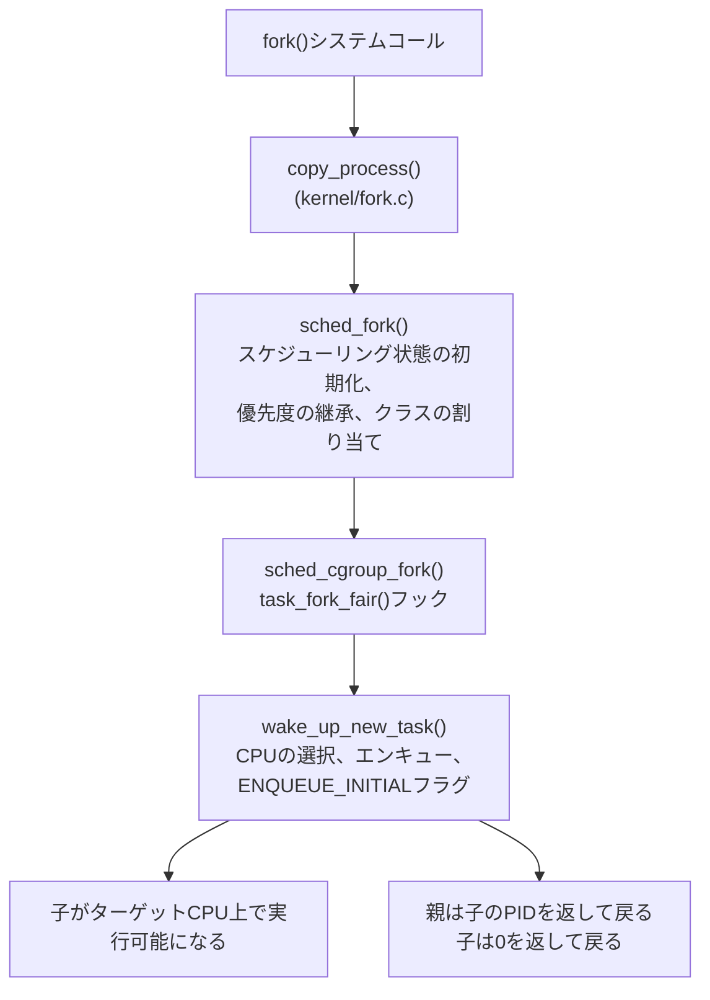

# fork()すると何が起きるか — スケジューラから見た視点 {#what-happens-when-you-fork-the-schedulers-view}

> 新しいタスクがどのようにスケジューラに入り、親の優先度を継承し、最初のタイムスライスを得るか

## 概要 {#overview}

プロセスが`fork()`を呼び出すと、カーネルはメモリをコピーするだけでは済まない。新しい`task_struct`を作成し、そのスケジューリング状態を初期化し、開始するCPUを選び、ランキューに追加しなければならない。スケジューラは各段階に慎重に関与し、子がすぐにCPUを独占したり、不公平な優位を継承したりしないようにする。



## sched_fork(): 子の初期化 {#sched_fork-initializing-the-child}

`sched_fork()`は、子がシステムの他の部分から見えるようになる前に、`copy_process()`の内部で呼び出される:

```c
// kernel/sched/core.c
int sched_fork(u64 clone_flags, struct task_struct *p)
{
    // 1. スケジューリングエンティティをゼロ初期化する
    __sched_fork(clone_flags, p);
    // 設定内容: p->se.vruntime = 0, p->se.vlag = 0, p->on_rq = 0 など

    // 2. 新規としてマークする — 早すぎる起床を防ぐ
    p->__state = TASK_NEW;

    // 3. 親の優先度を継承する
    p->prio = current->normal_prio;

    // 4. sched_reset_on_forkを処理する: 設定されていればSCHED_NORMAL/nice 0にリセットする
    if (unlikely(p->sched_reset_on_fork)) {
        if (task_has_rt_policy(p)) {
            p->policy = SCHED_NORMAL;
            p->static_prio = NICE_TO_PRIO(0);
        } else if (PRIO_TO_NICE(p->static_prio) < 0) {
            p->static_prio = NICE_TO_PRIO(0);
        }
        p->normal_prio = p->static_prio;
    }

    // 5. 優先度に基づいてスケジューリングクラスを割り当てる
    if (rt_prio(p->prio))
        p->sched_class = &rt_sched_class;
    else
        p->sched_class = &fair_sched_class;

    // 6. 負荷追跡を初期化する
    init_entity_runnable_average(&p->se);

    return 0;
}
```

### 優先度の継承 {#priority-inheritance}

子は`current->normal_prio`を継承する。これは親の*通常の*優先度であり、nice値は反映するが、優先度継承（PI）プロトコルによる一時的なブーストは反映しない。これにより、forkを通じた優先度の昇格が防がれる。

```c
// 子の優先度の連鎖:
p->prio = current->normal_prio;   // 動的な優先度（PIでなければ = normal_prio）
p->normal_prio = p->prio;         // 通常の（ブーストされていない）優先度
p->static_prio = current->static_prio;  // niceから導かれる基本優先度
```

親がnice -10なら、子もnice -10で始まる。これは意図的なものである。コンパイルワーカーをforkする高優先度のビルドシステムは、それらのワーカーも高優先度で実行すべきだからである。

### sched_reset_on_fork {#sched_reset_on_fork}

一部のコンテナランタイムは、forkを通じた権限昇格を防ぐために`sched_reset_on_fork`を使う:

```c
// 親が優先度50のSCHED_FIFO/RRなら、
// 子はSCHED_NORMAL/nice 0にリセットされる
// （CAP_SYS_NICEなしでRTタスクがRTの子を生み出すのを防ぐ）
```

## fairクラスのtask_forkフック {#the-fair-class-task_fork-hook}

`sched_fork()`の後、`sched_cgroup_fork()`は`p->sched_class->task_fork(p)`を呼び出す。`fair_sched_class`の場合、これは`task_fork_fair()`である:

```c
// kernel/sched/fair.c
static void task_fork_fair(struct task_struct *p)
{
    set_task_max_allowed_capacity(p);
}
```

これは、タスクが使うことを許される最大のCPU能力を設定する（big.LITTLEのような非対称なCPUトポロジでのEnergy-Aware Schedulingのため）。実際のvruntimeの初期化は、後で`wake_up_new_task()`の中で行われる。

## wake_up_new_task(): 子をCPUに載せる {#wake_up_new_task-putting-the-child-on-a-cpu}

`copy_process()`が完了し、子が完全に初期化された後、`wake_up_new_task()`が子を実行可能にする:

```c
// kernel/sched/core.c
void wake_up_new_task(struct task_struct *p)
{
    struct rq *rq;

    // 1. 遷移: TASK_NEW → TASK_RUNNING
    WRITE_ONCE(p->__state, TASK_RUNNING);

    // 2. fork時の負荷分散（WF_FORK）を使ってターゲットCPUを選ぶ
    p->recent_used_cpu = task_cpu(p);
    __set_task_cpu(p, select_task_rq(p, task_cpu(p), &wake_flags));
    // wake_flagsにはWF_FORKが含まれる → select_task_rq_fairはSD_BALANCE_FORKを使う

    // 3. ターゲットCPUのランキューをロックする
    rq = __task_rq_lock(p, &rf);
    update_rq_clock(rq);

    // 4. util平均（負荷追跡）を初期化する
    post_init_entity_util_avg(p);

    // 5. ENQUEUE_INITIALフラグ付きでエンキューする
    activate_task(rq, p, ENQUEUE_NOCLOCK | ENQUEUE_INITIAL);

    // 6. 子がcurrentをプリエンプトすべきかチェックする
    wakeup_preempt(rq, p, wake_flags);
}
```

### fork時のCPU選択（WF_FORK） {#cpu-selection-for-fork-wf_fork}

`select_task_rq_fair()`は`WF_FORK`フラグを受け取り、これはスケジューリングドメインをたどる際に`SD_BALANCE_FORK`に対応づけられる。目的は、アイドルまたは負荷の軽いCPUを見つけて、すぐに負荷を分散させることである。キャッシュ局所性を最適化する起床時の配置とは異なり、fork時の配置は負荷分散を最適化する。

1つのコアがビジーな4コアのシステムでは:
```
CPU 0: [busy task, busy task]  ← parent running here
CPU 1: [idle]
CPU 2: [one task]
CPU 3: [idle]

Fork result: child placed on CPU 1 or CPU 3 (idle CPUs preferred)
```

### ENQUEUE_INITIAL: 公平なスタート {#enqueue_initial-the-fair-start}

`ENQUEUE_INITIAL`付きの`activate_task()`は`enqueue_task_fair()`を呼び出し、それが初期フラグ付きで`place_entity()`を呼び出す。これは公平性にとって極めて重要である:

```c
// kernel/sched/fair.c — ENQUEUE_INITIAL付きのplace_entity()
vruntime = avg_vruntime(cfs_rq);  // 現在の平均の近くから始める
vslice /= 2;                       // すぐに実行されるよう半スライス分の優位を与える
se->vruntime = vruntime - lag;
se->deadline = se->vruntime + calc_delta_fair(se->slice, se);
```

**なぜ半スライスなのか？** これがないと、新しくforkされた子は`vruntime = 0`を持ち、他のすべてのタスクより先に実行されてしまう。`avg_vruntime - half_slice`にすることで、子は（即座ではないが）すぐに実行され、他のタスクを飢餓状態にすることなく公平な取り分を得る。

**ENQUEUE_INITIALがない場合**（通常の起床）: タスクは直接`avg_vruntime`に配置される。追加の半スライスの優位は新しいタスクだけのものであり、新しくforkされた子には実際にやるべき仕事があることが多いという想定を反映している（fork時にすでに公平な取り分を得ていた、スリープから起床するタスクとは違う）。

## fork()とvfork()とclone() {#fork-vs-vfork-vs-clone}

スケジューラはこれらを異なる形で扱う:

```c
// fork(): 完全なコピー、子は別のCPU上
pid_t child = fork();

// vfork(): 子は親のmmを共有し、親はブロックする
// cloneフラグのCLONE_VFORKにより、親はcompletionを待つ。
// スケジューラは子を通常どおり配置するが、
// 子がexec()または_exit()を呼ぶまで親は実行されない

// CLONE_VM付きのclone(): スレッドはmmを共有する
// 独立してスケジュールされるが、同じメモリマッピングを共有する
pthread_create(...)  // 内部でclone(CLONE_VM|CLONE_THREAD|...)を使う
```

スレッド（`CLONE_VM`）の場合でも、`sched_fork()`は実行され、優先度も継承され、スレッドは独立してCPUに配置される。スケジューラはスレッドをプロセスと何ら区別しない。違いはメモリ管理にあるだけで、スケジューリングにはない。

## 親と子の実行順序 {#the-parent-vs-child-execution-order}

`wake_up_new_task()`が戻った後、次に実行されるのは親でも子でもありうる。カーネルはどちらが先に実行されるかを保証しない。それは子がどのCPUに配置されたか、そしてプリエンプションが起きたかどうかに依存する。

歴史的に、Linuxは親を先に実行していた（子がすぐにexecする場合にCOWのコストを避けるため）。この方針は何度も見直されてきた。現在の挙動（CFS時代の`sched_child_runs_first`というチューニング可能なパラメータはEEVDFで削除された）は、相対的な仮想デッドラインによって決まる。

`wake_up_new_task()`によって子に早いデッドラインが与えられた場合、CFSは子を優先するヒントとして`set_next_buddy(&p->se)`を使っていた。EEVDFの下では、子の初期デッドラインの配置が実行順序を決める。

## fork時のスケジューリングを観察する {#observing-fork-scheduling}

```bash
# CPUの配置とともにforkイベントを監視する
trace-cmd record -e sched:sched_process_fork -e sched:sched_wakeup_new \
    -e sched:sched_switch ./workload
trace-cmd report | grep -E "fork|wakeup_new"

# 1秒あたりにいくつの新しいタスクが作成されたかを確認する
perf stat -e sched:sched_process_fork -a sleep 10

# 新しいタスクのCPU配置を監視する
perf script | grep wakeup_new | awk '{print $NF}' | sort | uniq -c
```

## 参考文献 {#further-reading}

- [fork()すると何が起きるか — メモリから見た視点](../mm/fork.md) — COW、ページテーブルのコピー、mm_struct
- [プロセスが起床するとき何が起きるか](wakeup.md) — 通常の起床における`try_to_wake_up()`のパス
- [CFS](cfs.md) — `place_entity()`が初期vruntimeをどう設定するか
- [コンテキストスイッチの一生](context-switch.md) — 子が最初にCPUの番を得たとき何が起きるか
