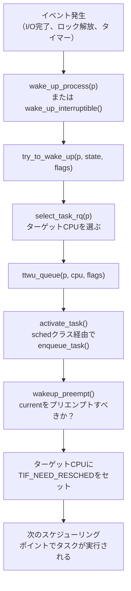
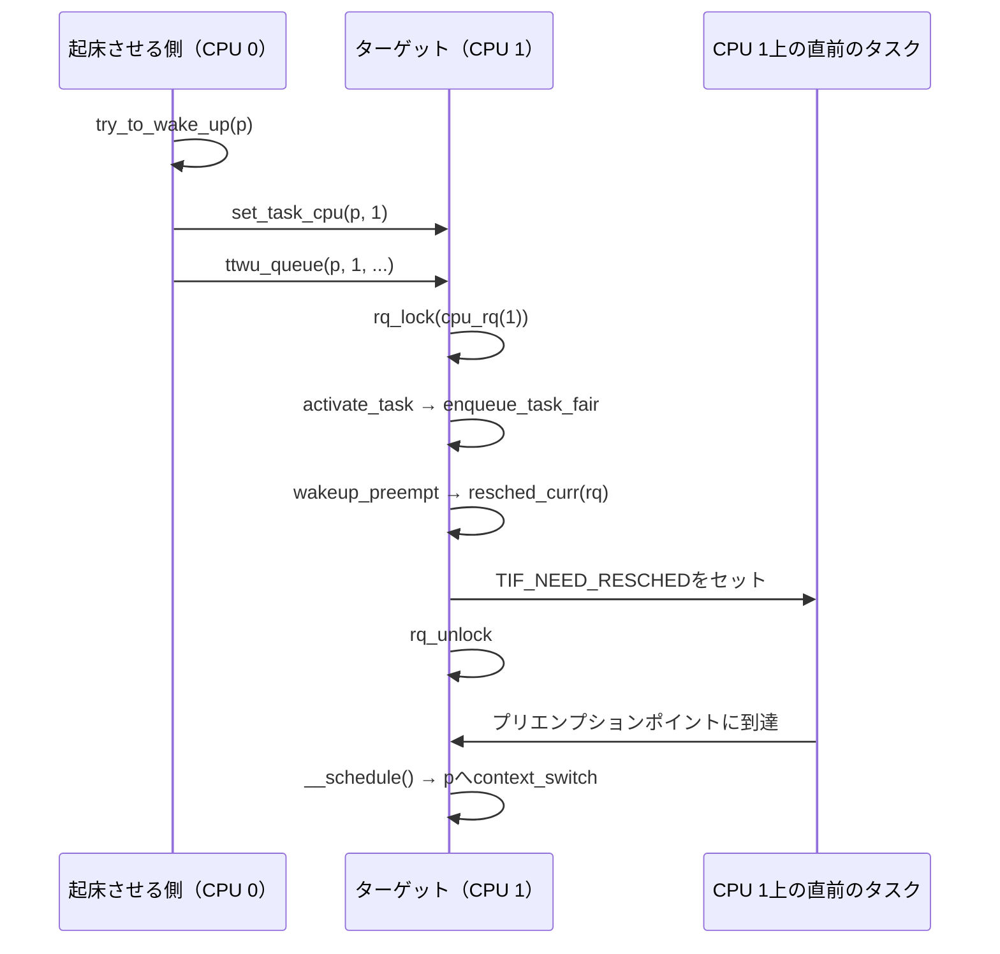

# プロセスが起床するときに何が起きるか {#what-happens-when-a-process-wakes-up}

> `wake_up_process()`からCPU上での実行まで

## 概要 {#overview}

プロセスが起床するのは、待っていたものが利用可能になったとき — ロックが解放された、ソケットにデータが届いた、タイマーが発火した、シグナルが配送された — である。起床パスは、タスクをスリープ状態から実行可能状態へ遷移させ、適切なCPUに配置し、場合によってはそのCPUで現在実行中のものをプリエンプトしなければならない。



## タスクの状態 {#task-states}

詳しく見る前に、関係するスリープ状態を確認しておく:

```c
// include/linux/sched.h
#define TASK_INTERRUPTIBLE      0x00000001  // シグナルで起床可能
#define TASK_UNINTERRUPTIBLE    0x00000002  // 明示的な起床のみ
#define TASK_WAKING             0x00000200  // まさに起床処理中
```

`TASK_INTERRUPTIBLE`は最も一般的なスリープ状態であり、I/O、ロック、あるいは永遠に来ないかもしれないイベント（だからシグナルで待機を中断できるべき）を待つときに使われる。`TASK_UNINTERRUPTIBLE`は、完了しなければならない待機 — 進行中のディスクI/O、カーネルのクリティカルセクション — のためのものである。これは`ps`の出力における「D」状態である。

`wake_up_process()`は`TASK_NORMAL = TASK_INTERRUPTIBLE | TASK_UNINTERRUPTIBLE`を使い、どちらの状態も起床させる。

## 入口: wake_up_process() {#entry-wake_up_process}

```c
// kernel/sched/core.c
int wake_up_process(struct task_struct *p)
{
    return try_to_wake_up(p, TASK_NORMAL, 0);
}
```

カーネルには、どのスリープ状態を起床させるかに応じて、いくつかの`wake_up_*`の変種がある:

| 関数 | 起床させる対象 |
|----------|-------|
| `wake_up_process(p)` | `TASK_INTERRUPTIBLE \| TASK_UNINTERRUPTIBLE` |
| `wake_up_interruptible(x)` | `TASK_INTERRUPTIBLE`のみ |
| `wake_up(x)` | `TASK_NORMAL`（待ちキュー経由） |
| `wake_up_all(x)` | 待ちキュー上のすべてのタスク |

## try_to_wake_up() {#try_to_wake_up}

起床処理の中核となる関数:

```c
// kernel/sched/core.c
int try_to_wake_up(struct task_struct *p, unsigned int state, int wake_flags)
{
    wake_flags |= WF_TTWU;

    // 高速パス: 自分自身を起床させる（まれだが正当）
    if (p == current) {
        if (!(READ_ONCE(p->__state) & state))
            return 0;
        WRITE_ONCE(p->__state, TASK_RUNNING);
        return 1;
    }

    // 他の起床者と直列化するためにp->pi_lockを獲得する
    raw_spin_lock_irqsave(&p->pi_lock, flags);

    // タスクが本当に起床可能な状態にあるかを確認する
    if (!(READ_ONCE(p->__state) & state))
        goto unlock;

    trace_sched_waking(p);

    // 遷移中であることを示す: シグナルによる二重起床を防ぐ
    WRITE_ONCE(p->__state, TASK_WAKING);

    // すでにランキュー上にあるなら、プリエンプションの調整だけ行う
    if (READ_ONCE(p->on_rq)) {
        ttwu_runnable(p, wake_flags);
        goto unlock;
    }

    // タスクがそれまで実行されていたCPUから完全に降りるのを待つ
    smp_cond_load_acquire(&p->on_cpu, !VAL);  // on_cpu == 0になるまでスピン

    // ターゲットCPUを選ぶ
    cpu = select_task_rq(p, p->wake_cpu, &wake_flags);
    if (task_cpu(p) != cpu)
        set_task_cpu(p, cpu);

    // ターゲットCPUにエンキューする
    ttwu_queue(p, cpu, wake_flags);

unlock:
    raw_spin_unlock_irqrestore(&p->pi_lock, flags);
    ttwu_stat(p, task_cpu(p), wake_flags);
    return success;
}
```

### on_cpuでのスピン {#the-on_cpu-spin}

```c
smp_cond_load_acquire(&p->on_cpu, !VAL);
```

タスクがまだ別のCPU上で実行中（`__schedule()`の途中、あるいは実行中）である場合、`smp_cond_load_acquire`は`p->on_cpu`が0になるまでスピンする。`finish_task_switch()`は、タスクがCPUから完全に降りた後に`smp_store_release()`でこれをクリアする。これにより、タスクがまだどこかで実行中であるうちに新しいランキューへ置かれることを防ぐ。

## CPUの選択: select_task_rq() {#cpu-selection-select_task_rq}

スケジューラは、起床したタスクをどのCPUに配置するかを決めなければならない。`SCHED_NORMAL`タスクについては、`select_task_rq_fair()`がこの判断を行う:

```c
// kernel/sched/core.c
int select_task_rq(struct task_struct *p, int cpu, int wake_flags)
{
    if (p->nr_cpus_allowed > 1 && !is_migration_disabled(p))
        cpu = p->sched_class->select_task_rq(p, cpu, wake_flags);
    else
        cpu = cpumask_any(p->cpus_ptr);

    return cpu;
}
```

`select_task_rq_fair()`はいくつかの要素を考慮する:

**起床アフィニティ（wake affinity）**: 起床させる側（waker）と起床させられる側（wakee）が頻繁に通信する場合、wakeeをwakerの近くに置くとキャッシュローカリティが向上する。これは、wakerが`wake_up()`を呼んだ直後にブロックする場合に特に効果的である — wakeeはwakerのキャッシュ内容を再利用できる。

**負荷分散**: 選ばれるCPUはアイドルか、負荷の軽いものであるべきである。この関数はスケジューリングドメイン（SMT → LLC → NUMAノード → システム）をたどって適切なCPUを探す。

**`WF_SYNC`フラグ**: 起床させるタスクが起床処理の直後にブロックしようとしている場合（例: プロデューサがコンシューマへ送信する場合）にセットされる。この場合、wakerがCPUを空けるので、wakeeはwakerのCPUに配置されることがある。

```c
// kernel/sched/sched.h
#define WF_SYNC         0x10  // wakerは起床処理の後にスリープする
#define WF_FORK         0x02  // 新しいタスク（fork）
#define WF_MIGRATED     0x20  // タスクは新しいCPUへマイグレーションされた
```

## エンキュー: ttwu_queue()とactivate_task() {#enqueuing-ttwu_queue-and-activate_task}

```c
// kernel/sched/core.c
static void ttwu_queue(struct task_struct *p, int cpu, int wake_flags)
{
    struct rq *rq = cpu_rq(cpu);

    rq_lock(rq, &rf);
    update_rq_clock(rq);
    ttwu_do_activate(rq, p, wake_flags, &rf);
    rq_unlock(rq, &rf);
}

static void ttwu_do_activate(struct rq *rq, struct task_struct *p,
                              int wake_flags, struct rq_flags *rf)
{
    int en_flags = ENQUEUE_WAKEUP | ENQUEUE_NOCLOCK;

    // アクティブ化する（schedクラスのデータ構造にエンキューする）
    activate_task(rq, p, en_flags);

    // 新たに実行可能になったタスクがcurrentをプリエンプトすべきかを確認する
    wakeup_preempt(rq, p, wake_flags);

    // 実行可能としてマークする
    ttwu_do_wakeup(p);   // p->__state = TASK_RUNNINGに設定する
}
```

`activate_task()`は`p->sched_class->enqueue_task()`を呼ぶ。fairタスクの場合、これはスリープしていた時間に応じて（`place_entity()`によって）調整されたvruntimeでタスクをCFSのRBツリーに入れる。

### 起床時のvruntimeの配置 {#vruntime-placement-on-wakeup}

長時間スリープしていたタスクは、古い（低い）vruntimeを持っている。その古いvruntimeのままRBツリーに戻ると、追いつくまでCPUを独占してしまいかねない。そこで`place_entity()`は、起床したタスクをおおよそ`avg_vruntime - half_slice`の位置に配置する:

```
Before sleep:  [A: vr=100] [B: vr=105] [C: vr=110]
After A sleeps for 500ms:  avg_vruntime ≈ 300
A wakes, placed at: 300 - half_slice ≈ 297
```

Aはすぐに実行される（先頭近くにいる）が、BとCを飢餓状態にはしない（「追いつく」ために200ms連続で実行する必要があるほど後ろにはいない）。

## プリエンプションの確認: wakeup_preempt() {#preemption-check-wakeup_preempt}

エンキューの後、スケジューラは新たに実行可能になったタスクが、ターゲットCPUで現在実行中のものをプリエンプトすべきかを確認する:

```c
// kernel/sched/core.c
void wakeup_preempt(struct rq *rq, struct task_struct *p, int flags)
{
    // 実行中タスクのschedクラスに委譲する
    rq->curr->sched_class->wakeup_preempt(rq, p, flags);
}
```

`fair_sched_class`の場合、`wakeup_preempt_fair()`は起床したタスクの仮想デッドラインが現在のタスクのものより早いかを確認する。早ければ`resched_curr(rq)`を呼んで`TIF_NEED_RESCHED`をセットする。

ターゲットCPUは即座にはプリエンプトしない — フラグをセットし、次のプリエンプションポイント（割り込みの終了、システムコールからの復帰、または明示的な`schedule()`呼び出し）を待つ。

## CPUをまたぐ起床 {#cross-cpu-wakeup}

別のCPU上のタスクを起床させる場合:



wakerはタスクをエンキューし、必要であれば`smp_send_reschedule()`によるプロセッサ間割り込み（IPI）を使ってターゲットCPUにTIF_NEED_RESCHEDをセットする。

## 待ちキュー {#wait-queues}

カーネルのコードの大半は`wake_up_process()`を直接呼ばず、**待ちキュー**を使う:

```c
// カーネル側: キューで待っているすべてのタスクを起床させる
wake_up(&wq_head);            // TASK_NORMALのタスクを起床させる
wake_up_interruptible(&wq);   // TASK_INTERRUPTIBLEのみ起床させる

// 待つ側（ドライバ/サブシステムのコード内）:
wait_event(wq, condition);           // TASK_UNINTERRUPTIBLE
wait_event_interruptible(wq, cond);  // TASK_INTERRUPTIBLE
```

待ちキューは条件変数へのアクセスを直列化し、条件を確認してからタスクがスリープするまでの間に起床が失われないことを保証する。

## 起床の観測 {#observing-wakeups}

```bash
# 起床レイテンシ: 起床から最初の実行までの時間
perf sched record -a sleep 5
perf sched latency --sort=max

# 個々の起床イベントをトレースする
trace-cmd record -e sched:sched_wakeup -e sched:sched_switch ./workload
trace-cmd report

# タスクがどのCPUで起床しているかを確認する
perf script -i perf.data | grep sched_wakeup | awk '{print $NF}' | sort | uniq -c

# /proc/PID/schedstat: タスクごとの起床統計
cat /proc/$PID/schedstat
# フィールド: cpu_time, runqueue_wait, timeslices_run
```

## 参考文献 {#further-reading}

- [コンテキストスイッチの一生](context-switch.md) — TIF_NEED_RESCHEDがセットされた後に何が起きるか
- [CFS](cfs.md) — 起床時に`place_entity()`でvruntimeがどう調整されるか
- [EEVDF](eevdf.md) — 適格性とデッドラインが起床時のプリエンプション判断にどう影響するか
